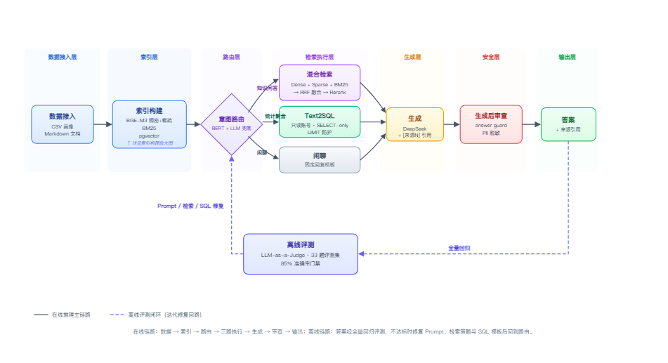
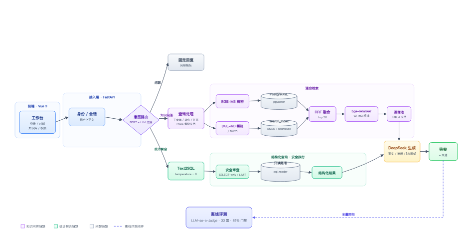
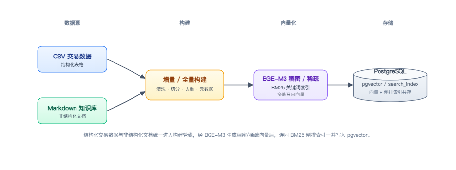

<div align="center">


<h1 align="center">千客引擎 (Qianke Engine)</h1>

<p align="center"><strong>专为电商打造的轻量级 AI 用户画像与业务分析引擎</strong></p>

[](LICENSE) [](pyproject.toml) [](web/package.json) [](web/package.json) [](docs/接口文档.md) [](docker-compose.yml) [](tests/eval_report.md) [](https://github.com/q93304989-bit/qianke-engine)

</div>

> Qianke Engine is a lightweight, evaluation-driven RAG engine for e-commerce
> user-profile analytics: hybrid retrieval, Text2SQL, anti-hallucination guard,
> physical tenant isolation, and an offline LLM-as-a-Judge gate.

面向电商运营、客服、数据分析与管理层的**千客引擎工作台**。它不是「把资料丢给大模型」：
系统先判断问题该走知识问答还是结构化统计，再经过**多路混合检索、RRF 融合、Cross-Encoder 精排**，
或**Text2SQL + 只读安全执行**，最后生成带引用来源的中文答案。内置的离线评测门禁，
把「回答质量」从主观感觉变成可回归的工程指标。

> **当前评测快照**：33 道黄金题，**97.0% 通过率**（32/33），判定覆盖率 100%，
> 安全边界 6/6，来源召回率 97.8%。运行 `uv run python scripts/run_eval.py` 可复现；
> 低于 85% 会以退出码 1 阻止提交。详见 [评测报告](tests/eval_report.md)。

## 宣传片

[](https://www.bilibili.com/video/BV1g9nJ6hEZ9)

**79 秒看懂千客引擎** — [B 站观看](https://www.bilibili.com/video/BV1g9nJ6hEZ9) ·
6 段 AI 空镜 + 2 段真实产品录屏 + 中文配音与字幕（视频标注：含 AI 生成内容）。

---

## 目录

- [宣传片](#宣传片)
- [核心特性](#核心特性)
- [系统架构](#系统架构)
- [能力清单](#能力清单)
- [快速开始](#快速开始)
- [评测与方法论](#评测与方法论)
- [关键设计取舍](#关键设计取舍)
- [数据口径](#数据口径)
- [项目结构](#项目结构)
- [安全与生产化](#安全与生产化)
- [文档](#文档)
- [开发与贡献](#开发与贡献)
- [License](#license)

## 核心特性

1. **增量更新**：CSV / Markdown 双轨接入；导入向导支持 `incremental`（只处理新增/变化文件，
   只重算被触及的用户）与 `full`（覆盖重建），大文件不必每次全量重算。
2. **双轨检索**：BGE-M3 稠密向量 + BM25/稀疏向量双路召回，经 RRF 融合、Cross-Encoder 精排；
   画像池与文档池分池保留，避免几千条画像把 SOP/口径挤出上下文。
3. **防幻觉审查**：生成后置 answer guard 拦截预测/越界内容；关键结论必须带 `[来源N]`，
   事实与推断分开表述；资料不足时明确说「没有这块信息」，宁可不答也不编造。
4. **多租户隔离**：企业账号对应独立物理库 `vec_db_ent_<id>`，demo / user / test 数据集分库；
   连接层切换 + 上传批次归属校验，漏传租户参数也不会静默读到别家数据。
5. **97% 离线评测通过率**：33 道业务黄金题，LLM-as-a-Judge 全量回归；内置 85% 通过率
   CI 门禁，报告与原始结果随仓库归档，核心 Prompt/路由改动必须可复现。

## 系统架构

### 端到端数据流



> 下面是更细的分层架构与数据接入流程。完整的 DDD/分层、代码模块依赖与检索细节见
> [架构图与流程图](docs/architecture-diagrams.md)，原始手绘版流程见
> [千客引擎-流程图](docs/千客引擎-流程图.md)。



**离线数据接入**（构建/重建索引时写入对应数据集库，不参与在线请求）：



一次知识问答的关键路径：

1. **路由**：BERT 判闲聊（约 13ms），不可用或低置信时由 LLM/规则兜底；业务问题进入查询处理。
2. **多路召回**：按需做子查询分解、问题简化、关键词扩写或 HyDE，并行跑稠密 + 稀疏/BM25，各路取 top 20。
3. **融合与精排**：RRF（k=60）取 top 30；画像池与文档池**分池精排**，避免 8,000+ 条画像把少量 wiki 挤出上下文。
4. **生成与溯源**：上下文 + 结构化结果交给 DeepSeek；答案中的每个关键结论带 `[来源N]`，事实与推断分开表述。
5. **后置审查**：对预测类、越界类回答做 answer guard，宁可不答也不编造；敏感信息只输出脱敏内容。

## 能力清单

| 场景 | 示例问法 | 依赖能力 |
|---|---|---|
| 人群圈选 | 高客单、喜欢美妆的女性用户有哪些 | 组合条件 + 混合检索 |
| 人群画像 | 深圳的钻石会员都是什么特征 | 画像检索 + LLM 归纳 |
| 标签口径 | 高价值用户怎么定义的 | Wiki 检索 + 引用 |
| 营销策略 | 给流失预警用户推荐召回方案 | SOP / 营销手册检索 |
| 人群对比 | 高客单用户和普通用户的偏好差异 | 多路检索 + 聚合 |
| 客服话术 | 用户投诉物流延迟怎么回复 | SOP 检索 |
| 业务统计 | 各会员等级的用户人数分别是多少 | Text2SQL + 只读执行 |
| 安全边界 | 预测一下明年的 GMV | 拒答 / 后置审查 |

### 权限与租户

- **能力驱动 RBAC**：L1 回答 → L2 来源 → L3 检索过程 → L4 SQL/运维；`guest` 固定 L0，连业务问答都不可用。
- **两级模型**：角色默认等级 + 人员单独授权；权限矩阵持久化在 `var/permissions.json`，修改后下一个请求生效。
- **企业隔离**：企业账号 → 独立库； `upload_owner` 校验上传批次归属；认证会话只存 token 哈希。
- **默认账号仅用于本地演示**：`admin / admin123`，首次启动前必须通过环境变量修改。

## 快速开始

### 环境要求

| 依赖 | 版本 / 说明 |
|---|---|
| Python | 3.12（`>=3.12,<3.13`） |
| Node.js | 20+（仅构建 Vue 前端） |
| Docker | PostgreSQL 16 + pgvector，推荐 Docker Desktop |
| 磁盘 / 内存 | 模型约 7 GB；建议 16 GB+ 内存 |
| LLM | DeepSeek API Key（或兼容 OpenAI 协议的网关） |

### 1. 获取代码与配置

```bash
git clone https://github.com/q93304989-bit/qianke-engine.git
cd qianke-engine

cp .env.example .env
# 至少设置 LLM Key（本项目不会隐式加载 .env）：
export DEEPSEEK_API_KEY="sk-..."
# Windows PowerShell:
# $env:DEEPSEEK_API_KEY="sk-..."
```

> `.env` 已被 `.gitignore` 排除；`.env.example` 只是变量清单。启动前请用 shell
> `export`、systemd 或容器 `env_file` 把变量注入进程。完整变量见
> [`.env.example`](.env.example) 与 [部署指南](docs/部署指南.md)。

### 2. 启动数据库（Docker Compose 一键拉起）

```bash
docker compose up -d
docker compose ps          # 看到 (healthy) 才继续
```

`docker-compose.yml` 拉起 PostgreSQL 16 + pgvector（默认 `vec_db` / `postgres` / `123456`，
与 `config.py` 对齐）。凭据如需修改，见 [部署指南](docs/部署指南.md#31-数据库)。

### 3. 安装 Python 依赖与模型

```bash
uv sync
```

模型权重**不入库**（仓库不会包含数 GB 的 LFS 对象），下载到约定目录：

```bash
uv run hf download BAAI/bge-m3 --local-dir models/bge-m3
uv run hf download BAAI/bge-reranker-v2-m3 --local-dir models/bge-reranker-v2-m3
```

> 国内网络可用 ModelScope 下载同名模型，放到相同目录即可。
> 可选：微调意图分类器（`src/rag_demo/bert_query_classify/`）缺失时自动回退规则，不影响启动。

### 4. 导入 demo 数据并构建索引

```bash
uv run python src/rag_demo/ingest_data.py
uv run python src/rag_demo/ingest_docs.py
uv run python src/rag_demo/tools/build_search_index.py
uv run python src/rag_demo/tools/check_search_index.py
```

### 5. 构建前端并启动

```bash
cd web
npm ci
npm run build
cd ..

uv run uvicorn rag_demo.api.main:app --host 0.0.0.0 --port 8000
```

打开 <http://127.0.0.1:8000>（自动跳转 `/v2/`），或访问 `/docs` 查看 API。
本地演示账号：`admin / admin123`（**首次启动前请改**）。

> 注意：`web/dist/` 是构建产物，不入库；换机器后必须重新 `npm run build`。
> 数据库未 healthy 时，检索会返回空结果，表现为「所有问题都无法确定」——先查
> `docker compose ps`，不要误判成 Prompt 坏了。

## 评测与方法论

### 当前结果

| 指标 | 最新全量结果 |
|---|---:|
| 题目数 / 成功判定 | 33 / 33 |
| **通过率** | **97.0%**（32/33） |
| 判定覆盖率 | 100.0% |
| 安全边界题 | 6/6 = 100% |
| 来源召回率（宏平均 / 微平均） | 97.8% / 96.7% |

报告与原始结果：[`tests/eval_report.md`](tests/eval_report.md)、
[`tests/eval_results_llm.json`](tests/eval_results_llm.json)。

### 从 75% 到 97%：LLM-as-a-Judge + 提示词靶向修复

这条曲线不是某个 Prompt 的魔法，而是**评测驱动开发（Eval-Driven Development）**的结果：
用 LLM-as-a-Judge 把每个失败案例变成可归因的修复项，再针对路由、检索、SQL 与拒答边界
做提示词靶向修复，最后用全量回归确认「没有为了单题刷分而破坏其他能力」。

| 阶段 | 通过率 | 做了什么 |
|---|---:|---|
| 基线 | 75.8% | 先跑通真实 RAG/SQL 链路，用 LLM-as-a-Judge 暴露坏例 |
| 定向修复 | 87.9% | 按失败案例归因：检索召回、引用、SQL、拒答边界逐项修 |
| 数据口径修正 + 全量回归 | **97.0%** | 修正评测题中「库里不存在」的条件；刷新报告，不调 Prompt 追分 |

关键原则：

1. **题目必须能在数据集里被验证**。例如「上海 + 钻石 + 美妆」在 demo 库中为 0 人，
   再好的模型也答不对；先跑 SQL 验证 `COUNT(*) > 0`，再谈 acceptance。
2. **评测是回归，不是刷分**。全量评测通过率低于 85% 直接失败；修改核心 Prompt、
路由、检索或 SQL 生成后，提交前必须重跑（见 [提交门禁](#提交门禁)）。
3. **接受「不确定」**。资料不足时明确说「没有这块信息」，比编一个数字更有价值；
   预测类问题由 answer guard 拦截，安全边界题必须拒答。

### 提交门禁

```bash
uv run python scripts/run_eval.py
# CI 可显式指定阈值：
uv run python scripts/run_eval.py --min-pass-rate 0.85
```

- 通过率 **< 85%** → `scripts/run_eval.py` 退出码 1；
- 没有可判定题目、裁判/回答异常未修复 → 同样失败；
- `--limit` / `--only` 只用于调试，不能替代提交前全量。

> 最新一轮唯一失败是 `OPT-01` 的生成波动（不是安全边界）；按「停止为刷分微调」原则，
> 不再针对单题调整 Prompt。门禁关注的是整体质量与边界不被突破。

## 关键设计取舍

| 决策 | 为什么 |
|---|---|
| **RRF 融合而非分数加权** | 稠密/稀疏两路分数量纲不同，按排名融合无需归一化；双路命中获得自然奖励。 |
| **画像池与文档池分开精排** | 画像 8,110 条、文档只有几十个 chunk；混排会被画像数量淹没，分池保证 SOP/口径始终有位置。 |
| **BERT 路由 + LLM 兜底** | BERT 约 13ms，低延迟拦闲聊；模型缺失或低置信时回退规则/LLM，服务不因分类器缺失而中断。 |
| **Text2SQL 只读账号** | 正则只是早失败提示，真正的安全边界是数据库层的 `SELECT` 权限 + 表白名单 + 强制 LIMIT。 |
| **按企业分库** | 比 `tenant_id` 行级过滤更彻底；连接层切换，漏传租户参数也不会静默读到别家数据。 |
| **contextvar 数据集上下文** | 同一进程内 demo / user / 租户请求互不串台；线程池显式复制上下文，避免「用 demo 数据回答 user 问题」。 |
| **answer guard 后置审查** | 不拦截用户提问，只在生成后处理预测/越界内容；宁可不答，也不编造。 |

## 数据口径

> **重要**：本仓库的 demo 是**模拟数据集**（`data/dianshuang`，21,000 条交易记录聚合出
> 8,110 个画像样本）。`user_id` 是逐行随机生成，**不是真实用户实体键**；同一 ID 在不同
> 记录里的姓名/年龄/城市可能不同。「用户累计订单 N 笔」实际是购买记录行数。
>
> 这不影响链路价值：意图路由、混合检索、分来源精排、Text2SQL、引用溯源、评测驱动
> 每一环都是真的，换真实数据仍成立。受影响的是「用户画像」的措辞——系统按
> **聚合样本口径**回答，接真实业务数据前必须先做实体消解。

能力边界：

- 不做实时数据 / 未来预测；「近 30 天」「本周」按历史快照的 `days_since_last_buy` 近似。
- 不把 8,110 个样本外推成「全量用户」统计结论。
- 手机号、身份证号等敏感字段只输出脱敏内容。

## 项目结构

```text
.
├── src/rag_demo/
│   ├── api/                 # FastAPI 路由、认证、SSE、观测
│   ├── retrieval/           # 查询处理、混合检索、RRF、精排
│   ├── generation/          # DeepSeek 答案生成、answer guard
│   ├── db/                  # schema、连接、租户分库、数据隔离
│   ├── mvp/                 # 四步导入向导（上传 → 确认 → 构建 → 查询）
│   ├── bert_query_classify/ # 意图分类训练与推理（可选微调产物）
│   ├── tools/               # 导入/建索引/检查/实验脚本
│   ├── eval_utils.py
│   └── tests/               # 历史评测脚本与 eval_questions.json
├── web/                     # Vue 3 + Vite 前端（构建到 web/dist）
├── docs/                    # 架构图、接口、数据模型、部署、评测方案
├── tests/                   # pytest 单测 + 最新评测报告/原始结果
├── scripts/                  # 离线评测入口 run_eval.py（LLM-as-a-Judge + CI 门禁）
├── docker-compose.yml        # PostgreSQL + pgvector
├── pyproject.toml / uv.lock  # Python 依赖与锁
├── LICENSE / NOTICE
└── README.md
```

## 安全与生产化

- **密钥**：代码与示例中不含真实 API Key；`.env`、`.env.*` 全部忽略，只保留 `.env.example`。
- **模型**：`models/` 整个目录忽略，不提交权重也不提交 LFS 指针；按[快速开始](#快速开始)下载。
- **数据库**：`pgdata/`、SQLite、日志、上传文件均不入库；demo / user / 企业库物理隔离。
- **SQL**：`sql_reader` 只读账号 + SELECT-only 校验 + 强制 LIMIT + 表白名单。
- **身份**：生产关闭 `RAG_ALLOW_HEADER_AUTH`，启用 Cookie 会话；默认管理员密码必须修改。
- **前端**：`web/dist/` 不入库；部署时按 [部署指南](docs/部署指南.md) 重新构建。

> 本项目是演示/作品集，不等同于生产级安全审计。上线前请完成
> [部署指南 · 生产化检查清单](docs/部署指南.md#4-生产化检查清单)。

## 文档

| 文档 | 内容 |
|---|---|
| [架构图与流程图](docs/architecture-diagrams.md) | 分层架构、端到端数据流、检索细节、模块依赖 |
| [接口文档](docs/接口文档.md) | HTTP / SSE 接口、参数、权限、错误码与 curl 示例 |
| [数据模型](docs/数据模型.md) | 画像/文档/索引/账号表、物理隔离、数据不变量 |
| [部署指南](docs/部署指南.md) | 本地启动、环境变量、生产检查、排错、升级回滚 |
| [评测落地方案](docs/评测落地方案.md) | 离线/在线评测、Dual-Recall、Text2SQL EX、监控飞轮 |
| [项目背景](docs/项目背景.md) | 业务痛点、技术路线与能力边界 |
| [MVP 产品目标](docs/MVP产品目标.md) | 产品范围与里程碑 |
| [原始流程图](docs/千客引擎-流程图.md) | 手绘 Excalidraw 版 RAG 数据流 |
| [宣传片（B 站）](https://www.bilibili.com/video/BV1g9nJ6hEZ9) | 79 秒产品宣传片：6 段 AI 空镜 + 真实录屏 + 配音/字幕 |
| [产品宣传片脚本](docs/video_script.md) | 75s Demo 分镜、配音文案、字幕与事实核验 |
| [录屏操作指南](docs/recording_guide.md) | 演示账号/数据准备、逐镜头点击步骤、Auto-Pilot |
| [评测报告](tests/eval_report.md) | 最新 33 题逐题结果与失败复盘 |

## 开发与贡献

```bash
uv run pytest                 # 单元测试
uv run python scripts/run_eval.py     # 全量离线评测（需 API Key / DB / 模型）
cd web && npm run build       # 前端构建
```

贡献前请确认：

- 行为改动配测试；核心检索/Prompt/SQL 改动必须附全量评测结果；
- 提交信息遵循 Conventional Commits（`feat:` / `fix:` / `docs:` / `chore:`）；
- 不提交 `.env`、模型权重、数据库卷、`web/dist`、临时探针脚本；
- 评测题新增/修改先验证 demo 库真实命中，再写 acceptance。

## License

本项目采用 [Apache License 2.0](LICENSE)。第三方组件与模型许可见 [NOTICE](NOTICE)。

如果这个项目对你有帮助，欢迎 Star、提 Issue 或基于它做二次开发。

---

*Last updated: 2026-10-19 · Built with FastAPI, PostgreSQL + pgvector, BGE-M3, DeepSeek, Vue 3.*