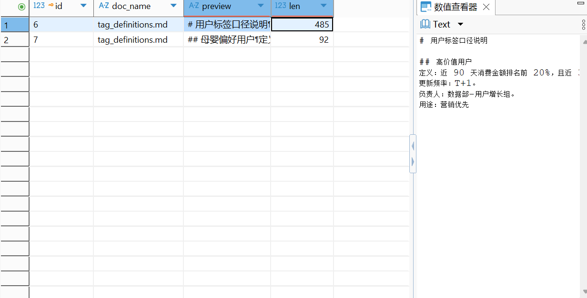

# 临时脚本

## 检索 wiki 文档

```python
from src.rag_demo.retrieval.hybrid_retriever import vector_search

results = [r for r in vector_search("高客单 客单价 定义", top_k=30) if r["source"] != "user_profile"]
for r in results[:5]:
    print(r["source"], r["score"], r["text"][:80])
```

输出：

```text
Loading weights: 100%|██████████| 391/391 [00:00<00:00, 14177.79it/s]
tag_definitions.md 0.5691404003417263 # 用户标签口径说明
## 高价值用户
定义：近 90 天消费金额排名前 20%，且近 30 天有活跃行为（登录、浏览、下单任一）。
更新频率：T+1。
负责
segmentation.md 0.4951693719423601 # 用户分群策略
## 分群目的
将用户按生命周期、价值、偏好划分为可运营的群体，支撑精准营销和差异化服务。
## 分群维度
- 生命周期：新客（注册 ≤
marketing_playbook.md 0.4599134004064449 # 营销策略手册
## 一、新客转化
- 目标人群：注册 ≤ 30 天，未下单。
- 渠道：短信、App 推送、企微。
- 内容：首单立减 20 元，新人专享
cs_sop.md 0.4268819220924952 # 客服标准作业流程（SOP）
## 场景一：物流延迟投诉
1. 查询订单状态，确认是否已发货。
2. 若已发货且超过 7 天未更新，主动致歉。
3. 提供补
analysis_report_template.md 0.4005754948176903 # 用户分析报告模板
## 一、报告概述
- 报告主题：
- 分析周期：
- 数据来源：
- 分析人：
## 二、核心结论
1. 结论一：
2. 结论二：
```

## AI 分析

关键结论出来了：wiki 检索是通的，但语料里压根没有"高客单"的定义。

看召回结果：

| 文档 | score | 命中内容 |
|---|---|---|
| tag_definitions.md | 0.569 | 高价值用户定义（不是高客单） |
| segmentation.md | 0.495 | 分群目的 |
| marketing_playbook.md | 0.460 | 新客转化 |

`tag_definitions.md` 里只有「高价值用户」「流失预警」「高潜用户」「母婴偏好」四个标签，没有「高客单」。所以 `/qa` 里 LLM 说"无法严格确定高客单的判定标准"，不是它偷懒，是它真的没得引用。

## 修复：给 tag_definitions.md 补上高客单定义

打开 `data/docs/tag_definitions.md`，在「高价值用户」那段后面加：

```markdown
## 高客单用户
定义：近 90 天平均客单价 ≥ 1000 元。
更新频率：T+1。
负责人：数据部-用户价值组。
用途：高客单价商品推荐、VIP 服务分配、利润分析。

## 中客单用户
定义：近 90 天平均客单价在 500–1000 元之间。
更新频率：T+1。

## 低客单用户
定义：近 90 天平均客单价 < 500 元。
更新频率：T+1。
```

阈值 1000 元是我按你数据分布估的（从之前检索结果看，美妆女性用户的客单价在 666–2540 之间，1000 是合理分界）。你可以根据业务实际调整。

## 重新修改并重跑测试文档结果

```python
results = [r for r in vector_search("高客单 定义", top_k=30) if r["source"] != "user_profile"]
for r in results[:3]:
    print(r["source"], r["score"], r["text"][:80])
```

输出：

```text
Loading weights: 100%|██████████| 391/391 [00:00<00:00, 15538.14it/s]
tag_definitions.md 0.6213095743634919 # 用户标签口径说明
## 高价值用户
定义：近 90 天消费金额排名前 20%，且近 30 天有活跃行为（登录、浏览、下单任一）。
更新频率：T+1。
负责
segmentation.md 0.4830363104917895 # 用户分群策略
## 分群目的
将用户按生命周期、价值、偏好划分为可运营的群体，支撑精准营销和差异化服务。
## 分群维度
- 生命周期：新客（注册 ≤
tag_definitions.md 0.4733696266037011 ## 母婴偏好用户
定义：近 90 天购买母婴品类商品 ≥ 2 次，或浏览母婴品类 ≥ 10 次。
更新频率：T+1。
负责人：数据部-品类运营组。
用途：母婴
```

## 重跑结果还是「高客单」定义没被召回——命中的还是「高价值用户」

SQL 语句查询（用的是 DBeaver）：

```sql
SELECT id, doc_name, LEFT(chunk_text, 100) AS preview, LENGTH(chunk_text) AS len
FROM wiki_vectors
WHERE doc_name = 'tag_definitions.md';
```



分析后发现是切分策略有问题，改为 `$Markdown 标题切分 + 二次字符切分$`。

重新切块后的结果：

```text
正在加载 bge-m3 模型...
Loading weights: 100%|██████████| 391/391 [00:00<00:00, 13907.39it/s]
正在连接数据库...
✅ analysis_report_template.md: 导入 7 个分块
✅ cs_sop.md: 导入 4 个分块
✅ marketing_playbook.md: 导入 5 个分块
✅ segmentation.md: 导入 6 个分块
✅ tag_definitions.md: 导入 7 个分块

🎉 所有文档已入库，共 29 个分块

Process finished with exit code 0
```

重新查询：

```text
Loading weights: 100%|██████████| 391/391 [00:00<00:00, 12325.90it/s]
tag_definitions.md 0.6363354298176258 定义：近 90 天平均客单价 ≥ 1000 元。
更新频率：T+1。
负责人：数据部-用户价值组。
用途：高客单价商品推荐、VIP 服务分配、利润分析。
tag_definitions.md 0.549976772067162 定义：近 30 天浏览 ≥ 5 次，加购 ≥ 2 次，但未下单；或注册 ≤ 30 天且完成首单。
更新频率：T+1。
负责人：数据部-用户增长组。
用途：新客转
tag_definitions.md 0.5286707001132199 定义：近 90 天消费金额排名前 20%，且近 30 天有活跃行为（登录、浏览、下单任一）。
更新频率：T+1。
负责人：数据部-用户增长组。
用途：营销优先级
```

开头缺少「## 高客单用户」这一行。原因：`MarkdownHeaderTextSplitter` 默认会把标题提取到 metadata，正文里就不带标题了。

后果：LLM 拿到这块文本，不知道它讲的是哪个标签。如果不把 metadata 拼回去，将来 `/qa` 里 LLM 可能误把这个定义当成"高价值用户"或"流失预警"。

## 修复：把标题拼回正文

`ingest_docs.py` 里，`md_splitter` 切分后遍历时，把 metadata 里的标题拼回来：

```python
md_chunks = md_splitter.split_text(text)
chunks = []
for mc in md_chunks:
    # 把标题拼回正文开头
    headers = [f"{k}: {v}" for k, v in mc.metadata.items() if v]
    header_str = " ".join(headers)
    content = f"{header_str}\n{mc.page_content}" if header_str else mc.page_content
    chunks.extend(char_splitter.split_text(content))
```

这样每个 chunk 开头会带上 `h1: 用户标签口径说明 h2: 高客单用户`，语义完整。
