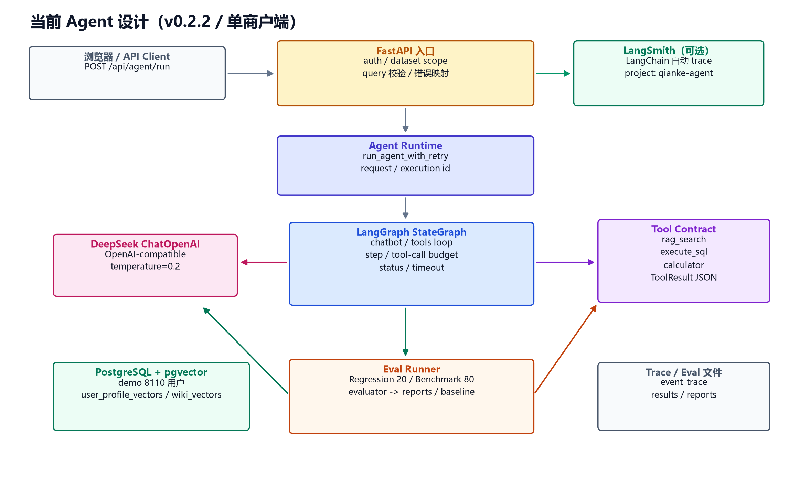
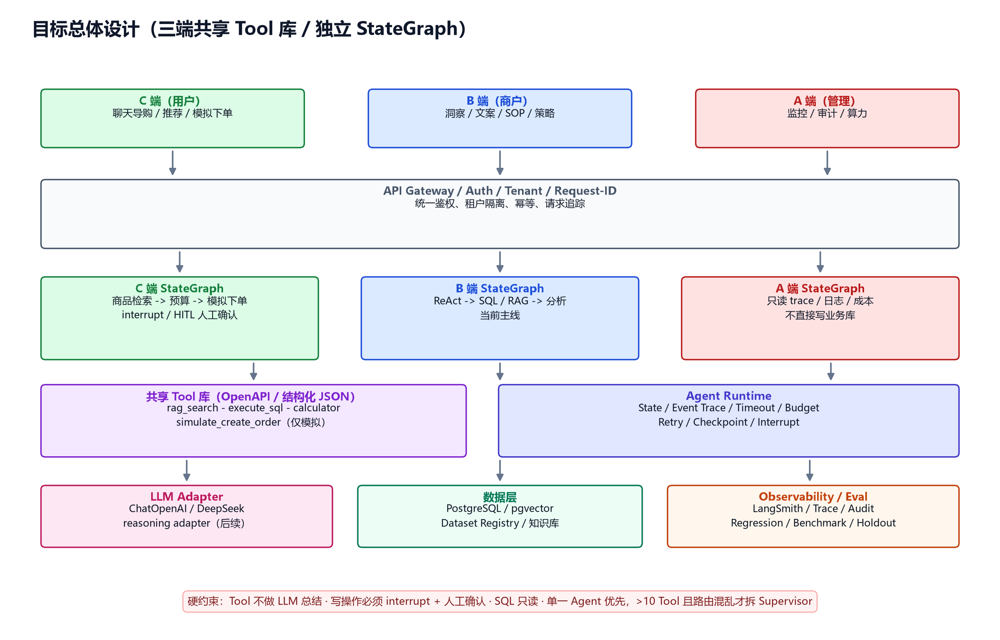

# Agent 设计与需求对齐

> 本文先对齐设计，不进入实现。  
> 状态：2026-10-28

## 1. 当前 Agent 设计



```text
API Client
  → FastAPI /api/agent/run
  → run_agent_with_retry
  → LangGraph StateGraph（chatbot / tools）
  → DeepSeek ChatOpenAI
  → rag_search / execute_sql / calculator
  → PostgreSQL pgvector
  → event_trace / Eval reports
  → LangSmith（可选）
```

关键事实：

- 只有 **B 端商户分析** 一条 StateGraph
- 单体 ReAct：`chatbot ↔ tools`
- 3 个原子 Tool
- Tool 返回 `ToolResult` dict
- 有 step / tool-call / timeout / token budget / retry / checkpoint
- 有 request_id / execution_id / event_trace
- 没有真实写操作、没有 C/A 端、没有 interrupt/HITL
- Eval：Regression 20 / Benchmark 80（development set）/ private holdout

## 2. 目标总体设计



```text
C 端（用户）       B 端（商户）       A 端（管理）
     \                 |                 /
        API Gateway / Auth / Tenant
                 |
   C StateGraph   B StateGraph   A StateGraph
        \             |             /
         共享 Tool 库 + Agent Runtime
                 |
     LLM Adapter / 数据层 / Observability / Eval
```

目标原则：

- 三端共享原子 Tool 库和 Runtime，但拥有独立 StateGraph
- Tool 只做确定性数据获取/执行，不做 LLM 总结
- 写操作必须 `interrupt` + 人工确认
- 单体 ReAct 优先；工具 > 10 且路由混乱才考虑 Supervisor
- A 端只读 trace / 日志 / 成本，不直接写业务库

## 3. 当前与目标差距

| 维度 | 当前 | 目标 |
|---|---|---|
| Agent 边界 | 单个 B 端 | C / B / A 三端 |
| 编排 | 单体 chatbot/tools | 三套独立 StateGraph |
| Tool | 3 个只读工具 | 3 个 + `simulate_create_order` 等 |
| Tool 返回 | `ToolResult` dict | OpenAPI 描述 + 结构化 JSON 字符串 |
| 写操作 | 无 | 仅模拟写 + interrupt/HITL |
| 步数 | Runtime 默认 5；Eval 配置 6 | 默认最多 5 |
| 取消/超时 | 协作式 | 硬边界 / interrupt |
| Streaming | 同步 `invoke` | 事件流 / 可取消 |
| 观测 | 自定义 trace + LangSmith | LangSmith 为主，自定义 ID 关联 |
| Eval | B 端回归/benchmark | 三端共享评测框架 |

## 4. 开发前需要确认的决策

建议默认方案如下，确认后再开发：

1. **先做 B 端 v0.3**
   - C/A 端只做接口/数据预留，不并行开发
2. **Tool 签名不立即重写**
   - 内部继续使用 `ToolResult` dict
   - 外部边界再适配 JSON 字符串 / OpenAPI
3. **默认步数统一为 5**
   - Runtime 和 Eval runner 都改为 5
   - 原 6 步保留为实验配置
4. **只有写动作使用 interrupt**
   - 分析查询不需要人工确认
   - `simulate_create_order` 必须确认，且只模拟、不落真实订单
5. **C/A 端不共享 StateGraph**
   - 共享 Tool / Runtime / LLM adapter
   - 各自维护独立编排
6. **保持 ChatOpenAI + deepseek-flash**
   - reasoning 模型 adapter 等实际切换时再做
7. **A 端只读**
   - 只读 trace、日志、成本、审计事件，不提供业务写接口

## 5. 推荐开发顺序

```text
第 1 步：B 端 v0.3
  - 统一 step=5
  - Tool schema 边界适配
  - LangSmith trace metadata
  - invalid_tool_calls / streaming 先不阻塞

第 2 步：共享 Runtime / Tool 层抽离
  - 三端可复用
  - 不改变现有 B 端行为

第 3 步：C 端
  - 商品检索、预算、模拟下单
  - interrupt/HITL

第 4 步：A 端
  - 只读监控、审计、成本

第 5 步：重新评估是否真的需要 Supervisor
```
