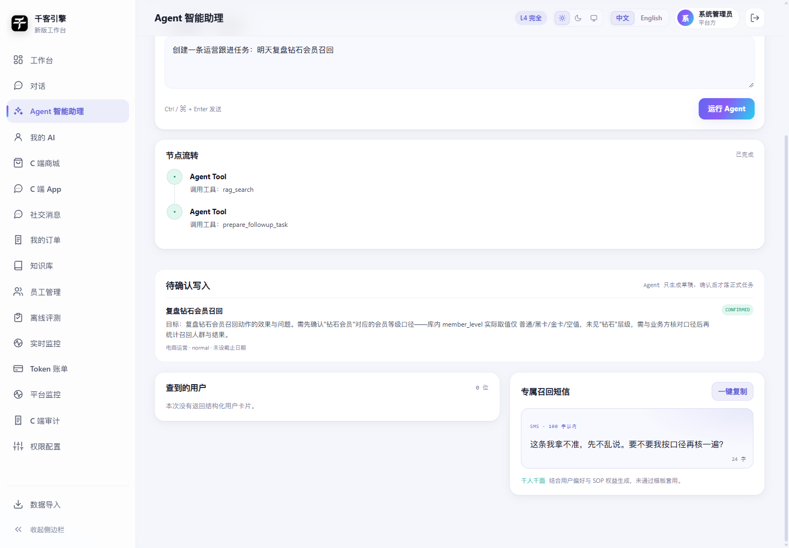

# B 端经营分析 Agent：受控写操作

> 首个写功能：**运营跟进任务**。
> 原则：Agent 只能生成草稿，用户确认后才落正式任务。

## 1. 为什么不是直接写业务库

经营分析 Agent 当前定位是决策支持，不是自动运营执行器。

因此写操作拆成两步：

```text
Agent 调用 prepare_followup_task
→ 只写 agent_action 表的 DRAFT
→ 前端展示待确认任务
→ 用户点击确认
→ POST /api/agent/actions/{id}/confirm
→ 状态变为 CONFIRMED
```

没有用户确认，就没有正式任务。

## 2. 当前唯一写功能

```text
action_type = followup_task
标题 title
说明 description
负责人 owner
优先级 priority: low / normal / high
截止日期 due_date
```

它写入的是**运营跟进任务表**，不是：

```text
订单
用户画像
优惠券
库存
活动状态
```

## 3. Tool 权限

```text
admin / ent_admin / exec / analyst / ops
→ 可见 prepare_followup_task

cs
→ 不可见

guest
→ 不可见

demo
→ 执行层拒绝
```

模型即使产生未授权 Tool Call，也会被 ToolPolicy 执行层拦截。

## 4. API

```text
POST /api/agent/actions/{action_id}/confirm
POST /api/agent/actions/{action_id}/cancel
```

规则：

```text
只能确认自己账号创建的 DRAFT
非 DRAFT 不能重复确认
非本人动作返回 ACTION_FORBIDDEN
```

## 5. 前端

Agent 返回的 `pending_actions` 会展示为「待确认写入」：



按钮：

```text
确认写入
```

确认后状态：

```text
DRAFT → CONFIRMED
```

## 6. 任务状态机

```text
DRAFT
  ├── confirm → CONFIRMED
  │                └── complete → COMPLETED
  └── cancel → CANCELLED
```

接口：

```text
GET  /api/agent/actions?status=&limit=
POST /api/agent/actions/{action_id}/complete
```

规则：

```text
只有任务所属账号能 complete
只有 CONFIRMED 可以 complete
重复 complete 返回 ACTION_NOT_CONFIRMED
```

## 7. 数据位置

```text
var/agent_actions.sqlite
```

表：

```text
agent_action
```

字段包含：

```text
action_id
account_id
dataset
request_id
action_type
title / description / owner / priority / due_date
status
created_at / confirmed_at / confirmed_by
```

## 8. 当前限制

```text
只写运营跟进任务
没有任意 SQL / 任意表写入
没有多级审批
没有任务负责人真实账号校验
没有任务执行器
尚未加入 Regression / Benchmark Eval
```

## 9. 后续

```text
1. 引入 task 执行与状态机
2. 增加审批链 / 角色权限
3. 把写动作加入 Agent Eval
4. 再考虑优惠券草稿、活动草稿等高风险写操作
```
