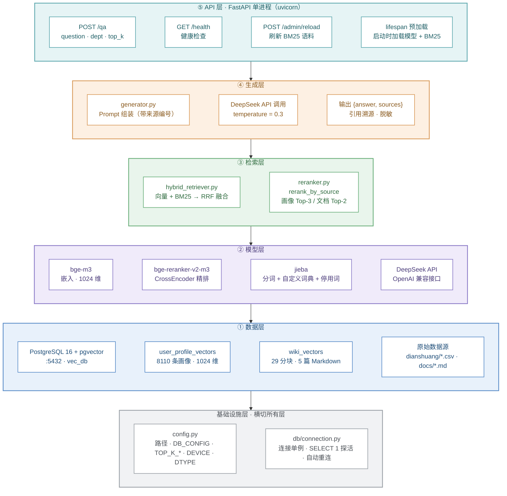
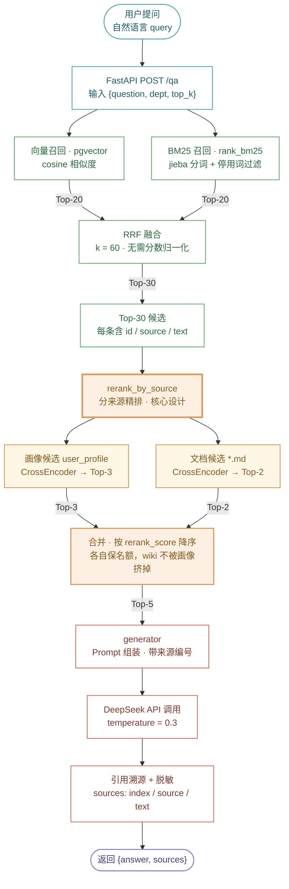
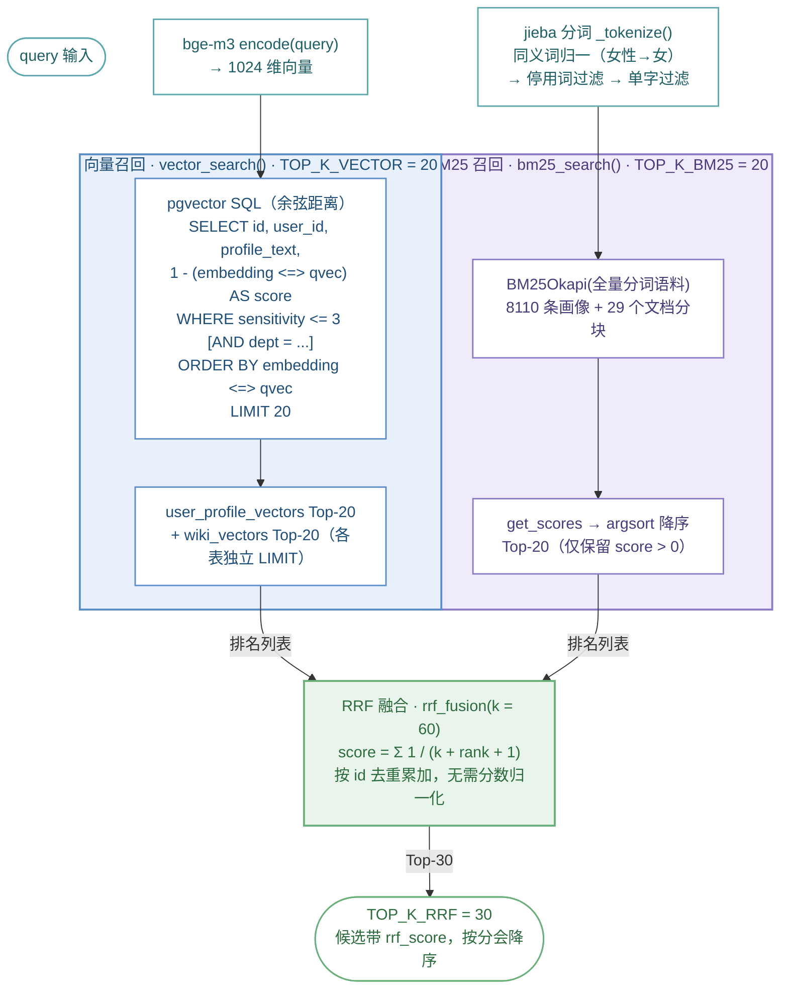
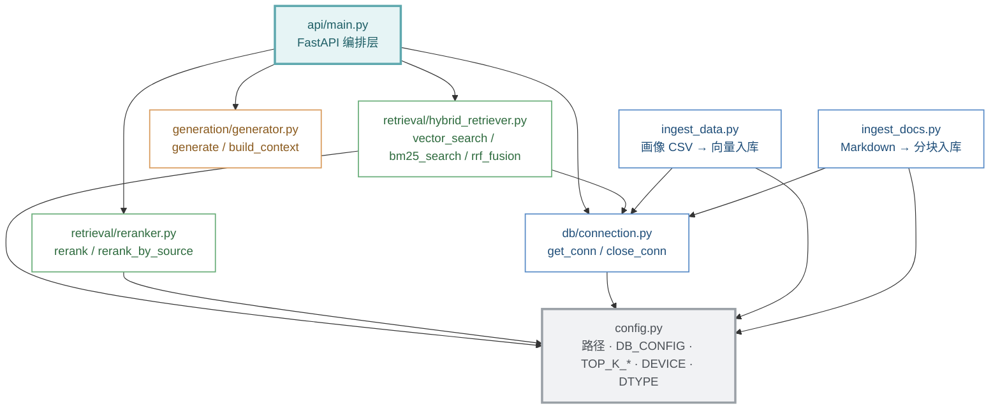

# 用户画像 RAG 系统 · 架构图与流程图

> **版本：v1.0 / 2026-10**
> 项目：用户画像分析助手 Demo ｜ 数据规模：8110 条用户画像 + 29 个知识文档分块
> 部署形态：FastAPI 单进程 + pgvector 容器（:5432）
> 本文档为 Mermaid 源码，可直接渲染；配套渲染预览见 `architecture-diagrams.html`

---

## 图 1 · 系统分层架构图

五层纵向分层，底部横切基础设施层。箭头方向 = 调用 / 依赖方向。



**图例**

| 颜色 | 含义 | 颜色 | 含义 |
|---|---|---|---|
| 青 `#E6F4F5` | ⑤ API 层 | 紫 `#F0EBFA` | ② 模型层 |
| 橙 `#FDF0E3` | ④ 生成层 | 蓝 `#E8F1FB` | ① 数据层 |
| 绿 `#E9F5EC` | ③ 检索层 | 灰 `#F1F2F4` | 基础设施层（横切） |

| 线条 | 含义 |
|---|---|
| 层间箭头 | 分层依赖方向：上层依赖下层 |
| 层内 `~~~` | 同层模块并列（不表示依赖） |

**读图要点**

- 层间箭头表示分层依赖：API 层依赖生成层，生成层依赖检索层，检索层依赖模型层，模型层与检索层依赖数据层，数据层依赖基础设施层。
- 运行时调用链：`POST /qa` → `hybrid_search`（用 bge-m3 / jieba / pgvector）→ `rerank_by_source`（用 bge-reranker-v2-m3）→ `generate`（用 DeepSeek API）。
- 数据层被两条路径访问：检索层**在线读** pgvector，`ingest_data.py` / `ingest_docs.py` **离线写** 向量，读写分离。
- `config.py` / `db/connection.py` 是被各层直接 import 的横切依赖，故置于底部。

---

## 图 2 · 端到端数据流图

从用户提问到返回 `{answer, sources}` 的完整链路，标注每步输入输出数量。



**图例**

| 颜色 | 阶段 | 数量变化 |
|---|---|---|
| 青 | 入口（用户 → API） | 1 条请求 |
| 绿 | 混合召回 + RRF 融合 | 20 + 20 → 30 |
| 橙（加粗） | **分来源精排（核心）** | 30 → 3 + 2 = 5 |
| 红 | 生成与溯源 | 5 条候选 → 1 条回答 |
| 紫 | 出口 | `{answer, sources}` |

**读图要点**

1. **双轨并行**：向量与 BM25 两路**独立召回**，各取 Top-20，互不影响。
2. **RRF 免归一化**：两路原始分数（cosine 距离 / BM25 分）量纲不同，用**排名**而非分数融合，规避归一化。
3. **分来源精排（核心设计）**：`rerank_by_source` 先把候选按 `source` 是否以 `.md` 结尾拆成两池，**画像池取 Top-3、文档池取 Top-2**，再合并重排。这样业务规则（wiki）不会被 8110 条画像在数量上整体挤掉。
4. **引用可回溯**：候选全程携带 `id / source / text`，生成后映射回原文，`sources` 字段返回编号、来源类型与原文片段（截断 100 字）。

---

## 图 3 · 检索层细节图

展开 `hybrid_search` 内部：向量召回 SQL、BM25 分词链路、RRF 融合公式与 TOP_K 参数。



**图例**

| 颜色 | 含义 |
|---|---|
| 青 | 公共预处理（编码 / 分词） |
| 蓝 | 向量召回分支 |
| 紫 | BM25 召回分支 |
| 绿 | RRF 融合与输出 |

**参数表**

| 参数 | 值 | 说明 |
|---|---|---|
| `TOP_K_VECTOR` | 20 | 向量单路召回数量 |
| `TOP_K_BM25` | 20 | BM25 单路召回数量 |
| `TOP_K_RRF` | 30 | RRF 融合后候选数量 |
| `rrf_fusion(k)` | 60 | 平滑常数，抑制头部单一排名的主导性 |
| `sensitivity_max` | 3 | 向量召回敏感度过滤上限 |
| `dept` | 可选 | 传入时对画像表追加 `AND dept = %s` |

**真实 SQL（向量召回）**

```sql
SELECT id, user_id, profile_text, 'user_profile' AS source,
       1 - (embedding <=> %s::vector) AS score
FROM user_profile_vectors
WHERE sensitivity <= %s
  -- [可选] AND dept = %s
ORDER BY embedding <=> %s::vector
LIMIT 20;
```

**RRF 公式**：`score(d) = Σ_r 1 / (k + rank_r(d) + 1)`，其中 `k = 60`，`rank` 从 0 计。同一文档在两路中都出现则分数累加——这正是 RRF 能同时奖励"双路命中"、又不需要归一化的原因。

---

## 图 4 · 代码模块依赖图

`src/rag_demo/` 下的模块关系。**箭头方向 = 依赖方向**（`A --> B` 读作「A 依赖 B」）。



**图例**

| 颜色 | 模块 | 依赖特征 |
|---|---|---|
| 灰（加粗边） | `config.py` | **被 5 个模块直接 import**，零入边、最多出边 |
| 青（加粗边） | `api/main.py` | 编排入口，依赖 retrieval + generation + db |
| 绿 | `retrieval/*` | `hybrid_retriever` 依赖 `db`；`reranker` 只依赖 `config` |
| 橙 | `generation/generator.py` | 零内部依赖（只调 openai SDK） |
| 蓝 | `db/connection.py`、`ingest_*.py` | 数据访问与离线入库 |

**读图要点**

- `config.py` 是唯一的**零依赖底座**，被 5 个模块直接 import（db、retrieval×2、ingest×2）。
- `db/connection.py` 是第二层公共依赖：`hybrid_retriever`（在线检索读库）与两个 `ingest_*`（离线写库）都经它拿连接。
- `api/main.py` 是唯一的**组装点**，`retrieval` 与 `generation` 之间**互不感知**——检索层不知道有 LLM，生成层不知道有向量库，换任一侧不影响另一侧。
- `hybrid_retriever.py` 与 `reranker.py` **彼此不 import**，两个模块平级，由 `main.py` 依次调用（先混合召回、再精排）。

---

## 附 · 五个关键设计点

| # | 设计点 | 落点 | 解决什么问题 |
|---|---|---|---|
| 1 | **双轨召回** | `rerank_by_source` | 画像与业务规则**分来源精排、各自保名额**，避免 wiki 被 8110 条画像在数量上挤掉 |
| 2 | **RRF 融合** | `rrf_fusion(k=60)` | 两路分数无需归一化，按排名累加，双路命中获得奖励 |
| 3 | **引用溯源** | 候选携带 `id / source / text` | 生成后映射回原文，`sources` 返回编号 + 类型 + 片段 |
| 4 | **探活重连** | `db/connection.get_conn()` | 每次调用先 `SELECT 1`，失败自动重连（规避服务端 kill 后 `closed` 仍为 0 的坑） |
| 5 | **预加载** | `api/main.py` 的 `lifespan` | 启动时一次性加载模型 + BM25 语料，避免首次请求慢 |

---

*v1.0 / 2026-10 · 所有模块名、参数、数据规模均取自仓库实际代码与数据目录*
