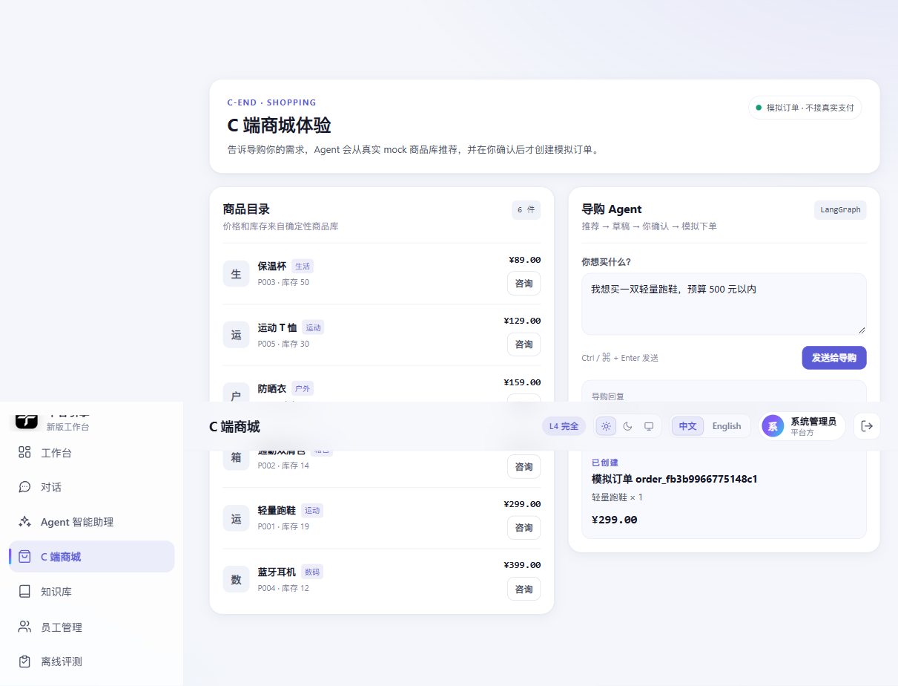
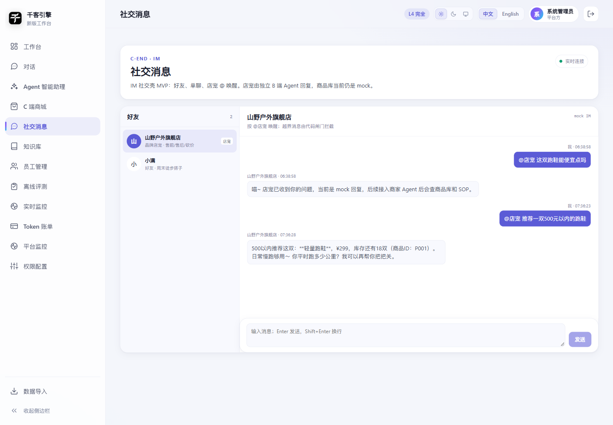
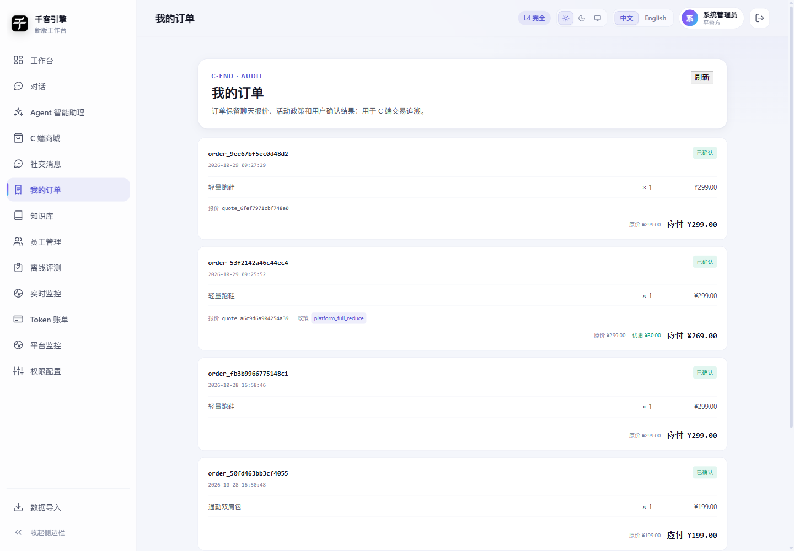
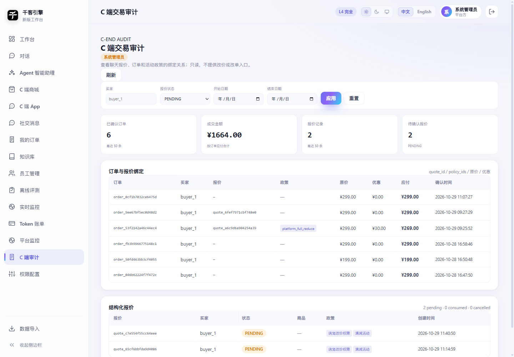

# C 端 Mock 商品与模拟订单 v0.1

> 当前没有真实商品/订单数据，先用独立 SQLite mock 存储验证 C 端订单闭环。
> 不写入 demo 评测库，不影响 Regression/Benchmark。

## 1. 存储

默认文件：

```text
var/c_end_mock.sqlite
```

可配置：

```bash
QIANKE_C_END_DB=var/c_end_mock.sqlite
```

表：

```text
c_product
  product_id / merchant_id / title / category / price / stock / status

c_order
  order_id / buyer_id / status / total_amount
  confirmation_hash / snapshot_json / idempotency_key / source_order_id
  created_at / confirmed_at

c_order_item
  order_id / product_id / quantity / unit_price

c_companion
  owner_id / name / species / persona / appearance
  level / exp / satiety / updated_at
```

伙伴字段是抽象表现层，不把“锦鲤”写死：

```text
species: digital_companion / cat / fish / robot / brand_mascot / custom
```

默认伙伴为“小鱼 / digital_companion”；可通过 PATCH 改名、换 species/persona/appearance。
买家的伙伴只在确认订单后获得成长值/饱食度奖励。

```text
GET   /api/c/companion
PATCH /api/c/companion
{"name":"阿团","species":"cat","persona":"calm","appearance":"cat-v1"}
```

内置 6 个 mock 商品：

```text
P001 轻量跑鞋     299
P002 通勤双肩包   199
P003 保温杯        89
P004 蓝牙耳机     399
P005 运动 T 恤    129
P006 防晒衣       159
```

## 2. 订单状态

```text
DRAFT      已准备，未扣库存
CONFIRMED  已确认，已扣库存
```

流程：

```text
POST /api/c/orders/prepare
  → 校验商品/库存/价格
  → 创建 DRAFT
  → 返回 order_id + confirmation_token + 订单摘要

用户确认订单内容

POST /api/c/orders/{draft_id}/confirm
  → 校验 token
  → 校验商品价格/库存未变化
  → 扣库存 + 创建 CONFIRMED 订单
```

## 3. 强制约束

- prepare 不扣库存
- confirm 必须带 confirmation_token
- token 绑定草稿快照
- 商品价格变化后旧确认失效
- 库存不足拒绝
- request_id 幂等，重复确认返回同一订单，不重复扣库存
- 不能确认/查看其他 buyer 的订单
- 第一版只模拟，不接真实支付

## 4. API

```text
GET  /api/c/products
POST /api/c/orders/prepare
POST /api/c/orders/{draft_id}/confirm
GET  /api/c/orders/{order_id}
```

请求示例：

```json
{
  "items": [
    {"product_id": "P001", "quantity": 2}
  ]
}
```

确认示例：

```json
{
  "confirmation_token": "prepare 返回的 token",
  "request_id": "req_c_order_001"
}
```

## 5. C 端 Agent 与 HITL

C 端 Agent Graph：

```text
用户消息
  → recommend_products（真实商品库）
  → prepare_order（只生成 DRAFT）
  → interrupt（返回草稿，等待用户确认）
  → approved=true  → confirm_order（扣库存，生成正式模拟订单）
  → approved=false → CANCELLED
```

API：

```text
POST /api/c/agent/run
  → 首次一般返回 200 + status=AWAITING_CONFIRMATION + draft
  → 也可能直接返回推荐结果
  → client_message_id：客户端重试幂等键；已完成的请求回放原响应

POST /api/c/agent/resume
  → thread_id + approved
  → approved=true 创建模拟订单
  → approved=false 取消
```

关键点：

- `prepare_order` 不扣库存
- 用户在 interrupt 后确认
- 确认绑定 prepare 返回的 draft/token
- Agent 不能自行跳过确认创建订单

## 6. C 端页面

Vue 页面：

```text
/v2/#/c
```

功能：

- 商品目录
- 输入购物需求
- 导购 Agent 回复
- 订单草稿确认/取消
- 确认后展示模拟订单

页面源码：

```text
web/src/views/CShop.vue
```

截图：



## 7. IM 社交壳 MVP

页面：

```text
/v2/#/c/social
```



已实现：

- mock 好友列表（店宠 + 普通好友）
- 单聊消息持久化
- HTTP + WebSocket 双入口
- 店宠由独立 B 端店宠 Agent 回复
- 店宠可查询商家 SOP / 平台活动规则
- C 伙伴只做辅助传达与“锐评”，没有议价/下单权限
- 店宠回复携带结构化报价引用（quote_id / product_refs / policy_refs）
- 报价引用可跳转商城，直接转订单草稿；仍需用户逐单确认
- 订单记录 quote_id / policy_ids / original_amount / discount_amount
- 确认后 quote 状态变为 CONSUMED，形成可追溯审计链
- 只有被 `@店宠` 唤醒且命中意图白名单才进入店宠 Agent
- 未唤醒时返回固定拦截话术
- 聊天中不会创建订单；成交仍走 C 端 Agent 的 prepare → 用户确认 → confirm
- 店宠消息支持 before 游标分页，加载更早消息无重复/无遗漏
- 分页游标为 `created_at|message_id`，兼容旧式 `created_at`

API：

```text
GET  /api/c/friends
GET  /api/c/friends/{friend_id}/messages
POST /api/c/friends/{friend_id}/messages
  → content + client_message_id（可选，幂等键）
WS   /api/c/ws/chat/{friend_id}
  → client_message_id（可选，幂等键）
GET  /api/c/quotes/{quote_id}
POST /api/c/quotes/{quote_id}/prepare
```

当前限制：

- 商品库仍是 mock SQLite
- 店宠没有真实优惠/改价授权，砍价只能说明需商家确认
- C 伙伴只有锐评，不做自主谈判
- 报价商品数量默认 1，用户可在商城重新准备
- 只有 platform_full_reduce 活动被确定性应用；其他优惠仍需商家确认
- 没有真实双人推送 / 消息总线
- 没有好友申请/通过流程
- 双宠自主谈判协议尚未实现

## 8. 订单审计页

页面：

```text
/v2/#/c/orders
```



展示：

- 正式订单 ID / 确认时间
- 商品与数量
- 原价 / 优惠 / 应付
- 来源 quote_id
- 命中的 policy_ids

只展示正式订单，不把草稿当订单。

## 9. 当前买家身份

当前复用登录账号：

```text
buyer_id = buyer_<app_user.id>
```

这不是最终 C 端消费者模型。真正接入前需要独立消费者身份、收货信息和会员体系。

## 10. 管理端 C 端审计

页面：

```text
/v2/#/admin/c-end
```

API：

```text
GET /api/c/admin/audit?limit=50
GET /api/c/admin/audit?limit=50&buyer_id=buyer_1&status=PENDING
GET /api/c/admin/audit?limit=50&date_from=2026-10-29&date_to=2026-10-29
GET /api/c/admin/audit?limit=20&offset=20
GET /api/c/admin/audit/export?limit=50&buyer_id=buyer_1
```

分页：

```text
limit 1..200
offset >= 0
响应新增 orders_total / quotes_total
summary 仍描述当前页
```

订单和报价共用同一 offset，页码按两表 total 的较大值计算。

导出 CSV：

```text
UTF-8 BOM
字段：order_id,buyer_id,total_amount,original_amount,discount_amount,quote_id,policy_ids,confirmed_at
```

说明：`status` 同时作用于订单列表与报价列表。订单通过 `quote_id` 关联 `c_quote.status` 过滤；无 `quote_id` 的直购订单在 status 非空时不返回。订单 CSV 与审计列表使用相同的 buyer/status/日期/limit 口径。

筛选：

```text
buyer_id
status = PENDING / CONSUMED / CANCELLED
date_from / date_to（按自然日）
```

权限：

```text
仅 is_system_admin 可访问
非管理员 403
```

展示：

- 已确认订单数 / 成交金额
- 报价数 / PENDING / CONSUMED / CANCELLED
- 订单与 quote_id、policy_ids、原价、优惠、应付
- 报价商品引用与政策引用

只读：不提供改价、改单、删除报价入口。


