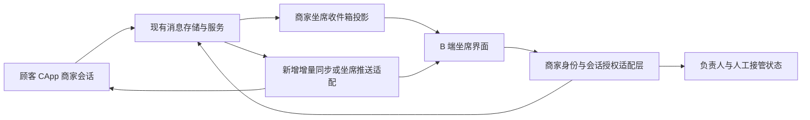

# 千客 B 端 2.0：客服会话工作台与完成口径经营报告

2026-11-14 · v0.1 · 离线设计评审稿

本稿补充客服会话和经营报告两个工作区，沿用 P0 的导航、角色首页、订单详情和商品/SKU 页面。只交付中文设计文档，不改生产代码、权限、数据库或交易状态机，不创建 PR。所有金额、顾客、坐席、消息和时间示例均为虚构模拟；设计不证明已有真实支付、客服在线或双向实时通信。

## 1. 决策、证据与实施边界

### 1.1 已确认与待评审

| 类别 | 内容 |
| --- | --- |
| 已确认 | 继续模拟交易；流水按订单完成时间；店主关注经营报告、客服关注顾客对话、仓库关注商品更新；正文默认 18px、辅助内容不低于 16px；灰青 6:3:1 |
| 本稿建议 | 在现有 CApp/IM 数据与消息能力上增加 B 端商家坐席适配层、收件箱投影和授权；人工接管同一商家会话；经营报告同时区分期间流水与完成订单群净额 |
| 待确认 | 人工接管与恢复自动回复规则；坐席与 owner/admin/staff 的权限映射；退款跨月主口径；营业时区；导出数量限制和文件有效期 |
| 本轮不实施 | 消息发送、接管、退款、统计查询、导出服务、P0 生产页面修改；下述 API 名称和新增字段均为提议 |

复用 IM 是已记录的建议，尚不能写成已落地决策。设计把可选方案做具体，交由产品和后端评审；未决项不阻碍阅读本稿，但对应能力不能直接据此上线。

依据：[产品决策](./b-end-2.0-decisions.md)、[调研与信息架构](./b-end-2.0-research.md)、[P0 设计说明](./b-end-2.0-p0-design.md)、[P0 离线原型](./b-end-2.0-p0-wireframe.html)。

代码基线：`893c81dac60dff5266cc049eba66390de6073720`，本次获取的 `origin/agent`。此提交归档了 P0 设计文件，但所读 `web/src/b-workbench.js` 仍是七个平铺视图。对方所述新 P0 生产壳层不在该代码基线中；本稿按已交付设计约定接入，不声称已检查新壳层或线上页面。

### 1.2 现有实现证据与纠偏

| 编号 | 已读取的事实 | 设计影响 |
| --- | --- | --- |
| E01 | [B 工作台](../../web/src/b-workbench.js) 的 `VIEWS` 有订单、售后、商品、用户画像、Super-agent、策略、审计；没有坐席收件箱或经营报告 | 新增两个工作区，保留已有能力；用户画像不是会话工作台 |
| E02 | [B API](../../src/rag_demo/api/b_workbench.py) 的 `/me`、`/orders`、`/chat-profiles` 按商家绑定读取；`/me` counts 来自有 limit 的集合，订单接口无本稿所需期间全量汇总契约 | 不用已加载数量或前端列表求和冒充全店汇总 |
| E03 | [CApp](../../web/src/views/CApp.vue) 已调用消息历史、未读、已读和店宠 WebSocket；[C API](../../src/rag_demo/api/c_end.py) 的 `/threads/unread`、`/threads/{thread_id}/read` 按当前买家工作 | 可复用底层能力，不能把买家接口作为商家授权接口 |
| E04 | C API `chat_websocket` 把当前账号映射为 `buyer_{account_id}`；`_send_store_message_once` 写入买家消息并调用店宠回复 | B 端不能传入顾客 ID 冒充顾客发送，也不能把当前 WS 地址当作已存在的坐席广播通道 |
| E05 | [消息存储](../../src/rag_demo/c_end/social.py) 的 `c_message` 包含 owner_id、friend_id、sender_id、receiver_id、content、metadata_json、created_at；列表按 owner/friend 隔离 | 需要商家→会话→顾客的可靠映射和独立坐席身份；禁止仅按 friend_id 合并不同顾客 |
| E06 | [C 端存储](../../src/rag_demo/c_end/store.py) 的 `get_thread_unread` / `mark_thread_read` 使用 owner/thread 和 last_read_at；首次访问历史初始化为已读 | 不复用此游标表示客服已读；也不能据此声称全部动态店宠会话已有正确未读覆盖 |
| E07 | [IM 协议草案](./im-protocol-v0.md) 明确“服务端/客户端尚未接入”；提出 `/im/ws`、seq 和同步动作 | 这些只能作为迁移设计参考；不能直接宣称 `/im/ws` 可用 |
| E08 | [商家订单模型](../../src/rag_demo/merchant/models.py) 的 `Order` 已有 paid_at、completed_at、refund_amount、refunded_at，并通过 to_dict 返回；B orders 使用该模型 | 旧决策文档 §2.3“没有 paid_at/completed_at”与代码不符；本稿以代码为准，不重复新增已有字段 |
| E09 | [PostgreSQL 订单仓储](../../src/rag_demo/merchant/postgres_repository.py) 的状态更新在 COMPLETED 时写 completed_at；[SQLite 仓储](../../src/rag_demo/merchant/sqlite_repository.py) 的退款保留完成时间 | 统计完成事件不能只筛选当前 status=COMPLETED，否则退款后的历史完成订单会消失 |
| E10 | 两种商家仓储均有单次部分/全额退款金额与时间；已退款订单拒绝再次改变金额，当前不是可累加的多笔退款事件账本 | 可提出兼容投影，但不能伪称已支持多次部分退款、退款撤销或完整历史快照 |

以上为源码静态核对，不等于生产接口验收。旧文档的不足在本稿内明确说明，本轮不回改旧文档。

## 2. 接入 P0 与页面框架

客户服务分组增加“客服会话”，经营与管理分组增加“经营报告”。客服首页进入“待我回复”，店主首页的模拟完成流水卡进入同范围经营报告；仓库默认入口仍是商品/SKU 与待发货。

沿用 P0 左侧分组、商家上下文、单店模式提示和订单抽屉。未有真实多店成员契约前，切店保持禁用。与订单/售后的跳转携带当前 merchant、order_id 和返回位置，服务端重新验证权限，不复制一套订单表或发货按钮。

宽屏沿用 228px 导航。1440px 视口下，客服内容采用约 300px 会话列、中间自适应消息列、约 280px 上下文列；剩余空间不足时上下文收为抽屉，不压缩正文。768–1199px 使用列表与消息两列、上下文抽屉；767px 及以下使用列表、会话、上下文三个连续单页。390px 手机返回会话列表时保留筛选、选中项和滚动位置。

正文 18px，时间、标签、紧凑表格最低 16px。60% 纸面、30% 灰青文字/边界/次级面、10% 当前项和主操作；错误和未读同时用文字、形状表达。输入区遵循键盘与安全区高度，消息区单独滚动；弹层关闭回到触发控件，隐藏面板不可被 Tab 聚焦。

## 3. 客服坐席工作台

### 3.1 桌面结构

```text
店铺 / 单店模式                     当前坐席 · 权限说明
客服会话                           数据更新于… / 连接状态
┌────────────────┬──────────────────────────┬────────────────┐
│ 待我回复 / 未分配 │ 顾客简称 · 会话号 · 负责人 │ 顾客与订单上下文 │
│ 我的会话 / 已结束 │ 状态 · 人工/自动回复模式   │ 脱敏顾客标识     │
│ 搜索与筛选        │ 消息时间线                │ 关联订单/售后    │
│ 顾客 · 消息摘要   │ 顾客 / 坐席 / 店宠 / 系统 │ 查看订单抽屉     │
│ 未读 · 待回复时间 │ 新消息定位 / 加载更早消息  │ 用户画像来源时间 │
│ 负责人 · 状态     │ 快捷回复 / 引用订单        │ 不展示全店报告   │
│ …               │ 输入区 · 发送结果          │                  │
└────────────────┴──────────────────────────┴────────────────┘
```

上述是布局示意，无真实会话数、收入或在线坐席数。模拟稿的每条顾客、消息和订单均需显示“模拟样例”；“模拟交易”只描述订单，不代表正式客服消息可以随意试发。

### 3.2 收件箱语义

| 项目 | 设计规则 |
| --- | --- |
| 默认队列 | 待我回复：分配给当前坐席且 reply_due=true；未分配：无负责人且 OPEN；我的会话：当前负责人全部；已结束：RESOLVED |
| 未读 | 当前坐席尚未读到的可见消息，与“待回复”分开；读过顾客消息后仍可能待回复 |
| 会话行 | 顾客脱敏简称、最近公开消息摘要、更新时间、未读徽标、负责人、处理状态、待回复时长；金额不作为列表必需字段 |
| 排序 | 待我回复优先按最早未回复顾客消息时间；普通列表按最近活动时间；增加新消息时保留正在操作的行并提示更新 |
| 查询 | 顾客标识或订单号、负责人、处理状态、未读；搜索范围始终受商家和坐席权限约束 |
| 数量 | 服务端返回过滤范围总数与 snapshot_at；无法返回时显示“已加载 N 条”，不推断全量 |
| 分页 | 游标分页与稳定排序键；重复数据按 conversation_id 去重；切换筛选废弃旧请求结果 |

建议状态为 OPEN（处理中）、WAITING_CUSTOMER（待顾客补充）、RESOLVED（已结束）；分配状态独立于处理状态。有效顾客新消息可以把 WAITING_CUSTOMER/RESOLVED 重新打开，但须后端统一处理。系统通知、内部备注、自动状态更新不应误触发待回复。

`reply_due`、`waiting_since` 应由服务端根据最后一条未回应的顾客消息计算。客服公开回复可以清除待回复；店宠回复能否清除，取决于自动接待策略，不能由前端猜测。时间超过某值仅显示等待时长；未设置服务时段和 SLA 前不标“超时违规”。

### 3.3 分配、已读和并发

1. 客服可领取允许范围内的未分配会话；领取提交 conversation_id、expected_version、request_id。两人同时领取时，一人成功，另一人看到实际负责人并可刷新。
2. 转派给他人需单独的分配权限，展示旧/新负责人及理由。不能凭人员出现在下拉中推断其在线或有接待能力。
3. 阅读仅在消息已取得、会话处于前台且相应内容实际进入可视区域后提交游标；预取列表和后台推送不自动清未读。标记只影响当前坐席，不改变顾客已读或其他坐席游标。
4. 同一坐席多设备取单调向前的已读游标。新分配时，以已有可验证游标或明确历史导入规则初始化；无记录显示“未读状态待初始化”，不直接归零。
5. 回复与分配使用服务端版本复核。被转派或权限撤销后，未发送草稿保留在当前会话界面，发送禁用；不自动转发给新负责人，不继续展示已失去权限的数据。

### 3.4 消息与快捷操作

消息明确显示发言者类型：顾客、人工客服、店宠自动回复、系统事件。人工回复使用实际坐席的服务身份，不能借用顾客 ID 或把人工文字显示为店宠生成。默认支持纯文本；图片、语音、文件、引用和业务卡片按后端 capability 开放，未知内容类型显示安全降级说明。

发送状态区分“发送中”“已保存”“送达未知”“发送结果待确认”“失败”。服务端确认持久化后才能显示已保存；只有接收端回执才能显示已送达/已读。WebSocket 连接成功只表示本端通道可用，不表示顾客在线。

超时后保持原 client_message_id，先按该 ID 查回或增量同步；确认未提交且允许重试后，仍使用同一 ID。禁止 HTTP 与 WebSocket 同时重发造成重复消息。空白消息拒绝；字数上限由 capability 给出；切换会话不得把 A 的草稿发给 B。离开带草稿会话时保留当前页面内存并提示，第一版不把顾客消息和草稿静默写入共享设备的长期存储。

| 快捷操作 | 行为及边界 |
| --- | --- |
| 快捷回复 | 选择后填入草稿，可编辑，由客服主动发送；不自动触达 |
| 查看订单 | 服务端核验当前商家和顾客关联后打开 P0 订单抽屉；不直接推进订单状态 |
| 引用订单信息 | 仅将当前可见、允许对顾客披露的摘要填入草稿；客户可点击卡片须再次验权；不含凭据、内部备注或其他顾客信息 |
| 查看售后 | 跳转已有售后详情，保留返回上下文；退款/验收继续走原权限和确认流程 |
| 用户画像 | 辅助抽屉显示来源与更新时间，不替代实际聊天原文；没有画像正常显示空状态 |
| 标记待顾客补充 / 结束 | 明确改变会话处理状态，不代表退款已完成或问题被顾客确认解决 |

内部备注不属于首版必需范围；若后续加入，必须使用独立数据类型、显著“仅内部可见”，不得混入公开消息发送路径。

### 3.5 人工接管与店宠边界（建议，待确认）

建议在同一商家会话维持 `BOT_ASSISTED` / `HUMAN_HANDOFF` 两种模式。客服领取并进入人工接待时，服务端原子地记录负责人、模式及版本；HUMAN_HANDOFF 中停止自动对外回复和自主执行建议。尚在生成的店宠响应在发送前重新验证模式版本，过期结果只能保留为内部草稿或丢弃，不能与人工抢答。

“结束会话”不自动恢复店宠回复。恢复需有权限人员明确选择“恢复自动接待”，写操作日志。接管冲突、模式切换失败时仍按后端实际模式显示，不先把页面改成成功。此规则需要产品确认和 C 端提示支持，不能只隐藏 B 端头像完成。

人工回复未来必须能出现在顾客原有商家会话中；不能只写 B 端副本。如果当前 C 端通道无法接收坐席主动消息，应先采用明确的历史/增量轮询兼容方案并显示同步状态，或保持发送禁用，不能宣称双向实时已完成。

## 4. IM 复用与新增 B 端读模型



该图是目标设计，不表示事件总线或新推送已经存在。

| 层 | 复用 | 新增或核实 |
| --- | --- | --- |
| 身份 | 登录会话、账号状态、商家成员关系 | service.view/send/assign 等坐席能力；每个读取、发送、订阅重新验权 |
| 消息 | 已有历史内容、message_id、存储服务、幂等机制思路 | 人工发送者、商家范围查询、顾客可见投递、B/C 一致消息 ID、稳定游标 |
| 会话 | 当前买家 owner_id + friend_id 及店宠商家映射 | 唯一 conversation_id ↔ merchant/buyer/legacy_thread 映射；不可只用 friend_id 作为全局键 |
| 收件箱投影 | 消息与已验证顾客/订单关系 | assignee、处理状态、reply_due、等待时间、坐席已读、版本、最后活动、投影新鲜度 |
| 实时 | CApp 现有 WS 连接处理与 HTTP 回退经验 | 商家订阅、fan-out、断线增量回放、权限撤销、服务端事件顺序；不假定旧 WS 已有广播 |
| 交易 | 商家订单/售后读取与原动作服务 | 报告聚合、快照、退款事件适配；聊天不能直接改订单或退款 |

读模型可以是当前单体中的查询/投影，不要求先引入微服务或消息中间件。消息事实只保留一套权威来源，坐席投影不能成为另一个互相覆盖的消息库。投影延迟时显示“更新于…”和刷新入口；如果消息正文已到但列表未更新，显示同步中，不丢弃消息。

首版只纳入商家映射明确的顾客—商家会话，不纳入顾客私人伙伴对话、私人好友聊天和无明确授权的群聊。修复或迁移历史映射需要单独清单，不靠推测名称匹配。

稳定序号若未落地，适配层须提供稳定且可恢复的游标，例如经服务端定义的 `(created_at,message_id)`；不得仅按时间字符串排序而漏掉同一时间的消息。若决定接入 IM v0 的 seq，需要实际实现和迁移验证后才能使用该能力名。

## 5. 完成口径经营报告

### 5.1 页面与入口

```text
经营报告                                  [模拟交易]
单店 · CNY（示例） · 时间范围 · 时区 · 截至时间 · [查看口径]
[模拟完成 GMV] [完成订单数] [本期退款冲减] [本期净完成流水]
期间明细（日/月） / 完成订单 / 退款调整 / 数据质量
同一快照的明细、总计、币种与口径版本          [导出]
```

卡片不使用“到账”“可提现余额”“真实收入”“利润”。完成金额与退款均为模拟交易记录，本稿定义的是经营分析指标，不是会计收入确认规则。趋势只在服务端能按完整时间事件聚合时显示；未接入时显示能力待接入，不画虚构折线。

### 5.2 时间、对象和金额

建议默认使用商家营业时区；该配置未确定时，评审样例统一 Asia/Shanghai，并在界面明示“设计示例时区”。日期范围包含用户选择的结束日，查询转换为该时区 `[开始日00:00, 结束日次日00:00)`，再转换成 UTC；不能简单假设每个自然日都是固定 24 小时。

同一报告固定 merchant_id、currency、range、timezone、as_of、metric_version、simulation_mode 和 snapshot_id。首次完成事件在期内即属于该期；当前状态变成 REFUNDED 不应删掉原完成事件。缺 completed_at 的历史完成/退款订单进入数据质量项，不能用 created_at、paid_at 或 updated_at 替代。

金额建议采用订单完成时的 total_amount 快照，以定点金额或 Decimal 计算。折扣、运费、税费是否已经包含须由订单金额契约说明；缺成本字段不计算利润。不同币种分别出报告，不自动换汇或直接相加。单一完整查询成功且没有符合条件订单时，零才是可靠的结果。

### 5.3 两种退款视角不能混合

令 T 为所选期间，A 为报告截至时间，且所有事件满足商家、币种及模拟模式一致。所有纳入事件均须已发生且生效时间不晚于 A；日期范围包含未来日期时，未来部分标为“尚未发生”，不画成完整零值经营日。以下为建议口径，退款跨月方案需确认。

| 指标 | 建议定义 | 页面说明 |
| --- | --- | --- |
| G(T)：模拟完成 GMV | completed_at ∈ T 的订单完成金额快照之和，每订单只计一次 | 完成后退款仍保留原完成额；没有有效完成事件的不纳入 |
| N(T)：完成订单数 | 上述有效完成订单的去重数量 | 退款不倒扣完成事件数量；退款订单数单列 |
| R_event(T)：本期退款冲减 | refunded_at ∈ T，且原完成事件有效且不晚于退款的确认退款金额；每退款事件只计一次 | 可能来自以前月份完成的订单；申请/审批中不计 |
| Net_event(T)：本期净完成流水 | G(T) − R_event(T) | 本期发生视角，可为负数，不代表本期完成订单的最终净额 |
| R_cohort(T,A)：本期完成订单截至 A 的退款 | 原订单 completed_at ∈ T 且退款生效时间 ≤ A 的确认退款总额 | 用于观察这一批完成订单，允许包含次月退款 |
| Net_cohort(T,A)：完成订单群净额 | G(T) − R_cohort(T,A) | 随截至时间变化，必须展示 A，不能冒充历史冻结值 |
| 完成客单价 | G(T) / N(T)，N=0 时为空 | 不用期间净流水除以完成单数，避免跨期退款扭曲 |

主卡建议使用期间发生视角；“完成订单”页签同时显示其截至时间净额。两套净额分开命名、分开导出，不在同一列切换含义。完成前取消/退款、仅发货后退款但从未完成的订单，放入“非完成订单退款”辅助项，不能从完成 GMV 中再次扣除。退货入库是库存事件，不能被当成退款事件重复扣减。

当前只保留单笔退款金额与时间的订单可形成标记为 `legacy_single_refund` 的兼容事件；它不是完整多退款账本。不得把累计退款快照当作每次事件反复求和。未来多次部分退款需独立 refund_id、amount、effective_at、state、order_id 及去重约束；退款撤销需独立反向事件，不能静默覆盖原记录。本轮不实施此模型变更。

### 5.4 跨月算例（全部虚构模拟）

下表币种均为 CNY，年份均为 2026 年，时间均为 Asia/Shanghai；金额只用于验证定义。

| 模拟订单 | 完成时间 | 完成金额 | 模拟退款 | 说明 |
| --- | --- | ---: | --- | --- |
| DEMO-A | 10-31 23:50 | 200.00 | 11-02，50.00 | 上月完成、本月部分退款 |
| DEMO-B | 11-01 10:00 | 300.00 | 11-03，300.00 | 本月完成、本月全退；当前状态 REFUNDED |
| DEMO-C | 11-04 10:00 | 120.00 | 无 | 本月完成 |
| DEMO-D | 未完成 | 不纳入 | 11-01 取消退款 80.00 | 非完成订单退款，单列 |
| DEMO-E | 11-30 20:00 | 140.00 | 12-02，40.00 | 本月完成、次月部分退款 |

11 月报告截至 11-30 日末：G=560.00、N=3、R_event=350.00、Net_event=210.00。11 月完成订单群的 R_cohort=300.00，Net_cohort=260.00。DEMO-D 的 80.00 不计入本期完成流水冲减。

截至 12-02 退款已发生后，11 月期间发生视角仍为 210.00；11 月完成订单群净额变为 220.00，因为新增归属于 DEMO-E 的 40.00 退款。若 12 月尚无新完成订单，12 月期间净完成流水为 -40.00，不能强制显示 0。10 月原完成 GMV 仍为 200.00；截至 11 月末对应订单群净额为 150.00。

该算例表达两种查看目的，不自动决定财务关账、税务归属或实际资金结算。

### 5.5 数据质量与快照

- completed_at 缺失/无时区、退款早于完成、币种缺失、重复事件、金额冲突、无法关联订单的退款分别计数。无法确定金额时显示“未知”，不补零。
- 字段不完整时，相关汇总显示“部分数据/暂不可计算”和排除数量；若无法证明范围完整，不显示可信净额或同比。
- 历史无时区时间戳须通过明确迁移规则解释；前端不可按当前电脑时区猜测。
- `is_simulated`、completion_source 在现有 Order 模型中未见；当前模拟环境须由可信服务端来源统一声明，未来不得把历史未标记订单自动当真实交易。
- 如果历史更新没有事件日志或版本快照，不能仅靠当前订单行重建任意历史 as_of。首版可以返回“当前查询快照”；历史截至时间选择在具备事件历史后再开放。
- 新快照不覆盖已导出的旧文件；迟到事件和数据修正要带修订说明及 metric_version。店主首页与报告应使用同一查询契约，不能各自计算不同总额。

### 5.6 导出边界

分别提供“期间汇总”“完成订单明细”“退款事件明细”。导出明确当前过滤全量或勾选范围，不能把当前分页当全量；默认不导出顾客消息和个人联系方式。数据权限、币种、时区、范围、as_of、simulation_mode、metric_version、snapshot_id、排除记录数和导出时间一同写入文件。

建议服务端创建异步导出任务，状态 QUEUED/RUNNING/READY/FAILED/EXPIRED；返回行数与 expires_at，页面不凭固定倒计时猜有效期。下载时再次验权，使用受控下载接口或短期授权链接，不使用公开永久链接。取消权限后禁止新下载并按服务端策略撤销任务；已下载文件无法技术性收回，应如实说明。

失败可重试同一导出请求 ID；重复点击不能产生多份相同任务。CSV 文本字段处理公式注入，金额保留精度；大范围上限、保留时长、同步小文件策略留给后端能力契约。此设计不意味着目前已有报告或异步导出接口。

## 6. 业务视角与权限矩阵（提议）

现有角色为 owner/admin/staff，不等同于店主/客服/仓库。以下建议能力需要服务端显式映射；禁止按前端角色选择器放权。尤其不能把所有 staff 同时当作客服和仓库，也不能默认 admin 获得全部财务与消息权限。

| 能力 | 店主视角 | 客服视角 | 仓库视角 |
| --- | --- | --- | --- |
| 看经营汇总/退款调整 | 有 reports.view 授权时允许 | 默认不允许 | 默认不允许 |
| 导出经营报告 | 单独 reports.export | 默认不允许 | 默认不允许 |
| 看商家全部会话 | 有 service.view_all 才允许 | 默认仅分配给自己与可领取队列 | 不允许 |
| 公开回复 | 单独 service.send，不能由店主身份自动推出 | 允许范围内，仍需分配/模式校验 | 不允许 |
| 领取/转派 | service.assign；转派含他人需更高范围 | 可领取；转派另行授权 | 不允许 |
| 客服已读/状态 | 有会话可见性才可操作 | 当前允许会话 | 不允许 |
| 订单/售后上下文 | 依现有权限 | 同商家且与当前会话顾客关联，最小字段 | 仅履约相关字段，沿用原权限 |
| 退款/模拟完成/库存更新 | 继续检查原业务能力与确认 | 会话权限不授予退款/完成 | 会话权限不授予任何库存能力 |

顾客联系方式默认脱敏；确需展开须独立能力与审计。会话引用订单、报告打开订单、直接 URL、CSV 下载、WebSocket 订阅均在服务端校验 merchant 与对象关系。权限撤销触发界面清理和订阅关闭；浏览器内隐藏按钮不能替代授权。

## 7. 状态、恢复和移动端

| 场景 | 会话工作区 | 经营报告 |
| --- | --- | --- |
| 初次加载 | 列表骨架、消息骨架；发送禁用，无伪造未读数 | 卡片骨架和查询条件；金额不先填 0 |
| 成功且为空 | “暂无符合条件的会话”；区分筛选为空与尚无顾客会话 | 完整查询无记录时为 0；说明所选期间与币种 |
| 数据缺失 | 无关联订单/无画像独立为空，不清空消息 | 完成时间缺失等进入数据质量，不伪装没有经营 |
| 查询失败 | 保留有权限的旧数据并标记旧时间；局部重试 | 保留旧快照并明确不对应新筛选；暂停导出新筛选 |
| 断线 | “消息同步中断”；先补齐增量；发送按结果状态处理 | 不适用实时连接；刷新失败保留旧快照 |
| 401/403 | 请求重新登录或无权限；清除受限内容，保留安全返回路径 | 无权限页，不返回缓存金额或继续下载 |
| 409 并发冲突 | 显示新的负责人/版本；保留草稿，禁止盲重试 | 快照失效则重新查询，不混合新旧数据 |
| 导出失败/过期 | 首版不导出聊天 | 显示任务原因；重试或重新生成，旧链接不可伪装可用 |

手机会话顶部保留顾客、负责人、处理状态、返回和上下文按钮；消息历史与输入分别滚动。订单上下文复用全屏抽屉，关闭返回原会话位置。报告手机端按两列或单列显示卡片，明细转为订单/退款卡；宽表放在局部滚动容器，禁止整个页面横向溢出。

## 8. 后端字段与 API 依赖清单

### 8.1 字段契约建议

| 对象 | 最小字段 | 现状与要求 |
| --- | --- | --- |
| 身份能力 | account_id、merchant_id、capabilities、membership_version | 复用账号/成员，新增能力映射；前端不提交可信角色 |
| 会话投影 | conversation_id、merchant_id、buyer_id、legacy_thread_ref、assignee_id、status、mode、version、last_activity_at、reply_due、waiting_since | 新增；范围映射必须可审计 |
| 坐席阅读 | conversation_id、agent_account_id、last_read_cursor、unread_count | 新增，独立于买家已读；服务端单调更新 |
| 消息 | message_id、conversation_id、sender.kind/id、content/segments、created_at、cursor、client_message_id、delivery_state | 部分复用，坐席身份/稳定游标/送达状态须新增或核实 |
| 上下文 | 允许访问的 order_refs、脱敏 customer、profile.updated_at/source | 复用订单和画像读取，补关联与权限校验 |
| 完成事实 | order_id、merchant_id、currency、completed_at、completion_amount、simulation_mode、completion_source | 已有金额/完成时间；快照、来源和模拟标记需契约 |
| 退款事实 | refund_id、order_id、amount、currency、effective_at、state、source、event_version | 当前单笔 refund_amount/refunded_at 可适配；多事件须新增 |
| 报告快照 | snapshot_id、metric_version、range、timezone、as_of、simulation_mode、totals、quality、generated_at | 新增服务端全量聚合契约 |
| 导出任务 | job_id、request_id、snapshot_id、scope、status、rows、expires_at、error | 新增；审计创建人、授权范围和下载事件 |

### 8.2 API 提议（以下地址均未实现/未验收）

| 提议接口 | 用途 | 必要约束 |
| --- | --- | --- |
| GET /api/b/service/capabilities | 当前坐席能力与同步/发送支持 | merchant 由会话和成员关系验证；无 capability 就不开放按钮 |
| GET /api/b/service/conversations | 队列、搜索、过滤、游标分页 | total/snapshot_at/next_cursor；稳定排序；商家隔离 |
| GET /api/b/service/conversations/{id} | 当前会话与顾客/订单上下文 | 逐对象验权与字段脱敏 |
| GET /api/b/service/conversations/{id}/messages | 历史 before_cursor 或增量 after_cursor | 互斥参数、limit、稳定游标；不只返回最新一页充当完整同步 |
| POST /api/b/service/conversations/{id}/messages | 人工公开回复 | client_message_id 幂等、expected_version、人工模式、持久化确认；相同键不同内容拒绝 |
| GET /api/b/service/conversations/{id}/message-status | 超时查回结果 | 按当前坐席及 client_message_id；返回 committed/not_found/pending，禁止越权枚举 |
| POST /api/b/service/conversations/{id}/read | 上报已看见消息游标 | 只更新当前坐席，不使用买家 read 接口 |
| PATCH /api/b/service/conversations/{id}/assignment | 领取/转派 | expected_version、request_id、目标坐席能力、冲突反馈 |
| PATCH /api/b/service/conversations/{id}/state | 处理状态/人工接管模式 | 明确区分动作，服务端状态机、审计、版本复核 |
| WS /api/b/service/events 或授权增量轮询 | 消息/分配/权限变化通知 | 重新鉴权、事件游标、断线补偿；仅为传输方案提议 |
| GET /api/b/reports/completion | 同一快照的汇总、质量和维度 | 全量服务端查询；币种/时区/期间/指标版本 |
| GET /api/b/reports/completion/details | 完成订单或退款明细 | snapshot_id、kind、cursor；总计与汇总一致 |
| POST /api/b/report-exports | 创建导出 | 权限、request_id、snapshot_id、范围与字段白名单 |
| GET /api/b/report-exports/{id}；GET …/{id}/download | 进度与受控下载 | 重新验权、过期、失败原因、下载审计 |

新接口使用结构化 `{code,message,request_id}` 错误；HTTP 401/403/409/422/429 等与明确错误码配套。角色、坐席身份、商家和模拟模式由可信服务端决定，不能相信前端传入值。具体字段命名、分页协议、限流与兼容旧接口需实现方评审。

## 9. 交付顺序与验收清单

建议分三步落地：先确认权限/人工接管/退款口径并完成服务端契约；再接只读收件箱、历史和完整报告聚合；最后开放受控回复、分配、实时恢复和导出。依赖不足时明确显示未接入，不用模拟数据填充生产空白。

以下是实施后的验收要求，本轮仅审查设计，不声称已执行这些系统测试。

| 编号 | 验收情境 | 预期 |
| --- | --- | --- |
| CS01 | 两名坐席同时领取 | 一次成功；另一方收到冲突与真实负责人 |
| CS02 | 打开列表但未进入会话；坐席读消息 | 前者不清未读；后者不修改顾客与其他坐席游标；待回复独立存在 |
| CS03 | 发送已落库但响应超时 | 按同一 ID 查回，顾客只看到一条；不得伪标已读 |
| CS04 | 断线期间产生多条同时间消息 | 稳定游标补齐且去重；旧数据不覆盖新消息 |
| CS05 | 人工接管时店宠仍在生成 | 店宠发送前复核版本，不发生双重公开回复 |
| CS06 | 伪造商家、顾客、会话、订单 ID | API/订阅/下载拒绝；无私人伙伴或其他商家信息泄漏 |
| CS07 | 权限撤销或会话转派 | 订阅/发送立即受限，受限信息清理，草稿不误发 |
| CS08 | 手机切换列表、上下文、键盘 | 不横溢、不遮发送按钮，返回位置正确，18/16px 字号维持 |
| RP01 | 11 月虚构算例 | 560 / 3 / 350 / 210；订单群净额 260；取消退款 80 单列 |
| RP02 | 12 月退款后重查 | 11 月期间净额仍 210；订单群净额 220；12 月无新完成时为 -40 |
| RP03 | 当前状态由 COMPLETED 变 REFUNDED | 原完成 GMV 和单数保留；按事件扣退款一次 |
| RP04 | 月末边界、不同币种、缺失时间、重复退款 | 按时区半开区间；币种分开；异常明确；不补零或重复计数 |
| RP05 | 汇总、分页、导出同时查询 | 使用同一 snapshot_id，超过页面条数仍覆盖授权全量 |
| RP06 | 旧快照、迟到事件、导出失败/过期 | 显示时间/版本与状态；不把旧快照冒充新范围 |

## 10. 开放问题与本轮验证记录

| 待决项 | 本稿建议 | 在确认前的限制 |
| --- | --- | --- |
| 人工接待与店宠 | 明确接管，结束后不自动恢复 | 不上线公开人工发送及自动模式切换 |
| 退款跨月 | 主卡按退款发生期；另列完成订单群净额 | 仅展示标明建议的设计算例，不宣称经营口径已获确认 |
| 角色映射 | 以能力映射三种业务视角 | 不把已有 staff 直接放权，不改生产权限 |
| 时区与金额组成 | 商家营业时区、完成金额快照，币种分开 | 不推断历史无时区时间或隐含税费构成 |
| C/B 双向消息 | 共用事实存储，加商家授权与投递适配 | 不把现有买家 WS 描述为人工客服消息通道 |
| 导出 | 同快照异步任务、受控下载 | 上限、有效期、保留期由后端和产品确定 |

本轮核对了上述三个设计文档、IM 草案、CApp、B/C API、消息与阅读存储、商家订单模型及两种仓储相关代码。文档提供具体页面、行为、契约和算例，未制作可选 HTML，未改生产文件，未启动服务或调用业务写接口。

文档交付验证覆盖相对引用有效性、需求覆盖、虚构算例的十进制金额计算及变更范围。未执行生产 pytest、Regression Eval、浏览器、真实收发或报表接口验收：本轮不含可运行功能或 Agent 核心修改；实施后的验收清单不能当作已通过结果。
