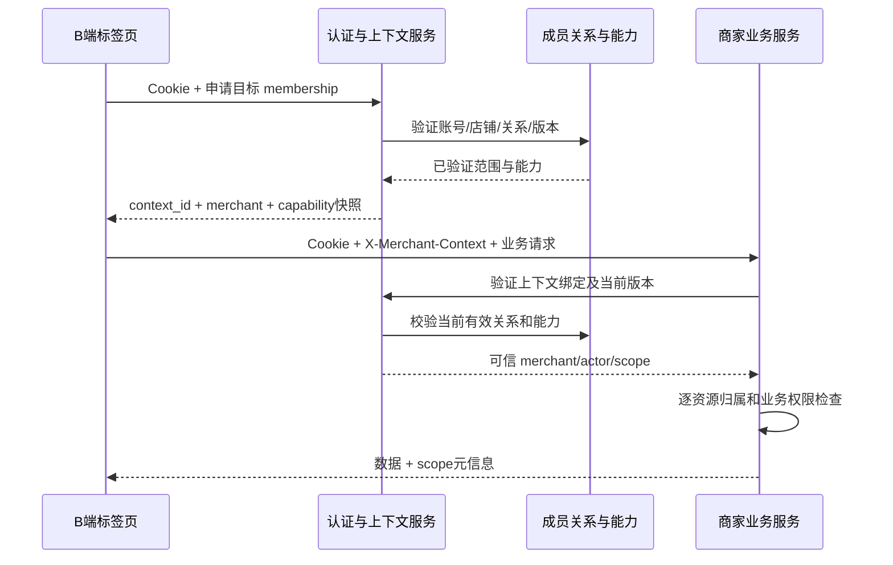

# 千客 B 端 2.0：多店切换与角色能力映射契约

2026-11-14 · v0.2 · 仅设计评审稿

本稿补充一账号多店、明确店铺上下文和业务视角到服务端能力的映射。只新增文档，通过 Pachat 附件交付，不改生产页面、数据库、权限或接口，不创建 PR。所有账号、店铺、会员关系、版本和会话标识示例均为虚构模拟。

v0.2 根据 Pachat #48 的设计评审，补充逐项兼容映射、具体撤权事务协议、HTTP/WS 防护选型及书签验收。评审有条件通过不等于用户批准上线；以下新增协议是本稿推荐方案，产品与实现负责人批准前不得迁移或开启多店写流量。

## 1. 代码基线与现状

对照 `origin/b-end-2.0-p0` 提交 `2440df37730fd06f3e10a5c0e86eac6dbb9ef070`。本稿不是 PR #5 复审，不把其他代理报告的测试结果作为本次验证。

| 证据 | 当前事实 | 设计影响 |
| --- | --- | --- |
| [C 端存储](../../src/rag_demo/c_end/store.py)：c_merchant_member | account_id 为主键，只允许每账号一行；字段含 merchant_id、role、created_at | 必须改变成员关系模型才能多店，不能只加下拉框 |
| 同文件 bind_merchant_member | ON CONFLICT(account_id) 更新 merchant_id/role | 当前“绑定另一个商家”会替换原绑定，不是切换当前工作店铺 |
| 同文件 get_merchant_member / unbind_merchant_member | 分别只按 account_id 查询/删除 | 新模型下必须显式指定商家或 membership_id；不能任取一行或删全部店铺关系 |
| [PG 控制面结构](../../src/rag_demo/control/schema_pg.sql) | c_merchant_member 同样 account_id 主键 | SQLite 与 PG 路径均须迁移/兼容，不能只修改一份建表语句 |
| [B API](../../src/rag_demo/api/b_workbench.py)：_membership、ROLE_PERMISSIONS | 当前账号映射单店；owner/admin/staff 三类静态权限；系统管理员无绑定时可绑定默认演示商家 | 多店解析需要统一服务端入口；自动默认绑定必须与正式多店选择隔离 |
| [租户 API](../../src/rag_demo/api/tenants.py)：_manage_tenant、bind/unbind | 管理路径也依赖单店查询；平台管理员或该店 owner 管理成员 | 迁移必须覆盖成员维护，不能只让工作台能读多店 |
| [Super-agent API](../../src/rag_demo/api/superagent.py)：_tenant_scope、_resolve_merchant | 普通账号单店，平台管理员 scope=None 可跨租户 | B 端嵌入的策略/审计/工作项不能在切店时意外进入平台全局作用域 |
| [登录与会话](../../src/rag_demo/auth.py)：resolve_session、current_account、revoke_session | Cookie 会话映射账号，请求账号由 ContextVar 保存 | 账号认证可复用；新增的是每个请求的商家成员上下文，不是第二套登录 |
| [B 页面](../../web/src/b-workbench.js)：api、loadMe、workspaceRole | 请求通过同源 Cookie；store switch 禁用；业务视角 override 是前端展示选择 | 前端角色视角不授予能力，切店须同时换上下文与数据状态 |
| [C 端 Service Worker](../../web/public/sw.js) | /api/、/auth/、/whoami 等跳过缓存 | 不能据此认为所有 B 端缓存策略已验证；未来 B 端 API/私有数据不得进入公共离线缓存 |

上述为静态代码证据。当前没有本文的多店列表、请求上下文、membership_version、切换流程或动态能力契约。

依据：[产品决策](./b-end-2.0-decisions.md)、[P0 设计](./b-end-2.0-p0-design.md)、[客服/报告设计](./b-end-2.0-customer-service-report.md)、[库存/支付审计设计](./b-end-2.0-inventory-payment-audit.md)。本文沿用其能力边界，不重复设计订单、商品、客服或报告表格。

## 2. 身份模型与方案取舍

### 2.1 分开五个概念

| 概念 | 含义 | 不应混淆为 |
| --- | --- | --- |
| account | 登录的自然人/操作账号及账号状态 | 店铺、工作角色或一个商家的数据范围 |
| merchant | 业务数据所属店铺/租户及店铺状态 | 登录凭据或可随意修改的前端参数 |
| membership | 某账号在某商家的有效成员关系 | 全平台权限；A 店 owner 不推出 B 店 owner |
| role/capability | 该成员关系中的角色模板及可执行动作 | 前端选择的“店主/客服/仓库”视角 |
| work context | 某个页面请求正在使用的已验证成员关系 | 修改账号绑定、切换登录账号或永久选择默认店铺 |

建议保持 account 独立，通过多条 membership 连接多个 merchant。每条关系具有独立角色、能力、状态和版本；一个账号可以在 A 店是店主，在 B 店只做仓库工作。商家暂停、账号停用、成员撤销任一条件都能拒绝访问。

### 2.2 一账号多店与多账号切换

| 方案 | 优点 | 代价 | 本稿建议 |
| --- | --- | --- | --- |
| 一个账号，多店成员关系 | 一次登录、明确个人操作审计、每店独立权限 | 必须解决请求范围、缓存和多标签页问题 | 主方案 |
| 多个账号分别登录 | 既有独立账号可继续使用 | 频繁登录、身份混淆、共享凭据风险 | 保留“退出并换账号”，不作为切店实现 |
| 一个全局 active_merchant 写在账号/session | 实现表面简单 | 标签页 A 切店可能改变标签页 B 的写入目标 | 不采用 |

同浏览器一个登录 Cookie 通常共享给多个标签页。换账号须注销/重新认证，所有旧上下文与私有页面状态失效；需要同时使用不同账号可用独立浏览器配置环境，首版不设计一页持有多套账号凭据。切店始终保持同一个 account，不通过修改 Cookie 或绑定表实现。

## 3. 成员关系、角色与有效能力

### 3.1 拟新增模型

| 对象 | 最小字段/约束 |
| --- | --- |
| merchant_membership | membership_id、account_id、merchant_id、status（ACTIVE/SUSPENDED/REVOKED）、legacy_role、role_profile_ids、membership_version、created_at、updated_at；account_id+merchant_id 唯一 |
| role_profile | profile_id、商家/系统模板作用域、capability 集合、policy_version；业务标签和权限定义分开 |
| membership_grant/deny | 可选的明确授权/拒绝，目标能力、资源范围、授予依据/操作者；先使用受控模板，避免首版任意规则语言 |
| merchant | merchant_id、name、status、业务设置版本；现有租户登记可复用，字段以实际结构迁移 |
| work_context | opaque context_id、server_session_binding、account_id、membership_id、merchant_id、membership_version、policy_version、expires_at、revoked_at |
| member_audit | 关系/角色/能力变更前后、操作者、商家、原因、request_id、版本、时间 |

建议保留被撤销关系的审计，重新启用时递增版本而非让旧上下文重新生效。唯一性是否使用同一行状态恢复或新 membership_id 需要确定，但旧 context 永不复活。禁止因账号在 A 店已有关系而覆盖其 B 店关系。

有效能力由服务端确定：

```text
有效能力 =（当前店角色模板 ∪ 明确授权）∩ 当前店策略允许范围 ∩ 系统支持能力 − 明确拒绝
随后再校验：账号/店铺/成员 ACTIVE + 资源归属 + 行/字段范围 + 业务前置条件
```

不能把多个店铺的能力先合并后套用到当前店，也不能把多个业务视角的默认菜单合并成写权限。是否允许多角色模板由产品确认；冲突时明确拒绝优先。未识别 capability 默认拒绝。即使拥有某能力，尚未实现的服务也应返回不支持，不能显示假成功。

membership_version 在角色、显式授权、拒绝、状态等变化时递增；共享角色策略变化用 policy_version，并同步使相关 context 失效。只比较 membership_version 而忽略模板策略版本会留下旧权限窗口。

若允许多个模板，context 中的 policy_version 必须代表本次有效策略集合（含模板、店铺限制、明确拒绝）的服务端聚合修订号，或改为明确版本向量；不能只取其中一个模板版本。以下 JSON 使用聚合修订号表达。

### 3.2 业务视角与服务端能力映射（建议）

现有 owner/admin/staff 作为 legacy_role 保留迁移语义，不直接改名成店主/客服/仓库。以下为新能力配置建议，不是已生效授权。

| 业务视角 | 建议默认入口 | 所需读能力 | 可能的写能力，必须显式授权 | 默认不获得 |
| --- | --- | --- | --- | --- |
| 店主 | 经营概览；报告未接入时为可用经营待办 | reports.view、orders.view、inventory.view | reports.export、members.manage、各类订单/库存动作分别授权 | 平台全局管理；其他店铺数据；凭店主标签自动发送客服消息 |
| 客服 | service.view_assigned 所允许的会话队列；未接入则已有订单/售后只读 | service.view_assigned、orders.view_scoped、after_sales.view_scoped、profiles.view_scoped | service.send、service.claim；转派、退款另行授权 | 全店报告、库存调整、模拟支付/完成、成员管理 |
| 仓库 | 商品/SKU/待发货 | products.view、inventory.view、orders.fulfillment_view | inventory.adjust_available、orders.ship；stocktake/阈值修改独立授权 | 客户私人会话、全店财务、退款、模拟支付/完成、成员管理 |

表中部分能力来自前两份设计，均待实现。旧的 view_orders、operate_orders、operate_inventory 等应通过兼容映射明确保留，不能直接以一个宽泛旧权限自动授予全部新增动作。例如旧 operate_inventory 涉及图片和告警，不足以证明获准实物盘点；旧 operate_orders 也不等于未来真实收款能力。

默认入口按“本人在当前店获准且实际可用的页面”选择。多视角用户可保存当前店偏好，但只能改变首页布局；界面应明确“工作视角”，避免呈现为权限切换。没有任何业务访问能力时显示“已加入店铺，尚无可用工作权限”，不退回拥有更多数据的首页。

### 3.3 授权维护与撤销

成员变更请求带 expected_membership_version 和 request_id，验证操作者对目标店的 members.manage、可授予能力上限和目标关系。不能授予自己不允许委派的权限，不能把 A 店管理能力用于 B 店。系统管理员的特权使用单独平台管理入口、明确目标商家和审计理由。

撤销最后一名有效 owner、批量降权、移除自己可能导致无人管理，需在事务中验证商家 owner 保留规则并提供交接流程；不能仅靠前端警告。并发两个管理员互相撤销时，服务端锁定/版本策略保证不违反约束。具体 owner 交接审批规则待产品确认。

权限撤销不只关闭菜单：新请求即时拒绝，已有 WS/SSE 订阅失效，后台任务在执行/下载等关键阶段复核，缓存授权失效。不能只靠很长的 context 有效期等待自然过期。

撤权顺序以 §3.5 推荐事务协议的提交为边界：撤销之后作出授权决定的请求必须查到最新版本，不能只依赖可能延迟的通知或本地缓存。业务先提交则保留已完成效果并审计；撤销先提交则旧授权写入失败。这里不承诺当前代码已支持“即时撤权”。已经发送或进入网络发送队列的数据不能远程收回；前端仍须丢弃旧范围响应并清理显示。

### 3.4 旧角色 × 权限兼容映射（逐项提案）

来源为基线 `ROLE_PERMISSIONS` 及对应路由实际检查。表中“有/无”是现状；新 capability 是拟定映射。迁移生成 `legacy_compat` 能力集并输出逐账号差异清单，不把旧角色直接改成业务视角。兼容能力只适用于列明的旧操作，不能因未来新增同类接口而扩大。

| 旧 permission | owner | admin | staff | 拟映射 capability / 决策 |
| --- | --- | --- | --- | --- |
| view_orders | 有 | 有 | 有 | 保留 orders.view，仅本店原有订单读取；不据此授予财务报告 |
| view_products | 有 | 有 | 有 | 保留 products.view，仅本店商品读取 |
| view_after_sales | 有 | 有 | 有 | 保留 after_sales.view，仅本店售后读取 |
| view_superagent | 有 | 有 | 有 | 保留 superagent.view 与 superagent.audit.export_legacy，仅本店现有工作项/线程/策略/审计及原审计CSV路径；不含平台队列、经营报告和跨店读取 |
| operate_orders | 有 | 有 | 无 | 保留 legacy.orders.status_update，仅现有 PATCH 的 PAID/SHIPPED/COMPLETED/CANCELLED 及原状态机；不自动授予新真实收款、退款或批量接口 |
| resolve_after_sale | 有 | 有 | 无 | 保留 after_sales.resolve_legacy，仅现有批准/驳回及其已有业务效果；不能包装成新支付通道退款权限 |
| receive_return | 有 | 有 | 无 | 保留 after_sales.receive_legacy，仅现有收货验收及其已有库存/退款效果；不扩大到任意库存调整 |
| approve_superagent | 有 | 有 | 无 | 保留 superagent.approve，仍受动作策略、对象归属和人工确认约束 |
| manage_members | 有 | 无 | 无 | 保留 members.manage 的本店维护入口；新增委派上限/最后owner规则是显式收窄，批准并通知后生效 |
| operate_inventory | 有 | 有 | 无 | 保留 products.media.manage、inventory.alerts.scan、inventory.alerts.ack、inventory.alerts.dispatch，限定原图片和告警动作；不授予库存改量/盘点/阈值修改 |

另有部分现状不经过上述命名权限，不能漏算，也不能据此给所有新角色放权：

| 现有隐式/角色检查路径 | 迁移处理 |
| --- | --- |
| 已绑定账号可读商品库存快照、库存告警、图片审计、chat-profiles，以及 /me 计数 | 对既有有效 owner/admin/staff 明确保留 inventory.view、inventory.alerts.view、products.media.audit_view、profiles.view_legacy、workspace.counts_legacy；未知角色/无效成员拒绝。新仓库/客服模板不能继承该整包，尤其不能默认读取画像和全店计数 |
| Super-agent 以 owner/admin 判定启动、停止、策略修改 | 将既有同店动作逐项映射 superagent.run、superagent.stop、superagent.policy.manage；staff 不得获得；现有动作策略继续约束，不能把 approve 当作一切操作的权限 |
| 系统管理员在旧 Super-agent 路径 scope=None | B 工作区明确收窄为当前店 context；平台全局能力另入口。此迁移差异须单独批准，不将平台管理员隐式复制成每店owner |
| 没有对应旧动作的新能力 | 默认拒绝 reports.view/export、service.send/claim、inventory.adjust_available、inventory.stocktake、真实支付等；需要明确新授权，不按角色名称推导 |

`legacy.orders.status_update` 保留现有副作用，不宣称“模拟不会写数据”；迁移不把历史支付来源改标为真实。新颗粒度订单能力落地时另给替换表、通知与回归，不能直接删除兼容别名。旧售后处理可能触发既有退款/库存动作，必须保留原有校验和动作范围，不把“拒绝新退款接口”解释成取消旧售后能力。上表的明确收窄项未经批准时保持迁移未开放，不能以“兼容”名义静默改变生产权限。

### 3.5 撤权与业务提交的推荐协议（待批准、未实现）

现状：[商家 PG 仓储](../../src/rag_demo/merchant/postgres_repository.py) 自己取得连接并提交事务；[SQLite 仓储](../../src/rag_demo/merchant/sqlite_repository.py) 每次写入使用自己的 BEGIN IMMEDIATE；账号库由 auth.py 独立连接配置。控制面 [pg_compat](../../src/rag_demo/control/pg_compat.py) 把 BEGIN IMMEDIATE 翻译为普通 BEGIN，不会自动得到 SQLite 的单写者语义。因此，“中间件先查权限，再调用现有独立事务方法”不满足原子撤权边界。

本稿选择首版保守协议：**同一权威业务数据库、同一连接事务持锁到提交；同店写操作串行化**。需要先提供可传入事务的 repository/UoW，不能在持锁期间调用自行提交的旧方法。跨数据库或无法接入的写路径保持关闭；不采用内存 mutex、最终一致缓存或跨连接的提前检查来声称原子保证。

建议新增持久 guard 行：global_policy_guard、account_guard、session_guard、merchant_guard。行在账号/会话/店铺开通时受控创建，缺行即拒绝，不使用“锁空查询结果”。锁顺序固定如下；同层多个 ID 按确定顺序排序，模式在开始前选定，禁止中途共享锁升级。

```text
global_policy_guard → account_guard(account_id升序)
→ session_guard(session_binding升序) → merchant_guard(merchant_id升序)
→ membership及request_id记录 → 订单/预占等业务头记录
→ 库存行(merchant_id,sku,warehouse_id升序) → 同事务审计/结果/outbox → COMMIT
```

PG 使用 READ COMMITTED，S 表示行 FOR SHARE，X 表示行 FOR UPDATE；guard 取得之后重新读取授权和业务版本，不能使用锁前读取的快照。行锁与事务释放机制参考 [PostgreSQL 显式锁文档](https://www.postgresql.org/docs/current/explicit-locking.html)，以下 guard 组合是本项目设计推导，并非现有实现。

| 操作 | global / account / session / merchant 锁模式 | 锁后动作 |
| --- | --- | --- |
| B业务写、单行批次、后台敏感动作 | S / S / S / X | 复核有效状态、context/策略版本、能力和资源；检查幂等；业务+审计+结果同事务提交 |
| 本店成员/角色/店策略变更、owner交接、店铺停用 | S / S（操作者及目标账号排序） / S（操作者） / X | 复核管理权限和expected版本，检查owner约束，递增版本，写审计与失效outbox |
| 账号停用或恢复 | S / X（相关账号排序） / 不需要 / 不需要 | 修改本地B授权屏障及epoch；原context不复活，恢复需新会话/范围 |
| 当前会话注销/撤销 | S / S / X / 不需要 | 标记session屏障失效并写事件；同一binding不可重新启用 |
| 共享角色模板变更 | X / S（操作者） / S（操作者） / 按需要X | 复核平台权限，递增聚合策略版本，失效相关context；不先锁商家再回头取global |
| context签发、受保护响应/WS事件准入 | S / S / S / S | 读取当前授权；签发范围或将已裁剪事件放入有界发送队列，随后释放；不持锁等待网络 |

具体顺序伪代码：

```text
业务事务 W:
  BEGIN; 按表取得全部guard
  重新解析当前account/session/member/merchant/policy；任一失效则ROLLBACK
  校验context版本、能力、目标merchant和幂等载荷；锁业务资源
  执行业务状态机；写business_audit、request_result、必要outbox
  COMMIT（此时才释放merchant X和其他guard）

成员撤销事务 R:
  BEGIN; 按表取得全部guard（与W竞争同一个merchant X）
  复核操作者、expected_membership_version、owner保留约束
  将成员改为REVOKED并递增版本；写member_audit和失效outbox
  COMMIT；通知连接关闭只是加速，不是新请求验权的唯一依据

R先提交 → W取得guard后读取新版本，拒绝旧授权
W先提交 → R等待W释放guard，随后撤销；已提交业务保留
```

批次仍按前一份库存设计逐行原子，每行重新拿锁并验权，不让整个大批次长期占锁。锁超时/死锁时完整回滚；有限重试重新取得全部锁、重新验权，不能重放外部副作用或切到别店。首版同店写串行会限制吞吐，需要压测后决定是否批准；不得未经并发证明自行优化为不同锁路径。

所有触及相同库存/订单的 C 端、管理员、定时任务、reserve/release/commit/cancel/return 路径也必须先取相同 merchant_guard，再进入业务行锁。保留现有 `_allocate_stock` 的 SKU→warehouse 排序。reserve/commit 的 reservation 头记录、订单状态变更的 order 头记录仍在库存行之前；多个头记录先固定类型/ID顺序。不能拿到库存锁后再请求商家guard；跨商家批次不在首版范围。`reserve_inventory` 目前调用 `_resolve_write_lines` 在 reservation 锁之前，实施前须检查其隐式写锁及唯一/FK锁，统一纳入上述顺序，而非只调整表面 SELECT FOR UPDATE。

账号认证库独立时，不声称一个事务覆盖两库。推荐在业务权威库使用单调的 account/session 授权屏障：停用/注销先提交B拒绝屏障，再更新认证库；后者失败则B继续拒绝并进入可重试恢复，不自动解封。只有重新核验认证状态并明确恢复的流程才能创建新epoch/context。所有改密、停用、注销和运维入口须接入；漏接或仅异步同步时，不得开放本文宣称的撤销语义。该跨库协调是新增实施前置条件，不是当前能力。

SQLite 仅在 guard、membership、业务与审计真正处于同一数据库文件及同一连接时，可用 BEGIN IMMEDIATE 覆盖整个事务；现有分库/独立连接不能因此视为原子。无法满足条件的 SQLite 环境继续旧单店或只读，不提供多店写入。外部消息/图片存储等副作用采用受控 outbox/独立任务契约；数据库锁不能回滚已发出的网络请求，长任务撤权策略仍须产品确认。

## 4. 每个标签页独立的店铺上下文

### 4.1 请求授权流程



context_id 建议为服务端生成的不可猜测标识，绑定当前认证会话和成员关系；它不是可脱离 Cookie 使用的独立登录凭据。浏览器只在内存持有，不放入地址栏、日志或共享 localStorage。复制到另一账号/会话不能使用；修改 merchant_id 也不能改变它的范围。

服务端从 context 解析可信 merchant_id，并检查当前登录账号、会话、账号状态、店铺状态、成员状态、membership_version、policy_version 和所需能力。客户端传入 merchant_id/path 店号只能作为目标选择或一致性校验，不能作为授权依据；与 context 不一致返回 SCOPE_MISMATCH，不自动切店。

即使攻击者猜中 context，仍需同一有效认证会话且当下权限满足。创建/撤销 context 和所有业务写操作统一采用 §4.3 的同源、CSRF/Origin 保护；不能因增加范围 header 便认为认证风险已解决，也不宣称当前项目已有该统一中间件。

### 4.2 标签页与后台任务

标签页一使用 A 店 context，标签页二使用 B 店 context；二者不互相覆盖。最近访问店铺可以作为不含敏感数据的偏好提示，下一次打开仍重新校验，不能在用户未选择时改变已有标签页。

已受理的库存批次、导出和工作项保存创建时的 merchant_id、actor、所需能力、request_id、对象范围和版本。执行时不得读取“当前活跃店铺”重新决定目标；切店不迁移任务，也不取消已提交的业务效果。任务结果通知明确店名，打开前重新申请其店铺上下文并验权。

后台任务遇到成员撤销后是否继续由商家系统身份执行，必须按任务契约明确。默认对尚未开始的敏感动作停止并标受限，不擅自升级为系统权限；已原子提交部分保留并审计，不伪称整批撤回。

### 4.3 HTTP 与 WebSocket 的明确推荐选型

本稿选择 **HTTP 使用 Cookie + X-CSRF-Token + X-Merchant-Context；WebSocket 使用同源 Cookie 握手 + 首帧 context/CSRF 认证**。首版不同时实现 ticket 路径，不允许连接内换店。以下均为待批准实施方案，未声称已有防护；参考 [OWASP CSRF 防护](https://cheatsheetseries.owasp.org/cheatsheets/Cross-Site_Request_Forgery_Prevention_Cheat_Sheet.html)与 [WebSocket 安全指南](https://cheatsheetseries.owasp.org/cheatsheets/WebSocket_Security_Cheat_Sheet.html)，具体协议为本项目设计选择。

| 防护面 | HTTP / context 管理 | WebSocket |
| --- | --- | --- |
| 传输与来源 | 生产HTTPS；写请求必须精确匹配服务端配置的 Origin（scheme/host/port），不按子串/后缀匹配；缺失或null拒绝。反向代理来源只信受控配置 | 生产WSS；升级前验证同一Origin白名单和有效Cookie；不能用“浏览器会自动带Cookie”代替来源验证 |
| CSRF | 服务端会话绑定的随机 synchronizer token，经同源认证 bootstrap JSON 返回；内存保存，所有POST/PUT/PATCH/DELETE均验证 X-CSRF-Token | 首帧仅允许 auth，携带相同会话的csrf_token及context_id；全部验证成功前不订阅、不发送业务数据 |
| context签发前 | 申请本来尚无目标context，因此用Cookie+Origin+CSRF验证，再验证目标membership；不能要求已有context造成首次进入死循环 | 已通过HTTP取得context后才能认证；没有context则关闭，不自动选择第一店 |
| 范围 | 业务请求用 X-Merchant-Context；成员管理、上传、导出创建、旧接口也进入同一验证链 | 首帧绑定单一account/session/merchant/versions，后续消息不能替换；换店关闭并新建连接 |
| 异常 | CSRF/Origin失败403，认证失效401；禁止GET产生业务写；JSON业务写只收约定内容类型，上传multipart仍须相同token/header | 未认证连接仅接受一个有界认证帧；推荐5秒超时/8KiB上限，失败关闭；具体容量参数纳入上线配置确认 |
| 后续访问 | context版本与当前能力每次复核；旧无context兼容仅影响范围解析，不豁免CSRF | 每个订阅/动作验权，消息及资源范围必须匹配连接；新敏感事件进入发送队列前按§3.5复核；会话/成员撤销关闭连接 |
| 凭据保护 | Cookie使用Secure/HttpOnly及适当SameSite；CSRF/context不入URL、日志或持久缓存；禁止向任意Origin开放带凭据CORS | 认证首帧必须在日志/错误采样中脱敏；不把Cookie/token放URL或子协议字段 |

拟增加 `GET /api/b/session-bootstrap` 返回当前会话的CSRF token与最小账号信息，响应no-store、无跨域读授权，不接受任意账号ID，不签发业务能力。换账号/重新认证轮换token；仅切店不轮换会话token，避免破坏其他标签页。token不等于context，两者都不是可单独登录的凭据。CORS、SameSite和范围header不能替代各自的校验。

WS建议只承担消息订阅/通知，业务写继续走受保护HTTP；如未来确需WS发送客服消息，必须单独定义同等能力、幂等、审计和消息级校验，不能因为连接已认证而自动开放。关闭通知丢失时，后续事件准入仍从权威状态验权；不能只靠订阅缓存继续送数据。已排队/在途字节无法保证收回，客户端按generation丢弃；不把这个物理边界表述成“撤销后绝无任何旧字节到达”。

非浏览器集成另设受控服务身份入口，不以兼容为由关闭本组Cookie接口的Origin/CSRF验证。缺少安全bootstrap或任何旧写路径无法接入时，暂停多店写入发布；这与业务参数是否已经确认是两个独立门槛。

## 5. 切店后的作用域清单

| 对象 | 必须携带/验证的范围 | 切店动作 |
| --- | --- | --- |
| API 请求 | account/session、context、merchant、能力、资源归属 | 所有新请求使用新 context；不能漏掉订单、图片、售后、画像、告警等旧接口 |
| Super-agent/策略/审计 | 同一商家 context，不能在 B 端传 scope=None | 新增 B 端适配或统一 resolver；平台全局接口保持独立入口 |
| 页面状态 | context_id + merchant_id + 本地 generation | 订单抽屉、选择项、筛选、汇总、确认框和错误消息整体隔离/重置 |
| 异步响应 | 请求发出时的 generation/context + 响应 scope | 旧店迟到响应丢弃，不覆盖新店界面；AbortController 只是优化，不代替版本判断 |
| 查询缓存 | account/session scope、merchant、membership/policy版本、query | 切店后不复用旧店键；权限变化立即失效；缓存命中仍不能绕过服务端写权限 |
| 浏览器持久化 | 仅非敏感偏好可存；每账号/店铺分键 | 不把客户明细、消息、权限快照、context 存入共享长期缓存 |
| WS/SSE/轮询 | 单会话绑定的授权上下文和店铺订阅 | 退订并关闭旧页连接，停止旧轮询；新连接鉴权完成后才接收新店数据 |
| 深链接 | merchant 路由提示 + resource_id + 重新授权 | 没权限显示无权访问，不改成查当前店同名订单 |
| 导出/上传 | 创建任务范围、上传归属、下载时权限 | 不把 A 店正在上传的图片挂到 B 店；旧任务显示原店名 |
| 角色首页/业务设置 | 当前店能力、可用服务、时区、币种、模拟模式 | 换店重新取得，不能沿用 A 店目标/指标口径到 B 店 |

建议页面链接形如 `/v2/b.html?merchant=DEMO-M-A&view=orders&order=DEMO-O-1`，参数只表达目标。解析后先列出/验证本人有效成员关系，再取得 context，然后请求该店订单。不得把地址参数作为 SQL 租户条件的唯一依据。找不到对象与跨店对象不泄漏对方信息。

HTTP 私有响应建议 `Cache-Control: private, no-store`，不得进入 CDN 公共缓存或 Service Worker 静态缓存；若后续确需服务端查询缓存，键必须包含完整授权范围。私有响应不只是按 merchant 分键：同店客服和店主字段权限也可能不同。

浏览器 WebSocket 不照搬 fetch 的任意自定义 header；采用 §4.3 选定的 Cookie + 首帧 context/CSRF 方案。认证完成前不发业务数据，Origin、后续验权和撤销均需实现；当前没有本稿的 B 坐席 WS。

## 6. 切店 UI 与状态机

### 6.1 选择器

顶部显示当前店名、店号辅助信息、当前工作视角；下拉只列本人可见的成员关系，支持店名搜索。列表包含店名、本人在该店的角色摘要、店铺/关系状态，不默认展示各店收入、顾客数量等未授权业务数据。

只有一家有效店铺时显示“单店模式”，不展示会跳转到不存在目标的按钮。零家显示“尚未获得店铺访问权限”，不自动把账号绑定到演示店。模拟样例与生产店明确标识，模式由服务端确认。

从书签或分享链接进入时先显示“正在验证此店铺的访问权限”；重新检查membership后再加载对象。失去权限显示“你当前无权访问此店铺，请选择其他可访问店铺”，不以旧缓存或最近访问偏好绕过校验。

### 6.2 正常切换

1. 用户选择目标店铺。若有未保存草稿或选择，提示其所属原店，默认可取消切换；可以明确丢弃，或在获准且实现支持时只保留原店内存草稿，不能复制到目标店。
2. 若存在尚未确认结果的单次写请求，先查回结果再切换；不得把 AbortController 中止网络当作撤销服务端写入。已受理的长任务可以在明确提示“仍在原店执行”后离开。
3. 申请目标 context。这个阶段页面仍标原店，目标店显示“正在验证权限”，新写操作暂时禁用，不能先改店名再显示原数据。
4. 申请成功后增加 generation，停止旧读取、连接与轮询；整体替换当前店、context、能力、设置和路由，清空旧敏感页面内容，进入目标店加载态。
5. 启动新范围读取与订阅。只接受新 generation/context 对应响应；加载完成显示目标店内容，焦点落在新页面标题并宣读店名变化。

服务端创建 context 只授权一个工作范围，不改变 membership 绑定，也不修改其他标签页的工作店铺。旧 context 是否回收只影响本页创建的实例，不能因此注销同账号其他标签页。

### 6.3 失败、冲突、撤权

| 状态 | 表现与恢复 |
| --- | --- |
| 店铺列表加载失败 | 保留已验证且仍有效的当前范围，显示重试；无有效范围时不显示旧缓存业务数据 |
| 目标店无权限/暂停 | 不切换，显示原因；原店仍有效则停留原店，不能自动选第三家店 |
| 申请过程中连续选 B/C | 后选优先；丢弃先前申请返回，回收未使用 context；不短暂闪现中间店数据 |
| membership/policy版本变化 | 显示权限已更新，禁用写并清除旧确认；重新获取能力后由用户重新确认动作，不能自动重放旧写请求 |
| 当前店权限撤销 | 清空敏感内容、关闭连接、停止新写，展示无权限与本人其他可访问店铺；不得继续显示旧金额/消息 |
| 账号退出/被停用/换账号 | 所有标签页旧身份 context 无效；清缓存、关闭订阅、取消未发送草稿；显示重新登录 |
| 目标店 context 已取得但页面加载失败 | 标题和状态均明确目标店，显示其加载失败；不把原店数据填在目标店名下 |
| 切换/请求超时 | 查 context 申请或重新取得新范围；未经确认的新范围不提交业务写；不能把双请求当两次业务动作 |

手机选择器用可关闭的全屏列表或底部面板，保留当前店标记和搜索。Escape/返回关闭并回焦点；列表项朗读店名、角色和不可选原因。复用现有 18px 正文/最低16px辅助文字；切换状态不能仅靠颜色表达。

## 7. 拟新增 API 与示例

所有接口/字段名称均为设计提案，尚未实现。

新增契约的 account_id、merchant_id、membership_id、context_id 对外统一为不透明字符串；版本为正整数。账号库原有整数主键在服务端适配，不在本轮改其存储类型或既有认证API。客户端不将标识转浮点数、截断或比较大小；以下字符串“1001”仍是虚构账号。

| 接口 | 作用 | 关键校验 |
| --- | --- | --- |
| GET /api/b/memberships | 当前账号可访问的店铺关系列表 | 不接受任意 account_id 查他人；最小元数据；分页/搜索上限明确 |
| POST /api/b/work-contexts | 申请某成员关系的工作上下文 | Cookie账号、成员/店铺 ACTIVE、预期版本、策略版本；不改绑定 |
| GET /api/b/work-contexts/{id} | 当前 context 与能力刷新/查状态 | 会话绑定、当前权限；不能枚举他人的 context |
| DELETE /api/b/work-contexts/{id} | 回收本页 context | 不注销账号或删除 membership；幂等 |
| GET /api/b/workbench/me（扩展） | 当前店铺、能力、设置、视角选项 | 统一 context resolver；旧单店兼容见 §9 |
| PATCH /api/b/memberships/{id} | 维护该店成员角色/状态 | members.manage、可委派范围、expected_version、request_id、owner保护 |
| GET /api/b/membership-audit | 当前店成员变更审计 | 独立审计能力、字段脱敏、分页 |

示例一：同一虚构账号在两家模拟店拥有不同成员关系。角色标签不能覆盖 capability。

```json
{
  "account_id":"1001",
  "memberships":[
    {"membership_id":"DEMO-MEMBER-A","merchant_id":"DEMO-M-A","merchant_name":"模拟店A","status":"ACTIVE","legacy_role":"owner","membership_version":7,"policy_version":3,"view_options":["owner"]},
    {"membership_id":"DEMO-MEMBER-B","merchant_id":"DEMO-M-B","merchant_name":"模拟店B","status":"ACTIVE","legacy_role":"staff","membership_version":2,"policy_version":5,"view_options":["warehouse"]}
  ],
  "next_cursor":null
}
```

示例二：切换到 B 店的申请。request_id 只用于这次范围申请幂等，不能拿来重放库存或订单动作。

```json
{
  "membership_id":"DEMO-MEMBER-B",
  "expected_membership_version":2,
  "expected_policy_version":5,
  "request_id":"DEMO-CONTEXT-REQUEST-1"
}
```

示例三：服务端响应。以下是明确分配过的建议能力，不表示当前 staff 已有这些细粒度权限。

```json
{
  "context_id":"DEMO-OPAQUE-CONTEXT-B",
  "account_id":"1001",
  "merchant_id":"DEMO-M-B",
  "membership_id":"DEMO-MEMBER-B",
  "membership_version":2,
  "policy_version":5,
  "capabilities":["products.view","inventory.view","orders.fulfillment_view"],
  "view_options":["warehouse"],
  "default_view":"warehouse",
  "simulation_mode":"SIMULATED",
  "expires_at":"2026-11-14T02:00:00Z"
}
```

实际标识必须随机生成，以上 DEMO 字符串不能作为生产凭据；有效期只是格式示例，不代表确定的小时数。客户端后续发送 `X-Merchant-Context`，业务响应同时返回 `scope:{merchant_id,membership_version,policy_version}`，便于发现前后端范围错误；该回显不取代服务端授权。

带 `{id}` 的 context 管理路由仍须脱敏：反向代理、访问日志、错误跟踪和指标只记录路由模板及不可逆关联摘要，不记录原始路径中的 context_id；请求 header/body 也不得完整采集。可在实现阶段改用固定路径加请求头承载 context，保持同一审计边界。

| 错误码 | HTTP/处理 |
| --- | --- |
| UNAUTHENTICATED | 401；重新登录，不自动把旧上下文移给新账号 |
| MEMBERSHIP_NOT_ACCESSIBLE / MERCHANT_UNAVAILABLE | 403/404按统一披露策略；不返回其他商家详情 |
| CONTEXT_REQUIRED / MULTISTORE_CONTEXT_REQUIRED | 409；选择有效店铺，不默认取第一条 |
| CONTEXT_EXPIRED / MEMBERSHIP_VERSION_CONFLICT / POLICY_VERSION_CONFLICT | 409；重新取得上下文；写操作需重新确认 |
| SCOPE_MISMATCH / CONTEXT_ACCOUNT_MISMATCH | 403；拒绝伪造或错配范围，不自动修正 |
| CAPABILITY_DENIED | 403；禁止动作，不能靠切换视角恢复 |
| LAST_OWNER_PROTECTED / MEMBERSHIP_CONFLICT | 409；交接/刷新后重新操作，不跳过保护 |
| INVALID_REQUEST / RATE_LIMITED | 422/429；结构化字段错误/重试信息 |

错误统一为 `{error:{code,message,request_id,details}}`，不得依靠中文字符串匹配。scope错配、过期重试等不能导致原业务请求在新店执行。重放 context 申请前仍验权；已撤销版本不因命中幂等结果重新有效。

## 8. 审计与范围一致性

context 审计记录申请/拒绝/回收/失效：account、会话安全摘要、目标商家、membership、版本、结果、原因码、request_id、服务器时间。服务端可以证明“已签发某店范围”，不能仅凭签发事件宣称浏览器已经完成显示；可选前端 activated 事件须标客户端报告。

成员变更审计与变更同事务：旧/新角色、能力差异、状态、版本、操作者、原因、目标商家。店铺切换不会产生新的成员授权，不能把 context 创建事件记录成 membership grant。

订单、库存、退款、报告导出和客服发送的业务审计必须保留执行时的 merchant、account、membership_id/version、policy_version 与 request_id；不依赖后续查当前成员角色解释过去行为。审计中不记录登录 Cookie、context 原值或完整顾客内容。

平台管理员在 B 工作区同样使用明确店铺范围。平台跨租户运维需要独立的 platform capability、显著全局模式和审计理由；不能因为旧 Super-agent API 对系统管理员返回 None，就在普通 B 页显示全部商家工作项。该差异必须写进 resolver/适配器与测试。

## 9. 数据迁移、旧单店兼容与回滚

### 9.1 迁移步骤（设计，不执行）

1. 盘点单店依赖：B `_membership`、租户管理、Super-agent scope、策略/审计、开通流程、维护脚本、后台任务、测试 fixture、PG/SQLite 结构。对仍依赖 `get_merchant_member(account_id)` 的入口逐一登记。
2. 建立新 membership 表、context 与审计结构，加入 `(account_id,merchant_id)` 唯一约束、状态与版本。旧表快照备份并验证恢复，暂不开放第二家店。
3. 每条旧关系精确迁移到一个 membership，保留 account、merchant、role 和创建时间，初始化版本与 `legacy_compat` 标记；未知/重复/失效租户进入迁移异常清单，不自动授予默认 owner。
4. 上线统一 resolver，保留旧角色已有权限，不因布局变化静默降权或扩大授权。新客服/报告/库存能力单独配置；owner/admin/staff 到新 capability 的兼容映射逐条审核。
5. 同时修正 bind/unbind/provision/member管理：新增关系不覆盖另一店，删除必须指定 membership 或 account+merchant，角色变更带版本。原 account级解绑函数在多店账号上必须拒绝歧义，不能继续一条 DELETE 删除所有关系。
6. 双读比对单店账号范围、权限和数据；业务读写及后台路径全部能接受验证后的 context，旧入口不会绕过后，才开放多店成员添加与选择器。

旧“系统管理员首次访问自动绑定默认商家”只能在明确演示环境且有明确操作意图时保留；正式多店工作台零成员不应自动产生关系。平台管理能力与商家工作范围分开。

### 9.2 旧客户端兼容

- 仅对迁移时明确标记 legacy_compat、从未启用多店且唯一有效关系仍为原 legacy_merchant_id 的账号：旧无 context 请求可解析该固定关系，并进行相同能力与资源校验；记录兼容调用，返回当前范围。不要仅按“总行数=1”忽略成员/店铺停用。
- 多个有效关系：旧无 context 请求返回 MULTISTORE_CONTEXT_REQUIRED，不选择第一条、最近一条或账号默认店。尤其是写请求，必须在业务执行前拒绝。
- 零有效关系：明确无访问权限，不自动创建演示关系。
- 一旦账号启用过多店，永久退出该自动兼容路径；即使后来只剩一个有效关系，也要求明确 context。否则 A 店撤权后仅剩 B 店时，旧 A 页面无范围写请求可能被错误落到 B 店。原绑定店停用/撤销、被替换或请求 merchant 与兼容范围不一致时拒绝，不能自动选另一家店。
- 不认识新 resolver 的旧服务实例不得与多店写流量混跑；单纯双写旧表不能表达多关系，不应把旧表当第二权威来源。

### 9.3 发布回滚

以功能开关逐步开放列表→明确上下文只读→上下文写入→新增第二店。每阶段保留单店回归和租户隔离验证。回滚先关闭新增成员/新 context，停止新敏感动作，处理已经受理任务；保留 membership、审计和任务的商家归属。

已有多店数据时，不能直接部署只识别 account单行的旧版本或把多条关系压成第一条。建议提供兼容维护模式：原来已验证的单店账号可按批准策略使用；多店账号要求显式上下文或暂停业务入口，等待兼容恢复。是否指定默认店必须经明确迁移决策，不能自动删除其他关系。

撤销错误授权采用新的带版本成员变更，并让相关 context 失效；不删除历史审计。已经发生的订单/库存业务不能通过“切回原店”撤销，按对应业务纠正流程处理。数据备份恢复是受控灾难恢复，不是普通切店回退。

## 10. 测试、验收与开放决策

以下为实现后的验收要求，本轮未执行这些生产系统测试。

| 编号 | 情境 | 预期 |
| --- | --- | --- |
| ID01 | 同账号A店owner、B店warehouse | 能力严格按店，A财务能力不进入B；切店不覆盖成员关系 |
| ID02 | 伪造merchant/path/body/context或换账号复用context | 服务端拒绝，无对象/金额泄漏；视角选择不改变授权 |
| ID03 | 同标签页A→B→C快速切换，A慢响应最后返回 | 只显示最终C范围，旧响应不得覆盖标题/数据 |
| ID04 | 标签页1切B，标签页2仍A提交 | 标签页2继续明确A范围；不会因全局session选择写B |
| ID05 | 当前请求已提交但响应超时后切店 | 查回原店请求，不能在新店自动重试或生成第二动作 |
| ID06 | 切店时有未保存草稿/选中订单/上传 | 明确处理原店状态；不得把内容、图片或选择附给新店 |
| ID07 | 角色/模板变更、成员撤销、店铺暂停、账号退出 | 新请求、订阅、下载、后台动作均受限，旧数据清理，不能靠context TTL继续访问 |
| ID08 | 两管理员并发移除owner/角色升权 | 版本/委派边界/最后owner保护成立，审计与变更原子 |
| ID09 | A店订单链接在B店打开、书签重开或书签所属店已撤权 | 显示验证状态并重新验证A；无权则拒绝，不用缓存绕过、不在B查同名ID |
| ID10 | B页以平台管理员查看Super-agent | 仍限当前店；全局运维入口独立且显式 |
| ID11 | WS旧连接晚到事件、Cookie换号、权限撤销 | 首帧/Origin/会话/范围复核，关闭旧订阅，事件不串店 |
| ID12 | 同店不同能力、跨账号/店缓存命中 | 缓存键与字段范围隔离，私有数据不进入公共SW/CDN |
| ID13 | 旧无context客户端有0/1/2有效关系，或曾多店后仅剩B店 | 无权限则拒绝；仅原固定单店且legacy_compat可兼容；其他要求明确范围，撤销A不让旧A写落B |
| ID14 | bind/unbind/provision与迁移回滚 | 不覆盖其他店，不按account误删全部；多店不压缩成单店 |
| ID15 | 单店、列表空/错、暂停店、390px手机、键盘 | 状态与范围一致，焦点恢复，不先改店名后残留旧数据 |
| ID16 | 申请context成功但页面加载失败 | 明确目标店失败，签发审计不冒充已显示/已完成业务 |
| ID17 | 敏感写授权通过后、提交前并发撤权或修改共享角色策略 | 按统一串行化边界决定先后；撤权先提交则业务写失败，业务先提交则保留审计；多模板策略版本无遗漏 |
| ID18 | owner/admin/staff × 十个旧permission及隐式读路径 | 按§3.4逐项对照；保留旧业务效果，新增能力默认拒绝，明确收窄项须批准，无静默扩/降权 |
| ID19 | reserve/commit/cancel/return与成员撤销、库存调整并发 | 全部先guard后业务锁，同一连接提交；反向资源顺序、超时、死锁重试均不越权或重复副作用 |
| ID20 | 认证库更新失败、注销屏障写失败、跨库/独立连接旧仓储 | 拒绝虚假成功与原子性声明；已写拒绝屏障不自动撤回，不符合UoW前提的多店写路径关闭 |
| ID21 | 缺失/伪造Origin、CSRF、旧会话token，context首次申请与上传 | 全部受统一防护；首次申请不要求已有context但要求有效Cookie/CSRF；上传无豁免 |
| ID22 | WS无首帧、超时/超大首帧、错店/错会话token、尝试连接内换店 | 认证前零业务消息，异常关闭；业务写不因连接成功自动开放，日志无原始认证数据 |
| ID23 | 新契约大整数账号标识、刷新书签、HTTP/WS失效事件丢失 | ID按字符串往返不丢精度；权威状态仍控制请求/消息准入，不靠客户端缓存或通知单独授权 |

建议扩展 [租户管理测试](../../tests/test_tenants_admin.py)、[B API 测试](../../tests/test_b_workbench_api.py)、[PG 租户隔离测试](../../tests/test_tenant_isolation_pg.py)、[控制面契约测试](../../tests/test_control_repository_contract.py)，并增加请求并发、多标签页及订阅撤销的集成验收。UI 隐藏不能代替直接 API 的负向权限测试。

如果 Agent Runtime/Tool 后续接入多店上下文，应在任务创建与工具调用保留可信 merchant 和权限，不允许模型通过自然语言改店；新增 Eval 覆盖跨店诱导、旧上下文重放、平台全局范围误用、权限变化和同名资源。涉及核心/Tool 变更按 AGENTS.md 跑 pytest 与 Regression Eval；本文不修改这些实现。

待产品确认：多角色是否允许、业务能力模板与可委派上限、owner交接规则、context生命周期、旧客户端兼容截止时间、长任务撤权策略、历史多店回滚维护策略。待实现负责人批准并验证：§3.4迁移差异、§3.5同库UoW/锁协议与认证屏障、§4.3传输/CSRF及容量参数。技术方案已给出推荐选择，不再由实现者自由猜测；任何否决需先修订设计并复审。以上均未标为用户已确认，未满足时不开放多店写流量。

本轮验证范围为代码/文档静态核对、相对引用、JSON示例一致性、范围与能力算例、文档结构和仅新增文件的变更检查。未实施数据库迁移，未运行生产pytest/Eval、真实账号切店或浏览器测试；没有生产 PR、部署或接口上线声明。
