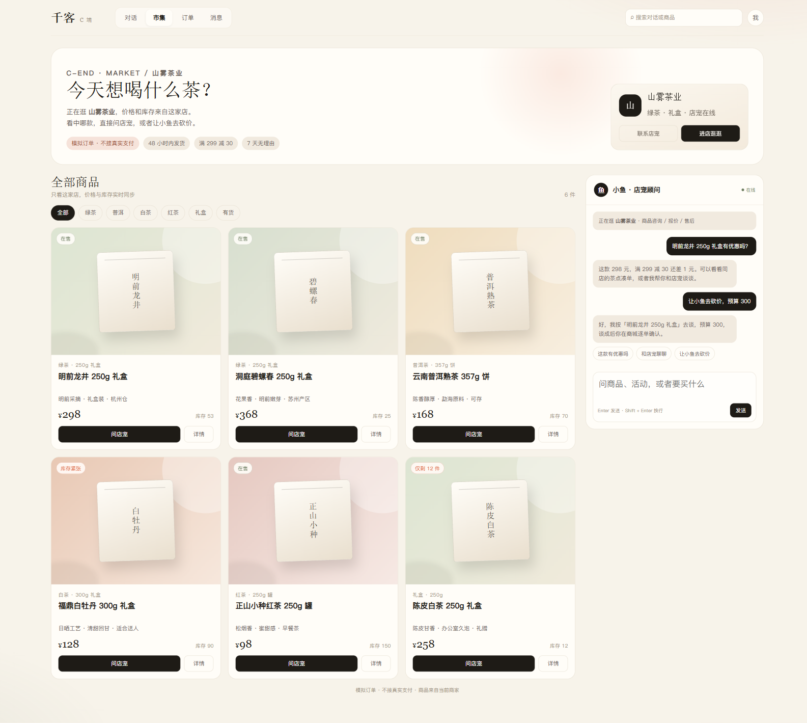
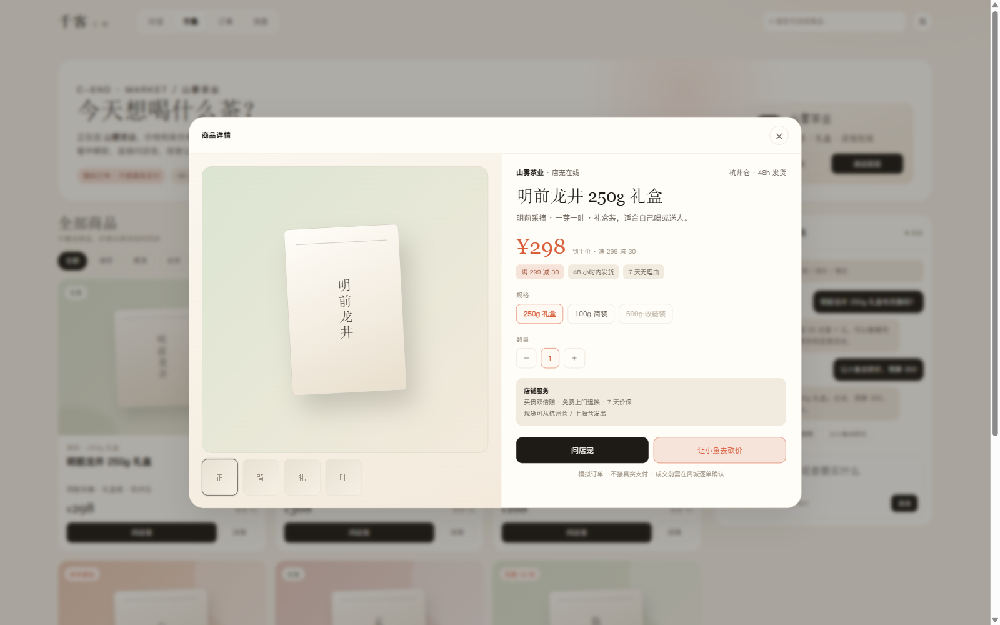
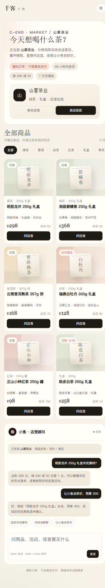
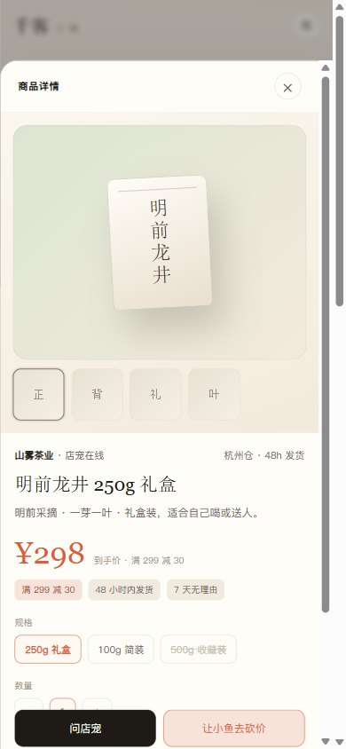

# CShop 改版设计稿

日期：2026-11-12  
参考：三只松鼠旗舰店（京东 POP 商家）商品页 / 店铺页  
设计稿：`docs/design/cshop-redesign.html`

## 设计原则

不照搬京东红色视觉，只借鉴信息层级：

```text
京东的“信息完整度”
+
千客 C 端的暖白、陶土色、低饱和
```

## 方案 A：桌面店铺页



结构：

```text
顶部导航：对话 / 市集 / 订单 / 消息 / 搜索
店铺 Hero：山雾茶业、品牌说明、服务标签、进店/联系店宠
筛选栏：全部 / 绿茶 / 普洱 / 白茶 / 红茶 / 礼盒 / 有货
商品卡 3 列：
  商品图
  分类 + 规格
  标题
  卖点
  价格 + 库存
  问店宠 / 详情
右侧小鱼栏：
  当前店铺上下文
  对话
  快捷问题
  输入框
```

## 方案 B：桌面商品详情



结构：

```text
左侧：主图 + 缩略图
右侧：
  店铺 / 发货地
  标题
  价格 + 到手价说明
  优惠标签
  规格
  数量
  店铺服务
  问店宠（主按钮）
  让小鱼去砍价（次按钮）
  模拟订单提示
```

## 方案 C：手机端





手机端：

```text
商品卡 2 列
隐藏“详情”按钮，点卡片进详情
详情从底部弹出
底部 sticky：问店宠 + 让小鱼去砍价
```

## 对照当前 CShop

| 项目 | 当前 | 设计稿 |
|---|---|---|
| 商品展示 | 横向信息行 | 图片商品卡 |
| 价格/库存 | 有 | 强化到手价 + 库存 |
| 商品详情 | 无独立层 | 商品详情弹层 |
| SKU | 无 | 规格选择 |
| 服务/发货 | 无 | 服务条 + 发货地 |
| 主行动 | 问店宠 | 问店宠 + 砍价双行动 |
| 京东差异 | - | 保留暖白品牌，不复制红色 |

## 你截图里发现的另一个问题

当前小伴会说：

> 我没有议价的本事，砍价得你和店里的 @店宠 谈。

但页面底部又有“让小鱼去砍价”按钮，两个交互互相矛盾。

建议一起调整为：

```text
小伴识别到“帮我砍个价”
→ 不拒绝
→ 直接打开当前店铺的砍价确认层
→ 由小伴 + 店宠完成谈判
```

## 待确认

1. 只做商品卡（A）
2. 商品卡 + 商品详情（A+B，推荐）
3. 商品卡 + 商品详情 + 修正小伴砍价路由（A+B+C，推荐）
