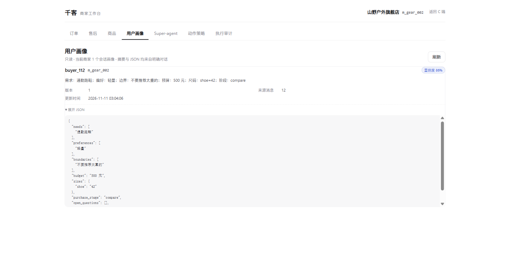
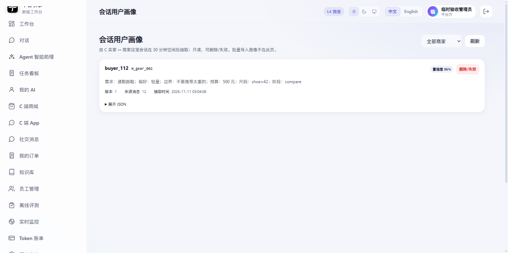
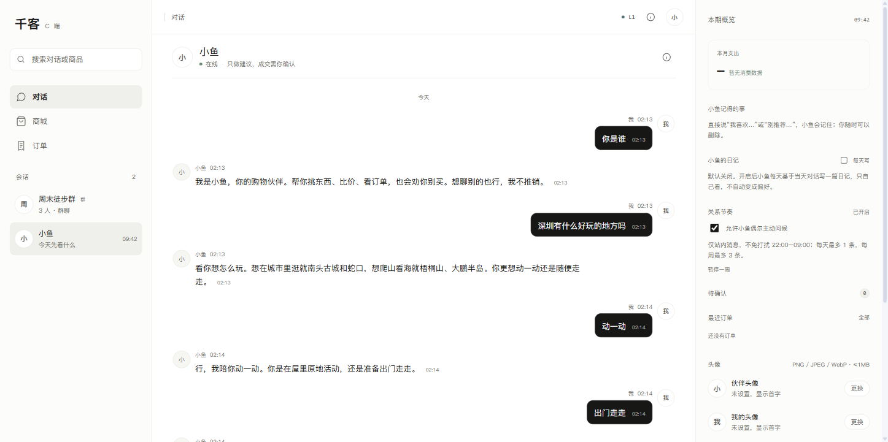

# B 端会话画像与 C 记忆日记 E2E

日期：2026-11-11

## 1. B 工作台用户画像

- 账号：`test_b_merchant`（绑定 `m_gear_002`）
- 入口：`/v2/b.html` → 用户画像
- 结果：列表展示 1 个会话画像，摘要可见，展开 JSON 可见
- 截图：

## 2. 管理端会话画像

- 账号：临时验收管理员（已删除）
- 入口：`/v2/#/admin/chat-profiles`
- 结果：可看全部商家，按商家筛选，展开 JSON，删除/失效
- 截图：

## 3. B 小千查询画像

请求：

```text
POST /api/agent/run
query: 查一下我商家的用户 buyer_112 的画像摘要，只回答画像摘要
```

实际工具调用：

```text
get_chat_user_profile(buyer_id="buyer_112")
```

实际回答摘要：

```text
buyer_112 画像摘要：
- 需求：通勤跑鞋
- 偏好：轻量
- 边界：不要推荐太重的
- 预算：500 元
- 尺码：鞋码 42
- 阶段：compare（比较中）
- 置信度 0.86，基于 12 条会话消息
```

商家账号只允许 `get_chat_user_profile` / `search_chat_user_profiles`，不会获得平台 SQL/RAG 权限。

## 4. C 端记忆日记开关

- 账号：`test_c_buyer`
- 入口：`/v2/#/c/app` → 右侧“小鱼的日记”
- 结果：默认关闭；开启后每天生成日记，展示日期与内容
- 截图：

## 5. 测试

```text
pytest: 731 passed, 5 skipped
frontend build: success
```

已知限制：

- 常驻扫描器 `scripts/b_profile_worker.py` 尚未注册成系统服务；本地需手动启动或配置 cron/systemd。
- 当前店宠会话固定 `store_demo` / `m_gear_002`。
- 真实 LLM 抽取质量依赖模型；失败时不写入，不阻塞后续任务。
