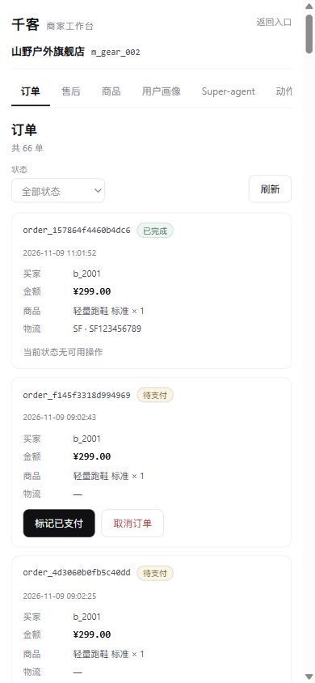
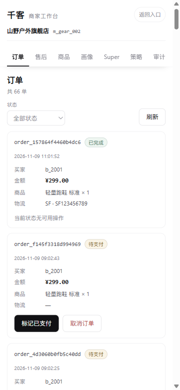
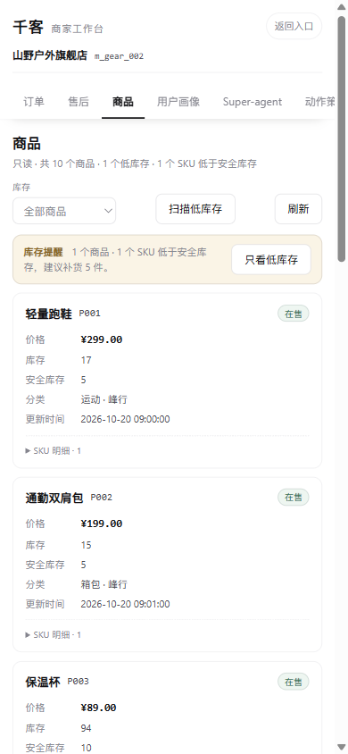
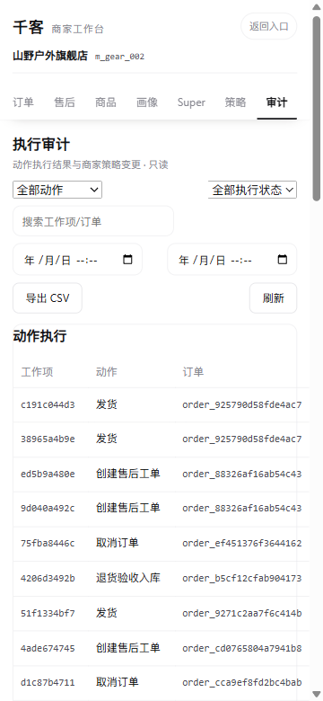
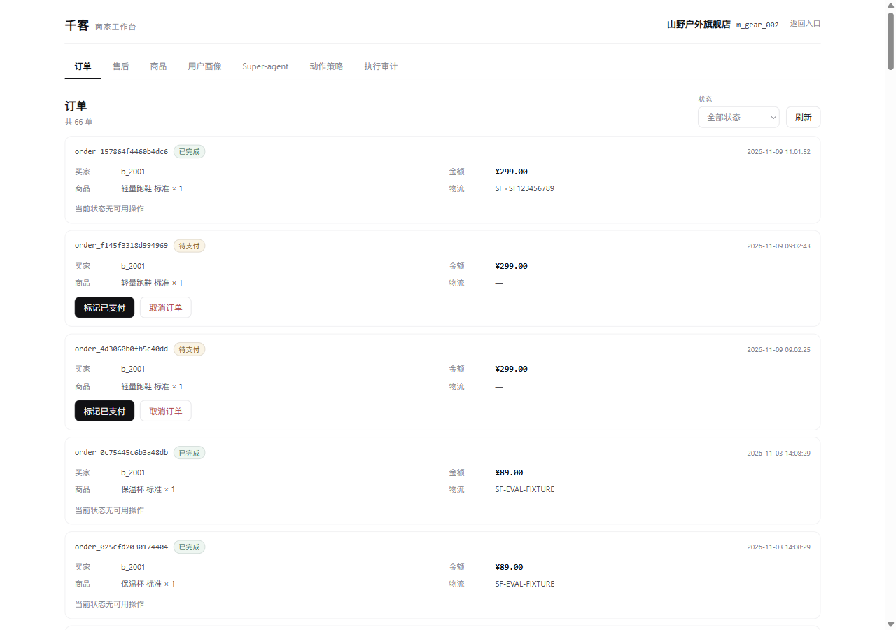

# B 端手机端适配修复

日期：2026-11-12

## 问题

在 360 / 390px 手机宽度复现：

```text
1. 顶部 7 个视图 tab 横向被裁切，只露出前 5 个
2. 切换 tab 后导航不会自动滚到当前项
3. 顶部“返回入口”在窄屏只是小号文字，触控目标偏小
4. 商品页“只看低库存”按钮被压成两行
5. 执行审计宽表格没有明显的横向滑动提示
```

截图（修复前）：



## 修复

### 手机端短标签

```text
用户画像 → 画像
Super-agent → Super
动作策略 → 策略
执行审计 → 审计
```

桌面端仍显示完整标签。

### 导航

- 手机端 nav sticky。
- 当前 tab 渲染后自动滚到可视区域。
- 增加横向滚动惯性、scroll-snap。
- 短标签在 360px 宽度下 7 个 tab 全部可见。

### 顶部

- “返回入口”改为边框 pill，触控目标更大。
- 商家名/商家 ID 字号在手机端收紧。

### 商品库存提醒

- 文案和“只看低库存”按钮允许换行。
- 按钮不换行，不再被压成两行。

### 执行审计

- 宽表格增加横向滚动惯性。
- 表格底部增加“左右滑动查看”提示。
- 工具栏允许换行。

## 修复后

360px 订单页：



360px 商品页：



360px 执行审计：



桌面回归：



## 验证

```text
viewport 360x780:
  document scrollWidth = clientWidth = 345
  nav 标签: 订单 / 售后 / 商品 / 画像 / Super / 策略 / 审计
  7 个 tab 全部可见

viewport 390x844:
  document 无横向溢出
  商品库存提醒按钮单行
  执行审计表格可横向滚动

viewport 1280x900:
  desktop 标签仍为完整文案
  document scrollWidth = clientWidth = 1265
```

代码：

```text
web/src/b-workbench.css
web/src/b-workbench.js
```

只改前端 B 工作台，后端接口未改。

## 已知限制

1. 当前只验证了 360 / 390 / 1280 三个宽度，未覆盖所有安卓 WebView。
2. 审计宽表格仍需要横向滑动，只是增加了提示和惯性。
3. B 端页面没有底部 Tab，仍采用顶部滚动导航；后续可评估改成底部 5 项主 Tab。
