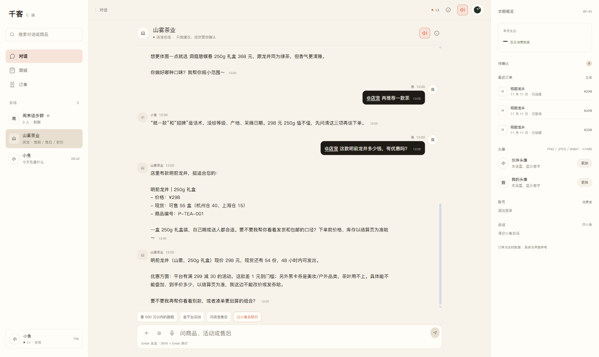
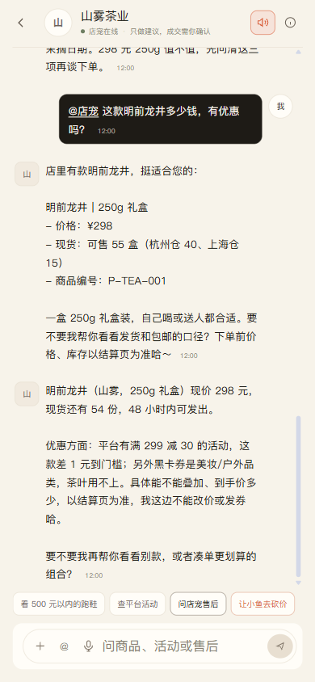

# C 端对话滑轨与滚动定位

日期：2026-11-12

## 问题

桌面端 C App 中间对话区没有独立滚动：

```text
整个 .c-app 由内容撑高
→ 页面整体滚动
→ 中间对话区没有自己的滑轨
→ 切换会话时内容从顶部出现，再跳到底部
```

用户要求：中间对话框做成可见滑轨，不要每次从上面往下滑。

## 修复

### 1. 桌面三栏固定视口高度

```css
@media (min-width: 981px) {
  .c-app { height: 100dvh; overflow: hidden; }
  .c-shell { height: 100%; min-height: 0; }
  .c-main { height: 100%; min-height: 0; overflow: hidden; }
  .c-chat { height: 100%; min-height: 0; }
  .c-sidebar, .c-context { height: 100%; overflow-y: auto; }
}
```

这样只有中间对话区滚动，左侧会话列表和右侧详情各自滚动。

### 2. 中间对话常显滑轨

```css
.c-thread {
  overflow-y: scroll;
  scroll-behavior: auto;
  scrollbar-gutter: stable;
  scrollbar-width: thin;
  scrollbar-color: var(--c-line-strong) var(--c-panel-2);
}

.c-thread::-webkit-scrollbar { width: 10px; }
.c-thread::-webkit-scrollbar-track { background: var(--c-panel-2); border-radius: 999px; }
.c-thread::-webkit-scrollbar-thumb {
  min-height: 42px;
  border: 2px solid var(--c-panel-2);
  border-radius: 999px;
  background: var(--c-line-strong);
}
```

### 3. 不再从顶部滚到底部

`scrollToBottom()` 从 `requestAnimationFrame` 改为 `nextTick`：

```js
nextTick(() => {
  const el = document.getElementById("c-app-thread");
  if (el) el.scrollTop = el.scrollHeight;
});
```

在 DOM 更新后、浏览器绘制前直接定位，切换/加载时不会再出现从顶部滚到底部的过程。

## 验证

桌面端 1680×1003，打开山雾茶业长会话：

```text
.c-app height = 1003px, overflow = hidden
document scrollHeight = clientHeight = 1003
#c-app-thread:
  scrollHeight = 1867
  clientHeight = 740
  scrollTop = 1127（接近底部）
  overflow-y = scroll
  scrollbar-width = thin
```

中间对话区出现独立滑轨，页面本身不再无限变长。



手机端 390×844 回归：

```text
document scrollWidth = clientWidth = 390
#c-app-thread scrollHeight = 2159, clientHeight = 668
输入框焦点正常，font-size = 16px
```



## 改动文件

```text
web/src/views/CApp.vue
```

## 已知限制

1. 桌面端滑轨为自定义 WebKit 样式；Firefox 使用 `scrollbar-color`，轨道的圆角/粗细会略有差异。
2. 手机端保持原有全屏对话布局，滑轨随内容出现，不额外占据固定栏。
3. 当前只验证 Chrome 桌面和 Chromium 移动模拟，未覆盖 Safari 桌面。
