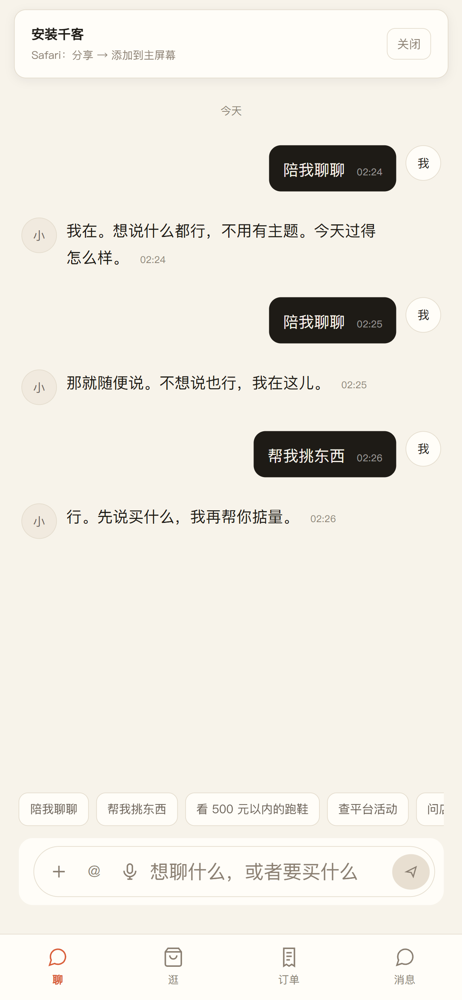
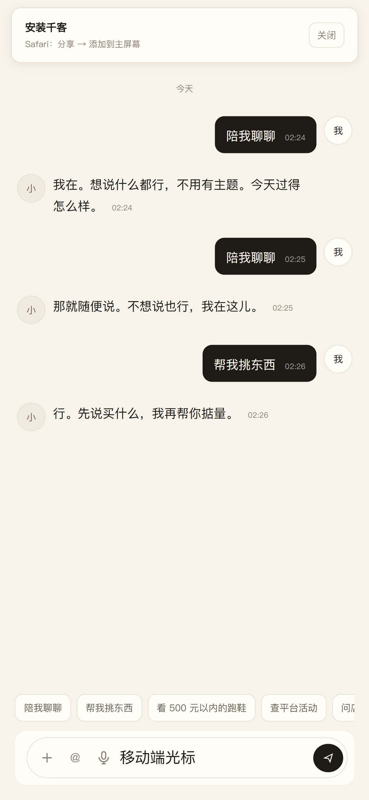
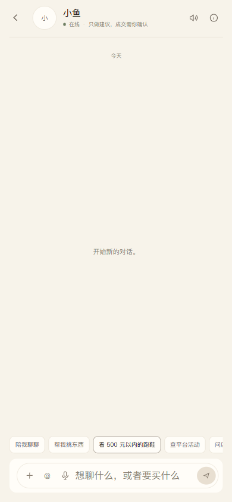

# C 端输入框光标问题修复

日期：2026-11-12

## 复现

iPhone Safari / 移动端 C App：

```text
点击底部输入框
→ 光标没有正常出现/立即消失
→ 输入体验异常
```

iPhone 模拟环境实测发现两个叠加问题。

## 根因 1：安装横幅挡住输入框

iPhone / iPad 首次进入 C App 会显示“安装千客”横幅。

原移动端样式：

```css
.c-install-banner {
  position: fixed;
  bottom: calc(64px + env(safe-area-inset-bottom));
  left: 16px;
  right: 16px;
}
```

横幅正好覆盖底部输入区，点击输入框实际被横幅拦截。

修复：

```text
手机端横幅移到顶部安全区下方
不再覆盖 composer
```

## 根因 2：输入框字号 <16px 触发 iOS 自动缩放

原样式：

```css
.c-composer textarea { font-size: 12px; }
```

iOS Safari 对小于 16px 的输入控件会强制放大视口，导致光标/输入状态异常。

修复：

```text
textarea font-size: 16px
caret-color: var(--c-text)
-webkit-text-size-adjust: 100%
```

## 修复后

安装横幅在顶部，不再遮挡输入框：



iPhone 模拟环境输入：



验证结果：

```text
activeElement = c-app-input
font-size = 16px
visualViewport.scale = 1
输入值成功写入：移动端光标
安装横幅 bottom = 66px（顶部区域），与 composer 不重叠
```

## 公网验证

公网地址：

```text
https://qianke.qiankeagent.com/c/login
```

公网登录后 C App：



```text
https://qianke.qiankeagent.com/ready → 200
https://qianke.qiankeagent.com/c/login → 200
公网 C App activeElement = c-app-input
font-size = 16px
visualViewport.scale = 1
```

## 改动文件

```text
web/src/views/CApp.vue
```

## 已知限制

1. 使用 iPhone Safari 模拟环境验证，未在真实 iPhone 设备上点测。
2. 安装横幅仍在，只是移到顶部；用户可点“关闭”。
3. 输入框字号从 12/13px 提升到 16px，手机端占位文字会略大，这是避免 iOS 自动缩放的必要取舍。
