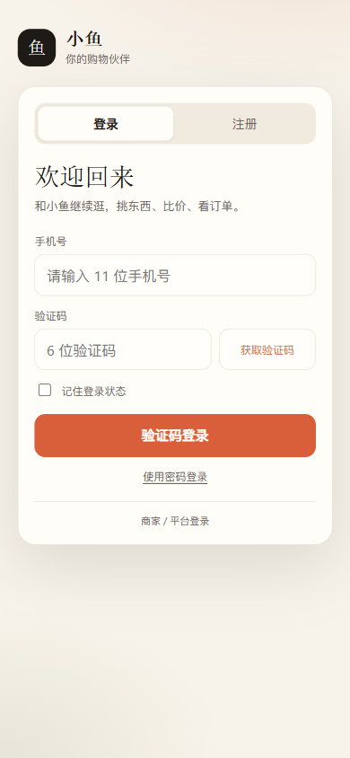
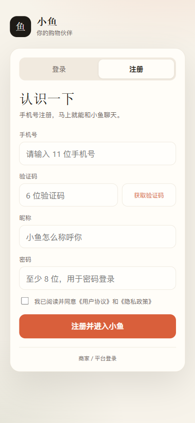
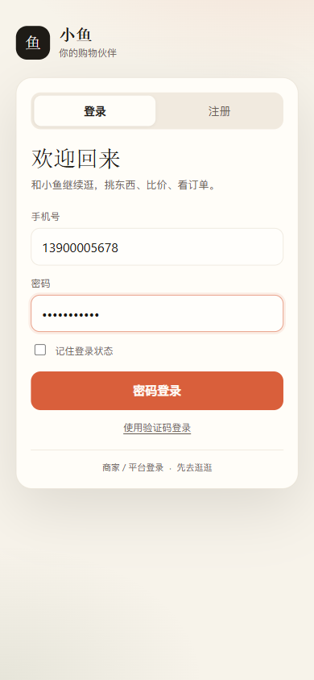
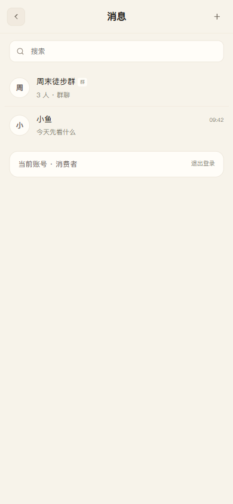
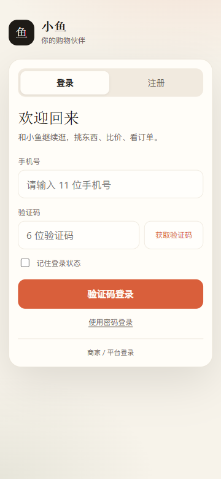

# C 端消费者注册 / 登录

日期：2026-11-12

## 已实现

```text
/c/login                       独立 C 端登录页
/api/c/auth/sms/send           获取验证码
/api/c/auth/register           手机号 + 验证码 + 昵称 + 密码注册
/api/c/auth/login/code         验证码登录
/api/c/auth/providers          登录页判断是否演示模式
/auth/login                    密码登录（复用现有接口）
/auth/logout                   退出登录（复用现有接口）
```

## 账号模型

新增消费者账号：

```text
account_type = consumer
role = buyer
enterprise_id = null
status = active
buyer_id = buyer_{account.id}
```

消费者注册后直接 active，不走企业审核与邀请码；不能进入 A/B 管理端，只能访问 C 端。

## 登录页



## 注册页



注册流程：

```text
手机号 → 获取验证码 → 昵称 → 密码（至少 8 位）
→ 同意协议 → 注册并进入小鱼
```

开发环境验证码：

```text
123456
```

页面会显示“演示环境验证码”，生产模式不返回验证码。

## 密码登录



验证码登录为主，密码登录作为兜底。

## 退出登录

移动端消息列表底部：



桌面端右侧面板也有“账号 → 退出登录”。

## 入口兼容

- `/login` 增加“我是买家 · 去 C 端登录 →”。
- `resolveEntry` 识别 `account_type=consumer` 后直接进入 `/v2/#/c/app`。
- 原有 `test_c_buyer`（enterprise 类型、无企业）仍通过原兜底逻辑进入 C 端。
- B/A 登录与入口未改，实际浏览器验证 B 端登录仍进入 `/v2/b.html`。

## 安全

```text
验证码 5 分钟过期
验证码一次性使用
验证码只存 HMAC，不存明文
同手机号 60 秒冷却，每天最多 10 次
同 IP 每天最多 50 次
验证码错误 5 次作废
手机号唯一索引
密码 Argon2id
注册必须勾选协议
不明确返回“手机号已注册”
```

当前验证码和限流存进程内存，适用于单进程演示。生产多进程部署需要换 Redis；短信供应商适配点：

```text
QIANKE_SMS_PROVIDER
src/rag_demo/c_end/consumer_auth.py::_send_via_provider
```

## 验证

```text
API 实测:
  sms/send → dev_code 下发（仅演示模式）
  register → 200，account_type=consumer，Set-Cookie
  whoami → account_type=consumer
  logout → 200

浏览器 390x844 实测:
  注册 → 自动登录 → /v2/#/c/app
  密码登录 → /v2/#/c/app
  验证码登录 → /v2/#/c/app
  移动端消息列表 → 退出登录 → /c/login
  /login C 端入口可见
  B 账号登录仍进入 /v2/b.html

360 宽度登录页:
  scrollWidth = clientWidth = 360，无横向溢出

测试:
  tests/test_c_consumer_auth.py: 8 passed
  全量 pytest: 751 passed, 5 skipped
```

## 已知限制

1. 开发环境验证码固定为 `123456`，仅限本地演示。
2. 生产短信供应商尚未接入真实凭证；未配置时发送接口返回 503。
3. 验证码/限流是单进程内存实现，多进程部署需要 Redis。
4. 暂未做“忘记密码”、短信改绑、注销账号。
5. 暂未做游客浏览；未登录访问 C 端会回到登录流程。
6. 现有手工 C 测试账号仍保留，未强制迁移为 consumer 类型。


360 宽度：


