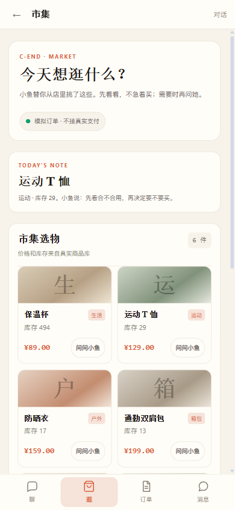
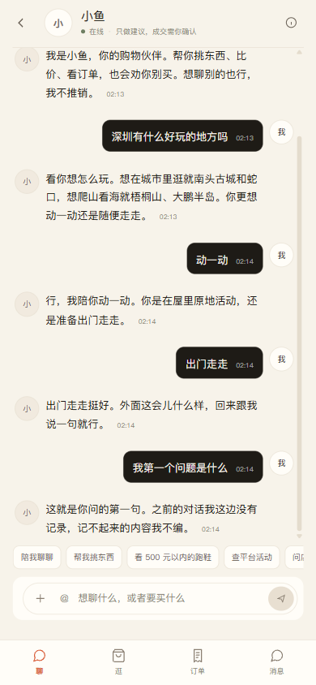

# C 端暖白市集风格落地（A 方向）

日期：2026-11-11

## 已改

### 1. C 端 Token

```text
纸白背景 #F7F3EA
卡片纸白 #FFFDF8
主墨色 #1E1B16
次级文字 #6B6258
强调柿子 #D95F3B
辅助鼠尾草 #6F7F63
细线 #E4DCCD
```

C App 和 CShell 使用同一套暖白 Token，不再纯白。

### 2. CShell 导航

```text
聊 / 逛 / 订单 / 消息
```

底部 Tab 激活态使用柿子色，顶栏标题改为宋体气质。

### 3. 市集页

```text
“今天想逛什么？”
今日手记
市集选物
双列商品笔记卡
```

商品卡从“目录行”改为：

```text
分类色块图
商品名
真实库存/分类
价格
问问小鱼
```

没有真实商品图时，用分类色块 + 首字占位，不伪造商品照片。

### 4. C App 对话页

只换视觉气候：

```text
暖白纸面
墨色发件
柿子色激活态
底部导航：聊 / 逛 / 订单 / 消息
```

对话逻辑、记忆、日记、订单确认全部未动。

## 截图





## 验证

```text
frontend build: success
浏览器 390x844：C 市集 / C App 均正常
底部导航：聊 / 逛 / 订单 / 消息
商品卡双列，无横向溢出
```

## 已知限制

- 商品图目前是分类色块占位，接入真实商品图后会明显更像“市集”。
- “今日手记”目前取第一个运动类商品，后续应接运营配置或小鱼推荐。
- C App 对话页仍是气泡结构，只是换了颜色和字型；下一批可以再做行式消息与商品卡嵌入。
- 还没有“我”页，底部第四项暂为“消息”。
