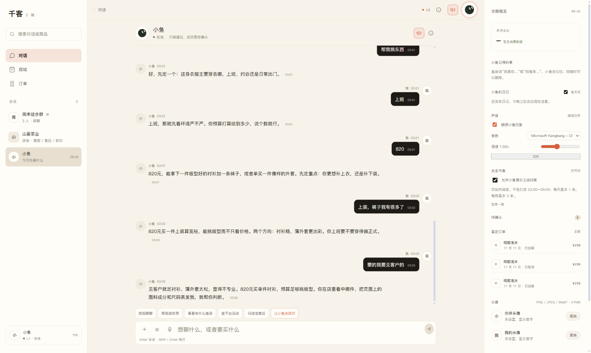
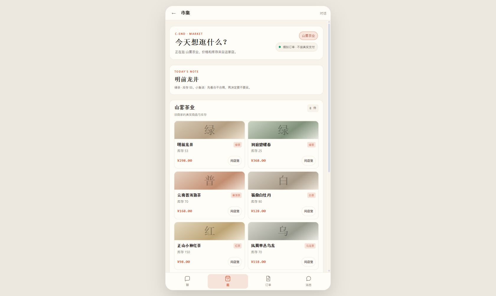

# C 端写死数据审计

日期：2026-11-12

## 本轮修复

### 1. 砍价商品不再固定“跑鞋”

原代码：

```js
const NEGOTIATION_DEFAULT = { need: "跑鞋", budget: 500, quantity: 1 };
```

现在：

```text
打开砍价确认层
商品从当前会话最后一条用户消息提取并归一化
预算只从用户消息提取，默认 500 可改
当前 merchant 自动带入
```

### 2. CApp 固定商品快捷语

```text
“看 500 元以内的跑鞋”
→ “看看有什么推荐”
```

### 3. 删除未使用的写死回复

删除了 `localReply()`：它固定返回

```text
轻量跑鞋 P001，299 元，库存 18 件
```

该函数没有调用点，属于死代码。

### 4. 删除演示账号的固定报价卡

演示账号不再显示写死的：

```text
轻量跑鞋 · P001 / ¥299.00 / 满 299 减 30
```

待确认计数同步归零；真实报价只来自后端谈判结果。

### 5. CShop 固定开场白

```text
“我想买一双轻量跑鞋，预算 500 元以内”
→ 空输入框 + 通用 placeholder
```

同时删除商家场景下“检测到轻量跑鞋就改写消息”的兜底逻辑。

## 验证

CApp 真实账号快捷语：

```text
陪我聊聊 / 帮我挑东西 / 看看有什么推荐 / 查平台活动 / 问店宠售后 / 让小鱼去砍价
body 中不再出现“跑鞋”
```



CShop 茶商店铺：

```text
输入框 value = ""
placeholder = 例如：问商品、活动和优惠
商品来自 /api/c/merchant/products?friend_id=store_tea
```



## 保留的 demo 数据

以下内容是 `demo_visitor` 演示账号的种子数据，不是真实用户数据：

```text
CApp threads 初始的 store_demo / friend_demo
messagesByThread 里的跑鞋示例
store_demo mention 配置
```

真实消费者登录后：

```text
stripDemoSeedForRealAccount()
→ 清空固定种子会话/消息
→ 动态加载 merchant friends 与真实消息
```

因此这些种子只影响演示账号；如果要求连 demo 种子也完全动态化，需要后端提供 demo fixture API，本轮未做。

## 其他默认值

```text
CApp 砍价默认预算 500（用户未说预算时）
CShop 砍价默认预算 500（可编辑）
```

这是默认输入值，不是固定商品，可修改。

## 改动文件

```text
web/src/views/CApp.vue
web/src/views/CShop.vue
```

## 未改

- 后端 demo fixture / 商家种子商品
- 演示账号的初始会话种子（真实账号会被清空）
- CShop 商品价格、库存全部来自接口，无前端写死
