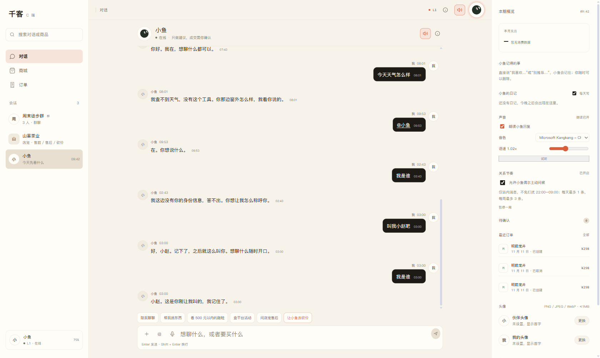

# C 端顶部小鱼头像突出

日期：2026-11-12

## 调整

顶部栏小鱼头像：

```text
尺寸：34px → 44px
垂直居中：centerDelta = -0.29px
强调：低饱和 accent 描边 + 4px 柔和外环
```

自定义头像按钮同步从 28px 放大到 44px，避免用户上传头像后尺寸跳变。

桌面截图：



元素截图：


## 验证

```text
桌面 1680x1003:
  avatar width/height = 44px
  topbar height = 56px
  centerDelta = -0.29px（垂直居中）
  document scrollWidth = clientWidth = 1680

手机端:
  C App 移动布局不渲染此顶部栏，不受影响
  document scrollWidth = clientWidth = 390
```

## 改动文件

```text
web/src/views/CApp.vue
```

## 说明

放大对象是 CApp 桌面顶部栏的小鱼 GrokBot 头像，不是左侧会话列表头像，也不是聊天消息头像。
