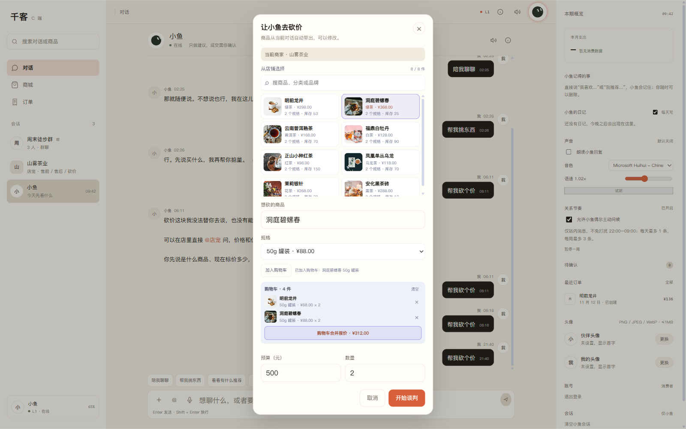
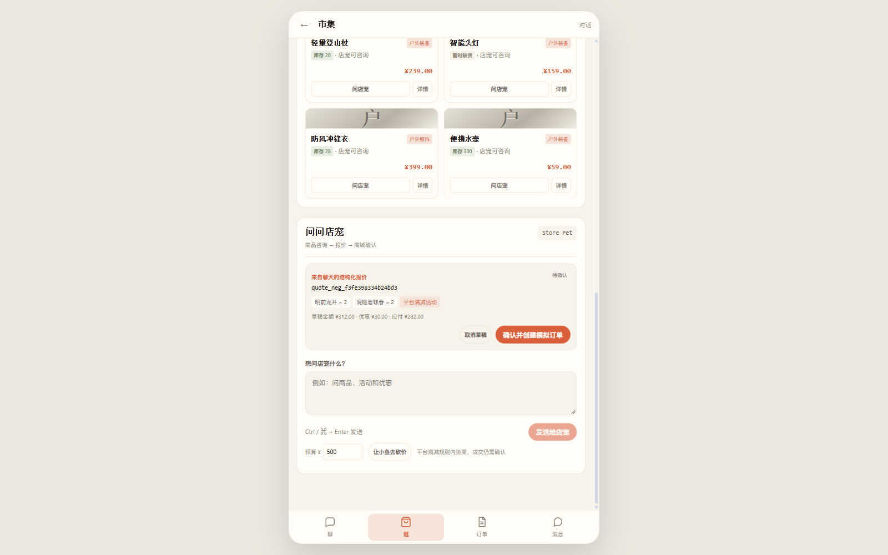
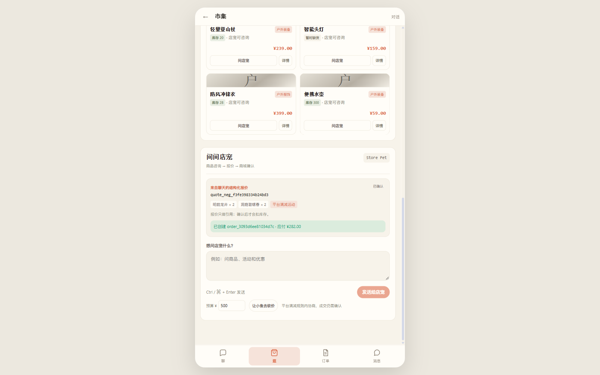

# P2.5 CApp 购物车 + 多商品合并报价

日期：2026-11-12

## 已完成

```text
CApp 购物车（localStorage）
商品 + SKU + 数量加入购物车
同 SKU 自动合并数量
购物车列表 / 单条移除 / 清空
购物车合计金额
购物车合并报价
后端多商品报价 items[]
平台满减按合并后小计计算
CApp 报价卡显示「等 N 件 / 应付总额」
报价链接带 quote_id 打开 CShop
CShop 多商品报价 → 草稿 → 确认订单
```

## 实测流程

加入购物车：

```text
明前龙井 50g 罐装 × 2   ¥136.00
洞庭碧螺春 50g 罐装 × 2  ¥176.00
购物车合计：¥312.00
```



合并报价请求：

```json
{
  "need": "购物车合并报价",
  "budget": 500,
  "quantity": 1,
  "friend_id": "store_tea",
  "items": [
    {"sku": "SKU-TEA-001-50G", "quantity": 2},
    {"sku": "SKU-TEA-002-50G", "quantity": 2}
  ]
}
```

报价结果：

```text
明前龙井 50g 罐装 × 2   ¥136.00
洞庭碧螺春 50g 罐装 × 2  ¥176.00
小计 ¥312.00
平台满减 -¥30.00
应付 ¥282.00
```

CApp 报价卡：

```text
来自店宠的结构化报价
明前龙井 等 4 件
¥282.00
平台满减活动
```

点击「查看报价」进入 CShop：



CShop 实测：

```text
报价 chips：
  明前龙井 × 2
  洞庭碧螺春 × 2
  平台满减活动

准备订单：
  草稿金额 ¥312.00
  优惠 ¥30.00
  应付 ¥282.00

确认订单：
  order_3093d6ee81034d7c
  应付 ¥282.00
```



商家订单实际数据：

```text
order_3093d6ee81034d7c
status = CREATED
total = 312.0（原价，平台优惠由 C 端承担）

item:
  P-TEA-001 / SKU-TEA-001-50G / 2 件 / ¥68.00
  P-TEA-002 / SKU-TEA-002-50G / 2 件 / ¥88.00
```

## 实现要点

- 购物车存 `localStorage`，按当前商家展示。
- 加入购物车时校验商品、SKU、库存、数量。
- 同商家同 SKU 合并数量，单 SKU 最多 20 件。
- 后端 `POST /api/c/negotiations` 支持 `items[]`：
  - 最多 10 个 SKU；
  - 每个 SKU ≤ 20 件；
  - 全部按商家 SKU 库存校验；
  - 平台满减按合并小计计算；
  - 生成一个多商品 PENDING 报价。
- 复用现有报价转订单链路，CShop 自动支持多商品 chips、草稿和确认。
- CApp 报价卡显示商品件数和应付总额，链接带 `quote_id`。

## 验证

```text
浏览器 E2E：
  加 2 个商品 → 购物车合计 312
  合并报价 → 报价应付 282
  CApp 报价卡：等 4 件 / ¥282.00
  查看报价 → CShop 2 个商品 chips
  准备订单 → 草稿 312 - 30 = 282
  确认订单 → 应付 282
  商家订单 2 个 SKU，原价 312
  Console 错误：无

全量 pytest：764 passed, 5 skipped
前端 build：success
PWA 缓存：v17
```

## 已知限制

1. 购物车只存在浏览器本地，不跨设备同步。
2. 购物车只在砍价确认层内展示，没有全局悬浮购物车入口。
3. 当前只对当前商家购物车做合并报价，跨商家需要拆单。
4. 一次最多 10 个 SKU，每 SKU 最多 20 件。
5. 商品数量只能在加入前修改；购物车行内不能直接加减数量（可移除后重加）。
6. 商家订单金额是原价，平台优惠由 C 端订单承担。
7. 一单合并报价仍只生成一个 PENDING 报价，不支持拆单/拆券。

## 下一步

```text
购物车全局入口 + 数量增减
或
CShop 购物车（与 CApp 共用）
或
拆单 / 多商家结算
```
