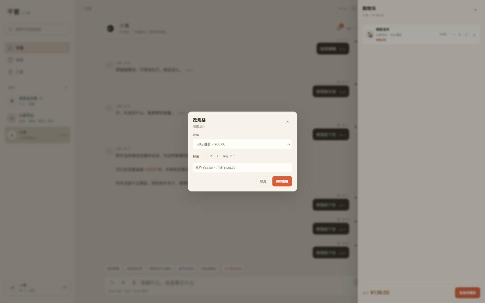
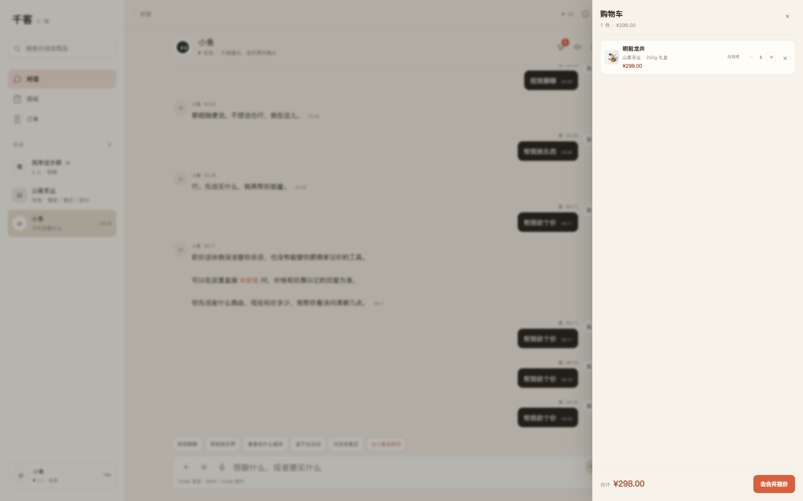

# P2.7 CApp 购物车商品规格编辑

日期：2026-11-13

## 已完成

```text
购物车全局抽屉内「改规格」
砍价确认层购物车行内「改规格」
编辑弹层读取商品当前 SKU
SKU 规格 / 价格 / 库存联动
数量随规格库存自动收敛
保存后更新购物车规格、单价、数量
目标 SKU 已在购物车时自动合并
保存后合计 / 角标即时更新
写入 localStorage
```

## 实测流程

购物车初始：

```text
明前龙井 50g 罐装
¥68.00 × 2
合计 ¥136.00
```

点击「改规格」：



编辑弹层：

```text
商品：明前龙井
规格：
  250g 礼盒 ¥298.00
  50g 罐装  ¥68.00（当前）
数量：2
单价 ¥68.00 · 小计 ¥136.00
```

切换为 250g 礼盒：

```text
规格：250g 礼盒
数量自动收敛为 1（仍可增减）
单价 ¥298.00 · 小计 ¥298.00
```

保存后购物车：



```text
明前龙井 250g 礼盒
¥298.00 × 1
合计 ¥298.00
```

localStorage 实际数据：

```json
[{
  "friend_id": "store_tea",
  "product_id": "P-TEA-001",
  "title": "明前龙井",
  "sku": "SKU-TEA-001-250G",
  "spec": "250g 礼盒",
  "price": 298,
  "stock": 53,
  "quantity": 1
}]
```

## 实现要点

- 编辑时实时请求：
  ```text
  GET /api/c/merchant/products?friend_id=store_tea&limit=12
  ```
- 按 `product_id` 找到商品并加载全部 SKU。
- 当前 SKU 默认选中；缺货 SKU 禁用。
- 数量上限：
  ```text
  min(选中 SKU 库存, 20)
  ```
- 保存逻辑：
  - 普通情况：更新原购物车行的 SKU / 规格 / 单价 / 库存 / 数量；
  - 目标 SKU 已在同一商家购物车中存在：数量合并，删除旧行；
  - 保存后立即重算合计并写回 localStorage。
- 抽屉和砍价确认层共用同一编辑入口。

## 验证

```text
浏览器 E2E：
  购物车 50g ×2，合计 136
  点改规格 → 弹层默认 50g
  切换 250g → 数量收敛到 1，单价 298
  保存 → 购物车变 250g ×1，合计 298
  localStorage sku/spec/price/stock 全部更新
  Console 错误：无

前端 build：success
PWA 缓存：v19
全量 pytest：764 passed, 5 skipped（后端本轮未改）
```

## 已知限制

1. 规格编辑只支持同一商品内换 SKU，不支持换商品。
2. 每个商家商品列表只取前 12 个；商品不在列表时无法编辑。
3. 编辑弹层不显示商品图片/详情。
4. 规格缺货时不能保存，但没有补货提醒。
5. 购物车仍然只存在本地，不跨设备同步。
6. 没有规格变更历史/审计。

## 下一步

```text
购物车换商品
或
CShop 接入同一购物车
或
多商家拆单结算
```
