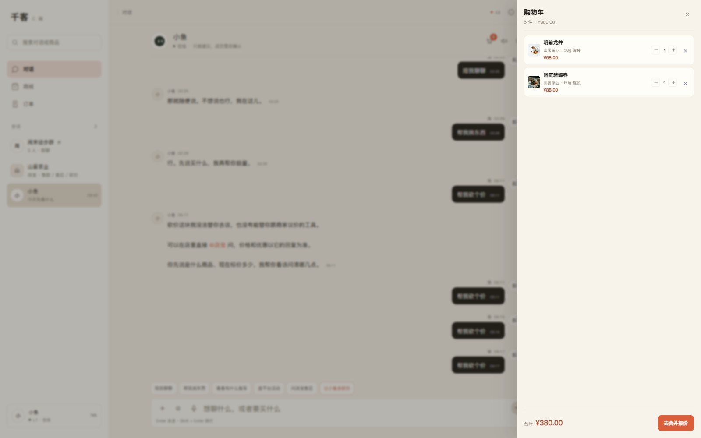
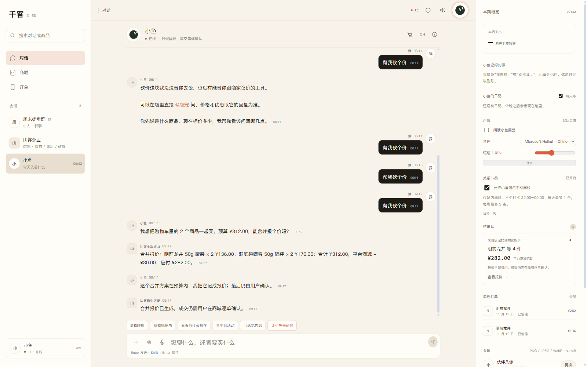
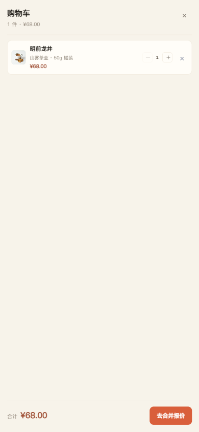

# P2.6 CApp 全局购物车入口 + 行内数量增减

日期：2026-11-13

## 已完成

```text
CApp 对话头部全局购物车按钮
购物车数量角标
右侧购物车抽屉
购物车行内数量 − / +
数量修改即时更新合计与角标
抽屉内单条移除
购物车空态
抽屉「去合并报价」直接打开砍价确认层
砍价确认层购物车行内也可增减数量
```

## 实测流程

加入：

```text
明前龙井 50g 罐装 × 2
洞庭碧螺春 50g 罐装 × 2
```

关闭砍价层后，对话头部出现购物车按钮，角标：

```text
4
```

点击购物车按钮 → 右侧抽屉：

```text
明前龙井 50g 罐装    ¥68.00   − 2 +
洞庭碧螺春 50g 罐装  ¥88.00   − 2 +
合计 ¥312.00
去合并报价
```



行内 `+` 实测：

```text
明前龙井 ×2 → ×3
合计 ¥312.00 → ¥380.00
购物车角标 4 → 5
```

`−` 恢复为 ×2，合计回到 ¥312.00。

点击「去合并报价」→ 砍价确认层，购物车行内仍可增减：

```text
购物车 · 4 件
明前龙井 50g 罐装 × 2
洞庭碧螺春 50g 罐装 × 2
购物车合并报价 · ¥312.00
```

合并报价结果：

```text
小计 ¥312.00
平台满减 -¥30.00
应付 ¥282.00
```

CApp 报价卡：

```text
明前龙井 等 4 件
¥282.00
```

报价成功后购物车清空、角标消失。



## 手机端



实测：

```text
390px 宽度
购物车按钮可见
抽屉宽度 390px
页面无横向溢出
购物车行内数量可增减
```

## 实现要点

- 购物车按钮放入对话头部 `c-chat-actions`，桌面/手机共用。
- 角标显示所有购物车商品总件数。
- 抽屉为固定右侧浮层，移动端全宽。
- 数量控制函数：
  ```text
  changeCartItemQuantity(sku, delta)
  上限：min(SKU 库存, 20)
  下限：1
  ```
- 所有数量修改立即写回 `localStorage`。
- 「去合并报价」把购物车商品带入现有砍价确认层，复用 P2.5 的 `items[]` 合并报价链路。
- 关闭抽屉不会丢购物车。

## 验证

```text
浏览器 E2E（桌面）：
  加 2 商品 → 角标 4
  打开全局抽屉 → 2 行商品
  行内 + → 数量 3、合计 380、角标 5
  行内 − → 恢复 312
  去合并报价 → 确认层购物车
  合并报价 → 应付 282
  成功后购物车清空、角标消失
  Console 错误：无

手机端：
  390px 宽度
  购物车按钮可见
  抽屉 390px
  无横向溢出

前端 build：success
PWA 缓存：v18
全量 pytest：764 passed, 5 skipped（后端本轮未改）
```

## 已知限制

1. 购物车仍只存在浏览器本地，不跨设备同步。
2. 购物车抽屉按全部商品展示；若混入多个商家，合并报价会提示分开结算。
3. 数量上限为 SKU 库存或 20 件中较小值。
4. 抽屉已支持购物车商品规格编辑，见 [capp-cart-spec-edit.md](capp-cart-spec-edit.md)。
5. 购物车没有优惠预览，合并报价后才计算平台满减。
6. 全局入口只在对话页头部，没有底部导航常驻入口。

## 下一步

```text
购物车商品详情 / 编辑规格
或
CShop 接入同一购物车
或
多商家拆单结算
```
