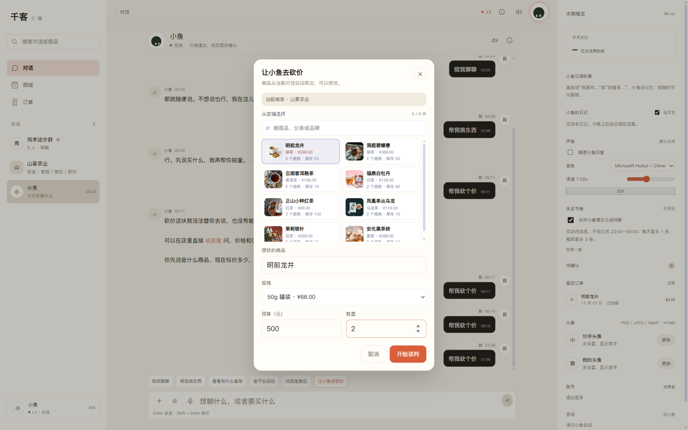

# P2.4 CApp 商品搜索 + 图片商品卡

日期：2026-11-12

## 已完成

```text
CApp 砍价确认层商品搜索
图片商品卡（2 列）
卡片展示图片 / 标题 / 分类 / 默认 SKU 价格 / 规格数 / 库存
点击商品卡选择商品
选择后加载该商品 SKU
保留手动输入商品名
```

## 实测流程

```text
CApp → 帮我砍个价
→ 从店铺选择
→ 商品卡 8 张，图片全部加载成功
→ 搜索「龙井」
→ 仅剩 1 张：明前龙井
→ 清空搜索
→ 点击明前龙井
→ 规格下拉：250g / 50g
→ 选择 50g 罐装
→ 数量 2
→ 开始谈判
```

请求：

```json
{
  "need": "明前龙井",
  "budget": 500,
  "quantity": 2,
  "friend_id": "store_tea",
  "sku": "SKU-TEA-001-50G"
}
```

报价：

```text
明前龙井 × 2
单价 ¥68.00
合计 ¥136.00
```



## 实现要点

- 商品数据复用：
  ```text
  GET /api/c/merchant/products?friend_id=store_tea&limit=12
  ```
- 商品卡使用 `image_url`，加载失败时降级为分类首字占位块。
- 前端本地搜索字段：
  - 商品标题
  - 分类
  - 品牌
- 卡片信息：
  - 商品图
  - 标题
  - 分类 + 默认价格
  - 规格数量 + 库存
- 选中卡片高亮，随后展示 SKU 下拉。
- 规格加载逻辑与 P2.3 一致，继续透传 `sku`。

## 验证

```text
浏览器实测（本地 127.0.0.1:8000）：
  商品卡：8 张
  图片加载：8/8 成功
  搜索「龙井」：1 张
  选择明前龙井 → 50g → 数量 2
  请求 sku=SKU-TEA-001-50G
  报价 ¥136.00
  Console 错误：无

前端 build：success
PWA 缓存：v15
全量 pytest：763 passed, 5 skipped（后端本轮未改）
```

## 已知限制

1. 商品只取当前商家前 12 个，没有分页。
2. 搜索是前端本地过滤，不查服务端全文索引。
3. 商品卡使用默认 SKU 价格，不是最低价。
4. 没有商品详情弹层；规格在下方下拉中选择。
5. 一单一商品，没有购物车。
6. 图片来自商家商品图；加载失败时只显示分类占位。

## 下一步

```text
购物车 / 多商品合并报价
或
CApp 商品详情弹层 + 规格选择
```
