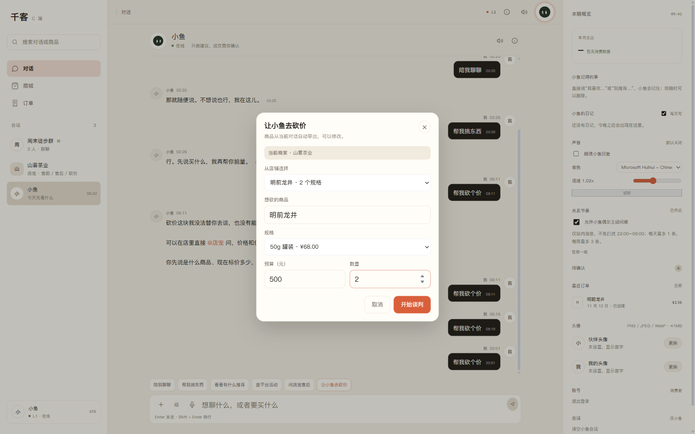

# P2.3 CApp 直接选商品 + SKU

日期：2026-11-12

## 已完成

```text
CApp 砍价确认层直接展示当前商家商品列表
选择商品后自动加载该商品 SKU
选择 SKU 后请求携带 sku
不依赖先逛 CShop / localStorage lastProduct
手动填写商品名仍然保留
```

## 实测流程

浏览器全新上下文：

```text
localStorage qianke:lastProduct = null
登录 C 端
直接进入 CApp
输入「帮我砍个价」
```

确认层直接出现当前商家商品：

```text
从店铺选择：
  明前龙井 · 2 个规格
  洞庭碧螺春 · 2 个规格
  云南普洱熟茶 · 2 个规格
  福鼎白牡丹 · 2 个规格
  正山小种红茶 · 2 个规格
  凤凰单丛乌龙 · 2 个规格
  茉莉银针 · 2 个规格
  安化黑茶砖 · 2 个规格
```

选择「明前龙井」后：

```text
规格：
  250g 礼盒 · ¥298.00
  50g 罐装  · ¥68.00
```

选择 50g、数量 2，发起谈判：

```json
{
  "need": "明前龙井",
  "budget": 500,
  "quantity": 2,
  "friend_id": "store_tea",
  "sku": "SKU-TEA-001-50G"
}
```

报价结果：

```text
明前龙井 × 2
单价 ¥68.00
小计 ¥136.00
合计 ¥136.00
```



## 实现要点

- 砍价确认层新增「从店铺选择」下拉框。
- 打开确认层时调用：
  ```text
  GET /api/c/merchant/products?friend_id=store_tea&limit=12
  ```
- 商品下拉选项显示标题 + 规格数量。
- 选择商品后：
  - 填充商品名；
  - 加载该商品 SKU；
  - 默认选中第一个有货规格。
- 规格下拉继续受库存限制，缺货规格禁用。
- 手动输入商品名仍会触发一次商品/SKU 匹配。
- 最终谈判请求继续透传 `sku`。

## 验证

```text
浏览器实测（localStorage 为空）：
  直接进 CApp → 砍价确认层
  → 商品下拉有 8 个真实茶商品
  → 选择明前龙井
  → 规格下拉出现 250g / 50g
  → 选择 50g
  → 数量 2
  → 请求带 sku=SKU-TEA-001-50G
  → 报价 ¥136.00

Console 错误：无
前端 build：success
PWA 缓存：v14
```

## 已知限制

1. 商品列表来自当前店员会话对应商家；没有商家会话时仍需手填。
2. 只展示前 12 个商品，没有搜索/分页。
3. 商品下拉只显示标题和规格数量，不显示图片。
4. 一单一商品，没有购物车。
5. 后端本轮无改动，未新增 pytest；全量 pytest 仍为 763 passed / 5 skipped。

## 下一步

```text
购物车 / 多商品合并报价
或
CApp 商品搜索 + SKU 选择
```
