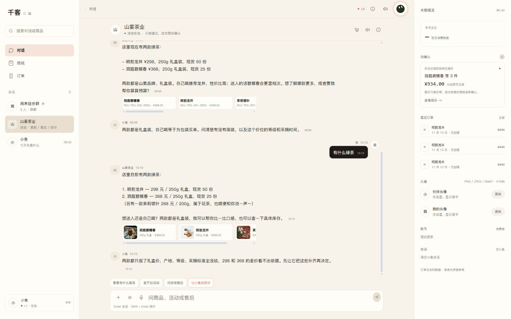
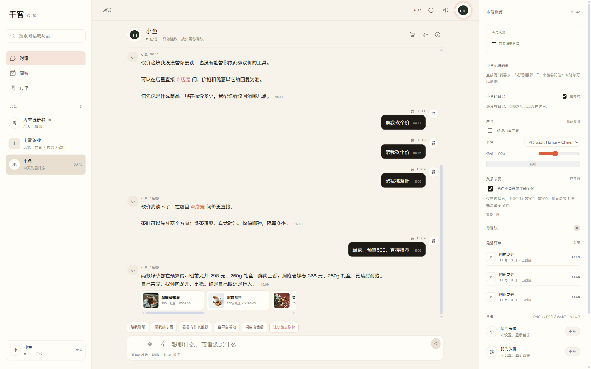

# CApp 商品语义检索 + 聊天商品图片

日期：2026-11-13

## 问题

CApp 里真实商品存在，但聊天中出现了几类无效回答：

```text
用户：茶叶 / 绿茶 → 小伴：没查到在售商品
用户：你家有什么东西 → 店宠：未被唤醒 / 只处理某类问题
用户：有没有图片 → 小伴：有图，但没法显示给你
```

根因：

1. CApp 小伴工具固定使用旧默认商家（户外店），没有按真实商品目录兜底。
2. 商品搜索只做 SQL 标题/category 字面匹配，没有品类语义。
3. 商家单聊仍要求每条消息 `@店宠`，自然问法被挡掉。
4. 工具结果只有商品 ID/标题/价格，没有把图片带到聊天消息。

## 修复

### 1. 轻量语义商品检索

新增 `src/rag_demo/c_end/catalog_search.py`：

```text
品类同义词：茶叶/茶/绿茶/红茶/乌龙/普洱/白茶...
中文二元/三元片段
标题相似度兜底
「全部/有什么/东西」泛浏览
```

同时新增 `web/src/catalogSearch.js`，CShop 搜索和 CApp 砍价层商品搜索共用同一套语义匹配。

### 2. 跨商家兜底

CApp 小伴：

```text
先搜默认商家 → 没有命中时遍历真实商家目录 → 返回带 merchant_id 的商品
SKU/库存按商品自己的 merchant_id 查询
```

店宠仍只查当前商家，不会把别家商品混进店铺咨询。

### 3. 商家单聊自动唤醒

```text
商家单聊：不再强制每条 @店宠
群聊：仍保留显式 @ 规则
显式 @ 后不再用关键词白名单返回「只处理某类问题」
LLM 不可用时返回诚实的「暂时没连上」，不再输出 mock 商品/优惠
```

### 4. 聊天商品图片

商品工具结果现在携带：

```json
{
  "product_id": "P-TEA-001",
  "merchant_id": "m_tea_001",
  "title": "明前龙井",
  "spec": "250g 礼盒",
  "price": 298,
  "image_url": "/uploads/products/m_tea_001/P-TEA-001.webp?v=..."
}
```

CApp 在文字气泡下渲染商品卡：

```text
商品缩略图 + 标题 + 规格 + 价格
```

小伴的 `/api/c/agent/run` 返回 `product_refs`，店宠回复的 `metadata.product_refs` 同样带图片；消息持久化后刷新仍能显示。

## 实测

### 商家店宠

```text
用户：你家都有什么东西啊
店宠：8 个现货商品，含明前龙井、洞庭碧螺春、普洱、白茶、红茶、乌龙、花茶、黑茶
展示：商品图片卡
```

```text
用户：有什么绿茶
店宠：明前龙井、洞庭碧螺春；同时说明茉莉银针属于花茶
展示：对应商品图片卡
```



### CApp 小伴

```text
用户：帮我挑茶叶 → 绿茶，预算500，直接推荐
小伴：两款绿茶 + 商品图片卡
图片实际加载：6 张，全部 naturalWidth > 0
```



## 验证

```text
前端购物车：12 passed
前端语义搜索：4 passed
前端 build：PASS
全量 pytest：767 passed, 5 skipped
浏览器：店宠自然问法自动唤醒、商品图片加载、CShop/CApp 搜索「茶叶」命中
PWA：v21
```

## 限制

- 当前是确定性轻量语义检索（同义词 + 分词 + 相似度），不是向量检索；对完全未知的新品类仍需补别名/embedding。
- CApp 小伴跨商家推荐时，后续下单仍需要选择具体商家；图片卡目前只展示，不直接跳商品详情。
- 店宠自动唤醒只适用于商家单聊；群聊仍要求 `@店宠`。
- 商品图片卡最多展示 6 个，横向滚动。
- 测试过程中产生的验收订单尚未清理。
