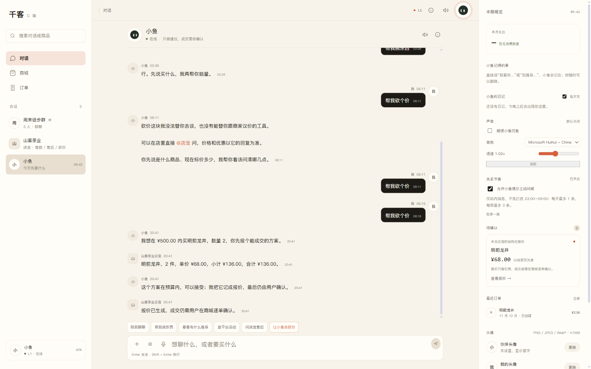

# P2.2 CApp SKU 透传与按当前规格砍价

日期：2026-11-12

## 已完成

```text
CShop 记住当前商品 / 规格 / 数量
CApp 打开砍价确认层时读取上次浏览商品
CApp 拉取当前商家 SKU 列表
确认层显示规格下拉框
默认选中 CShop 当前规格
数量默认取 CShop 当前数量
谈判请求携带 sku
报价按选中 SKU 单价 × 数量生成
```

## 实测流程

```text
CShop：
  明前龙井 → 50g 罐装 → 数量 2

localStorage：
{
  "merchant_id": "m_tea_001",
  "product_id": "P-TEA-001",
  "title": "明前龙井",
  "sku": "SKU-TEA-001-50G",
  "spec": "50g 罐装",
  "price": 68,
  "quantity": 2
}

CApp 输入「帮我砍个价」
→ 砍价确认层
→ 商品：明前龙井
→ 规格下拉：
   250g 礼盒 ¥298.00
   50g 罐装 ¥68.00（选中）
→ 数量：2

POST /api/c/negotiations：
{
  "need": "明前龙井",
  "budget": 500,
  "quantity": 2,
  "friend_id": "store_tea",
  "sku": "SKU-TEA-001-50G"
}
```

报价结果：

```text
明前龙井 × 2
单价 ¥68.00
合计 ¥136.00
```

CApp 报价卡出现：

```text
来自店宠的结构化报价
明前龙井
¥68.00
```



## 实现要点

- CShop `rememberProduct(product, sku, quantity)` 写入：
  - `product_id`
  - `merchant_id`
  - `title`
  - `sku`
  - `spec`
  - `price`
  - `quantity`
- CApp 读取 `qianke:lastProduct`，打开确认层时异步拉取：
  ```text
  GET /api/c/merchant/products?friend_id=store_tea&limit=12
  ```
- 按商品标题匹配当前商品，填充 SKU 下拉框。
- 选择规格后，预算与数量仍可手动修改。
- `runNegotiation` 把 `sku` 透传给后端。

## 验证

```text
浏览器实测：
  CShop 选 50g + 数量 2
  → CApp 砍价确认层自动带出
  → 下拉默认 50g 罐装
  → 请求带 sku=SKU-TEA-001-50G
  → 报价 136.00
  → CApp 报价卡出现

Console 错误：无
前端 build：success
```

## 已知限制

1. CApp 现在可以直接从店内商品列表选择商品和 SKU，不再依赖先逛 CShop；见 [capp-product-picker.md](capp-product-picker.md)。
2. 商品通过标题匹配，同名商品/歧义标题可能匹配失败。
3. CApp 报价卡当前显示单价，总价在对话 transcript 中。
4. 一单一商品，没有购物车。
5. 多商家时只按当前 merchant thread 拉 SKU，不跨店。

## 下一步

```text
P2.3：CApp 直接选择商品 + SKU（不依赖先逛 CShop）
或
购物车 / 多商品合并报价
```
