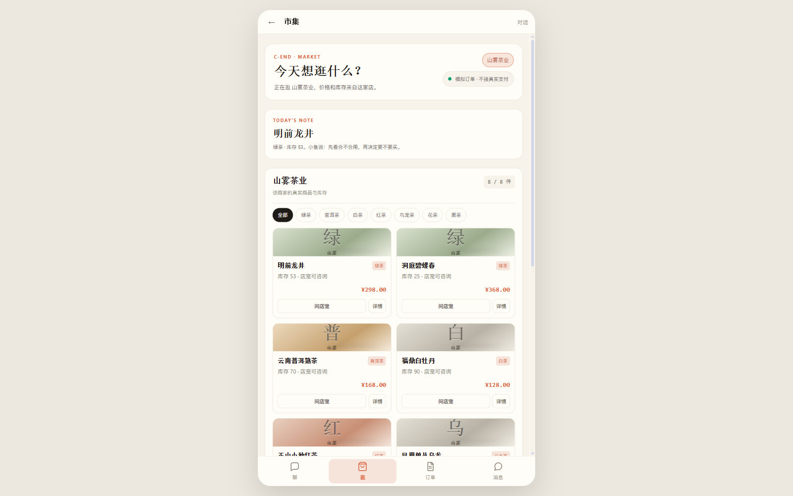
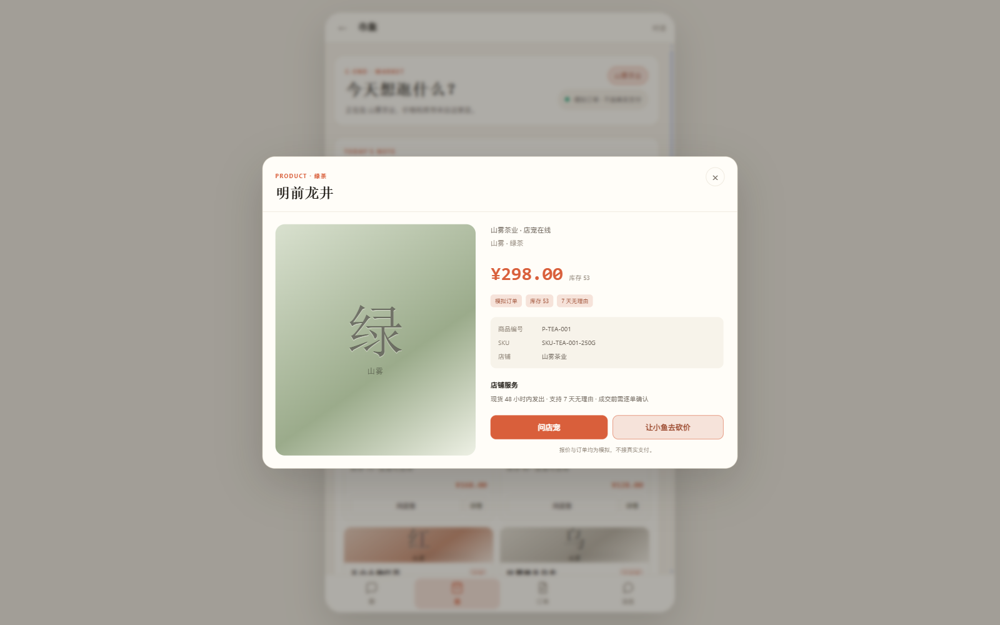
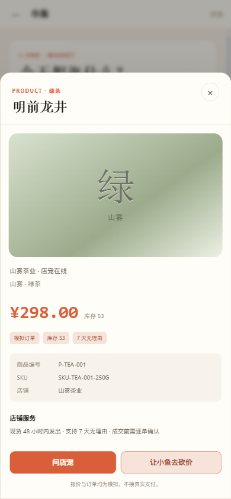
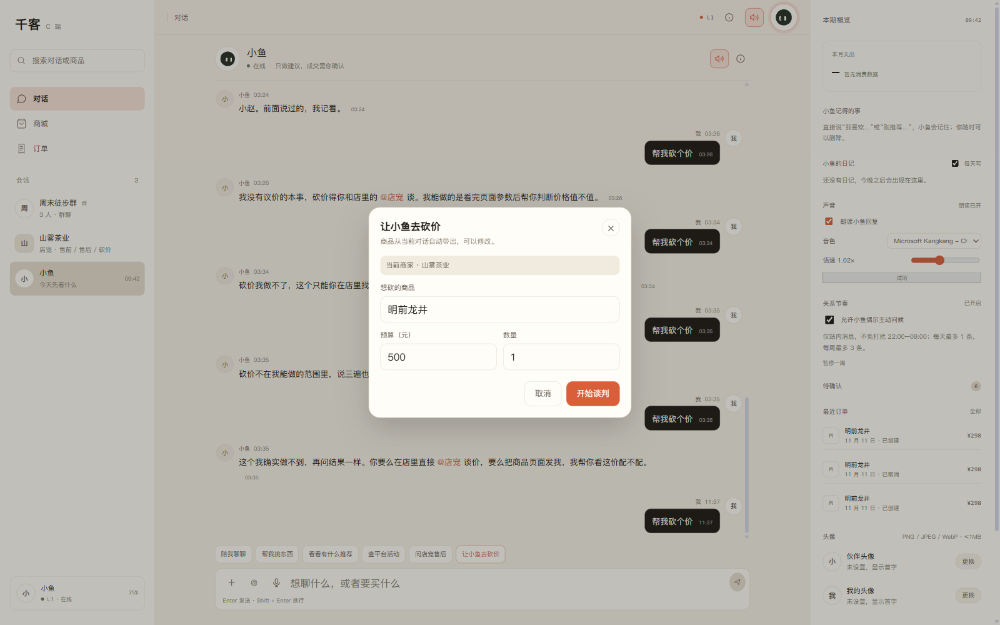
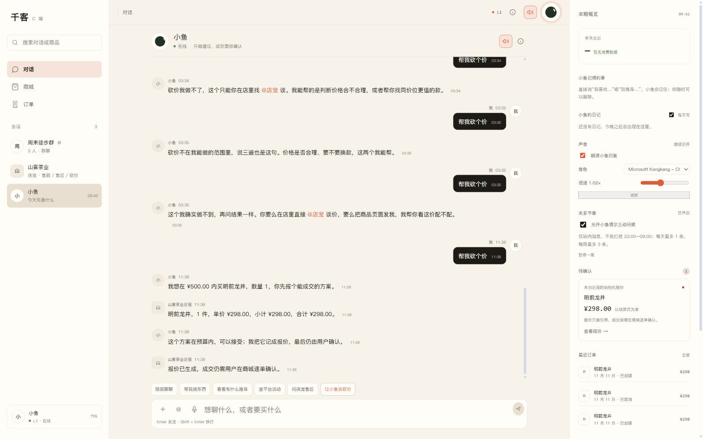

# CShop 商品卡 / 详情 / 小伴砍价路由

日期：2026-11-12

## 按 C 方案落地

```text
1. CShop 商品卡
2. 商品详情弹层
3. CApp「帮我砍个价」改为直接进入当前店铺砍价
```

## CShop 商品卡

- 保留 C 端暖白、陶土色视觉。
- 商品改为图片感卡片：分类大字、店名、标题、库存、价格。
- 商品卡支持分类筛选：全部 / 绿茶 / 普洱茶 / 白茶 / 红茶 / 乌龙茶 / 花茶 / 黑茶。
- 每张卡有两个动作：
  - 问店宠
  - 详情



## CShop 商品详情

点击卡片或“详情”打开弹层：

```text
商品大图（分类视觉）
店铺 / 品牌 / 分类
价格 + 库存
商品编号 / SKU
店铺服务
问店宠
让小鱼去砍价
```



手机端从底部弹出，操作区 sticky：



### 详情页砍价

点击“让小鱼去砍价”会直接带当前商品发起谈判：

```json
{
  "need": "明前龙井",
  "budget": 500,
  "quantity": 1,
  "friend_id": "store_tea"
}
```

实际结果：

```text
双宠谈判达成，报价已生成
明前龙井 1 件 ¥298.00
```

## CApp「帮我砍个价」路由

之前小伴会回复“我没有议价的本事”，但页面又有“让小鱼去砍价”按钮，逻辑冲突。

现在：

```text
小伴会话里输入“帮我砍个价”
→ 识别砍价意图
→ 找到最近一家店（山雾茶业）
→ 打开砍价确认层
→ 商品自动带出最近订单商品（明前龙井）
→ 确认后由小鱼和店宠谈判
```



实际谈判成功生成报价：



## 验证

```text
CShop:
  8 个商品卡正常渲染
  分类筛选：白茶 → 1 个商品 / 8 件
  商品详情打开 / 关闭正常
  手机端详情 bottom sheet + sticky CTA
  detail 砍价请求 friend_id=store_tea
  谈判成功生成报价

CApp:
  “帮我砍个价”不再走小伴拒答
  确认层商家 = 当前商家 · 山雾茶业
  商品 = 明前龙井
  谈判后报价卡出现

前端 build: success
```

## 已知限制

1. 商品接口目前没有商品图片字段，商品卡/详情使用分类视觉，不伪造图片。
2. CShop 实际运行在 CShell 的 560px 手机框内，商品卡为 2 列；“宽屏店铺页”设计稿保留为视觉参考，未强行改成三栏。
3. CApp 砍价商品提取依赖会话/最近订单；提取不到时用户可在确认层手动改。
4. 小伴拦截只在有 merchant thread 时生效；没有店铺上下文时仍走普通回复。
5. 本轮只改前端，未重跑 pytest。
