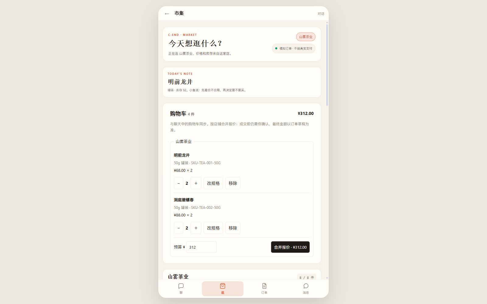
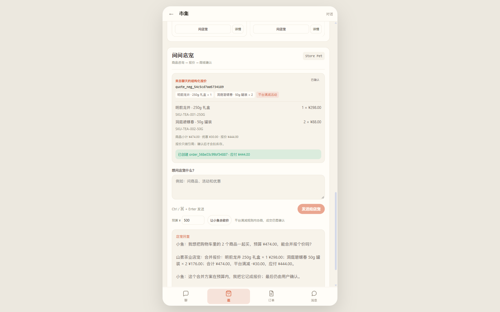

# CShop / CApp 共享购物车

日期：2026-11-13。基线：`shared/cshop-cart` @ `13017c6`（基于 `agent` @ `a646c18`）。

## 行为与范围

- `web/src/cart.js` 作为两入口的共用状态，保留 `qianke:cart` 的数组格式，兼容原 CApp 购物车。
- 同一应用中的路由共享 Vue 状态；同源标签页通过 `storage` 事件同步。存储被禁用时仅在当前页面生命周期内共享。
- 行标识包含 `friend_id + sku`，避免同名 SKU 误改其他店铺；数量为整数并受库存及 20 件上限约束。换成同店已有 SKU 时合并数量，并采用新读取的价格与库存。
- CShop 商品详情可加购，购物车可改数量、改规格、移除、按店铺合并报价；单次最多 10 个 SKU。请求仅传真实选择的 `items: [{sku, quantity}]`，金额由后端计算。
- CApp 生成报价后保留购物车。只有确认订单成功才移除已购数量，保留其他商家及后来增加的数量。
- 合并报价后修改购物车会阻止使用过期报价；有草稿时先取消草稿再重新报价。CApp 报价链接携带商家和购物车来源标识。
- 未更改后端、交易权限、真实支付、Agent Tool 或模型逻辑。

## 订单 HTTP 契约兼容

本次实测确认：`POST /api/c/orders/{id}/confirm` 的返回商品行不含 `sku/spec`，但报价引用与订单草稿包含 SKU。

清购物车优先使用订单返回的 SKU。若缺失，必须同时满足订单状态为 `CONFIRMED`、订单 `quote_id` 与报价一致、按商品及单价汇总的数量完全一致，才使用该报价引用的 SKU。任一条件不符则保留购物车，避免误删。已覆盖同商品多 SKU、错误报价 ID 和不匹配数量的单测。

## 截图

CShop 读取 CApp 的购物车（同一 `qianke:cart`），支持行内数量与规格编辑：

合并报价 → 确认订单后，购物车清空；CApp 侧角标同步消失：

## 验证结果

| 检查 | 结果 |
| --- | --- |
| `cd web; npm run test:cart` | 12 passed |
| `cd web; npm run build` | PASS；存在原有大 bundle 警告 |
| 维护者环境：`python -m pytest tests/ -q` | 764 passed, 5 skipped |
| 维护者环境：前端 `npm run build` | PASS |
| CApp 加入两种茶 50g 各 2 件 → CShop | 商品、SKU、数量一致，小计 312 元 |
| CShop 改数量及 250g 规格 → 另一 CApp 标签页 | 实时同步；反向修改也同步 |
| 预算 50 元合并报价 | 后端拒绝，购物车 4 件保留 |
| 预算 312 元合并报价与草稿 | 小计 312、优惠 30、应付 282，两个 SKU 均为 2 件 |
| 草稿存在时在另一标签页增加数量 | 显示已变化提示，确认按钮禁用 |
| 取消草稿 | 商品保留，可重新报价 |
| 确认模拟订单 | CShop 与另一 CApp 标签页同步清空；订单应付 282 元 |
| 390 × 844 CSS 像素视口 | 数量、规格、报价、准备与确认订单可操作；文档宽度等于视口宽度，无横向溢出 |
| 窄屏 250g × 1 确认 | 应付 298 元，成功后清空 |

浏览器验证使用本机临时 SQLite 数据库与测试账号，调用实际 C 端路由、谈判和订单代码，无真实支付或模型调用。窄屏通过 390px iframe 运行原应用，实测 `innerWidth=390`；未宣称真机触屏或软键盘验证。

Codex 环境首次全量测试为 733 passed / 1 failed / 35 skipped：图片上传测试缺少运行时审计目录 `var/uploads/products`。创建该忽略目录后重跑全量通过；维护者环境独立复跑为 764 passed / 5 skipped。未修改后端测试或跳过条件。

## 限制

- 购物车仍为同源浏览器本地数据，不跨设备同步，不增加账号隔离；多个标签页同时写入仍遵循 localStorage 最后一次写入。
- 每个商家的规格编辑列表最多读取 50 个商品；CApp 原有编辑入口仍读取 12 个。
- 后端接口仍承担价格、库存、权限与最终成交校验；前端显示的购物车金额是上次选购时的商品金额。
- 35 个 pytest 用例按现有条件跳过；未运行真实模型 / PostgreSQL 服务集成验收。本次不涉及 Agent 核心逻辑，未运行在线 Agent Eval。
- 改动为前端补丁，合并与上线由维护者审核处理。
