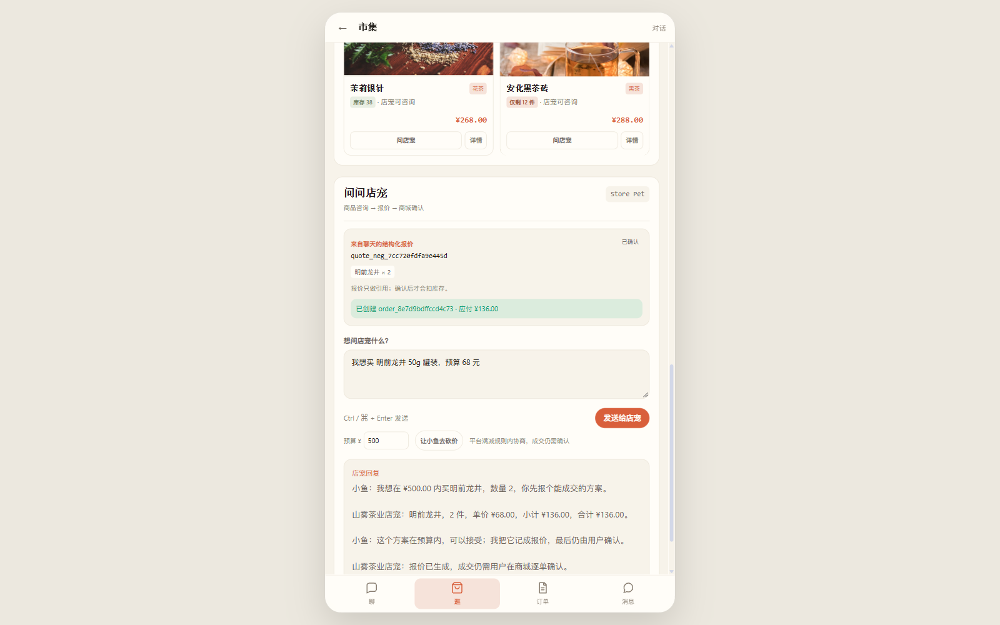

# P2.1 SKU 感知的砍价 / 报价 / 下单

日期：2026-11-12

## 已完成

```text
砍价请求带 sku
报价 product_refs 记录 sku / spec / unit_price
报价 → 订单草稿使用选中 SKU 单价
数量选择（1–20，受 SKU 库存限制）
SKU 库存不足时谈判拒绝并提示
确认订单时按 SKU 单价 / 数量落商家订单
```

## 请求

```json
POST /api/c/negotiations
{
  "need": "明前龙井",
  "budget": 500,
  "quantity": 2,
  "friend_id": "store_tea",
  "sku": "SKU-TEA-001-50G"
}
```

## 报价

```text
quote_neg_7cc720fdfa9e445d
明前龙井 × 2
单价 ¥68.00
合计 ¥136.00
```

报价 `product_refs`：

```json
{
  "product_id": "P-TEA-001",
  "title": "明前龙井",
  "sku": "SKU-TEA-001-50G",
  "spec": "50g 罐装",
  "price": 68.0,
  "unit_price": 68.0,
  "quantity": 2
}
```

## 草稿与订单

实测：

```text
报价 → 准备订单
  草稿金额 ¥136.00
  应付 ¥136.00

确认订单
  order_8e7d9bdffccd4c73
  应付 ¥136.00
```

商家订单实际数据：

```text
order_8e7d9bdffccd4c73
status = CREATED
total = 136.0

item:
  product_id = P-TEA-001
  sku = SKU-TEA-001-50G
  quantity = 2
  unit_price = 68.0

SKU-TEA-001-50G 库存：
  available_qty = 116
  reserved_qty = 7
```

说明 SKU 单价和数量已进入商家订单/库存域，不再是默认商品价。



## 库存不足

```text
SKU-TEA-004-300G 只有 18 件
请求数量 20
→ REJECTED
→ reason = INSUFFICIENT_STOCK
→ transcript: “只剩 18 件，不够你要的 20 件”
→ 不生成报价
```

## 兼容

旧报价没有 `unit_price` 时回退到商品当前价，避免历史报价无法准备订单。

## 测试

```text
tests/test_c_end_negotiation.py
  - 选中 SKU 报价价格/数量
  - 报价 → 草稿使用 SKU 单价
  - 报价 → 确认生成商家订单
  - SKU 库存不足拒绝
  → 7 passed

全量 pytest：763 passed, 5 skipped
前端 build：success
```

## 已知限制

1. CApp 已支持从上次浏览商品透传 SKU，见 [capp-sku-negotiation.md](capp-sku-negotiation.md)。
2. 一单一商品；多商品报价/购物车未做。
3. 数量上限 20，受前端和 API 双重限制。
4. C 端商品库存仍是模拟汇总，SKU 库存以商家库存域为准。
5. C 端订单行暂未持久化 SKU 字段，SKU 已写入商家订单和报价审计链。
