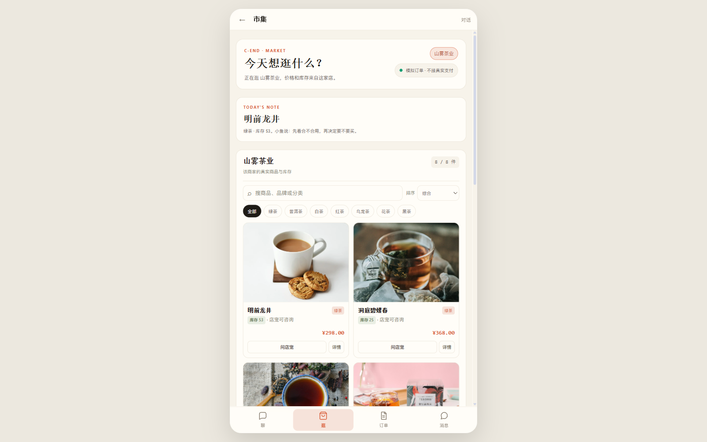
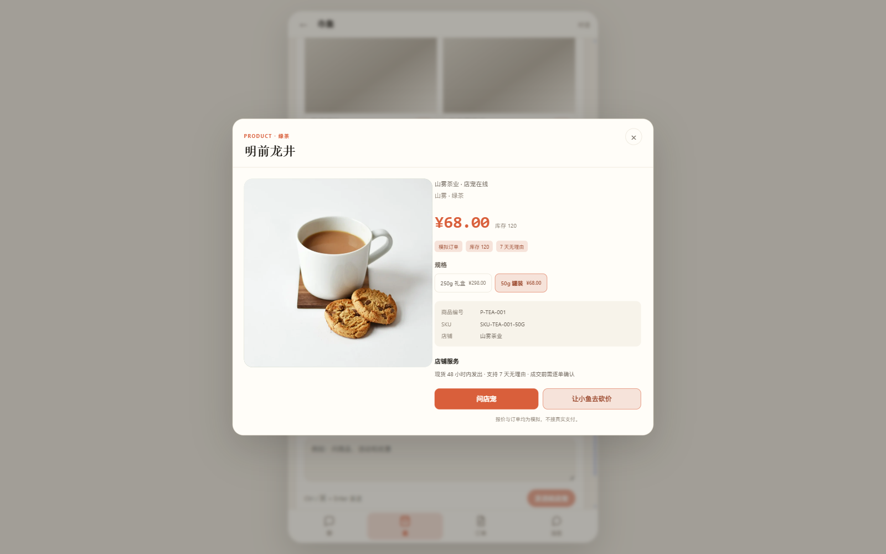
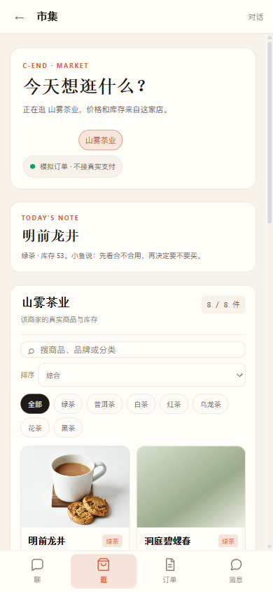

# P2 CShop：SKU / 搜索 / 排序 / 库存提示

日期：2026-11-12

## 已完成

```text
C 商品接口返回全部 SKU（规格 / 价格 / 库存 / 是否有货）
CShop 商品搜索
CShop 排序：综合 / 价格升 / 价格降 / 库存优先
商品卡库存标签：库存 / 仅剩 N 件 / 暂时缺货
详情 SKU 规格切换
规格切换后价格 / 库存 / SKU 编号 / 咨询文案联动
```

## 后端

`GET /api/c/merchant/products` 现在每个商品返回：

```json
{
  "sku": "SKU-TEA-001-250G",
  "price": 298.0,
  "stock": 53,
  "skus": [
    {
      "sku": "SKU-TEA-001-250G",
      "spec": "250g 礼盒",
      "price": 298.0,
      "stock": 53,
      "reserved_qty": 0,
      "in_stock": true
    },
    {
      "sku": "SKU-TEA-001-50G",
      "spec": "50g 罐装",
      "price": 68.0,
      "stock": 120,
      "reserved_qty": 0,
      "in_stock": true
    }
  ]
}
```

首个 SKU 继续作为商品卡默认价格/库存，保持旧字段兼容。

## 搜索 / 排序



实测：

```text
搜索「龙井」→ 1 个商品：明前龙井
价格从低到高：
  正山小种红茶 ¥98
  凤凰单丛乌龙 ¥118
  福鼎白牡丹 ¥128
  云南普洱熟茶 ¥168
```

## SKU 切换

详情页选择规格：

```text
明前龙井
  250g 礼盒 ¥298 / 库存 53
  50g 罐装 ¥68 / 库存 120
```

切换到 50g 后：

```text
价格：¥298 → ¥68
库存：53 → 120
SKU：SKU-TEA-001-250G → SKU-TEA-001-50G
咨询文案：我想买 明前龙井 50g 罐装，预算 68 元
```



## 库存提示

商品卡显示：

```text
库存 N
仅剩 N 件（≤ 15）
暂时缺货
```

缺货 SKU 在详情中置灰、不可选择，并显示「缺货」。

## 手机端



390px 宽度下：

```text
搜索/排序改为纵向排列
商品卡 2 列
无横向溢出
```

## 测试

```text
新增 tests/test_c_end_merchant_products.py
→ C API 返回全部 SKU、默认 SKU 字段一致
→ 1 passed

前端 build：success
```

全量 pytest：761 passed, 5 skipped。

## 已知限制

1. SKU 感知报价/下单已在 P2.1 完成，见 [cshop-sku-negotiation.md](cshop-sku-negotiation.md)。
2. 商品卡只展示首个 SKU；进入详情后才能切换。
3. 搜索为前端本地过滤，未接服务端全文检索。
4. 价格排序基于各商品默认 SKU，不是最低价排序。
5. 库存阈值当前硬编码 ≤15，后续应使用商家安全库存。
