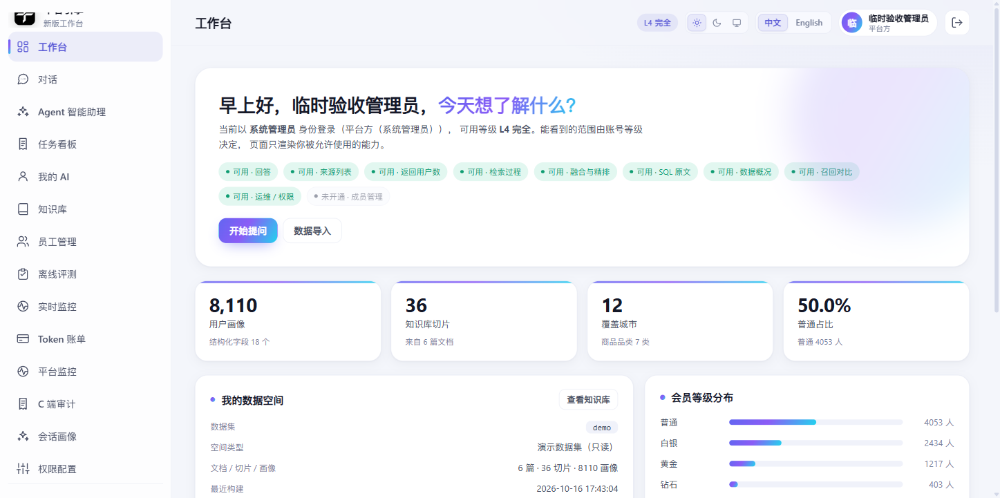

# 登录入口与三端导航隔离

日期：2026-11-11

## 登录后按角色进入

```text
系统管理员 / 企业管理员 → /v2/#/（管理工作台）
已绑定商家的账号       → /v2/b.html（商家工作台）
普通买家账号           → /v2/#/c/app（C 端 App）
```

实现位置：`src/rag_demo/api/static/login.js` 的 `resolveEntry()`。

## 主工作台不再混入 C 端入口

管理工作台侧边栏已移除：

```text
C 端商城
C 端 App
社交消息
我的订单
```

管理员仍保留：

```text
C 端审计
会话画像
```

截图：

## C 页面独立布局

`/c`、`/c/social`、`/c/orders` 路由增加 `standalone: true`，直接访问时不再渲染企业工作台侧边栏。

## 验证

```text
test_b_merchant 登录 → /v2/b.html
test_c_buyer 登录 → /v2/#/c/app
临时管理员登录 → /v2/#/
frontend build：success
login.js node --check：success
```

已知限制：

- C 商城/订单/社交页目前只是去掉工作台外壳，还没有统一 C 端底部 Tab 壳。
- 浏览器可能缓存旧 `login.html`/JS，需要强刷或用带版本参数 URL。
