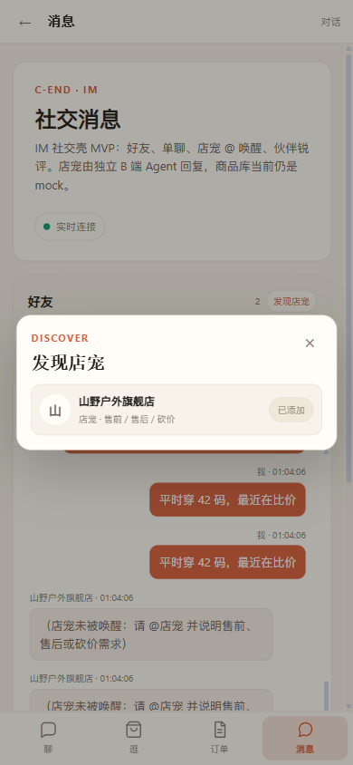
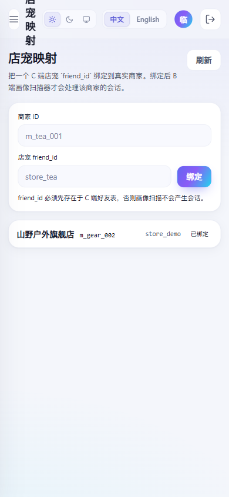
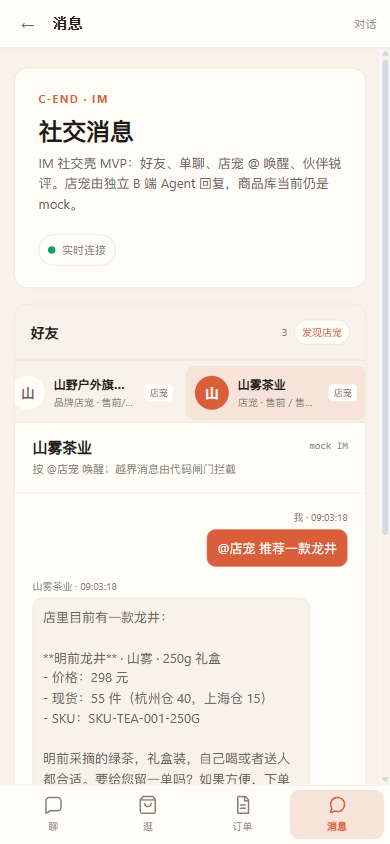
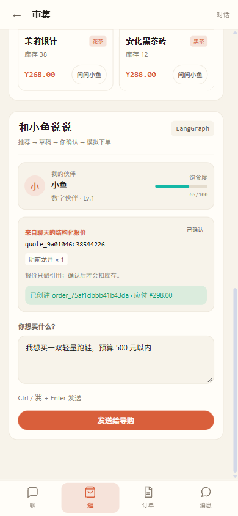
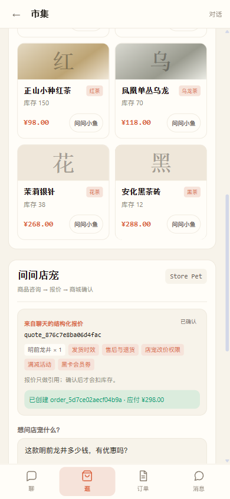

# C 端商家店宠发现 + 管理端店宠映射

日期：2026-11-11

## C 端发现店宠

入口：

```text
C 端 -> 消息 -> 好友 -> 发现店宠
```

行为：

```text
GET  /api/c/merchants/available
  → 返回已绑定商家的店宠
  → 已添加显示“已添加”

POST /api/c/friends/merchants
  → 把店宠加入当前买家好友
  → 重复添加幂等
```

截图：

## 管理端店宠映射

入口：

```text
/v2/#/admin/merchant-store-friends
```

能力：

```text
查看所有店宠 friend_id 与 merchant_id 的绑定
新增/更新绑定
```

截图：

## 完整链路

```text
管理员绑定 store_tea -> m_tea_001
→ C 买家在“发现店宠”添加山雾茶业
→ c_friend 出现 store_tea
→ 买家与 store_tea 产生 c_message
→ B 画像扫描器遍历映射
→ 生成 m_tea_001 下该买家的画像
```

## 多商家店宠 Agent 路由

已验证：

```text
store_tea → m_tea_001
买家发送 "@店宠 推荐一款龙井"
→ 店宠读取 m_tea_001 商品
→ 返回 P-TEA-001 明前龙井
→ metadata.product_refs 带 SKU / 价格 / 库存
```

截图：



实现：

```text
friend_id → c_merchant_store_friend → merchant_id
→ store_agent._tools(merchant_id)
→ 商品 / 库存 / 订单全部按该商家查询
→ system prompt 使用该商家名称
```

## 报价 → 订单按商家路由

验证链路：

```text
茶商店宠报价
→ metadata.merchant_id = m_tea_001
→ CShop 带 quote + friend_id + merchant_id 打开
→ 商品列表切到山雾茶业
→ 报价准备订单
→ c_order.merchant_id = m_tea_001
→ 商家订单写入 m_tea_001
```

实际验证：

```text
订单 order_75af1dbbb41b43da
金额 298
merchant_source = merchant_v1
merchant_status = CREATED
```

截图：



## C 端商城按会话商家切换

CShop 支持 query：

```text
/c?quote=...&friend_id=store_tea&merchant_id=m_tea_001&merchant_name=山雾茶业
```

有 `friend_id` 时商品来自：

```text
GET /api/c/merchant/products?friend_id=store_tea
```

无 `friend_id` 时保持原来的默认市集。

## CShop 右侧顾问切到店宠 Agent

带 `friend_id` 进入 CShop 时：

```text
右侧标题：问问店宠
徽标：Store Pet
商品按钮：问店宠
发送：POST /api/c/friends/{friend_id}/messages
内容自动补 @店宠
返回 metadata.quote_id 后直接加载报价卡
```

实测：

```text
茶商页面询问 “这款明前龙井多少钱，有优惠吗？”
→ 山雾茶业店宠回复价格/库存/活动口径
→ 右侧出现 quote_876c7e8ba06d4fac
→ 准备订单/确认订单成功
→ order_5d7ce02aecf04b9a，应付 ¥298
```

截图：



## 取消 / 售后 / 退款按商家路由

已改为默认读取 `c_order.merchant_id`：

```text
取消已确认订单
→ 商家取消：m_tea_001

售后审批通过
→ 商家退款：m_tea_001

退货验收通过
→ 商家入库 + 商家退款：m_tea_001
```

实际验证：

```text
茶商订单 order_5d7ce02aecf04b9a
→ POST /api/c/orders/{id}/cancel
→ C 订单 CANCELLED
→ merchant_id = m_tea_001
→ 商家订单 CANCELLED
```

## 对账 / 回访按商家路由

同步补齐：

```text
定时对账：按 c_order.merchant_id 读取商家订单
购后回访：按 c_order.merchant_id 读取签收状态
```

已验证：

```text
茶商订单在 reconcile_orders 中不会误报 MERCHANT_ORDER_MISSING
_merchant_order_state(..., m_tea_001) 返回 CREATED
```

## 已知限制

- 默认映射只有 `store_demo → m_gear_002`；其它商家需要管理员先绑定。
- 店宠 SOP 仍然是平台共享的 `store_policy`，还没有按商家配置。
- 发现页只展示已绑定映射，不展示未绑定商家。
- C 端双宠谈判/议价仍默认山野户外商品库，还未按会话商家切换。
