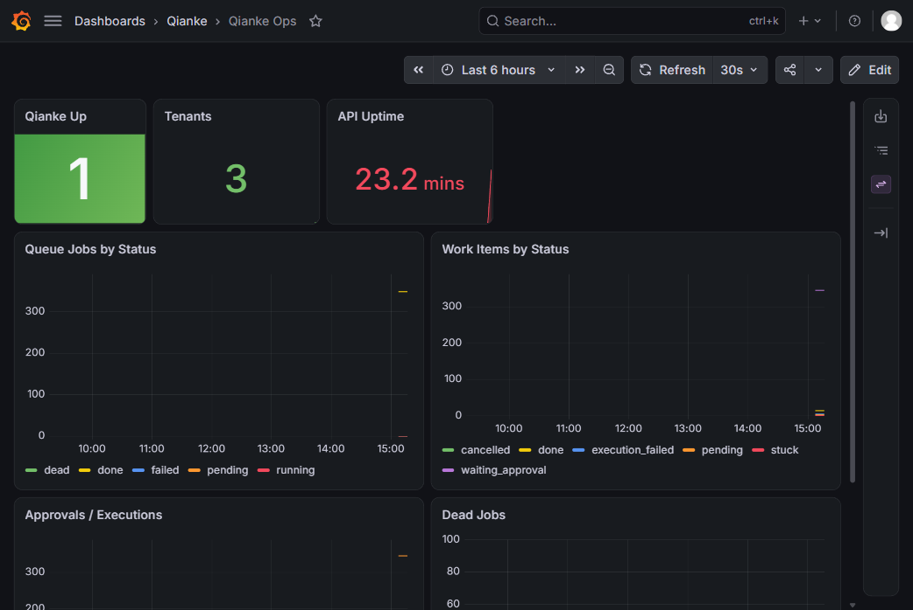

# 可观测性实际部署：Prometheus + Grafana + Alertmanager

> 日期：2026-11-05 · 状态：本机 Docker 已运行并验证

## 1. 运行组件

| 组件 | 容器 | 地址 |
|---|---|---|
| Prometheus | `qianke-prometheus` | http://127.0.0.1:9090 |
| Grafana | `qianke-grafana` | http://127.0.0.1:3000 |
| Alertmanager | `qianke-alertmanager` | http://127.0.0.1:9093 |
| API | 本机 | http://127.0.0.1:8080 |

Grafana 本地账号：

```text
admin / qianke-admin
```

仅本机试点使用，正式环境必须改成随机密码或接入 SSO。

## 2. Prometheus

配置：

```text
ops/prometheus.yml
```

抓取目标：

```text
http://host.docker.internal:8080/metrics
```

验证：

```text
targets: qianke → health=up
qianke_up = 1
```

规则：

```text
ops/alert-rules.yml
```

当前规则：

```text
QiankeApiDown
QiankeDeadJobs
QiankeQueueBacklog
QiankeStuckWorkItems
```

实际触发：

```text
QiankeStuckWorkItems firing
value=1
```

原因：历史数据里存在 1 个 STUCK 工作项；属于真实数据告警，不是配置错误。

## 3. Alertmanager

配置：

```text
ops/alertmanager.yml
```

当前 receiver 只落 Alertmanager UI，未接外部 webhook。需要通知时在 receiver 增加 webhook。

## 4. Grafana

Provisioning：

```text
ops/grafana/provisioning/datasources/prometheus.yml
ops/grafana/provisioning/dashboards/default.yml
ops/grafana/dashboards/qianke-ops.json
```

数据源：

```text
Prometheus → http://host.docker.internal:9090
```

Dashboard：

```text
Qianke Ops
uid=qianke-ops
7 panels
```

验证：

```text
/api/health → 200
/api/datasources → Prometheus
/api/search?query=Qianke → Qianke Ops
Grafana datasource proxy query qianke_up → 1
```

截图：



## 5. 启动命令

```bash
docker run -d --name qianke-prometheus --restart unless-stopped \
  -p 9090:9090 \
  -v "$PWD/ops/prometheus.yml:/etc/prometheus/prometheus.yml:ro" \
  -v "$PWD/ops/alert-rules.yml:/etc/prometheus/alert-rules.yml:ro" \
  prom/prometheus:latest

docker run -d --name qianke-alertmanager --restart unless-stopped \
  -p 9093:9093 \
  -v "$PWD/ops/alertmanager.yml:/etc/alertmanager/alertmanager.yml:ro" \
  prom/alertmanager:latest

docker run -d --name qianke-grafana --restart unless-stopped \
  -p 3000:3000 \
  -e GF_SECURITY_ADMIN_USER=admin \
  -e GF_SECURITY_ADMIN_PASSWORD=qianke-admin \
  -e GF_USERS_ALLOW_SIGN_UP=false \
  -v "$PWD/ops/grafana/provisioning:/etc/grafana/provisioning:ro" \
  -v "$PWD/ops/grafana/dashboards:/var/lib/grafana/dashboards:ro" \
  grafana/grafana:latest
```

## 6. 端口说明

本机 8000 落在 Windows 动态排除段 `7942–8041`，当前 API 跑在 8080。

固定域名已通过本地 cloudflared ingress 指向 8080：

```text
qianke.qiankeagent.com → http://127.0.0.1:8080
```

本地配置：

```text
ops/cloudflared.yml（不入库，含本机凭据路径）
ops/cloudflared.example.yml（模板）
```

实测：

```text
https://qianke.qiankeagent.com/health → 200 {"status":"ok"}
https://qianke.qiankeagent.com/ready  → 200 四项全绿
```

等管理员清理端口排除后，可把 ingress 改回 8000。

## 7. 已知限制

```text
Prometheus/Grafana 仅本机，未做持久化 volume
Grafana 使用默认本地密码
Alertmanager 未接外部通知
没有 Blackbox 探针
没有日志聚合（Loki）
没有告警值守/分组策略
```
