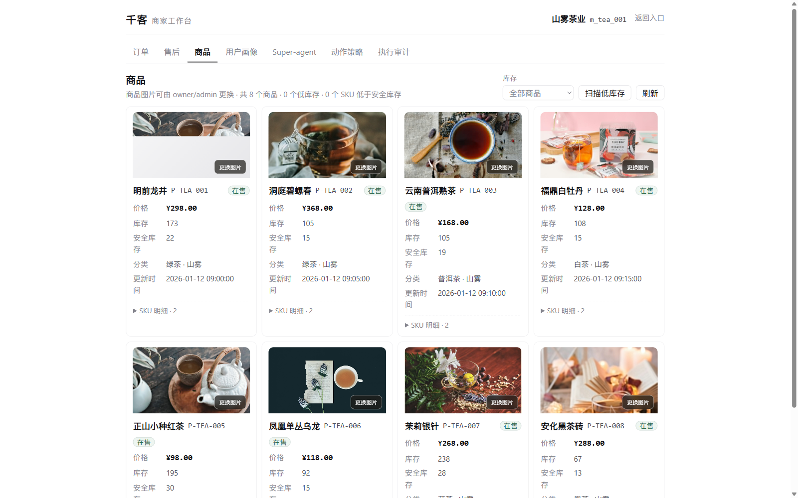
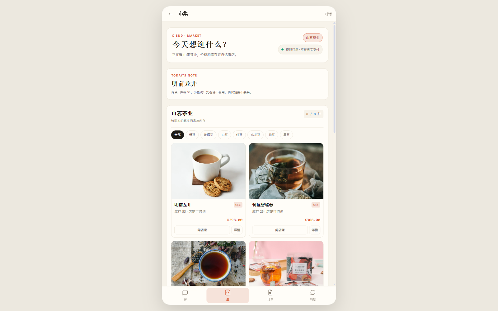
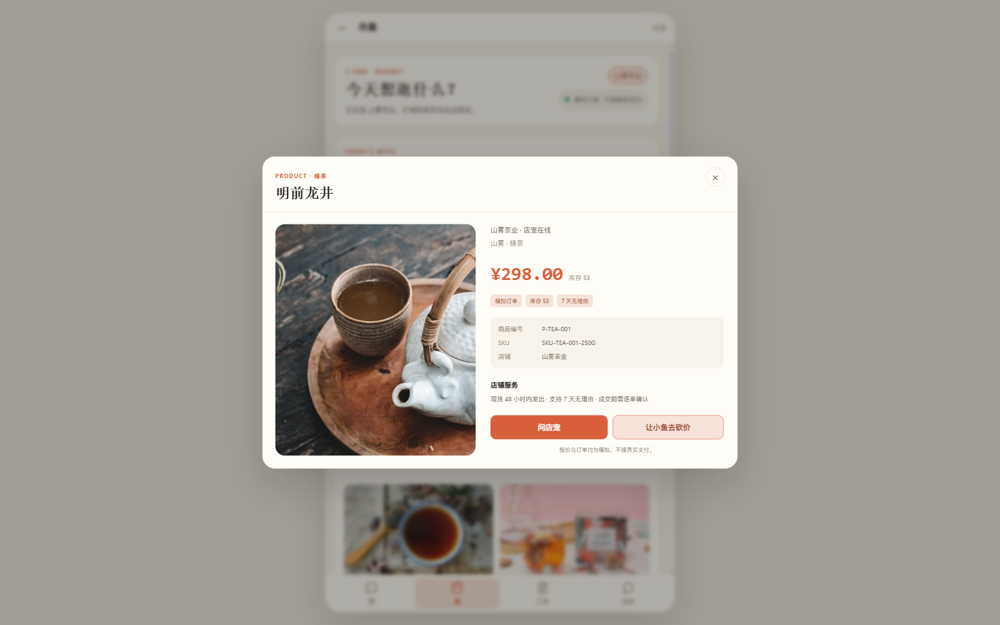
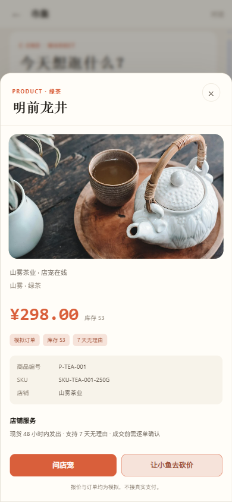
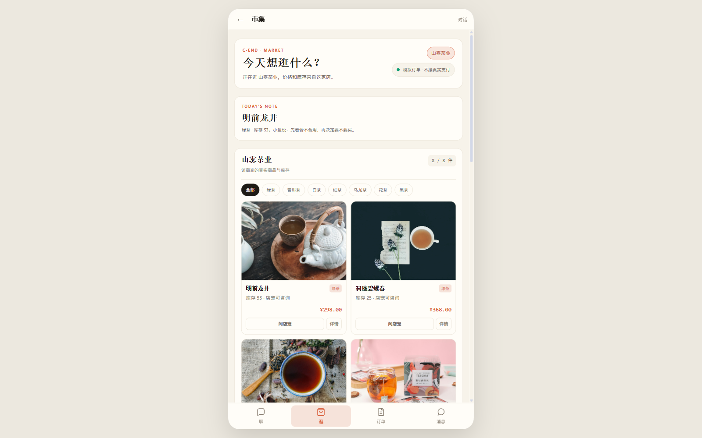
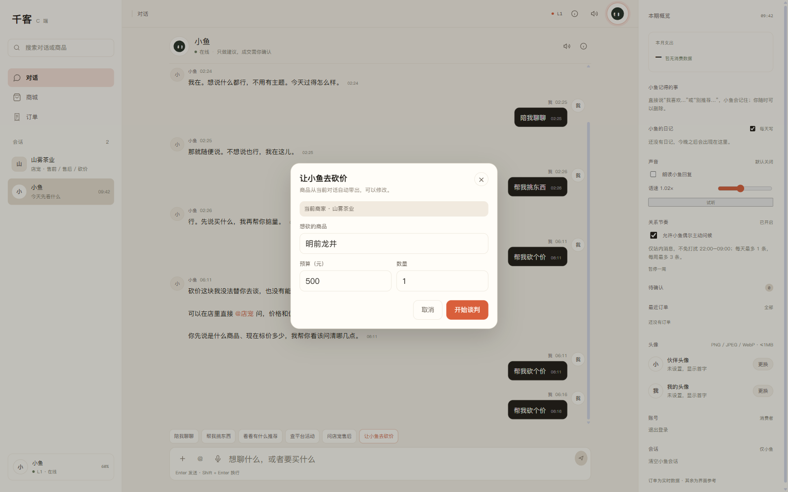
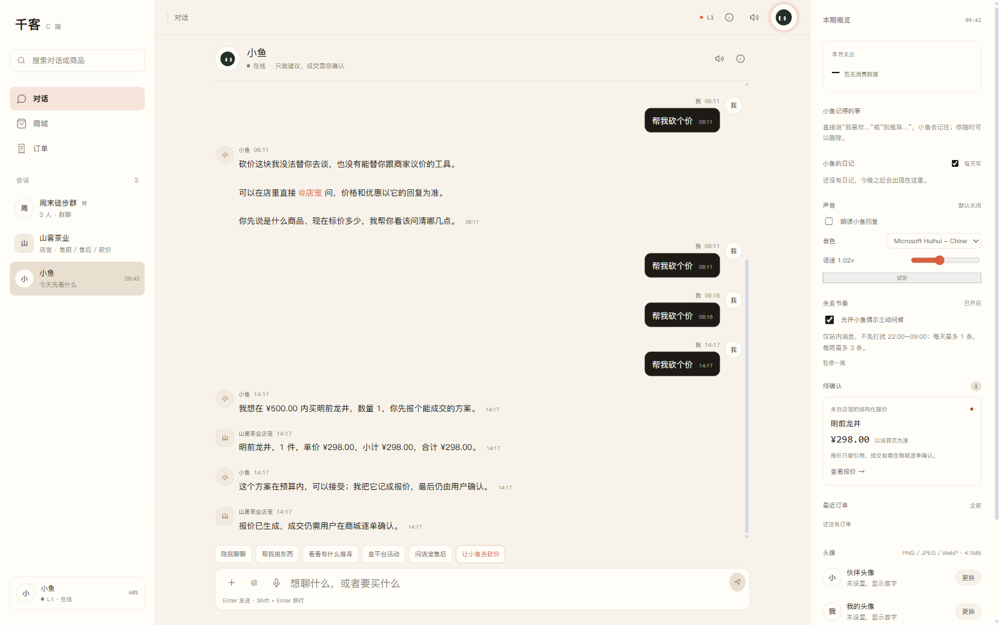

# P0 公网验收：商品图片 / CShop / 小伴砍价

日期：2026-11-12  
环境：`https://qianke.qiankeagent.com`

## 结论

主链路通过，验收中发现并修复了 3 个问题：

```text
1. PWA 缓存旧 JS，导致公网小伴砍价路由不生效
   → sw.js 缓存版本 v8/v7 → v9/v8

2. 公网真实 C 账号没有 store_tea 好友，小伴找不到当前商家
   → CShop 进店自动 POST /api/c/friends/merchants

3. 新账号没有订单历史，砍价确认层商品为空
   → CShop 记住上次浏览商品，CApp 优先读取

另外：CShop 图片加载瞬时失败后会永久降级为分类视觉
   → 每次商品列表刷新时清空图片错误状态
```

## 验收路径

### B 端上传

入口：

```text
https://qianke.qiankeagent.com/v2/b.html
测试账号：test_b_image / password123
绑定：m_tea_001（山雾茶业）
```

验证：

```text
8 个商品图片卡片
8 个「更换图片」入口
上传 P-TEA-002 成功
POST /api/b/workbench/products/P-TEA-002/image → 200
image_url 更新为 /uploads/products/m_tea_001/P-TEA-002.webp?v=...
```



### CShop 商品图

```text
https://qianke.qiankeagent.com/v2/index.html#/c?friend_id=store_tea&merchant_id=m_tea_001&merchant_name=山雾茶业
```

验证：

```text
8 个商品卡
8 张图片 complete=true / naturalWidth>0
商品详情大图正常
详情按钮：问店宠 / 让小鱼去砍价
无横向溢出（1600px / 390px）
```





手机端：



### CShop 详情砍价

实际请求：

```json
{
  "need": "明前龙井",
  "budget": 500,
  "quantity": 1,
  "friend_id": "store_tea"
}
```

结果：

```text
HTTP 200
status = ACCEPTED
报价：明前龙井 1 件 ¥298.00
双宠谈判达成，报价已生成
```



### CApp 小伴砍价

步骤：

```text
先逛 CShop，点击「明前龙井」详情
→ 进入 CApp 小伴会话
→ 输入「帮我砍个价」
→ 砍价确认层自动打开
```

验证：

```text
商家：当前商家 · 山雾茶业
商品：明前龙井（来自上次浏览商品）
POST /api/c/negotiations 携带 friend_id=store_tea
谈判成功
出现「来自店宠的结构化报价」卡片
```





## Console / Network

使用 Chrome DevTools 检查 B 端和 CShop：

```text
B 端：
  /api/b/workbench/products → 200
  /uploads/...webp → 200
  /static/products/...jpg → 200

CShop：
  /api/c/merchant/products → 200
  /api/c/friends/merchants → 200
  /static/products/... → 200
  /uploads/... → 200

页面 JS 错误：无
Network 失败：无
```

剩余 console 噪音：

```text
1. Cloudflare Insights 被 CSP report-only 记录
   - 不影响页面功能；当前 CSP 是 Report-Only
2. 隐藏 file input 缺少 name 属性
   - 已补 name="product-image"
```

## 剩余低风险问题

| 问题 | 影响 | 建议 |
|---|---|---|
| 上传图片返回 `application/octet-stream` | 浏览器仍能展示 | 下轮补 WebP MIME / 对象存储 |
| 小程序/浏览器首次加载时发送按钮短暂禁用 | 用户过早输入会无响应 | 加“正在恢复会话”显式态 |
| 单张图片首次加载失败后只降级到分类视觉 | 刷新后恢复 | 加一次自动重试 / 后退 |
| 商品只有单张主图 | 详情无轮播 | P1 做多图 |
| 测试账号历史含旧拒答消息 | 演示观感 | 验收后清理测试会话 |
| 本地 uploads 不在 git、无备份 | 部署迁移会丢 | P1 接对象存储 |

## 测试

```text
全量 pytest：756 passed, 5 skipped
图片/B 工作台定向测试：17 passed
前端 build：success
```

本轮不涉及 Agent 核心逻辑，未跑 Regression Eval。

## 下一步

P0 已通过，建议进入 **P1 商品图生产化**：

```text
1. 商品多图 images[] + 详情缩略图
2. 上传接对象存储 / CDN，补 WebP MIME
3. 图片缩略图与缺图占位
4. B 端删除/替换图片的审计
5. 清理测试账号会话与上传测试图
```
