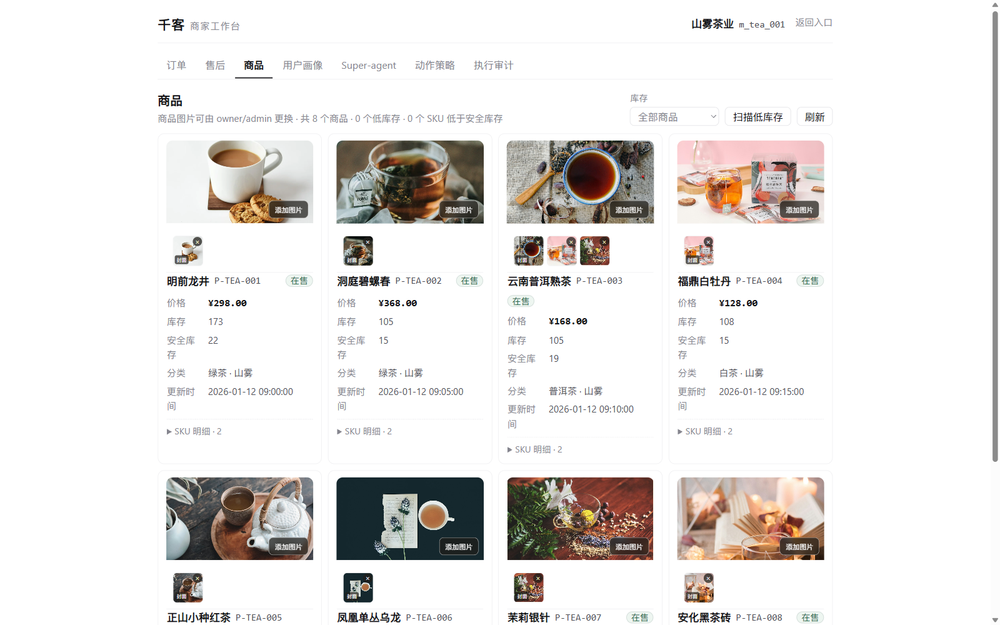
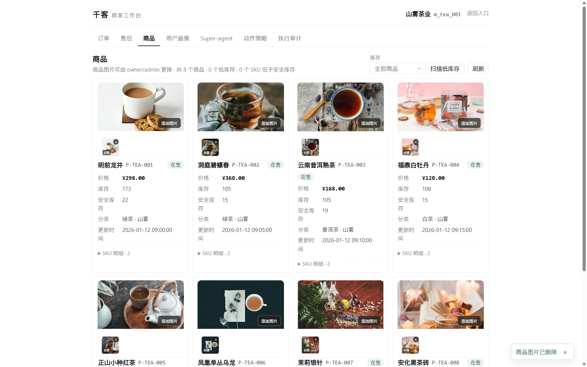
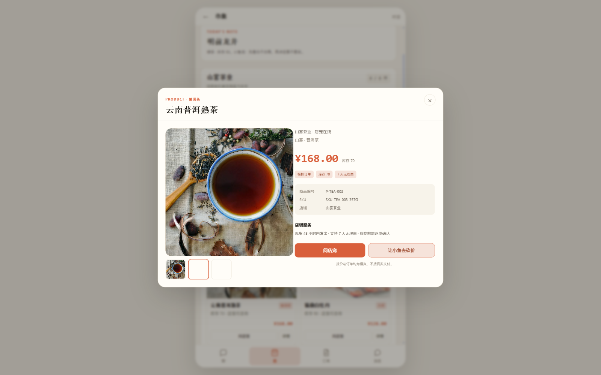

# P1：商品多图 / 缩略图 / 删除审计

日期：2026-11-12

## 已完成

```text
1. 商品多图 images_json
2. 上传自动生成 360px WebP 缩略图
3. CShop 详情缩略图切换
4. B 端添加多图 / 删除图片 / 首图封面
5. 图片操作审计 JSONL + 查询 API
6. WebP MIME 修正
7. CDN 前缀配置 QIANKE_PRODUCT_MEDIA_BASE_URL
```

## 数据模型

```text
m_product.image_url    保留为封面（兼容旧接口）
m_product.images_json  多图数组
```

示例：

```json
[
  {
    "url": "/uploads/products/m_tea_001/P-TEA-003-8ddf24d3bb.webp",
    "thumb_url": "/uploads/products/m_tea_001/P-TEA-003-8ddf24d3bb.thumb.webp"
  }
]
```

SQLite / PostgreSQL 启动时自动补 `images_json` 列。

## API

### 旧接口（兼容）

```text
POST /api/b/workbench/products/{product_id}/image
```

单张上传并重置图片列表。

### 多图追加

```text
POST /api/b/workbench/products/{product_id}/images
Content-Type: multipart/form-data
files: 多张图片
```

限制：

```text
单张 ≤ 2MB
PNG / JPEG / WebP
每个商品最多 8 张
第一张为封面
```

### 删除

```text
DELETE /api/b/workbench/products/{product_id}/images?url=...
```

删除第一张后自动顺延下一张为封面。

### 审计

```text
GET /api/b/workbench/products/{product_id}/image-audit
```

返回最近操作：

```json
{
  "action": "UPLOAD",
  "image_url": "/uploads/products/...",
  "actor_id": "135",
  "at": "2026-11-12T14:38:51+0800"
}
```

审计落本地：

```text
var/uploads/products/image-audit.jsonl
```

## B 端

商品卡展示：

```text
封面
缩略图横向列表
封面标记
× 删除
添加图片（多选）
```



删除已通过浏览器按钮验证，图片数量从 2 → 1，页面提示「商品图片已删除」，审计出现 `DELETE` 记录。



## CShop 详情轮播

详情页：

```text
主图
缩略图切换
当前缩略图高亮
```

实际验证：

```text
P-TEA-003 有 3 张图片
缩略图数量 = 3
点击第 2 张后主图切换为第 2 张 WebP
```



## 缩略图 / MIME

上传时生成：

```text
主图 1200px WebP
缩略图 360px WebP
```

实测响应：

```text
/uploads/.../P-TEA-003-8ddf24d3bb.webp
  → application/octet-stream（修复前）
  → image/webp（当前）

/uploads/.../P-TEA-003-8ddf24d3bb.thumb.webp
  → image/webp
  → 8.5KB
```

## CDN / 对象存储

当前默认本地磁盘：

```text
var/uploads/products/{merchant_id}/
```

支持 CDN 前缀：

```bash
QIANKE_PRODUCT_MEDIA_BASE_URL=https://cdn.example.com
```

`public_url()` 会把 `/uploads/...` 拼成 CDN URL。

生产环境接 OSS/S3 时，只需要替换 `product_media` 的写文件实现，商品 `images` 契约不变。

## 测试

```text
tests/test_merchant_product_image.py：8 passed
  - 单图 / 多图顺序 / 封面
  - 多图上传 + 主图/缩略图落盘
  - 删除 + 审计
  - 非图片拒绝
  - 租户隔离

全量 pytest：759 passed, 5 skipped
前端 build：success
```

## 已知限制

1. 目前只接了 CDN **前缀配置**，还没有云 OSS/S3 凭证与真实上传适配。
2. 审计落本地 JSONL，没有数据库审计表；生产建议改 DB/对象存储审计。
3. B 端还不支持手动选择封面；默认第一张为封面。
4. 种子图没有预生成缩略图，缩略图目前主要针对新上传图片。
5. 测试环境 P-TEA-003 仍有上传测试图；正式演示前可清理。
6. B 端多选 UI 已渲染并通过删除按钮验证；多图追加通过 API 验证。自动化对隐藏 file input 的文件选择存在渲染竞态，未把 UI 自动上传计为通过。
