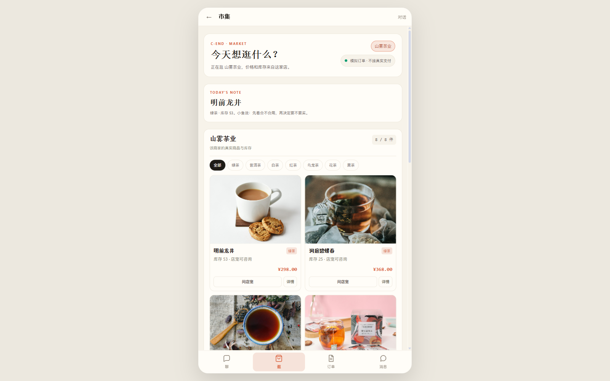
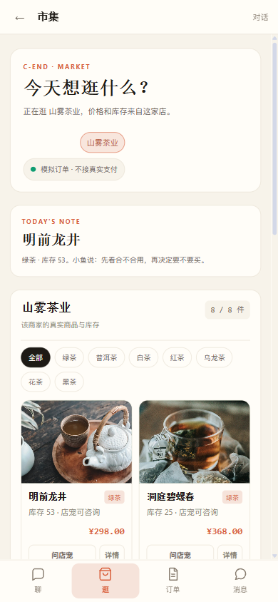
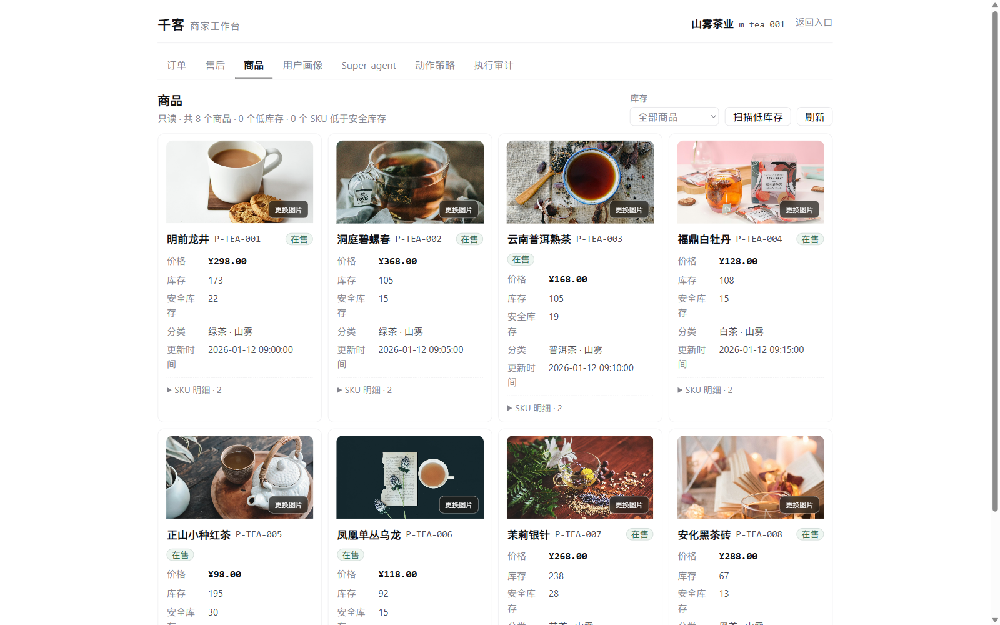
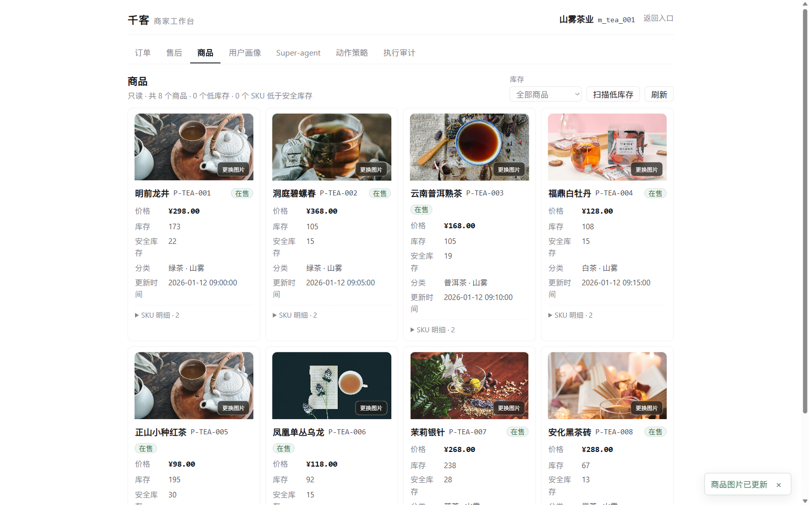
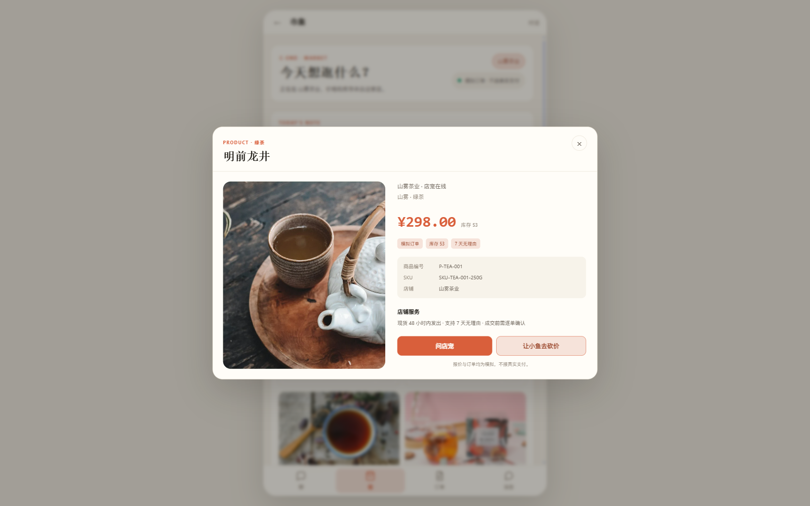

# 商品图片链路：公开茶图 + B 端上传 + CShop 展示

日期：2026-11-12

## 数据链路

```text
公开茶图
  → src/rag_demo/api/static/products/*.jpg
  → data/merchant/products.csv image_url
  → m_product.image_url
  → GET /api/c/merchant/products
  → CShop 商品卡 / 详情大图

商家上传
  → B 工作台商品卡「更换图片」
  → POST /api/b/workbench/products/{product_id}/image
  → Pillow 校验 + 转 WebP
  → var/uploads/products/{merchant_id}/{product_id}.webp
  → image_url = /uploads/products/...?v=...
  → CShop 立即使用新图
```

## 数据字段

`Product` 新增：

```python
image_url: str | None = None
```

接口返回：

```json
{
  "product_id": "P-TEA-001",
  "title": "明前龙井",
  "price": 298,
  "stock": 53,
  "image_url": "/static/products/tea-lungching.jpg"
}
```

## 示例图

8 个茶商品已配置公开 Unsplash 茶图：



手机端：



来源与许可：

[商品示例图来源与许可](../licenses/unsplash-tea-images.md)

## B 端更换图片

入口：`/v2/b.html` → 商品。

验收账号（仅本地演示环境）：

```text
test_b_image / password123
绑定 m_tea_001（山雾茶业）
```

每个商品卡：

```text
商品图
更换图片
商品标题 / 库存 / SKU
```



上传限制：

```text
PNG / JPEG / WebP
≤ 2MB
仅 owner/admin（operate_inventory 权限）
商品必须属于当前商家
```

上传成功后：

```json
{
  "product_id": "P-TEA-001",
  "image_url": "/uploads/products/m_tea_001/P-TEA-001.webp?v=..."
}
```



## CShop 商品详情

商家上传后的图片会立即出现在商品详情大图：



## 验证结果

```text
GET /api/c/merchant/products
  → 200，P-TEA-001 image_url=/static/products/tea-lungching.jpg

GET /static/products/tea-lungching.jpg
  → 200

B POST /api/b/workbench/products/P-TEA-001/image
  → 200，返回 /uploads/products/m_tea_001/P-TEA-001.webp?v=...

B 商品卡
  → 8 个图片预览 + 8 个「更换图片」入口

CShop
  → 8 个商品图正常渲染
  → 商品卡 4:3 图片位
  → 详情大图正常
  → 上传后图片 URL 切换为 /uploads/...

pytest
  → tests/test_merchant_product_image.py: 5 passed
  → 全量: 756 passed, 5 skipped
```

## 已知限制

1. 示例图是 Unsplash 公开茶图，不是对应商品的真实拍摄；商家应替换成自己的商品图。
2. 本地演示存储落 `var/uploads`；生产环境应换对象存储 / CDN，商品 `image_url` 契约不变。
3. 当前只支持单张主图，没有多图轮播；详情页先展示主图。
4. 上传只允许 owner/admin；staff 看不到「更换图片」入口。
5. 全量 pytest：756 passed / 5 skipped。
## 全量演示商品封面（2026-11-16）

CShop 默认市集之前只显示字母占位，因为大部分商品没有图片。

本次补齐所有商品：

```text
m_gear_002       10 个商品
m_sim_outdoor     3 个
m_sim_home        3 个
m_sim_coffee      3 个
m_sim_stationery  3 个
m_sim_fresh       3 个
----------------------
新增 25 张封面
```

已有图片保持不动：

```text
m_tea_001   8 张茶图
m_sim_tea   3 张茶图
```

生成脚本：

```text
scripts/fill_product_images.py
```

封面为确定性演示图（品牌 + 商品名 + 类目 + 商品编号），落盘：

```text
src/rag_demo/api/static/products/generated/*.png
```

并通过 `MerchantRepository.set_product_images` 写回：

```text
m_product.image_url
m_product.images_json
```

验证结果：

```text
全部商家商品缺图：0
CShop 默认 10 个商品缩略图：全部 900×900 正常加载
B 端商品表格同图显示
```


## 真实商品照片替换（2026-11-16）

商品封面已从程序生成图替换为 Pexels 真实照片：

- 25 个商品：m_gear_002 10 个、m_sim_outdoor / home / coffee / stationery / fresh 各 3 个
- 图片落盘：`src/rag_demo/api/static/products/real/*.jpg`
- 来源与许可：`docs/licenses/pexels-product-images.md`
- CShop 默认 10 个商品：全部加载真实照片
- B 端商品表格：显示同一张真实缩略图


图片是真实商品/场景照片，不是每个 SKU 的官方产品图；生产环境应替换为品牌授权素材。
