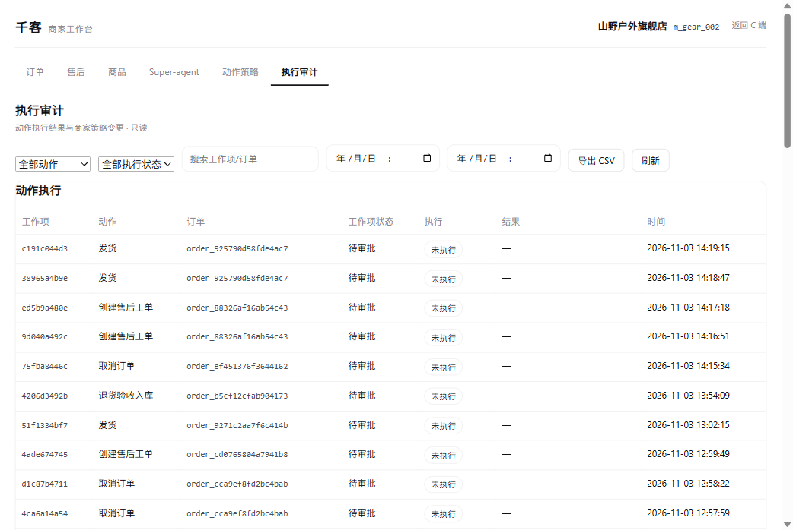

# 生产安全加固与租户试点

> 日期：2026-11-05 · 状态：已落地安全头、限流、策略审计哈希链与租户试点；SSO/PII/WORM 仍未做

## 1. 已落地

| 项 | 状态 | 证据 |
|---|---|---|
| 登录态 / 密码哈希 | ✅ 已有 | `rag_demo/auth.py`，Argon2 |
| 角色权限 owner/admin/staff | ✅ 已有 | 租户 API、B 工作台 |
| 租户数据隔离 | ✅ 已有 | `merchant_id` 作用域 + 跨租户守卫 |
| 高风险动作人工审批 | ✅ 已有 | Super-agent HITL |
| 动作策略/金额上限 | ✅ 已有 | `c_merchant_policy` |
| 执行审计 | ✅ 已有 | `sa_approval` + 审计页 |
| 策略审计哈希链 | ✅ 本次新增 | SHA-256 链式 `prev_hash/entry_hash` |
| 审计锚点 / 只追加 | ✅ 本次新增 | `c_policy_audit_anchor` + 触发器 |
| 日志 PII 脱敏 | ✅ 本次新增 | 手机号 / 邮箱 / 身份证 |
| CSP Report-Only | ✅ 本次新增 | 不强制执行，先观察违规 |
| SQL 只读防御 | ✅ 已有 | SELECT-only / 白名单 / LIMIT |
| 安全响应头 | ✅ 本次新增 | `api/security.py` + 2 tests |
| 登录失败限流 | ✅ 本次新增 | 5 次 / 300s，单进程内存 |
| 生产监控告警 | ✅ 本次部署 | Prometheus/Grafana/Alertmanager |

安全响应头：

```text
X-Content-Type-Options: nosniff
X-Frame-Options: SAMEORIGIN
Referrer-Policy: strict-origin-when-cross-origin
Permissions-Policy: geolocation=(), microphone=(), camera=()
Content-Security-Policy-Report-Only（report-uri /security/csp-report）
Strict-Transport-Security（仅 HTTPS）
```

CSP 上报：

```text
POST /security/csp-report → 204
最多记录 120 条/分钟，防止刷日志
```

PII 脱敏：

```text
13800138000 → 138****8000
alice@example.com → a***@example.com
110101199001011234 → 110101********1234
```

策略审计哈希链 + 锚点：

```text
每条策略变更记录 prev_hash + entry_hash
entry_hash = SHA256(prev_hash | canonical(payload))
锚点表 c_policy_audit_anchor 只允许 INSERT
锚点记录 checked / head_hash，用于发现尾部删除
```

校验：

```bash
python scripts/anchor_policy_audit.py --merchant m_gear_002
python scripts/verify_policy_audit_chain.py --merchant m_gear_002
# 或 GET /api/superagent/audit/policy/verify
```

限制：

```text
历史记录不回填（从启用后开始校验）
锚点在本机 PG，灾难级删除仍需异地 WORM 备份
```

B 工作台：



## 2. 租户试点

试点租户：

```text
merchant_id: m_pilot_001
owner: aaa / myc6666
补偿上限: 40
退款上限: 300
```

冒烟：

```bash
python scripts/tenant_pilot_smoke.py
```

隔离契约测试：

```bash
pytest tests/test_tenant_isolation_pg.py -q
# 1 passed
```

检查：

```text
tenant_exists
owner_bound
policy_initialized
work_items_scoped
```

## 3. 未完成（生产阻断项）

```text
SSO / MFA
PII 存储加密 / 数据分级
分布式登录限流（当前为单进程内存）
WAF / IP 白名单
审计 WORM / 异地备份（本机锚点已只追加）
Secrets Manager（当前 .env）
CSP 强制执行（当前 Report-Only）
依赖漏洞扫描与 SBOM
渗透测试
数据保留与删除策略
租户级配额/计费
```

## 4. 上线前最低清单

```text
[ ] Grafana 密码改为随机并纳入密钥管理
[ ] Alertmanager 接真实通知渠道
[ ] 审计日志只追加 + 备份
[ ] 租户数据导出/删除流程
[ ] 登录失败限流改成 Redis/PG 分布式
[ ] HTTPS/HSTS 在入口生效
[ ] 依赖漏洞扫描通过
```
