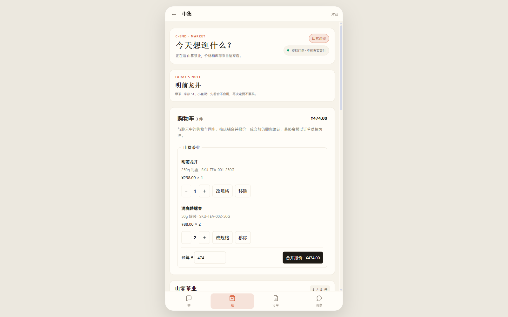
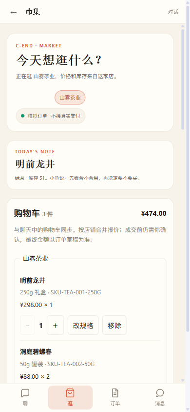
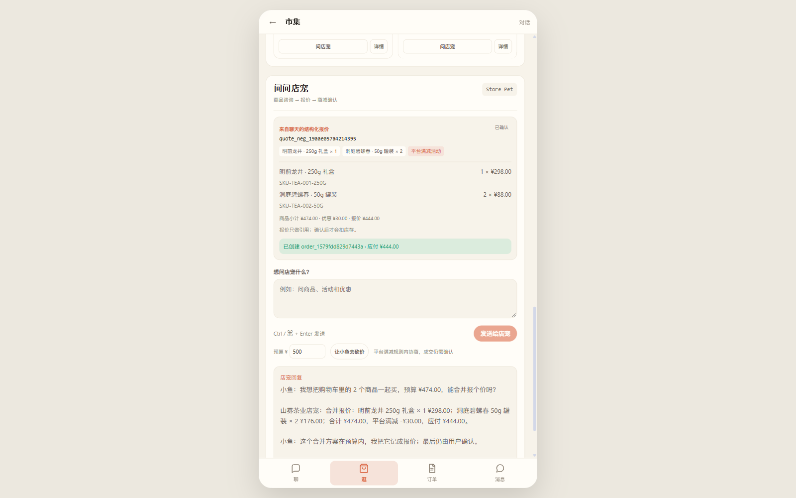

# 公网验收：CShop × CApp 共享购物车

日期：2026-11-13

环境：

```text
站点：https://qianke.qiankeagent.com
分支：agent @ 3150052
PWA：v20
执行：Playwright + Chrome DevTools MCP
```

## PWA 缓存迁移

验收前清理旧缓存：

```text
清理前缓存：qianke-c-end-shell-v18 / qianke-c-end-static-v19
注销旧 Service Worker
清理旧 cache
重新加载
```

重新注册后：

```text
Service Worker scope：https://qianke.qiankeagent.com/v2/
sw.js：qianke-c-end-static-v20 / qianke-c-end-shell-v20
当前缓存：qianke-c-end-shell-v20
```

## 桌面端

CApp 加购两种茶 50g 各 2 件：

```text
明前龙井 50g 罐装 × 2
洞庭碧螺春 50g 罐装 × 2
购物车角标：4
```

进入 CShop 后读取同一 `qianke:cart`：

```text
购物车 4 件
明前龙井 50g 罐装 ¥68.00 × 2
洞庭碧螺春 50g 罐装 ¥88.00 × 2
合计 ¥312.00
```



CShop 内改规格与数量：

```text
明前龙井 50g × 2
→ 250g 礼盒 × 1
→ 合计 ¥474.00
```

## 手机端

390 视口下：

```text
documentElement.clientWidth：380
documentElement.scrollWidth：380
购物车行：2
无横向溢出
```



## 合并报价与下单

报价：

```text
商品小计 ¥474.00
平台满减 ¥30.00
应付 ¥444.00
```

确认订单：

```text
order_1579fdd829d7443a
应付 ¥444.00
```



成交后：

```text
CShop 购物车：0 件
CApp 角标：消失
localStorage qianke:cart：[]
```

## 技术检查

Chrome DevTools：

```text
Console errors / warnings：0
主 JS：main-CPHSO3ep.js 200
whoami / friends / companion / orders / unread / groups：全部 200
```

## 结论

```text
公网 CApp → CShop 共享购物车：通过
公网规格 / 数量编辑：通过
公网合并报价：通过
公网准备 / 确认订单：通过
成交后两入口清空：通过
手机视口无横向溢出：通过
PWA v20 缓存迁移：通过
```

## 限制

- 手机验收使用 390px CSS 视口，不是真机触摸 / 软键盘。
- 购物车仍为同源浏览器本地数据，不跨设备。
- 该次验收产生测试订单 `order_1579fdd829d7443a`，演示前应清理。
