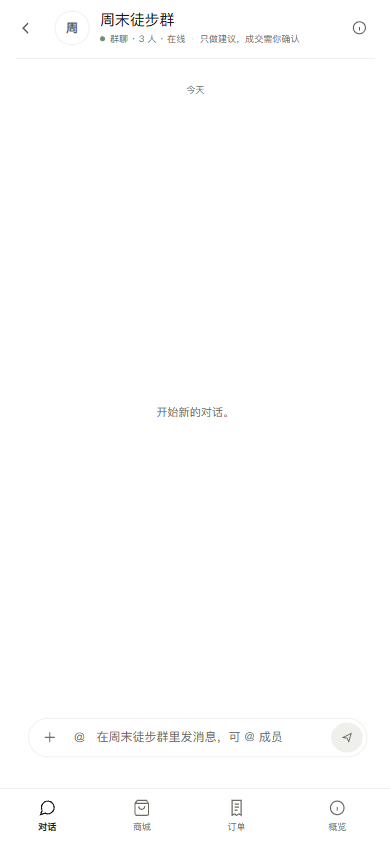

# 千客系统验收报告

> 日期：2026-11-10 · 范围：后端、运维、C 端与 B/A 端主要前端页面 · 结论：**可内部试点，不建议直接公开生产**

## 一、结论

核心链路和主要页面可用，生产预检全部通过；本次验收发现并修复 2 个真实问题：

```text
平台监控/Token 账单/计费页 500：ai_monitor / chat_history 使用了导入时缓存的旧 PG 配置（5432）
首页 Lighthouse：页脚对比度不足、缺少 meta description
```

修复后：

```text
710 passed, 5 skipped
production_preflight.py -> OVERALL PASS
Lighthouse 首页：Accessibility 100 / Best Practices 100 / SEO 100
19 个主要前端路由：0 console error、0 个 /api 或 /v2 4xx/5xx
C App 390px 移动端：无横向溢出
```

## 二、已修复

### 1. 监控/账单页 500

根因：

```text
ai_monitor._connect() / chat_history._connect()
-> auth.PG_CONFIG（模块导入时缓存）
-> port 5432
实际 pgvector 映射 15432
```

修复：

```text
auth.current_pg_config() 动态读取 .env
ai_monitor / chat_history 改用动态配置
新增 tests/test_auth_pg_config.py
```

复测：

```text
/api/monitor/overview             200
/api/admin/billing/prices         200
/api/admin/monitor/tenants        200
/api/billing/wallet               200
/api/billing/invoices             200
```

### 2. 首页可访问性/SEO

```text
页脚文字对比度 3.36 -> 5.23
补充 meta description
Lighthouse: 96/91 -> 100/100
```

截图：



## 三、页面验收

| 页面 | 结果 |
|---|---|
| 官网 /home | 正常；Lighthouse 100/100/100 |
| 工作台 / | 正常 |
| 对话 /chat | 正常 |
| Agent /agent | 正常 |
| 任务看板 /agent/actions | 正常 |
| 我的 AI /my-agent | 正常 |
| C 商城 /c | 正常（mock 商品库） |
| 社交消息 /c/social | 正常（mock IM） |
| 我的订单 /c/orders | 正常（空状态） |
| C App /c/app | 正常；移动端无横向溢出 |
| C 端审计 /admin/c-end | 正常 |
| 知识库 /kb、/kb/docs | 正常 |
| 员工管理 /staff | 正常 |
| 权限配置 /settings | 正常 |
| 离线评测 /eval | 正常 |
| 实时监控 /monitor | 修复后正常 |
| Token 账单 /billing | 修复后正常 |
| 平台监控 /admin/monitor | 修复后正常 |

## 四、仍然缺什么

### P0：上线前必须处理

1. **告警没有真正通知人**
   - Prometheus 正在 firing `QiankeStuckWorkItems`。
   - Alertmanager 只有默认 receiver，没有邮件/Webhook/企业微信配置。
   - 当前效果：告警面板能看到，但没人会收到通知。

2. **备份过期**
   - `backups/` 最新目录是 2026-11-05，之后没有新备份。
   - 没有找到千客专用备份计划任务。
   - 需要确认备份 cron/计划任务，并做一次恢复演练。

3. **Docker Desktop 单点**
   - 11-09、11-10 两次整站不可用，都是 Docker Desktop 停止。
   - 容器 restart policy 是 `unless-stopped`，但 Docker Desktop 本身没有随系统启动/守护。
   - 需要开机自启 + 外部健康检查 + 自动拉起。

4. **审批积压**
   - `WAITING_APPROVAL` 347 条，`PENDING` 审批 347 条。
   - `STUCK` 1 条：`saw_6a7a025aaf3c4fd5`，2026-11-02 起未处理。
   - `EXECUTION_FAILED` 5 条。
   - 需要人工清理/重放，否则监控会长期告警。

5. **凭据文件仍在磁盘**
   - `var/credential-rotation-final.txt` 仍存在，包含 PG / 只读账号密码。
   - 文件里的 admin 密码已失效（说明密码已改），但 PG 凭据仍需按敏感文件处理。
   - 建议删除文件或迁入密钥管理，并确认 `.gitignore` 未跟踪。

### P1：影响可信度/运营

6. **PG 观察没有连续运行**
   - `logs/control_pg_observation_20261109_recovery.jsonl` 最后写入 2026-11-09 21:52。
   - 没有新的 24h 观察证据。

7. **快递查询只有兜底**
   - 快递100 API 未配置凭据，服务端查询返回 503。
   - 订单页“去快递100查询”可用，但小鱼无法自动分析真实物流节点。
   - 签收回调接口已就绪，但没有真实物流商转发。

8. **C 端部分页面仍是演示数据**
   - C App 月度支出 `¥1,286`、部分会话/概览是静态参考；页面自己也标注“订单为实时数据 · 其余为界面参考”。
   - C 商城商品库、社交 IM 仍是 mock。
   - Dashboard 数字来自接口，但 demo 数据集不是生产数据。

9. **交易/物流仍是模拟**
   - 支付、真实订单、真实物流、真实 IM 都未接入。
   - 当前只能定位为内部试点/演示，不应对外承诺真实交易。

10. **日志噪音**
    - API 日志仍保留修复前的 5432 连接错误堆栈，缺少按启动切分/轮转。
    - 建议日志按日期/进程切分，避免历史错误干扰排障。

### P2：体验/工程

11. 前端无自动化视觉回归；本次靠 Playwright 人工巡检。
12. C App、C 商城、社交页仍有静态演示态，未完全接真实数据。
13. 没有真实 Push/IM 主动通知；关系节奏仍是打开 App 时检查。
14. 备份保留/恢复演练没有自动化验证。
15. 没有前端错误上报（Sentry 类）与用户行为分析。

## 六、C/B 账号补验\n\n前面主要是平台管理员视角；本轮另建临时 C 端买家和 B 端商家账号补验，完成后已清理。\n\n### C 端买家账号\n\n```text\n/c           C 商城正常，商品价格/库存来自确定性商品库\n/c/social    社交消息正常；明确标注 mock IM\n/c/orders    新账号空状态正确\n/c/app       C App 正常；无 console error\n```\n\nC App 实测：\n\n```text\n发送「我喜欢跑步，我的预算 500 元，别给我推荐跑鞋」\n-> 自动进入 companion 模式\n-> 回复不再推商品\n-> 小鱼记得的事出现 3 条：喜欢跑步 / 预算 500 元 / 不要推荐跑鞋\n-> 关系节奏设置可见，默认关闭\n```\n\n但发现一个真实 C 端体验缺口：**新账号仍然看到演示会话和静态概览**。\n\n```text\n新账号没有 c_app_message\n但 C App 仍显示 4 个种子会话、历史订单商品对话、\n「本月支出 ¥1,286」、1 条待确认报价\n```\n\n这会让真实买家误以为历史记录是自己的。建议：\n\n```text\n演示种子只对 demo 账号展示\n真实新账号从空会话开始\n月度支出/待确认报价改为接口数据或空状态\n```\n\n### B 端商家账号\n\n使用 `audit_b_temp` 绑定 `m_gear_002`，owner 角色：\n\n```text\n/v2/b.html 正常打开\n订单：66 单，可筛选、发货、完成、取消\n售后：24 单，可查看退货运输、验收\n商品：10 个，只读\nSuper-agent：50 个工作项，可审批\n动作策略：可配置动作/金额上限\n执行审计：可查看动作执行结果与 CSV\n```\n\n页面无 console error，B 端租户作用域正常（只看到 m_gear_002）。\n\n但发现一个 B 端运营缺口：**商品页所有商品库存显示 “—”。**\n\n```text\n商品 API 返回 skus，但 sku 数据没有 available_qty\nB 工作台商品页没有库存字段可显示\n```\n\n商家无法在 B 工作台判断真实可售库存；需要补库存汇总 API/展示，或明确标注“库存以仓库系统为准”。\n\n## 五、建议下一步

按顺序：

```text
1. 配 Alertmanager 邮件/企业微信 receiver，确认告警能到人
2. 恢复备份计划任务，做一次恢复演练
3. 清理 347 条待审批 + 1 条 STUCK + 5 条 EXECUTION_FAILED
4. Docker Desktop 开机自启 + 外部健康检查
5. 删除/迁移 credential-rotation-final.txt
6. 重新启动 24h PG 观察并出报告
```

完成 1–5 后，才适合从“内部试点”提升到“小范围生产”。


