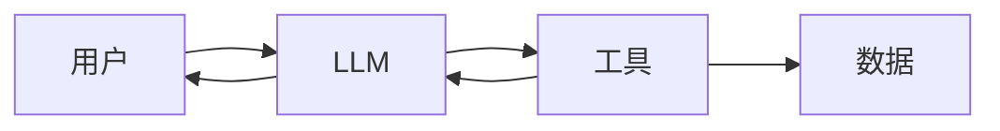
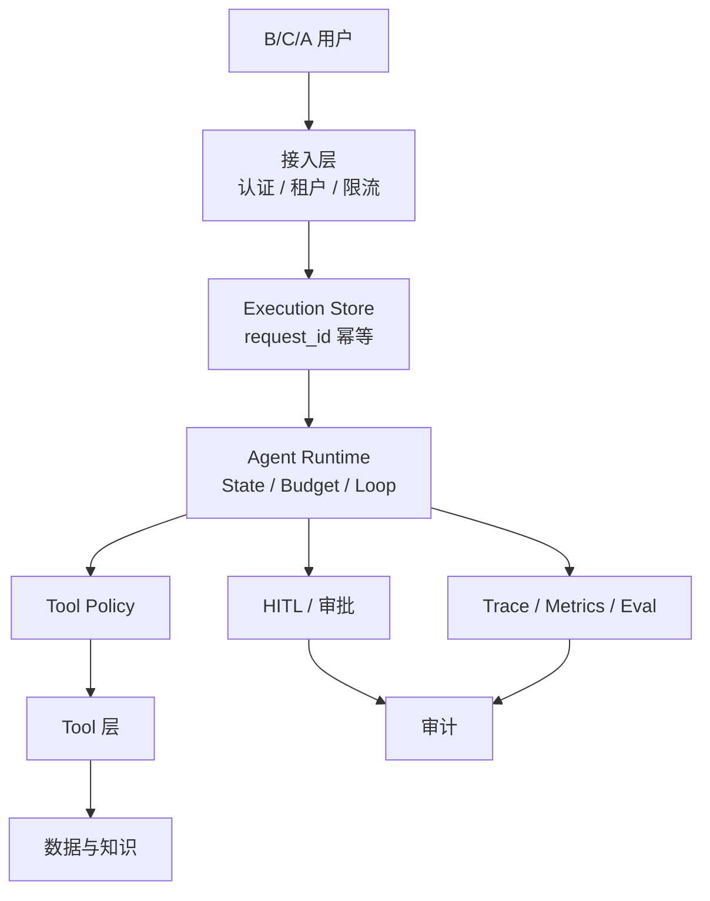

# 普通 Agent 与企业级 Agent 的区别

> 本文承接第一篇《企业级 Agent 架构设计：从 ReAct 到可治理的智能体系统》。  
> 第一篇回答“企业级 Agent 总体怎么分层”；本文回答一个更具体的问题：  
> **一个能跑 Demo 的 Agent，距离企业级 Agent 还差什么？**

## 1. 为什么需要区分“普通 Agent”和“企业级 Agent”

### 1.1 同样叫 Agent，目标完全不同

普通的 LLM Agent 通常只追求：

```text
用户提问
→ 模型决定是否调用工具
→ 工具返回结果
→ 模型生成回答
```

它关注的是“能不能完成一次任务”。

企业级 Agent 还要回答：

```text
是谁在调用？
能访问哪个租户的数据？
能调用哪些工具？
失败会不会重复执行？
风险动作谁批准？
结果能不能审计和复现？
系统如何评测和持续改进？
```

企业级 Agent 不是“普通 Agent + 更多工具”，而是“普通 Agent + 确定性治理体系”。

### 1.2 两类失败的成本不同

| 失败类型 | Demo Agent 的后果 | 企业级 Agent 的后果 |
|---|---|---|
| 答错 | 用户重问 | 错误经营决策、错误报表 |
| 越权查询 | 一般不涉及 | 跨租户数据泄露 |
| 工具误调用 | 重新执行 | 重复创建任务、错误修改状态 |
| 超时 | 刷新页面 | 长任务中断、资源占用、重复提交 |
| 无审批执行 | Demo 里可接受 | 高风险业务动作失控 |
| 无审计 | 难以复盘 | 无法追责、无法评测 |

所以企业级设计的第一原则不是“让 Agent 更聪明”，而是：

```text
让模型负责智能，让系统负责边界。
```

### 1.3 本文的比较维度

本文从七个维度比较：

```text
1. 运行机制
2. 身份与租户
3. 工具与权限
4. 数据访问
5. 人工审批
6. 可靠性
7. 可观测性与评测
```

这七个维度也是判断一个 Agent 能否进入企业环境的检查表。

## 2. 普通 Agent 的最小运行机制

### 2.1 一个典型 Demo Agent

```python
while not finished:
    response = llm.invoke(messages)
    if response.tool_calls:
        result = execute_tools(response.tool_calls)
        messages.append(result)
    else:
        finished = True
```

它通常具备：

```text
LLM
Tool Calling
对话消息
简单循环
最终回答
```

它通常不具备：

```text
身份认证
租户隔离
工具级授权
预算/步数约束
幂等
重试
Checkpoint
人工审批
审计
离线评测
```

这不是说 Demo Agent 没有价值，而是它的设计目标不同：验证模型能否使用工具，不是承担企业责任。

### 2.2 Demo Agent 常见实现

```text
固定一个用户
固定一个数据源
固定一组工具
没有身份上下文
没有数据范围
没有失败恢复
没有运行时观测
```

在 Demo 中，这些简化是合理的；一旦接入真实业务，它们就会变成风险。

## 3. 企业级 Agent 的七个新增边界

### 3.1 身份与租户

普通 Agent：

```text
用户输入就是全部上下文
```

企业级 Agent：

```text
登录账号 → 角色 → 企业/商家 → dataset/租户
```

必须确认：

```text
当前账号属于哪个企业？
能访问哪个商家/数据空间？
租户 ID 由谁决定？
模型能否覆盖租户参数？
```

Qianke 的当前实现：

```text
认证/会话：已实现
企业 dataset 绑定：已实现
dataset_scope / _tenant_scope：已实现
前端不能传 dataset/tenant 决定数据范围
```

状态依据：

```text
src/rag_demo/api/main.py::_tenant_dataset / _tenant_scope
docs/数据模型.md
```

### 3.2 工具与权限

普通 Agent：

```text
模型想调用什么工具，就执行什么工具
```

企业级 Agent：

```text
角色 → ToolPolicy → 允许的 Tool 集合
→ LLM bind_tools
→ 执行前再复核
```

Qianke 当前实现：

```text
ToolPolicy.for_account：已实现
执行时未授权 Tool → TOOL_NOT_ALLOWED：已实现
7 个注册 Tool：已实现
商家操作者的 API 级二次收口：已实现
```

但要注意：

```text
Tool Policy 只决定“能不能调用工具”；
不决定“工具能看到哪些数据”；
也不决定“任务还能不能继续执行”。
```

### 3.3 数据访问边界

普通 Agent：

```text
工具拿到连接就查
```

企业级 Agent：

```text
数据集/租户绑定
∩ SQL 只读 / 表白名单 / LIMIT
∩ 行/列/字段权限
∩ 审计与脱敏
```

Qianke 当前状态：

```text
dataset/租户：已实现
SQL 只读 + LIMIT：已实现
表/行/列级 Data Access Policy：分散实现，未统一
SQL 安全测试：有部分覆盖
```

### 3.4 人工审批

普通 Agent：

```text
模型直接回答或执行
```

企业级 Agent：

```text
低风险：自动执行
高风险：生成待确认动作
人工确认后才执行
执行结果有审计
```

Qianke 当前实现：

```text
受控写草稿 prepare_followup_task：已实现
独立 confirm_agent_action API：已实现
B 端主链路通用 HITL / interrupt resume API：未接入；C 端已有专用 interrupt/resume；Super-agent 有独立审批
Super-agent 审批链路：独立实现
```

### 3.5 可靠性

普通 Agent：

```text
一次调用；失败就重试
```

企业级 Agent：

```text
request_id 幂等
execution_id 追踪
timeout / cancel
retry 语义
checkpoint
失败终态
```

Qianke 当前实现与限制：

```text
request_id 幂等：已实现
execution_id / parent_execution_id：已实现
max_steps / max_tool_calls / timeout / token budget：已实现
retry：已实现（API 请求默认 max_retries=0；run_agent_with_retry 函数默认 1）
LangGraph checkpointer：已接入，有限使用
wall timeout：调用方等待上限，不是硬取消
B 端通用 HITL resume：未完成；C 端专用链路已实现
```

### 3.6 可观测性

普通 Agent：

```text
打印 Prompt / 回答
```

企业级 Agent：

```text
trace_id
request_id
execution_id
tool call
latency
token / cost
error
audit
```

Qianke 已有：

```text
event_trace
ai_monitor
LangSmith 可选
Eval 报告
```

仍缺：

```text
统一生产 SLO
成本看板
安全指标持续看板
```

### 3.7 评测

普通 Agent：

```text
人工看几条回答
```

企业级 Agent：

```text
Regression / Benchmark
业务正确性
工具策略合规
工具执行成功
错误恢复
安全对抗
成本/延迟
```

Qianke 已实现：

```text
Regression 20
Benchmark 80
Business Correctness
Tool Policy Compliance
Tool Execution
Error Recovery
```

具体基线以 `tests/evals/agent/` 为准，不在本文复制所有数字。

## 4. 架构对比

### 4.1 普通 Agent



特点：

```text
最短路径
最少组件
没有治理层
```

### 4.2 企业级 Agent



差异不是“多几个框”，而是：

```text
每个框都有明确的失败语义和边界
```

### 4.3 当前 Qianke 与目标架构

Qianke 当前是：

```text
B 端交互式 Agent Runtime
+ 独立 Super-agent 异步链路
+ 独立 C 端 Agent Graph
+ A 端审计/监控
```

目标态是：

```text
B/C/A 共享 Runtime、Tool、HITL、Trace
```

这是“已设计/规划中”，不是已上线。不要把目标架构图当作当前运行图。

## 5. 工具、权限与数据访问不是同一件事

这是普通 Agent 升级为企业级 Agent 时最容易混淆的地方。

| 层 | 决定 | 典型问题 |
|---|---|---|
| Runtime Policy | 任务能否继续 | 步数、超时、token、取消 |
| Tool Policy | 能否调用该工具 | 角色是否被允许用 SQL/RAG |
| Data Access Policy | 工具能看到什么数据 | 租户、表、行、列、只读 |

正确理解：

```text
ToolPolicy 允许调用 execute_sql
≠ 允许查询任意租户
≠ 允许执行任意 SQL
≠ 允许无限步数运行
```

三者必须分别实现、分别测试。

## 6. 可靠性差异

### 6.1 幂等

普通 Agent：

```text
重试 = 再跑一次
```

企业级 Agent：

```text
request_id + scope + hash
→ Execution Store
→ 回放 / 冲突 / 失败
```

Qianke 当前：

```text
已完成请求可回放
执行中重复请求返回 409
同 request_id 不同 query 返回 409
失败请求是否回放取决于 Execution Record 状态
```

### 6.2 Execution Record 与 Agent Result

```text
Execution Record = COMPLETED
≠
Agent Result = COMPLETED
```

如果 runner 正常返回 `status=FAILED`，当前代码仍会 `store.complete`，保存的是“带失败终态的响应”。

这不是文字游戏，而是回放语义的基础。

### 6.3 Timeout 与 Cancel

```text
Agent 内部 timeout：60s，Runtime 检查
wall timeout：70s，调用方等待上限
cancel：协作式取消
hard kill：当前没有
```

wall timeout 后：

```text
API 可以返回 504
Execution Record 可能 FAILED
worker 仍可能继续收尾
```

详细代码核验见第一篇 V0.5.2 §6.4。

## 7. 单 Agent 与 Multi-Agent 的成熟度误区

普通 Agent 往往只有一个循环；企业级 Agent 不一定要多 Agent。

Qianke 当前选择：

```text
B 端主 Agent：单 Agent
工具数量有限
任务边界相对清晰
先用 Runtime/Tool Policy/Eval 做扎实
```

多 Agent 的合理触发条件：

```text
工具明显增多且路由混乱
任务包含多个独立专业流程
职责需要不同权限/上下文
长任务需要并行或分工
维护成本已经超过拆分成本
```

不合理的触发条件：

```text
为了让架构图显得高级
为了追热点
还没有单 Agent 评测基线
```

## 8. Qianke Engine 的现状与边界

### 8.1 已实现

```text
B 端主 Agent Runtime
LangGraph 单 Agent 循环
7 个注册 Tool
Tool Contract
Tool Policy
受控草稿确认
request_id 幂等
request_id / execution_id / parent_execution_id
event_trace
attempt 级 retry
LangGraph SqliteSaver checkpointer（有限使用）
离线 Eval
```

### 8.2 部分实现

```text
B 端 HITL：受控草稿确认已实现；通用 interrupt resume 未接入
C 端：专用 interrupt/resume 已实现；Super-agent：独立审批链路
Checkpoint：SqliteSaver 已接入；
            没有对外的通用 resume API
C 端：独立 Agent Graph；不是三端统一 Runtime
Super-agent：独立队列/Worker；不是主 Agent 编排
```

### 8.3 已设计 / 规划中

```text
C/B/A 三端统一 Runtime
统一 HITL API
Tool Gateway 统一入口
Prompt Injection 独立运行时防护
Data Access Policy Engine
进程隔离的硬取消
Multi-Agent 协作
Planner / 统一 Memory Runtime
```

### 8.4 可复核证据

```text
代码:
src/rag_demo/agent/state.py
src/rag_demo/agent/loop.py
src/rag_demo/agent/service.py
src/rag_demo/agent/execution_store.py
src/rag_demo/agent/tool.py
src/rag_demo/agent/registry.py
src/rag_demo/agent/policy.py
src/rag_demo/agent/checkpoint.py
src/rag_demo/agent/actions.py
src/rag_demo/c_end/agent.py
src/rag_demo/superagent/

测试:
tests/test_agent_execution_safety.py
tests/test_agent_checkpoint.py
tests/test_agent_architecture.py
```

第一篇 V0.5.2 已记录 Git commit、测试命令和 34 passed 结果；本文不重复伪造新的运行结果。

## 9. 企业级 Agent 的评测差异

普通 Agent 评测：

```text
回答看起来对不对
```

企业级 Agent 评测：

| 维度 | 指标 |
|---|---|
| 业务 | Business Correctness、任务成功率 |
| 工具 | Tool Selection、Tool Execution、Tool Policy Compliance |
| 可靠性 | timeout、retry、error recovery、stale running |
| 安全 | 未授权工具、SQL 越权、跨租户、Prompt Injection、HITL bypass |
| 成本 | input/output/total tokens、cost/task |
| 延迟 | p50/p95、LLM latency、tool latency |

Qianke 当前有离线 Eval 和部分 trace；
生产 SLO、成本看板、Prompt Injection 专项测试仍未完成。

## 10. 常见误区

### 误区 1：工具越多越企业级

工具越多，授权、路由、评测和失败面越大。先控制工具边界。

### 误区 2：多 Agent 才叫企业级

单 Agent + 强 Runtime + 强治理通常比多 Agent 更可靠。

### 误区 3：有 Prompt 约束就等于安全

Prompt 不是授权系统；服务端权限、数据隔离和审批才是边界。

### 误区 4：有日志就等于可观测

没有 request_id、execution_id、trace、成本和错误分类的日志，无法支撑企业运维。

### 误区 5：通过 Demo 就能证明生产可靠

Demo 没有并发、租户、故障、成本和安全对抗。必须做 Eval、压测和故障演练。

## 11. 总结

```text
普通 Agent：让模型调用工具完成任务。
企业级 Agent：让模型在身份、权限、资源、数据、审批和评测约束下完成任务。
```

判断一个 Agent 是否企业级，不看它用了多少 Agent、多少工具，而看：

```text
身份是否可信
工具是否授权
数据是否隔离
高风险动作是否审批
执行是否幂等
失败是否可恢复
过程是否可追踪
结果是否可评测
```

Qianke Engine 当前已经具备 B 端主 Agent Runtime、Tool Policy、受控草稿、幂等、Trace、Retry、Eval 等基础；
三端统一、通用 HITL、Prompt Injection 防护、硬取消、统一 Data Access Policy 仍在设计或规划中，不能写成已实现。

## 12. 延伸阅读

### 项目内部

- [企业级 Agent 架构设计 V0.5.2](01-enterprise-agent-architecture-v0.5.2.md)
- `docs/agent.md`
- `docs/agent-design-current-vs-target.md`
- `docs/数据模型.md`
- `docs/接口文档.md`
- `AGENTS.md`
- `src/rag_demo/agent/`
- `tests/evals/agent/`

### 官方资料

- LangGraph：<https://langchain-ai.github.io/langgraph/>
- FastAPI：<https://fastapi.tiangolo.com/>
- OWASP Top 10 for LLM Applications：<https://genai.owasp.org/llm-top-10/>
- NIST AI Risk Management Framework：<https://www.nist.gov/itl/ai-risk-management-framework>
- OpenTelemetry：<https://opentelemetry.io/docs/>
- PostgreSQL：<https://www.postgresql.org/docs/>

> 外部链接仅作为学习入口；发布前需接入构建期链接检查。

<!-- required-check failure probe: READ_ONLY_VIOLATION -->

