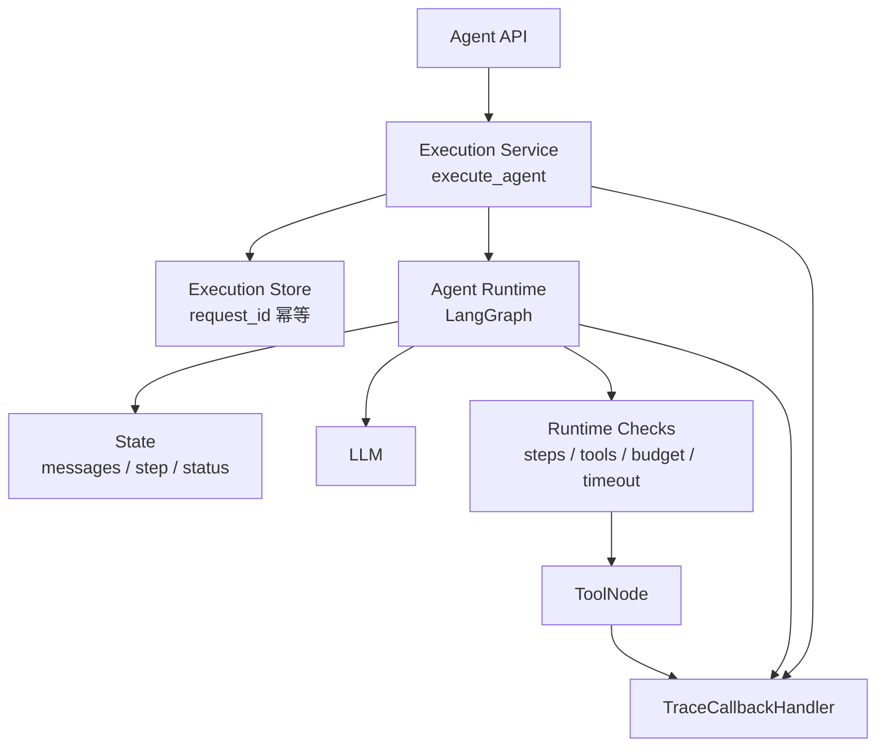

# Agent Runtime 设计

> 第 3 篇 · Agent Architecture  
> Runtime 不是“再包一层 LangGraph”，而是把模型的不确定性约束成可执行、可终止、可追踪、可恢复的工程边界。

## 1. 为什么需要 Agent Runtime

### 1.1 普通循环的问题

```python
while not finished:
    response = llm.invoke(messages)
    if response.tool_calls:
        messages.append(execute_tools(response.tool_calls))
    else:
        finished = True
```

这段代码可以跑 Demo，但无法回答：

```text
最多跑几步？
最多调几次工具？
超时怎么办？
失败能否重试？
重试是否重复副作用？
请求 ID 是什么？
执行 ID 是什么？
终态如何表达？
状态如何持久化？
```

这些问题不是 Prompt 能解决的，必须由 Runtime 统一管理。

### 1.2 Runtime 的职责

```text
执行生命周期
状态机
预算和限制
LLM/工具循环
终态定义
超时/取消
重试与幂等边界
Checkpoint
Trace 事件
```

Runtime 不负责：

```text
业务权限决策（Tool Policy / Data Access）
业务数据查询（Tool）
人工审批业务规则（HITL）
具体评测标准（Eval）
```

## 2. Runtime 的核心数据结构

### 2.1 AgentConfig

Qianke 当前配置（`src/rag_demo/agent/state.py`）：

```python
@dataclass(frozen=True)
class AgentConfig:
    max_steps: int = 5
    max_tool_calls: int = 10
    timeout_seconds: float = 60.0
    max_total_tokens: int = 0
```

语义：

| 参数 | 作用 | 0 值语义 |
|---|---|---|
| `max_steps` | 限制 LLM 决策轮数 | 不允许 0 |
| `max_tool_calls` | 限制工具调用次数 | 不允许 0 |
| `timeout_seconds` | Runtime 内部超时 | 必须 > 0 |
| `max_total_tokens` | token 预算检查 | 0 = 关闭检查，不是零预算 |

`max_total_tokens` 的代码依据：

```python
if tracer is not None and config.max_total_tokens:
    if tracer.total_tokens > config.max_total_tokens:
        return _terminate(... BUDGET_EXCEEDED ...)
```

注意：

```text
检查发生在 LLM 返回之后，不是调用前预留；
单次调用可能让总 token 超过配置上限；
usage 缺失时 token 统计可能为 0，不能当作真实零成本。
```

### 2.2 AgentState

```python
class AgentState(TypedDict, total=False):
    messages: Annotated[list, add_messages]
    step_count: int
    tool_call_count: int
    status: str
    error: str | None
    started_at: float
    request_id: str
    execution_id: str
    parent_execution_id: str | None
```

字段职责：

```text
messages            对话与工具 Observation
step_count          推理步数
tool_call_count     工具调用数
status              当前/终态
error               失败原因
started_at          超时判断
request_id          请求幂等
execution_id        本次执行身份
parent_execution_id retry 血缘
```

### 2.3 运行态与终态

```text
初始/中间态：
RUNNING

终态：
COMPLETED
MAX_STEPS_EXCEEDED
MAX_TOOL_CALLS_EXCEEDED
TIMEOUT
CANCELLED
BUDGET_EXCEEDED
TOOL_NOT_ALLOWED
FAILED
```

原则：

```text
终态必须明确，不能把超限伪装成普通回答；
失败必须可分类，不能都变成“模型回复失败”。
```

## 3. Runtime 内部结构



职责边界：

| 组件 | 负责 | 不负责 |
|---|---|---|
| Execution Service | 幂等 claim、调用 Runtime、complete/fail | 具体推理与工具逻辑 |
| Execution Store | request_id 状态记录 | 队列、重试策略 |
| Agent Runtime | State、循环、预算、终态 | 工具权限/数据权限 |
| ToolNode | 执行已授权工具 | 决定是否授权 |
| Checkpointer | 持久化 Graph state | 硬取消/恢复 API |
| Trace | 事件采集 | 业务决策 |

## 4. 一次 Runtime 执行

### 4.1 正常路径

```text
POST /api/agent/run
→ 认证/租户
→ Execution Store claim
→ run_agent
→ State 初始化
→ Graph invoke
→ LLM → Tool → Observation → LLM
→ 终态
→ event_trace
→ store.complete
→ 响应
```

### 4.2 关键代码路径

```text
src/rag_demo/agent/state.py       AgentConfig / AgentState
src/rag_demo/agent/loop.py        run_agent / build_graph / make_chatbot_node
src/rag_demo/agent/service.py     execute_agent / _run_with_deadline
src/rag_demo/agent/execution_store.py  claim / complete / fail
src/rag_demo/agent/checkpoint.py  get_checkpointer
```

### 4.3 终态判定

```python
if step >= config.max_steps:
    _terminate(... MAX_STEPS_EXCEEDED ...)

if next_tool_count > config.max_tool_calls:
    _terminate(... MAX_TOOL_CALLS_EXCEEDED ...)

if time.monotonic() - started_at > config.timeout_seconds:
    _terminate(... TIMEOUT ...)

if cancel_event is not None and cancel_event.is_set():
    _terminate(... CANCELLED ...)

if tracer.total_tokens > config.max_total_tokens:
    _terminate(... BUDGET_EXCEEDED ...)
```

## 5. Tool 调用与 Runtime 的关系

Runtime 不决定 Tool 是否被授权。

Tool 授权在：

```text
account → ToolPolicy.for_account → allowed_tools
→ LLM bind_tools
→ 执行时复核未授权 call
```

Runtime 只负责：

```text
LLM 是否可以继续下一轮
工具调用次数是否超限
执行是否超时/取消
```

因此：

```text
Runtime 超限 → 终态
Tool Policy 拒绝 → TOOL_NOT_ALLOWED
Data Access 拒绝 → 工具返回结构化错误
```

三者不能合并成一个 `allowed` 布尔值。

## 6. 幂等、Retry、Checkpoint 与 Timeout

### 6.1 幂等

```text
request_id + scope(dataset:account) + request_hash
→ agent_execution
```

规则：

```text
已完成 → 回放
执行中 → 409
同 request_id 不同内容 → 409
失败记录 → 返回失败
```

### 6.2 Execution Record vs Agent Result

```text
Execution Record = COMPLETED
≠
Agent Result = COMPLETED
```

runner 正常返回 `status=FAILED` 时：

```text
execute_agent → store.complete
Execution Record = COMPLETED
保存的是带失败终态的响应
```

只有 runner 抛异常/超时：

```text
store.fail → Execution Record = FAILED
```

### 6.3 Retry

```text
run_agent_with_retry
→ 每次 attempt 新 execution_id
→ parent_execution_id 指向上一 attempt
→ 只重试 FAILED / TIMEOUT / 超步数/超工具数
→ 不重试 BUDGET_EXCEEDED / CANCELLED
→ API 默认 max_retries=0
```

Retry 是重新执行，不是 resume。

### 6.4 Checkpointer

```text
LangGraph SqliteSaver
thread_id 默认 execution_id
API 通过 get_checkpointer() 传入
保存 Graph state
没有通用对外 resume API
```

另有一个不同机制：

```text
run_agent_with_retry(checkpoint_dir=...)
→ 每个 attempt 写 JSON 快照
→ 失败复盘，不是可恢复 checkpoint
→ 当前 API 不传 checkpoint_dir
```

### 6.5 Wall Timeout

```text
QIANKE_AGENT_WALL_TIMEOUT_SECONDS=70
_run_with_deadline
→ 到期抛 AgentRunTimedOut
→ API 504
→ store.fail
```

底层：

```text
Python 线程不能安全强杀
worker 仍可能收尾
wall timeout 不是 hard kill
```

写 Tool 上线前必须改成独立 Worker 或可取消执行器。

## 7. Runtime 的可靠性设计原则

```text
1. 所有限制都必须是运行时约束，不是展示字段
2. 每个终态必须可分类
3. 请求幂等与执行身份分离
4. Retry 与 Resume 分离
5. Timeout 与 Cancel 分离
6. Checkpoint 不等于外部副作用回滚
7. 写操作必须幂等 + 审批 + 审计
8. 失败不能伪装成普通回答
```

## 8. Qianke Engine 实践

### 已实现

```text
AgentConfig / AgentState
LangGraph B 端单 Agent Runtime
step/tool/timeout/token 限制
终态
request_id 幂等
execution_id / parent_execution_id
event_trace
attempt retry
SqliteSaver checkpointer（有限使用）
```

### 部分实现

```text
通用 HITL resume
硬取消/进程隔离
统一三端 Runtime
```

### 证据

```text
tests/test_agent_architecture.py
tests/test_agent_execution_safety.py
tests/test_agent_checkpoint.py
```

V0.5.2 记录的核验结果：

```text
34 passed
Git commit: 32ad31bc2636
```

本文不新增未验证的测试数字。

## 9. 方案对比

| 方案 | 优点 | 缺点 |
|---|---|---|
| 自研 while 循环 | 简单、可控 | 状态/预算/恢复需自建 |
| LangGraph | 状态图、checkpoint、interrupt 原语 | 需要理解图与状态边界 |
| 队列 + Worker | 长任务、隔离、重试 | 延迟、复杂度、幂等要求高 |

Qianke 的选择：

```text
交互式分析：同步 Runtime
异步调查/审批：Super-agent Worker
不做“所有任务都入队”
```

## 10. 常见误区

1. 把 `max_steps` 当作 Prompt 提示，而不是运行时检查。
2. 把 `timeout` 当作硬杀线程。
3. 把 retry 当作 checkpoint resume。
4. 把 Execution Record 的 COMPLETED 当作 Agent Result COMPLETED。
5. 把 Checkpoint 当作外部副作用回滚。
6. 没有幂等就重试写操作。
7. 把 Runtime 日志当完整审计。

## 11. 总结

Runtime 的核心不是“调用 LLM”，而是：

```text
定义状态
限制步骤与资源
执行循环
处理终态
管理身份与幂等
记录事件
支持有限恢复
```

Qianke 当前 Runtime 已具备 B 端主链路的核心约束；
通用 HITL、硬取消、统一三端 Runtime 仍是目标/规划，不应写成已实现。

## 12. 延伸阅读

### 内部

- [企业级 Agent 架构设计 V0.5.2](01-enterprise-agent-architecture-v0.5.2.md)
- [普通 Agent 与企业级 Agent 的区别](02-agent-vs-enterprise-agent.md)
- `docs/agent.md`
- `src/rag_demo/agent/`
- `tests/test_agent_*.py`

### 外部

- LangGraph：<https://langchain-ai.github.io/langgraph/>
- FastAPI：<https://fastapi.tiangolo.com/>
- OpenTelemetry：<https://opentelemetry.io/docs/>
- NIST AI RMF：<https://www.nist.gov/itl/ai-risk-management-framework>
