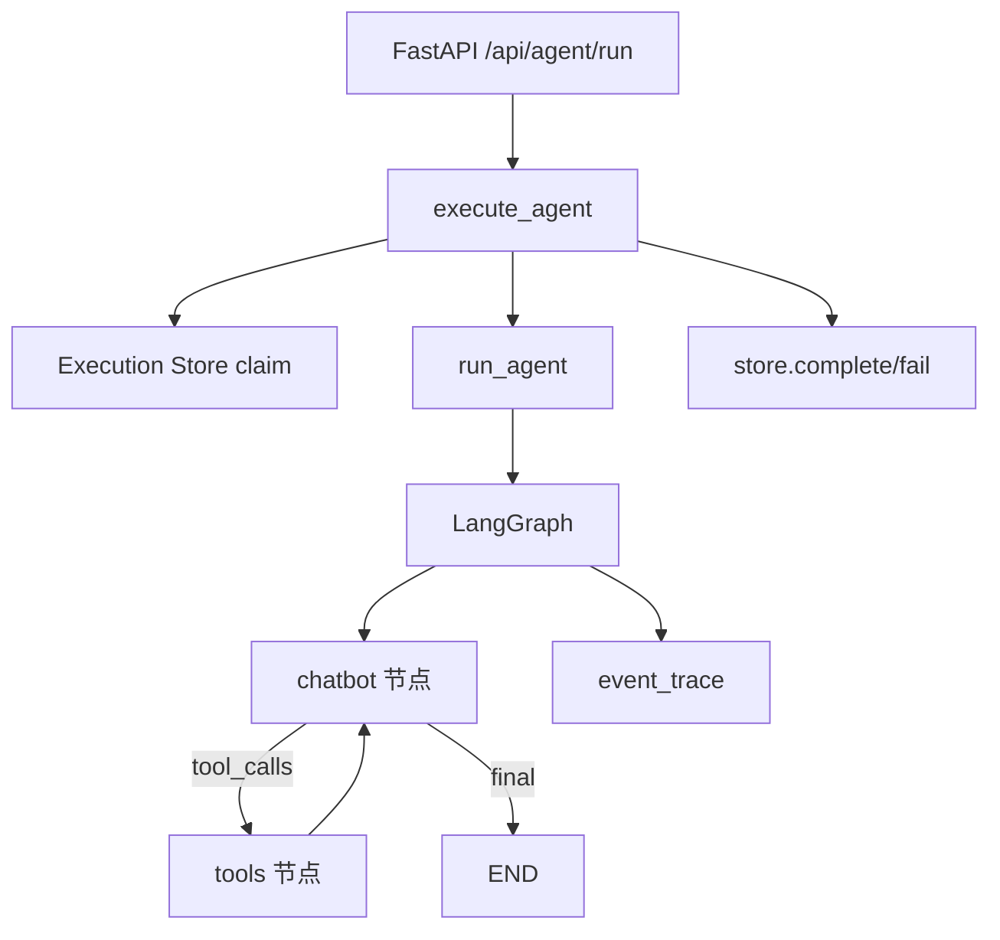
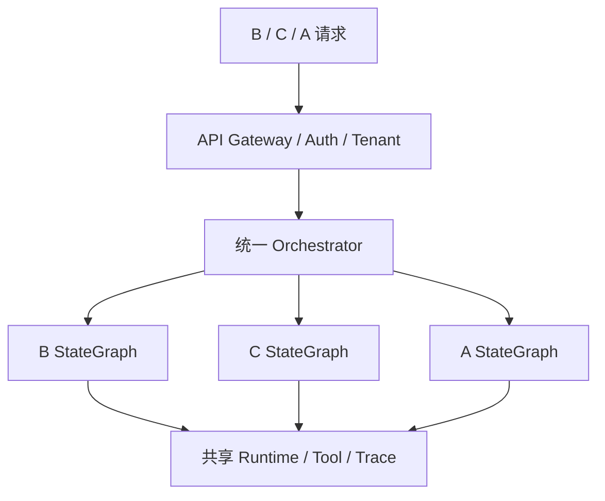

# Agent Orchestrator 设计

> Orchestrator 不是“再包一层 Agent”，而是决定**谁在什么条件下执行哪一步、状态如何流转、失败如何终止**。
> 本文区分“当前 Qianke 的 LangGraph 编排”和“目标态的统一三端 Orchestrator”。

## 1. 为什么需要 Orchestrator

一个 Agent Loop 可以只有一个 `chatbot ↔ tools` 循环。但企业系统会出现：

```text
B 端分析
C 端导购/交易
A 端审计/监控
异步调查/审批
长任务
多工具路由
```

如果每个入口各自写一套循环，会出现：

```text
状态不一致
权限边界分散
重试语义不同
Trace 字段不同
同一请求在不同入口表现不同
```

Orchestrator 的职责是把“流程组织”从“模型调用”和“业务 Tool”中拆出来。

## 2. Orchestrator、Runtime、Execution Store 的区别

| 概念 | 回答的问题 | 典型职责 |
|---|---|---|
| Orchestrator | 下一步执行哪个节点？ | 路由、条件边、子图/节点编排 |
| Agent Runtime | 执行时的状态/预算/终态是什么？ | State、限制、循环、取消、Trace |
| Execution Service | 这次请求如何进入/完成/失败？ | 幂等 claim、调用 Runtime、complete/fail |
| Execution Store | 请求级记录是什么？ | request_id 状态、回放、失败记录 |
| Queue/Worker | 长任务如何异步执行？ | WorkItem、claim、lease、retry |

它们可以部署在一个进程里，但设计上不能混为一谈。

## 3. 当前 Qianke 的 B 端编排

当前实现不是独立的 `Orchestrator` 类，而是 LangGraph StateGraph：

```text
chatbot 节点
  → 有 tool_calls → tools 节点
  → 无 tool_calls → END

tools 节点
  → ToolMessage → chatbot
```

代码：

```text
src/rag_demo/agent/loop.py::build_graph
src/rag_demo/agent/loop.py::run_agent
src/rag_demo/agent/loop.py::should_continue
```

核心路由：

```python
def should_continue(state):
    if state.get("status") in TERMINAL_STATUSES:
        return END
    last = state["messages"][-1]
    return "tools" if last.tool_calls else END
```

这说明：

```text
当前 Orchestrator = LangGraph 图本身
没有独立的“统一三端 Orchestrator 服务”
```

## 4. 当前执行链路



关键事实：

```text
1. Execution Store 在 Graph 外
2. Tool Policy 在 LLM bind_tools 与执行前检查
3. Runtime 限制在 chatbot 节点内检查
4. Super-agent 队列不在这条图里
```

## 5. 编排节点设计

### 5.1 节点职责

| 节点 | 职责 | 不负责 |
|---|---|---|
| chatbot | 调 LLM、检查预算/取消/终态、决定 tool call 或结束 | 执行 Tool、数据权限 |
| tools | 执行 ToolNode | 决定 Tool 是否被授权 |
| router / should_continue | 条件边选择 | 业务规则 |
| execution service | 幂等、deadline、complete/fail | 图内部路由 |

### 5.2 状态流转

```text
RUNNING
  → LLM 返回 tool_calls
  → tools 执行
  → Observation 回填
  → LLM 再决策
  → final answer / terminal
```

必须避免：

```text
工具结果直接变成下一轮系统指令
未授权 tool call 被执行
超限后继续跑
终态后又被后续节点覆盖
```

## 6. 目标态：统一 Orchestrator

目标架构：



目标能力：

```text
按入口/租户/任务类型选择 Graph
共享 Tool Contract、Trace、Evaluation
统一幂等和终态
保留各端不同的 Graph 结构
```

当前状态：

```text
B 端主 Graph：已实现
C 端 Graph：独立实现，不是由统一 Orchestrator 选择
A 端：审计/监控，不是 Agent Graph
统一 Orchestrator：已设计/规划中
```

## 7. 方案对比

### 7.1 LangGraph 编排

优点：

```text
StateGraph / 条件边 / checkpoint / interrupt 原语
节点边界清晰
可接 callback trace
```

缺点：

```text
需要理解图与状态
框架能力不等于项目治理能力
```

### 7.2 自研 while 循环

优点：

```text
完全可控、代码简单
```

缺点：

```text
状态、路由、checkpoint、HITL 都要自己实现
```

### 7.3 队列编排

优点：

```text
长任务、重试、隔离
```

缺点：

```text
延迟、幂等、状态同步复杂
```

Qianke 当前选择：

```text
交互式 B 端：LangGraph 同步编排
Super-agent 调查/审批：独立队列 + Worker
不是“所有 Agent 请求都先入队”
```

## 8. Qianke Engine 实践

### 已实现

```text
B 端 LangGraph chatbot/tools 图
should_continue 路由
Runtime 限制
Execution Store 外层幂等
event_trace
```

### 部分实现

```text
C 端 Graph 独立存在
Super-agent 独立 WorkItem/Queue/Worker
```

### 已设计/规划

```text
统一三端 Orchestrator
共享多端 Runtime
跨端任务路由
```

### 证据

```text
src/rag_demo/agent/loop.py
src/rag_demo/agent/service.py
src/rag_demo/c_end/agent.py
src/rag_demo/superagent/runtime.py
tests/test_agent_architecture.py
```

## 9. Orchestrator 与评测

需要评测：

```text
路由是否正确（选中正确 Graph/节点）
工具调用是否符合路径
是否存在无限循环
终态是否正确
超时/重试是否被正确处理
```

不要只评最终答案；编排错误会在正确回答前就产生不可接受的执行路径。

## 10. 常见误区

1. 把 LangGraph 当完整企业 Orchestrator。
2. 把队列当所有请求的必经路径。
3. 把 C 端独立 Graph 说成三端统一 Runtime。
4. 在节点里直接做数据权限，导致权限分散。
5. 没有终态保护，节点循环覆盖失败状态。

## 11. 总结

```text
Orchestrator 管流程
Runtime 管执行约束
Execution Store 管请求幂等
Queue/Worker 管异步长任务
```

Qianke 当前由 LangGraph 承担 B 端编排；
统一三端 Orchestrator 仍是目标设计，不能写成已实现。

## 12. 延伸阅读

- [企业级 Agent 架构设计 V0.5.2](01-enterprise-agent-architecture-v0.5.2.md)
- [普通 Agent 与企业级 Agent 的区别](02-agent-vs-enterprise-agent.md)
- [Agent Runtime 设计](03-agent-runtime.md)
- `src/rag_demo/agent/loop.py`
- `docs/agent-design-current-vs-target.md`
- LangGraph：<https://langchain-ai.github.io/langgraph/>
