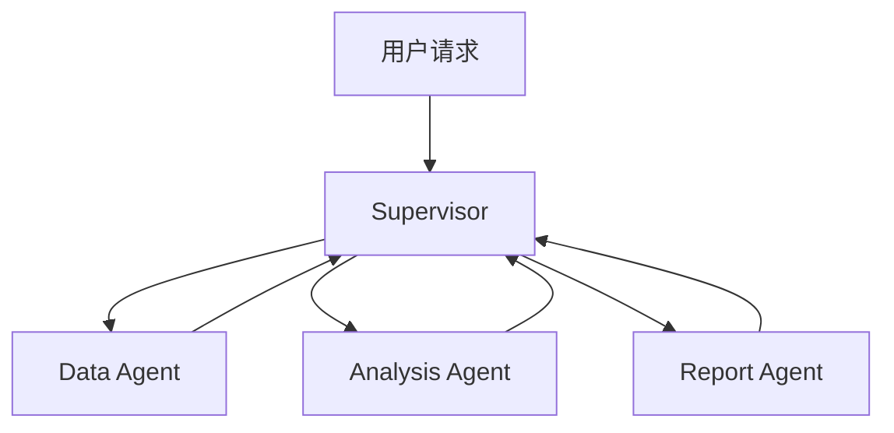

# Multi-Agent 协作架构

> 本文讲“什么时候需要多 Agent、怎么设计”，不是“多 Agent 一定更高级”。
> Qianke Engine 当前 B 端主 Agent 仍是单 Agent；多 Agent 属于规划/目标设计。

## 1. 为什么会出现 Multi-Agent

单 Agent 在工具变多、任务变长、职责冲突时会遇到：

```text
Prompt 过长
工具路由混乱
权限边界混杂
一个 Agent 同时承担查询、分析、审批
评测难以归因
```

多 Agent 的动机是降低单点复杂度，但会新增：

```text
状态同步
权限传播
证据合并
成本
失败恢复
```

## 2. 多 Agent 不是“多个模型同时聊天”

企业级 Multi-Agent 需要明确的协议：

```text
谁负责什么
输入/输出是什么
哪些状态共享
哪些数据不能共享
失败谁负责
结果如何合并
```

没有协议的多 Agent 只是把单 Agent 的混乱复制多份。

## 3. 常见拓扑

### 3.1 Supervisor



适合：

```text
任务可分解
每个子任务职责稳定
需要统一汇总
```

### 3.2 Sequential Pipeline

```text
Data Agent → Analysis Agent → Report Agent
```

适合：

```text
步骤严格串行
前一步输出是后一步输入
```

### 3.3 Peer Collaboration

```text
Agent A ↔ Agent B
```

适合协商/对等角色，但企业系统要额外处理：

```text
权限对等吗？
谁做最终决定？
协议失败怎么办？
```

## 4. 状态共享边界

多 Agent 不能简单共享全部消息。

```text
共享：任务目标、证据引用、审批状态
不共享：系统 Prompt、内部草稿、其他 Agent 的私有上下文
```

建议：

```text
Blackboard（共享证据板）
+ 每个 Agent 私有 State
+ 明确的合并规则
```

禁止：

```text
把所有 Agent 的完整对话都塞进每个 Agent 的上下文
```

## 5. 权限与租户

多 Agent 放大权限风险：

```text
Supervisor 有权限，子 Agent 是否自动继承？
子 Agent 调 Tool，谁做 Tool Policy？
子 Agent 能否访问其他租户的数据？
```

原则：

```text
权限按 Agent 职责授予
数据范围按租户绑定
跨 Agent 调用不能绕过服务端授权
```

不要让“Supervisor 有权限”自动变成“所有子 Agent 都有权限”。

## 6. 证据合并

多 Agent 的最终回答必须能追溯到：

```text
哪个 Agent 产出了哪条证据
证据来自哪个 Tool/数据源
哪些结论是多 Agent 共识
哪些是单个 Agent 推断
```

否则多 Agent 会降低可解释性，而不是提升。

## 7. 失败与恢复

需要定义：

```text
子 Agent 超时怎么办？
一个子 Agent 失败是否终止全局？
重试子 Agent 会不会重复副作用？
审批由谁发起？
最终状态如何汇总？
```

企业级原则：

```text
读任务可重试
写任务必须幂等 + 审批
失败必须明确终态
```

## 8. Qianke Engine 当前状态

### 已实现

```text
B 端主 Agent：单 Agent
C 端导购 Agent：独立 Graph
Super-agent：独立 WorkItem/Queue/Worker + 审批动作
```

### 已设计 / 规划中

```text
统一三端 Runtime
Supervisor/多 Agent 协作
共享证据板
跨 Agent 权限模型
Multi-Agent Eval
```

### 证据

```text
src/rag_demo/agent/loop.py
src/rag_demo/c_end/agent.py
src/rag_demo/superagent/runtime.py
docs/agent-design-current-vs-target.md
AGENTS.md §18
```

注意：

```text
C 端独立 Graph + B 端单 Agent + Super-agent Worker
不等于“已实现 Multi-Agent 协作架构”。
```

## 9. 什么时候值得拆分

| 信号 | 说明 |
|---|---|
| 工具数量明显增多 | 单 Agent 路由/评测开始混乱 |
| 任务包含多个专业流程 | 需要不同 Prompt、工具、权限 |
| 状态需要隔离 | 子任务不应共享全部上下文 |
| 长任务/并行 | 需要异步 Worker |
| 维护成本 | 单 Graph 已难以理解和回归 |

拆分前至少要有：

```text
单 Agent 基线
工具调用评测
权限/租户边界
Trace/成本数据
```

## 10. 常见误区

1. 为了架构图好看提前拆多 Agent。
2. 把多 Agent 等同于更强推理。
3. 所有 Agent 共享全部对话和权限。
4. 没有统一证据/评测，无法判断哪个 Agent 出错。
5. 写操作在多 Agent 间重试导致重复副作用。

## 11. 总结

```text
Multi-Agent 是复杂度工具，不是成熟度徽章。
先有单 Agent 的可观测、可评测、可治理，再根据真实瓶颈拆分。
```

Qianke 当前应以单 Agent + 独立 C/Worker 链路为基础，按工具数量、任务复杂度和权限边界逐步评估多 Agent。

## 12. 延伸阅读

- [Agent Orchestrator 设计](04-agent-orchestrator.md)
- [Agent Runtime 设计](03-agent-runtime.md)
- `docs/agent-design-current-vs-target.md`
- `AGENTS.md` §18
- LangGraph multi-agent 文档：<https://langchain-ai.github.io/langgraph/>
