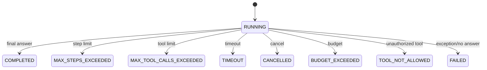

# Agent State 状态管理

> State 不是“聊天记录数组”。它至少同时包含任务、预算、终态和执行身份。
> 但 State 也不应吞掉业务数据、长期记忆和审计账本。

## 1. 为什么 State 会成为问题

简单 Agent：

```python
messages = []
messages.append(user_message)
```

企业级 Agent：

```text
当前任务是什么？
已执行几步？
调了几次工具？
是否超时？
是否取消？
request_id/execution_id 是什么？
失败原因是什么？
状态是否可恢复？
```

如果这些信息都塞进 messages：

```text
Prompt 膨胀
模型看到不该看到的状态
无法精确终态
无法做幂等
无法恢复
```

## 2. Qianke 当前的 AgentState

```python
class AgentState(TypedDict, total=False):
    messages: Annotated[list, add_messages]
    step_count: int
    tool_call_count: int
    status: str
    error: str | None
    started_at: float
    request_id: str
    execution_id: str
    parent_execution_id: str | None
```

职责：

| 字段 | 类型 | 作用 |
|---|---|---|
| messages | 对话 | LLM/工具 Observation |
| step_count | 预算 | 限制推理轮数 |
| tool_call_count | 预算 | 限制工具调用 |
| status | 控制 | 终态/中间态 |
| error | 诊断 | 失败原因 |
| started_at | 时间 | 超时判断 |
| request_id | 幂等 | 请求级身份 |
| execution_id | 执行 | 本次执行身份 |
| parent_execution_id | 血缘 | retry 关系 |

## 3. State 的生命周期



原则：

```text
终态只能进入一次；
终态后不再执行工具；
终态不能被后续节点悄悄覆盖。
```

## 4. State 的边界

| 数据类型 | 是否放 State | 原因 |
|---|---|---|
| 当前对话消息 | 是 | Agent 需要 |
| 步数/预算 | 是 | Runtime 需要 |
| request/execution ID | 是 | 幂等/Trace |
| 业务订单/库存数据 | 否（按需 Tool 返回） | 避免污染、越权 |
| 长期用户记忆 | 否（独立记忆系统） | 生命周期不同 |
| 审计/审批记录 | 否（独立存储） | 不可变、可追溯 |
| 全量 SQL 结果 | 不直接放 | 只放摘要/引用 |

## 5. 持久化与 Checkpoint

当前 Qianke：

```text
LangGraph SqliteSaver
thread_id 默认 execution_id
API 通过 get_checkpointer() 传入
可读 state snapshot
```

但：

```text
Checkpoint 持久化 Graph state ≠ 恢复所有外部副作用
当前没有通用对外 resume API
```

## 6. 对话状态与业务状态

```text
对话状态：messages、Tool Observation
任务状态：step、status、execution_id
业务状态：订单/库存/退款（数据库）
记忆状态：用户长期偏好（记忆系统）
审计状态：审批/动作记录（审计表）
```

不能把这些合并成一个 JSON 塞进 Prompt。

## 7. Retry 与 State

```text
retry 每次新 execution_id
parent_execution_id 记录上次执行
不是从 checkpoint 继续
```

Checkpointer 保存的是 Graph 状态；
retry 是重新执行。

## 8. Qianke 实践

已实现：

```text
AgentState
LangGraph checkpointer
终态
request/execution identity
```

部分实现：

```text
跨端统一 State
通用 State 恢复 API
```

证据：

```text
src/rag_demo/agent/state.py
src/rag_demo/agent/loop.py
src/rag_demo/agent/checkpoint.py
tests/test_agent_architecture.py
```

## 9. State 设计检查表

```text
[ ] 是否有预算字段
[ ] 是否有明确终态
[ ] 是否有 request/execution identity
[ ] 是否把业务数据误放 State
[ ] 是否把记忆误放 messages
[ ] 是否定义 State 持久化边界
[ ] 是否定义 retry 与 checkpoint 关系
```

## 10. 常见误区

1. State 只存 messages。
2. 把完整 SQL 结果放 State。
3. 把长期记忆塞进 messages。
4. 没有终态，异常变成普通回答。
5. 把 checkpoint 当业务事务回滚。
6. 把 retry 当 resume。

## 11. 总结

```text
State 是执行状态，不是数据库，也不是记忆系统。
State 要小而完整：任务、预算、终态、身份、错误。
业务状态、记忆、审计应在各自系统管理。
```

## 12. 延伸阅读

- [Agent Runtime 设计](03-agent-runtime.md)
- [Agent Memory 记忆系统](07-agent-memory.md)
- `src/rag_demo/agent/state.py`
- LangGraph persistence：<https://langchain-ai.github.io/langgraph/>
