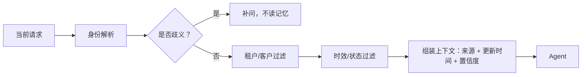

# Agent Memory 记忆系统

> Memory 不是“把历史对话都塞进上下文”，而是一条有身份、时效、来源、确认和版本的读写链路。
> Qianke 已有部分记忆实现；本文区分已落地能力与统一 Memory Runtime 目标。

## 1. 为什么 Memory 在企业里困难

普通 Agent：

```text
历史消息拼接
```

企业 Agent：

```text
这是谁的记忆？
属于哪个租户/客户？
是用户明确说的，还是模型推断的？
什么时候有效？
冲突版本以哪个为准？
未确认的记忆能否影响回答？
```

记忆错误会直接导致：

```text
把 A 客户偏好用到 B 客户
把旧偏好当当前事实
把模型猜测写成用户事实
```

## 2. 四类“记忆”必须分开

| 类型 | 示例 | 生命周期 |
|---|---|---|
| 会话记忆 | 当前对话摘要 | 会话 |
| 用户长期记忆 | 偏好、称呼、禁忌 | 长期 |
| 业务状态 | 订单、库存 | 事务 |
| 审计记录 | 审批、执行 | 不可变 |

不能把四类都放进一个 `messages` 或一个 memory 表。

## 3. 读路径



关键规则：

```text
身份不唯一就不读
跨租户不读
过期/删除不读
能读到 != 能相信：必须带来源、时效、置信度
```

## 4. 写路径

```text
会话结束/明确陈述
→ 候选记忆
→ 规则校验
→ 用户确认或策略允许
→ 写回
→ 版本 + 审计
```

不能：

```text
LLM 直接写长期记忆
用户未确认的推断直接生效
覆盖旧版本但没有记录
```

## 5. 候选记忆与版本

Qianke 的记忆文档已定义：

```text
PENDING_CONFIRMATION
ACTIVE
DELETED
version
confirmed_at / rejected_at
audit
```

候选确认流程：

```text
GET  /api/c/companion/memory-candidates
POST /api/c/companion/memory-candidates/{id}/confirm
POST /api/c/companion/memory-candidates/{id}/reject
```

意义：

```text
LLM 可以生成候选，但不能自行让长期记忆生效。
```

## 6. 身份解析

输入可能包含：

```text
客户 ID / 买家 ID
别称
订单号
收货人
当前会话成员
```

输出：

```text
resolved_customer_id
confidence
evidence[]
ambiguous?
```

歧义处理：

```text
多个候选 → 不读，先补问
无可靠记录 → 冷启动/补问
跨租户命中 → 拒绝 + 审计
```

## 7. 冲突与时效

记忆必须处理：

```text
同字段多个值
新旧版本
用户否认
过期偏好
来源可信度差异
```

规则：

```text
新版本不能静默覆盖旧版本
冲突要有 supersede/版本链
用户否认必须可追踪
```

## 8. Qianke Engine 状态

已落地（依据 `docs/product/agent-memory-context.md`）：

```text
身份解析/歧义判定
租户/客户/DELETED 过滤
来源/更新时间/置信度
B 端会话记忆接入
C 端候选记忆状态机
确认/拒绝/写回
版本/审计字段
C 端自动复盘候选
身份消歧生产入口
```

仍待：

```text
多客户别名生产入口
统一 Memory Runtime
跨端统一记忆策略
更多记忆写入口
```

## 9. 与 Agent State 的区别

```text
Agent State：当前执行
Memory：跨会话/跨任务
业务状态：数据库事务
审计：不可变记录
```

不要让 Agent State 承载长期记忆。

## 10. 常见误区

1. 历史消息就是记忆。
2. LLM 推断直接写长期记忆。
3. 不按租户/客户过滤。
4. 没有来源和时效。
5. 新值直接覆盖旧值，没有版本。
6. 记忆错误不记录审计。

## 11. 总结

```text
Memory 的核心不是存储，而是：
身份正确
租户隔离
来源可追溯
候选先确认
版本可回滚
时效可过滤
```

Qianke 已有部分记忆链路；统一 Memory Runtime 仍是目标，不应把全部能力写成已完成。

## 12. 延伸阅读

- `docs/product/agent-memory-context.md`
- `src/rag_demo/memory_context.py`
- `src/rag_demo/c_end/agent.py`
- [Agent State 状态管理](06-agent-state-management.md)
- 多租户隔离架构（规划中，见信息架构）
