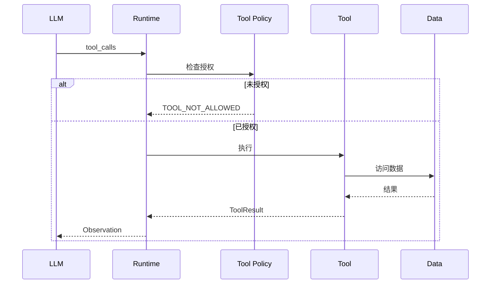

# Agent 工具调用机制

> Tool 不是“给 LLM 的一个 Python 函数”。
> 企业级 Tool 需要契约、授权、数据边界、错误码、幂等和审计。

## 1. 为什么 Tool 不能只是函数

普通函数：

```python
def query(sql):
    return db.execute(sql)
```

企业问题：

```text
模型能发现这个工具吗？
用户有权调用吗？
参数是否合法？
能查哪些表/租户？
失败如何返回？
是否有副作用？
能否重试？
是否有审计？
```

因此 Tool 需要完整契约。

## 2. Tool Contract

Qianke 当前：

```python
class ToolError(BaseModel):
    code: str
    message: str

class ToolResult(BaseModel):
    ok: bool
    data: dict[str, Any]
    error: ToolError | None = None
```

成功：

```json
{"ok": true, "data": {"columns": [], "rows": []}}
```

失败：

```json
{
  "ok": false,
  "data": {},
  "error": {"code": "SQL_VALIDATION_ERROR", "message": "SQL 校验失败：仅允许 SELECT/WITH、必须带 LIMIT、仅白名单表"}
}
```

原则：

```text
依赖 error.code，不依赖 message 字符串
失败也返回结构化 JSON
```

## 3. Tool 注册与发现

Qianke `registry.py` 注册 7 个 Tool：

```text
rag_search
execute_sql
calculator
prepare_followup_task
resolve_customer_identity
get_chat_user_profile
search_chat_user_profiles
```

每个 Tool 有：

```text
name
description
input_schema
fn
```

LLM 只应看到当前身份允许的 Tool 子集。

## 4. 调用链路



关键：

```text
模型决定调用 ≠ 用户授权
```

## 5. Tool Policy 与 Data Access 的区别

```text
Tool Policy：能否调用 execute_sql
Data Access：execute_sql 能查哪些表/租户
Runtime Policy：任务还能不能继续
```

三者不能合并。

## 6. Tool 分类

| 类型 | 例子 | 风险 |
|---|---|---|
| 只读查询 | RAG、SQL SELECT | 越权、慢查询 |
| 确定性计算 | Calculator | 输入边界、溢出 |
| 画像查询 | profile tools | 租户/客户数据 |
| 受控写草稿 | prepare_followup_task | 重复草稿、确认 |
| 外部动作 | 发送消息、退款 | 高风险，必须 HITL |

## 7. Tool 错误处理

```text
参数错误 → INVALID_ARGUMENTS
SQL 校验失败 → SQL_VALIDATION_ERROR
SQL 执行失败 → SQL_EXECUTION_ERROR
身份解析失败 → IDENTITY_RESOLVE_FAILED
画像不存在 → PROFILE_NOT_FOUND
画像查询失败 → PROFILE_QUERY_FAILED
画像搜索失败 → PROFILE_SEARCH_FAILED
工具异常 → TOOL_ERROR
```

错误必须：

```text
结构化
可分类
可重试/不可重试明确
不泄露敏感栈/SQL 结果
```

## 8. 幂等与重试

```text
只读 Tool：通常可重试
写 Tool：必须业务幂等键/唯一约束/审批
```

Qianke 受控草稿 `prepare_followup_task`：

```text
创建 DRAFT
requires_confirmation
独立 confirm API
```

当前 `create_followup_draft` 没有幂等键/唯一约束；retry 或重复调用可能生成多条 DRAFT。需要先补幂等键与回归测试，再把状态标为“已实现”。

## 9. Qianke 当前实践

已实现：

```text
7 个 Tool
Tool Contract
Tool Policy
执行时复核
SQL 只读
Calculator AST
受控草稿
画像 Tool
```

部分实现：

```text
统一 Tool Gateway
写 Tool 的进程隔离
独立 Prompt Injection 运行时防护
```

## 10. 常见误区

1. 把 Tool Policy 当数据权限。
2. 让 LLM 生成租户 ID。
3. 工具失败返回自然语言错误。
4. 写 Tool 无幂等。
5. 执行时不再复核授权。
6. 把 Tool 输出当指令。

## 11. 总结

```text
Tool = 契约 + 授权 + 数据边界 + 错误 + 幂等 + 审计
```

Qianke 当前 7 Tool 与 Tool Policy 已实现；
统一 Tool Gateway 和写操作隔离仍在演进。

## 12. 延伸阅读

- [Agent Runtime 设计](03-agent-runtime.md)
- Human-in-the-loop 人工审批（规划中，见信息架构）
- `src/rag_demo/agent/tool.py`
- `src/rag_demo/agent/registry.py`
- `src/rag_demo/agent/policy.py`
- `tests/test_agent_architecture.py`
