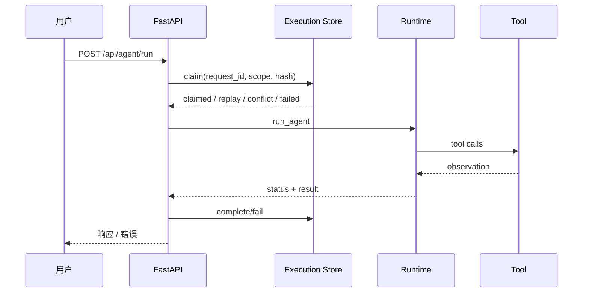

# Agent 执行流程与异常处理

> 企业级 Agent 的异常处理不是“except 后返回一句失败”，而是明确：
> 哪种失败、是否可重试、有没有副作用、Execution Record 是什么、用户看到什么、如何审计。

## 1. 为什么异常处理是架构问题

普通 Agent：

```python
try:
    answer = agent.run(query)
except Exception:
    return "抱歉，出错了"
```

企业问题：

```text
超时后任务是否还在跑？
重试会不会重复写？
Execution Record 是 COMPLETED 还是 FAILED？
用户看到 504 但后台成功怎么办？
Checkpoint 能否恢复？
```

## 2. 一次请求的完整链路



## 3. 三类结束

```text
正常完成：Agent Result = COMPLETED
业务失败：Agent Result = FAILED/TIMEOUT/...
执行异常：runner 抛异常 / wall timeout
```

必须区分。

## 4. Execution Record 与 Agent Result

```text
Execution Record = COMPLETED
≠
Agent Result = COMPLETED
```

实际：

```text
runner 正常返回 status=FAILED
→ store.complete
→ Execution Record = COMPLETED
→ 回放的是失败响应

runner 抛异常/超时
→ store.fail
→ Execution Record = FAILED
```

## 5. 终态

```text
COMPLETED
FAILED
TIMEOUT
CANCELLED
MAX_STEPS_EXCEEDED
MAX_TOOL_CALLS_EXCEEDED
BUDGET_EXCEEDED
TOOL_NOT_ALLOWED
```

原则：

```text
终态明确
终态不可被后续节点覆盖
终态可被前端/监控/评测消费
```

## 6. 超时

```text
AgentConfig.timeout_seconds=60：Runtime 内检查
QIANKE_AGENT_WALL_TIMEOUT_SECONDS=70：调用方等待上限
```

wall timeout：

```text
API 504
store.fail
worker 可能继续收尾
不是 hard kill
```

## 7. 重试

```text
只重试可重试终态
每次 attempt 新 execution_id
parent_execution_id 记录血缘
写操作必须幂等/审批
```

Qianke：

```text
run_agent_with_retry       函数默认 max_retries=1
/api/agent/run 请求模型      默认 max_retries=0
API clamp                   0–3
```

## 8. Checkpoint

```text
LangGraph SqliteSaver：Graph state
JSON attempt snapshot：失败复盘
两者都不是“外部副作用回滚”
```

当前没有通用 resume API。

## 9. 审计与用户可见性

```text
event_trace
execution_id / request_id
错误分类
耗时
token
```

用户侧不能只看到“失败”，需要：

```text
发生了什么
是否重试
是否需要换 request_id
是否有副作用
```

## 10. Qianke 当前状态

已实现：

```text
幂等 claim/replay/conflict
终态
wall timeout
attempt retry
event_trace
checkpointer
```

部分实现：

```text
前端错误分类体验
通用 HITL resume
硬取消
生产 SLO 告警
```

待补测试：

```text
runner 返回 FAILED 时 Execution Record 语义
超时后 worker 返回/覆盖
超时后 API 重提
```

## 11. 常见误区

1. 所有错误返回同一句话。
2. 超时后认为线程已停止。
3. retry 不区分副作用。
4. Execution Record COMPLETED 当业务成功。
5. 失败后不换 request_id 乱重提。
6. 没有 request/execution ID 无法审计。

## 12. 总结与延伸阅读

```text
异常处理的核心是状态语义：
什么失败
记录什么
能否重试
是否有副作用
用户看到什么
如何审计
```

Qianke 已有基础，但仍需补测试和生产 SLO，不能把目标能力写成已实现。

延伸阅读：

- [Agent Runtime 设计](03-agent-runtime.md)
- [Agent State 状态管理](06-agent-state-management.md)
- `src/rag_demo/agent/service.py`
- `src/rag_demo/agent/loop.py`
- `tests/test_agent_execution_safety.py`
