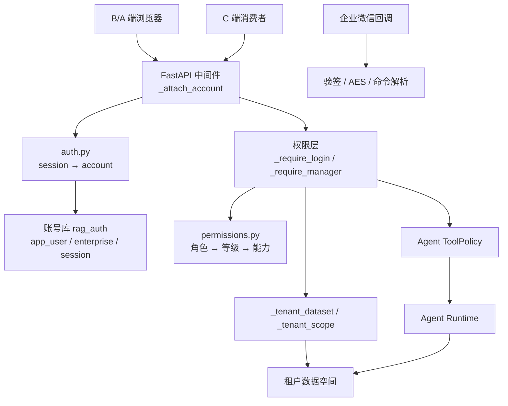

# 企业级身份认证与权限管理

> 认证回答「你是谁」，授权回答「你能做什么」，审计回答「你做过什么」。三者不能合并成一个 `role` 字段，也不能只靠前端隐藏按钮。

本文状态口径：**已实现** = 代码可核对；**部分实现** = 主链路可用但有明确缺口；**已设计** = 有方案未上线；**规划中** = 未开始。

## 1. 为什么需要 IAM

Demo 阶段常见做法是把身份交给调用方自报（`X-Role: admin`、`X-User: zhangsan`），这在生产上等于没有身份系统。Qianke 保留了这段历史，并明确标注：

```text
⚠ Demo 阶段两者都由请求头自报，不是安全边界
接入电商系统后必须改成「登录态 → 角色/用户」
—— src/rag_demo/permissions.py 模块注释
```

当前 `RAG_AUTH_ENABLED` 默认开启、`RAG_ALLOW_HEADER_AUTH` 默认关闭，生产请求不会因自报请求头获得高权限。

企业 IAM 要解决的是一组边界：

```text
账号从哪来（注册 / 审核 / 邀请码）
密码怎么存（慢哈希 / 兼容旧哈希 / 何时 rehash）
会话怎么失效（过期 / 退出 / 改密 / 停用）
暴力破解怎么挡（限流 / 验证码 / 锁定）
身份归属哪个企业、哪个商家
权限变更谁改的、什么时候改的
```

身份还会决定数据空间。Qianke 曾有一个真实缺陷：`/qa`、`/search`、`/stats` 改造前不切库，企业租户提问拿到 demo 答案，界面没有任何标识。修复方式是从登录账号推导数据集，而不是让前端传 `dataset`（`api/main.py::_tenant_dataset`）。

**结论：身份不是登录页的功能，而是后续所有授权、数据隔离和审计的前提。**

## 2. 基本机制

Qianke 当前有四条认证链路：

| 链路 | 入口 | 身份材料 | 现状 |
|---|---|---|---|
| B/A 端密码登录 | `POST /auth/login` | 账号 + 密码 | 已实现 |
| 企业员工注册审核 | `/auth/register` + 管理员审核 | 企业邀请码 + 状态 | 已实现 |
| C 端消费者登录 | `POST /api/c/auth/login/code` | 手机号 + 验证码 | 已实现（演示短信通道） |
| 企业微信操作 | 回调 / 审批命令 | 签名 + from_user + 白名单 | 已实现（账号角色映射缺失） |

会话机制：登录成功生成 `secrets.token_urlsafe(32)`，Cookie 存原文（HttpOnly + SameSite=Lax + 条件 Secure），数据库只存 `sha256(token)`；每次请求解析 Cookie → 查 `session` → 关联账号与企业；过期、退出、改密时删除记录。

密码机制：新密码一律 Argon2id；旧 PBKDF2 哈希登录通过后自动 rehash；修改密码会删除该账号全部 session，强制重新登录。

## 3. 总体架构



接入层解析 Cookie；身份层维护账号、企业、状态、角色、演示标记；授权层分接口能力、Agent 工具、数据租户作用域三层；审计层记录登录限流、账号变更与 Agent Trace。

## 4. 关键设计

### 4.1 身份只从可信来源取

`_role()` 的语义是：登录开启时请求头身份直接降级为 guest；关闭登录时（离线脚本）才允许请求头模式。换环境不能顺手换掉安全边界。

### 4.2 管理员身份用账号标记，不用角色名

系统管理员与企业管理员是账号上的布尔标记（`is_system_admin` / `is_enterprise_admin`）。早期审核产生的企业账号即使 `role` 还停在 `cs`，也不会失去企业管理员身份。

### 4.3 登录失败限流

默认 5 次 / 300 秒；`backend=postgres` 时写 `c_login_attempt` 固定窗口，多进程共享；PG 不可用自动回退单进程内存实现并告警。

### 4.4 会话与 Cookie

Cookie 使用 HttpOnly、SameSite=Lax 和条件 Secure（HTTPS 或反代声明 `X-Forwarded-Proto=https` 时设置）；TTL 默认 7 天，勾选「记住登录」30 天；改密删除该账号全部 session，退出只删当前 session。

### 4.5 账号状态先于权限判断

未登录返回 401（前端跳登录页）；待审核、已停用返回可区分的 403；active 才进入角色/能力判断。401 与 403 是接口契约，不是文案偏好。

## 5. 工程实现

| 能力 | 代码位置 |
|---|---|
| 账号 / 企业 / 会话 | `src/rag_demo/auth.py`（PG `rag_auth`，兼容 SQLite 迁移） |
| 密码哈希 | `auth.hash_password / verify_password` |
| 登录限流 / 安全头 / CSP 上报 | `src/rag_demo/api/security.py` |
| 账号注入与登录校验 | `src/rag_demo/api/main.py::_attach_account` |
| 角色与能力 | `src/rag_demo/permissions.py` |
| 消费者认证 | `src/rag_demo/c_end/consumer_auth.py` |
| 企业微信验签 | `src/rag_demo/superagent/wecom.py` |

```text
RAG_AUTH_ENABLED=1              # 默认开启登录态
RAG_ALLOW_HEADER_AUTH=0         # 禁止请求头自报身份
QIANKE_LOGIN_RATE_BACKEND=postgres # 不设置时按控制面后端推断；失败回退内存
QIANKE_COOKIE_SECURE=1          # 反代场景兜底
```

安全加固证据（2026-11-05 / 2026-11-09）：安全响应头已启用；CSP 为 Report-Only 且带 `/security/csp-report` 限流；`/metrics` 需要 Bearer token；历史上生产配置关闭 FastAPI 默认 Swagger 文档入口；当前公开 Architecture Handbook 使用 `/docs`，Swagger 按代码配置使用 `/api/docs`（是否启用取决于 `ENABLE_API_DOCS` 与部署环境，不能仅凭本文认定线上可访问）。默认凭据已轮换，旧密码登录 401（`docs/e2e/secrets-baseline.md`）。

测试文件存在但本文未执行、不宣称通过：`tests/test_auth_config.py`、`tests/test_auth_pg_config.py`、`tests/test_security_headers.py`、`tests/test_c_consumer_auth.py`。

## 6. 企业级要求

| 维度 | 要求 | 当前状态 |
|---|---|---|
| 安全 | 慢哈希、会话可吊销、限流、Cookie 安全属性 | 已实现 |
| 身份源 | SSO / OIDC / LDAP / 企业微信通讯录 | 未实现，规划中 |
| 强认证 | MFA / 设备绑定 | 未实现 |
| 生命周期 | 注册、审核、停用、离职回收、密码重置 | 部分实现（缺忘记密码、设备管理） |
| 密钥管理 | 不落库、不入 Git、可轮换 | 部分实现（仍依赖 `.env` + 检查脚本） |
| 审计 | 登录、登出、改密、权限变更可追溯 | 部分实现（账号变更只有日志） |
| 多端一致 | B/A/C 三端身份模型可解释 | 部分实现（同库不同入口，无统一身份网关） |
| 可用性 | 认证库故障不拖垮业务 | 部分实现（限流有降级，账号库无只读降级） |

## 7. 方案对比

| 方案 | 优点 | 缺点 | Qianke 选择 |
|---|---|---|---|
| 请求头自报身份 | 零成本接入 | 无安全边界，可冒充 | 仅离线脚本，默认关闭 |
| JWT 无状态令牌 | 无中心查询 | 撤销困难、泄露后长期有效 | 不采用 |
| 服务端 Session | 可即时吊销、实现简单 | 依赖中心存储与 Cookie 策略 | 当前采用 |
| 本地账号 + 邀请码 | 可控、无外部依赖 | 账号治理成本高 | 当前采用 |
| 企业 SSO / OIDC | 统一身份与离职回收 | 需要企业侧配合联调 | 目标态，未实现 |

对 Agent 系统还有个额外取舍：任务可能异步执行、跨请求重放，Session 不够用。Qianke 用 `request_id / execution_id` 标识执行，身份在入口解析一次写入 contextvar，工具只读上下文。详见《Agent 权限治理》。

## 8. Qianke Engine 实践

| 能力 | 状态 | 证据 |
|---|---|---|
| 账号 / 企业 / 会话模型 | 已实现 | `auth.py`、`rag_auth` |
| Argon2id + 旧哈希迁移 | 已实现 | `hash_password`、`password_needs_rehash` |
| 登录失败限流 | 已实现 | `api/security.py`、`c_login_attempt` |
| Cookie 安全属性 | 已实现 | `cookie_secure` |
| 账号状态区分 | 已实现 | `_require_login` |
| 角色 → 等级 → 能力 | 已实现 | `permissions.py` |
| 企业管理员管理本企业账号 | 已实现 | `_require_manager` |
| C 端验证码登录 | 已实现 | `c_end/consumer_auth.py` |
| 权限变更 / 登录审计表 | 部分实现 | 仅配置版本 + 日志 |
| 忘记密码 / 设备管理 | 未实现 | 无入口 |
| SSO / OIDC / MFA | 规划中 | `docs/e2e/security-hardening.md` 生产阻断项 |
| Secrets Manager / WAF | 规划中 | 当前 `.env` + 检查脚本 |

必须准确表述：「有登录页」≠「IAM 完成」；「角色矩阵存在」≠「权限治理闭环」；「默认凭据已轮换」≠「密钥管理已产品化」。

## 9. 评估 / 验收

```text
[ ] 未登录访问业务接口返回 401，而不是 403
[ ] 待审核 / 停用账号返回可区分的 403
[ ] 同一来源第 6 次失败登录在 300 秒内被拒绝
[ ] 改密后旧 Cookie 立即失效
[ ] 关闭登录时请求头身份不会越权到 admin
[ ] 企业管理员不能管理其他企业账号
[ ] 生产环境 API 文档入口关闭
```

建议命令（结果未在本文记录）：`python -m pytest tests/test_auth_config.py tests/test_security_headers.py tests/test_c_consumer_auth.py -q`；`python scripts/security_secrets_check.py`。

指标建议：`login_failure_rate_by_source`、`rate_limit_trigger_count`、`session_revoke_count`、`pending_account_backlog`、`credential_age_days`（目标 ≤ 90 天）。

## 10. 常见误区

1. **把身份判断写在业务函数里**：散落各处必然漏一处；修法是入口统一注入 + 唯一出口裁剪。
2. **把前端隐藏当授权**：前端禁用按钮只是体验优化，后端校验才是边界。
3. **令牌明文入库**：库被拖走等于所有人被登录，必须只存哈希。
4. **401 和 403 混用**：前端会误判为已登录，出现跳转死循环。
5. **改密不吊销会话**：用户以为安全了，旧设备仍在线。
6. **用角色名硬编码管理员**：历史数据会让角色列失真，必须用账号标记。
7. **只做认证不做数据隔离**：登录了不等于只能看自己的数据。

## 11. 总结

```text
认证解决“是不是你”，授权解决“能不能做”，隔离解决“能看哪份数据”。
身份必须来自可信登录态，不能来自调用方自报。
密码用慢哈希，令牌只存哈希，会话必须可吊销。
当前认证主链路已可用；SSO、MFA、密钥管理、完整审计仍是生产阻断项。
```

## 12. 延伸阅读

- 内部：[RBAC 与 ABAC 权限模型](02-rbac-abac.md)、[多租户隔离架构](03-multi-tenancy-isolation.md)、[企业级安全体系设计](10-enterprise-security-architecture.md)
- 代码：`src/rag_demo/auth.py`、`src/rag_demo/permissions.py`、`src/rag_demo/api/security.py`
- 证据：`docs/e2e/security-hardening.md`、`docs/e2e/secrets-baseline.md`、`docs/e2e/credential-rotation-2026-11-09.md`
- OWASP ASVS：<https://owasp.org/www-project-application-security-verification-standard/>
- NIST SP 800-63B：<https://pages.nist.gov/800-63-3/sp800-63b.html>
