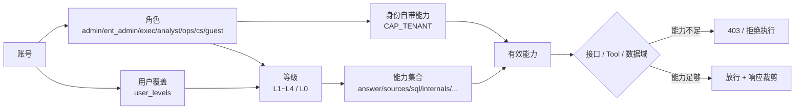

# RBAC 与 ABAC 权限模型

> RBAC 解决「同一类人给同一组权限」，ABAC 解决「同一类人在不同资源上权限不同」。两者不是替代关系，而是粒度与成本的取舍。

状态口径：**已实现** = 代码可核对；**部分实现** = 主链路可用但有缺口；**已设计** = 有方案未上线；**规划中** = 未开始；**理论知识** = 通用原理，不对应 Qianke 功能。

## 1. 为什么需要权限模型

最容易写出来的权限代码是「按角色名分支」：`if role == "admin": ... elif role == "analyst": ...`。角色少、出口少时能用，系统一复杂就出三类问题：判断散落（每个接口、每个响应出口各写一份）、无法配置（加一个能力要改代码发版）、解释不清（用户问「我为什么看不到 SQL」没人能统一回答）。

Qianke 踩过更隐蔽的一种：判断没写错，但**多个响应出口漏过裁剪**。`permissions.py` 模块注释写得很直白：

```text
一次问答有 3 个响应出口（/qa 直接返回、/qa/stream 的 meta、缓存命中直吐），
任何一处忘了裁剪就是一次越权。
```

因此权限模型的价值不只是「判断一次」，而是唯一真源（角色/等级/能力只定义一份）、可配置（管理员改配置，代码不感知）、可解释（`/whoami` 能自描述）、可审计（谁在什么时候改了权限）。

RBAC 负责前两条；ABAC 回答另一类问题：即使同是「运营」，A 商家和 B 商家的数据也不能互看；即使同是「owner」，1000 元退款是否允许还要看商家策略。

## 2. 基本机制

RBAC（理论知识）的核心是 `User → Role → Permission`；NIST 进一步定义角色继承、约束与职责分离（RBAC1/2/3），Qianke 未实现继承与 SoD 检测。ABAC（理论知识）的核心是策略函数 `decision = Policy(subject, resource, action, environment)`，工程上常拆成 PDP / PEP / PAP / PIP；Qianke 没有独立 PDP，判断直接写在 PEP 里。

Qianke 实际采用「两级 RBAC + 属性检查」：



等价表达：`effective_caps = level_caps(user_override or role_level) ∪ identity_caps(role)`，判断 `requested_cap ∈ effective_caps`。

商家侧是另一套 RBAC：`账号 → c_merchant_member(merchant_id, role)`，`role ∈ {owner, admin, staff}`，权限集合由 `ROLE_PERMISSIONS` 定义，接口用 `_require_permission` 校验。

## 3. 总体架构

```text
请求 → 身份解析（auth.current_account）
     → 平台 RBAC（角色 → 等级 → 能力） / 商家 RBAC（角色 → permission）
     → 能力判断（接口） / ToolPolicy（Agent） / 租户作用域（数据）
     → 响应裁剪（唯一出口） / 403 / 拒绝执行
```

属性来源包括账号状态、`is_demo`、`enterprise_id`、`account.dataset`、`merchant_id`、`c_merchant_policy` 与企业微信审批人白名单。RBAC 决定「能不能看这类信息」，属性与租户作用域决定「能看哪条数据」，这是两条不能互相替代的边界。

## 4. 关键设计

### 4.1 角色不直接映射权限，中间加一层「等级」

```text
L1 基础 → answer
L2 依据 → + sources / topk
L3 内部 → + internals（检索式、原文片段、精排分数）
L4 完全 → + sql / stats / raw_search / ops
```

管理员配置「等级能干什么」，业务代码只判能力。好处是调整权限只改配置、业务代码不出现角色名、新角色只需选等级。

### 4.2 唯一出口裁剪

所有问答出口必须经过 `permissions.render()`。被裁掉的字段**整键移除**，避免前端误以为「有值但没显示」。`trace` 内部再分级：L3 拿明细，L4 才拿融合汇总。

### 4.3 配置持久化与实时生效

落盘 `var/permissions.json`；写入用临时文件 + `os.replace` 原子替换；读取前比对 mtime/size，变了就重载；文件损坏回退默认（严格）配置并记错误日志。保存时校验未知能力、非法等级、guest 提权一律拒绝。另有自锁保护：管理员角色当前等级必须保留 `CAP_OPS`，否则保存后没人能再改权限。

### 4.4 身份自带能力不能被等级授予

`CAP_TENANT`（管理本企业成员）由企业管理员身份自带，不参与等级配置。`_normalize()` 发现它出现在等级能力里会直接报错，而不是静默忽略——静默忽略会让管理员以为已经配上了。

### 4.5 商家角色矩阵

`owner` 全部权限（含 `manage_members`）；`admin` 业务 + 审批 + 库存 + 画像，不含成员管理；`staff` 只看（订单/商品/售后/画像/砍价列表），不能操作。后端 `_require_permission` 是最终校验点；前端 `/api/b/workbench/me` 返回的 `permissions` 只用于禁用按钮。

### 4.6 属性式检查的现状

| 属性 | 来源 | 用途 |
|---|---|---|
| `account.status` | 登录态 | 待审核/停用降级为 guest 或 403 |
| `is_demo` | 账号标记 | 禁止写操作、清空 Tool、限制提问长度 |
| `enterprise_id` | 账号 | 企业管理员只能管本企业 |
| `account.dataset` | 企业 | 决定读哪个数据空间 |
| `merchant_id` | 成员表 | B 工作台 / Super-agent 数据作用域 |
| `c_merchant_policy` | 租户配置 | 允许动作、补偿/退款上限 |
| `from_user` + 白名单 | 企业微信回调 | 谁可以审批 |

这些是「硬编码 ABAC」：属性可信、判断明确，但没有策略语言、没有统一决策日志、新增规则要改代码。

## 5. 工程实现

| 模块 | 位置 | 职责 |
|---|---|---|
| 等级 / 能力 / 配置 | `src/rag_demo/permissions.py` | RBAC 真源与响应裁剪 |
| 身份注入与权限 API | `src/rag_demo/api/main.py` | `_role`、`_require`、`/whoami`、权限页 |
| 商家 RBAC | `src/rag_demo/api/b_workbench.py` | `ROLE_PERMISSIONS`、`_require_permission` |
| Agent Tool 授权 | `src/rag_demo/agent/policy.py` | 角色 → Tool 白名单 |
| Super-agent 审批权限 | `src/rag_demo/api/superagent.py` | owner/admin 才可审批 |
| 租户动作策略 | `src/rag_demo/c_end/store.py` | `c_merchant_policy` 读写 |

配置结构：`levels`（等级→能力）、`role_levels`（角色→等级）、`user_levels`（用户覆盖）、`version/updated_by`。测试现状：`ToolPolicy` 有单测（`tests/test_agent_execution_safety.py`）；`permissions.py` 未检索到独立单测（待核验），是后续补测试的优先项。

## 6. 企业级要求

| 维度 | 要求 | 当前状态 |
|---|---|---|
| 最小权限 | 默认 guest / L0，能力按需授予 | 已实现 |
| 职责分离 | 审批人不能是发起人的场景 | 部分实现（企业微信只校验发起人/白名单） |
| 可配置 | 管理员改权限无需发版 | 已实现（平台 RBAC 与商家动作策略） |
| 可解释 | 用户能查询自己有什么能力 | 已实现（`/whoami`） |
| 可审计 | 权限变更留痕、可回放 | 部分实现（配置版本 + 日志，无独立审计表） |
| 多租户 | 权限判断不跨租户 | 已实现（租户作用域独立于 RBAC） |
| 性能 / 一致性 | 鉴权不成为瓶颈；前后端同一份能力清单 | 已实现（mtime 缓存；`/whoami` 同源） |

## 7. 方案对比

| 模型 | 表达力 | 成本 | 典型场景 | Qianke 使用 |
|---|---|---|---|---|
| RBAC | 中 | 中 | 后台管理、功能权限 | 已实现 |
| ABAC | 高 | 高（属性、策略、测试） | 数据权限、金额/时间/环境约束 | 部分（硬编码属性检查） |
| ReBAC（关系） | 高 | 高 | 文档协作、组织树继承 | 未实现 |

从 RBAC 升级到 ABAC 的常见信号：同一角色在不同资源上权限不同（商家隔离已由租户作用域解决）、权限依赖业务数值（金额上限，Qianke 用租户策略表部分实现）、权限依赖环境（时间窗、IP、审批状态）、规则需要业务人员自己配置而不是发版。

## 8. Qianke Engine 实践

| 能力 | 状态 | 证据 |
|---|---|---|
| 角色 → 等级 → 能力 | 已实现 | `permissions.py` |
| 用户级提权覆盖 | 已实现 | `user_levels`、权限页 |
| 配置原子写 + 热加载 + 损坏回退 | 已实现 | `_write`、`_load` |
| 自锁保护 / guest 强制 L0 | 已实现 | `_normalize` |
| 响应裁剪唯一出口 | 已实现 | `render()` |
| 商家 owner/admin/staff 权限 | 已实现 | `b_workbench.ROLE_PERMISSIONS` |
| Agent Tool 角色白名单 | 已实现 | `agent/policy.py` |
| 商家级动作策略（允许动作、金额上限） | 已实现 | `c_merchant_policy` |
| 权限变更审计表 | 部分实现 | 配置版本 + 日志 |
| 统一策略语言 / PDP | 已设计 | 尚未落地 |
| 角色继承 / 自定义角色 / SoD / 资源级 ABAC | 规划中 | 无实现 |

必须准确表述：Qianke 是「RBAC 已落地 + 属性检查散落」，不是「完整 ABAC 引擎」；`c_merchant_policy` 是租户级动作策略，不是通用策略语言；租户隔离由数据作用域实现，不应说成 RBAC 的功劳。

## 9. 评估 / 验收

```text
[ ] 未授权能力在接口层返回 403，不是静默丢字段
[ ] 低权角色响应里不出现 sql / 原文片段 / 精排分数
[ ] 管理员保存权限后，下一个请求即生效
[ ] 配置文件损坏时回退默认且记录错误
[ ] guest 不能被配置成 L1+，管理员无法把自己降到无 CAP_OPS
[ ] 未授权 Tool 不会被执行（TOOL_NOT_ALLOWED）
[ ] 跨租户查询被租户作用域拦截
```

指标建议：`403_rate_by_capability`、`policy_config_version_age`、`user_override_count`、`unauthorized_tool_attempts`。建议对 `permissions.py` 补单测（当前缺口）。

## 10. 常见误区

1. **把角色名当权限判断**：角色一多就爆炸，且无法给单个用户临时提权。
2. **只做接口鉴权，不做响应裁剪**：接口放行后正文仍可能带 SQL 原文、原文片段。
3. **配置「尽力修复」**：非法配置被静默忽略，管理员以为生效了。
4. **认为 ABAC 能解决一切**：属性来源、策略测试、性能、可解释性都是成本。
5. **把前端 `can` 当安全边界**：前端只决定渲染，后端校验才是边界。
6. **忽略身份自带能力**：把成员管理当成普通能力勾给 L1，等于给所有人开管理口子。
7. **没有配置回滚与自锁保护**：一次误操作可能让系统再也没人能改权限。

## 11. 总结

```text
RBAC 管“功能权限”，属性与租户作用域管“数据边界”，二者不能互相替代。
Qianke 的 RBAC 已落到唯一真源 + 唯一出口裁剪，这比“多几个角色”更重要。
属性式策略目前是分散的硬编码判断；统一策略引擎仍属设计目标。
权限模型的价值在于可解释、可配置、可审计，而不只是能判断一次。
```

## 12. 延伸阅读

- 内部：[企业级身份认证与权限管理](01-identity-and-access-management.md)、[Agent 权限治理](04-agent-permission-governance.md)、[多租户隔离架构](03-multi-tenancy-isolation.md)
- 代码：`src/rag_demo/permissions.py`、`src/rag_demo/api/b_workbench.py`、`src/rag_demo/agent/policy.py`
- NIST RBAC 标准：<https://csrc.nist.gov/projects/role-based-access-control>
- OASIS XACML：<https://www.oasis-open.org/committees/xacml/>
- OWASP Access Control Cheat Sheet：<https://cheatsheetseries.owasp.org/cheatsheets/Access_Control_Cheat_Sheet.html>
