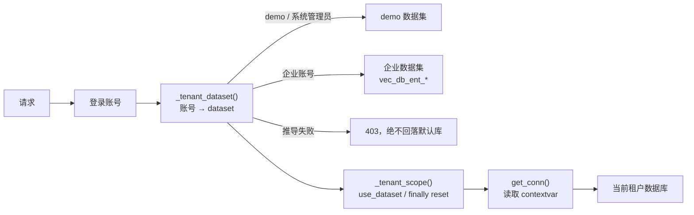

# 多租户隔离架构

> 多租户不是「加一个 tenant_id 字段」。它是一组必须同时成立的约束：身份可信、数据作用域固定、异步任务不串、缓存与日志不泄露。

状态口径：**已实现** = 代码可核对；**部分实现** = 主链路可用但有缺口；**已设计** = 有方案未上线；**规划中** = 未开始。

## 1. 为什么需要多租户隔离

Qianke 同时服务三类主体：

```text
平台方：系统管理员，跨租户运维与审计
企业租户：一个企业一个数据空间（enterprise.dataset）
商家租户：一个商家一份订单/商品/库存/工作项（merchant_id）
```

只要有一个入口把「租户」当成请求参数，越权就只差一个字段。Qianke 的反面案例写在代码注释里：

```text
为什么不让前端传 dataset / tenant_id：数据集决定「读哪个库」，属于权限而不是参数。
一旦前端能传，「切到别人的库」就只差一个请求体字段。
—— src/rag_demo/api/main.py
```

改造前 `/qa`、`/search`、`/stats` 根本不切库，企业租户提问拿到的是 demo 答案，而界面没有任何标识——这既是数据泄露风险，也是产品事故。

隔离失效通常不在「大架构」，而在这些细节：

| 失效点 | 典型表现 |
|---|---|
| 入口相信前端 | 传什么 `dataset` 就读什么库 |
| 忘记切库 / 忘记还原 | 同一线程下一个请求读到上一个租户的数据 |
| 异步任务丢上下文 | Queue Job 执行时没有租户，Worker 默认取到主商家 |
| 唯一键不含租户 | 不同商家相同 `thread_key` 互相串数据 |
| 详情接口只按 id 查 | 列表过滤了租户，详情却全库可查 |
| 回退默认值 | 推导不出租户时回落默认库，等于默认放行 |

**结论：多租户隔离的强度取决于最弱的一个入口，而不是最强的那条链路。**

## 2. 基本机制

常见隔离方案从强到弱：独立部署、独立数据库、共享库独立 Schema、共享表行级过滤（`tenant_id` 或数据库 RLS）。Qianke 采用混合方案：

| 数据面 | 隔离方式 | 证据 |
|---|---|---|
| 企业分析数据 | 每企业一个数据集 / 库（`vec_db_ent_*`），按账号切换 | `_tenant_dataset`、`use_dataset` |
| 商家业务数据 | 共享表 + `merchant_id` 作用域（repository 强制传参） | `merchant` repository、`_CURRENT_MERCHANT` |
| Super-agent 线程与工作项 | `merchant_id` 字段 + API 作用域 + `thread_key` 前缀 | `sa_thread` / `sa_work_item` |
| 控制面账号 | 共享库 `rag_auth`，按企业/商家绑定 | `app_user`、`enterprise`、`c_merchant_member` |



商家侧则是另一条链：`账号 → c_merchant_member → merchant_id`。所有仓储方法显式接收 `merchant_id`，后台任务用 `_CURRENT_MERCHANT` contextvar 固定作用域，动作执行前再次校验订单归属。

## 3. 总体架构

```text
平台层：系统管理员可跨租户；企业管理员管本企业；商家 owner/admin/staff 管本商家
控制面：rag_auth（账号/企业/会话）+ c_merchant_tenant / c_merchant_member / c_merchant_policy
数据面：每企业一个数据集（读侧隔离）；商家业务数据按 merchant_id 过滤
执行面：Agent 请求级 contextvar（账号、dataset）；Worker 请求级 contextvar（merchant_id）
```

租户元数据分布在：`enterprise`（企业、数据集、审核状态）、`c_merchant_tenant`（商家租户）、`c_merchant_member`（账号→商家与角色）、`c_tenant_provision`（开通记录）、`c_merchant_policy`（动作策略与金额上限）。

## 4. 关键设计

### 4.1 数据集由账号推导，前端无权指定

`_tenant_dataset()` 的规则：demo 账号与系统管理员固定读 demo 数据集；企业账号读自己的 `account.dataset`；推导不出来直接 403，**绝不回落 `DEFAULT_DATASET`**。这是整个隔离体系最关键的一条默认值策略。

### 4.2 contextvar 切库 + finally 还原

pipeline / 检索 / SQL 内部几十处 `get_conn()` 不传参数，靠 contextvar 决定去哪个库。切库只有 `use_dataset()` 一句，但必须在 `finally` 里 `reset_dataset()`：漏掉 reset 会让同一线程上的下一个请求继续读上一个租户的库。

### 4.3 查询前先确认租户库可用

`_tenant_ready()` 检查两张核心表是否存在；未构建完成返回可读的 403「当前租户数据为空，请先构建」，而不是把 `database does not exist` 抛给用户。

### 4.4 商家作用域必须落在数据访问层

B 工作台先从成员表取 `merchant_id` 再调仓储；Super-agent 用 `_resolve_merchant` 强制覆盖商家账号的 `merchant_id`，`_scoped_item` 校验工作项归属；Worker 执行前 `_CURRENT_MERCHANT.set(...)`；动作执行校验订单属于当前商家。

### 4.5 唯一键带租户前缀

非默认商家的 `thread_key` 自动加前缀（如 `m_tea_001:wecom:user:default`），避免不同商家使用相同 key 时串数据。

### 4.6 已知缺口

```text
sa_job 没有 merchant_id，队列观测仍全局
企业微信一个应用只映射一个商家
自定义 Webhook 的 merchant_id 只做字符串校验，需调用方保证可信
一个账号只能绑定一个商家；没有租户删除/停用流程
没有租户级配额、计费与 RLS（行级安全策略），过滤靠代码
```

## 5. 工程实现

| 能力 | 代码 / 表 |
|---|---|
| 账号→数据集 | `src/rag_demo/api/main.py::_tenant_dataset` |
| 请求级切库 | `_tenant_scope`、`db/connection.use_dataset / reset_dataset` |
| 企业注册与数据集 | `auth.create_user / approve`、`enterprise.dataset` |
| 商家租户与成员 | `c_end/store.py`、`c_merchant_tenant`、`c_merchant_member` |
| 商家数据访问 | `src/rag_demo/merchant/repository.py`（`merchant_id` 参数） |
| Agent 执行作用域 | `agent/actions.py::action_scope`、`superagent/worker.py::_CURRENT_MERCHANT` |
| 租户 API | `src/rag_demo/api/tenants.py`、`superagent.py` |

测试与验证（文件存在，本文未执行）：`tests/test_tenant_isolation_pg.py`（PG 跨租户契约）、`tests/test_tenants_admin.py`（唯一绑定）、`tests/test_agent_execution_safety.py`（dataset 隔离）、`tests/test_superagent.py::test_merchant_tenant_isolation`。

## 6. 企业级要求

| 维度 | 要求 | 当前状态 |
|---|---|---|
| 隔离强度 | 跨租户不可见、不可写、不可推断 | 部分实现（读侧切库 + 写侧 merchant_id 校验；队列/Webhook/单应用单商家缺口见 §4.6） |
| 默认安全 | 推导失败拒绝而不是放行 | 已实现 |
| 可扩展 | 新增租户不改代码 | 部分实现（租户注册 + 开通 API 已有，缺自助） |
| 可运维 | 能定位某请求属于哪个租户 | 部分实现（Trace 有 dataset/merchant，队列缺 merchant_id） |
| 合规 | 数据可导出、可删除、可审计 | 规划中（数据保留/删除策略未落地） |
| 性能 | 切库/过滤不成为瓶颈 | 部分实现（商家查询按客户数据量增长，存在 N+1 风险） |
| 配额 | 单租户资源上限 | 规划中 |

## 7. 方案对比

| 方案 | 隔离强度 | 成本 | 适用场景 | Qianke |
|---|---|---|---|---|
| 独立部署 | 最强 | 最高 | 强监管、超大客户 | 未采用 |
| 独立数据库 | 强 | 高 | 企业级 SaaS 常见 | 企业分析数据接近此模式 |
| 共享库独立 Schema | 中 | 中 | 多租户中等规模 | 未采用 |
| 共享表行级过滤 | 弱（依赖代码） | 低 | 商家级业务数据 | 当前采用 |
| 数据库 RLS | 中强（下沉到 DB） | 中 | 统一表结构、强隔离要求 | 规划中 |

Qianke 的取舍是：企业分析数据用物理隔离（一企业一库），商家业务数据用逻辑隔离（`merchant_id`）+ 服务端强制作用域。前者成本高但泄露面小，后者灵活但依赖每一层都记得过滤——因此需要契约测试和跨租户守卫。

## 8. Qianke Engine 实践

| 能力 | 状态 | 证据 |
|---|---|---|
| 企业数据集按账号推导 | 已实现 | `_tenant_dataset` |
| 请求级切库与还原 | 已实现 | `_tenant_scope`、`use_dataset/reset_dataset` |
| 商家租户注册与成员绑定 | 已实现 | `c_merchant_tenant`、`c_merchant_member` |
| 商家数据仓储强制 `merchant_id` | 已实现 | `merchant/repository.py` |
| Super-agent Thread/WorkItem 租户字段 | 已实现 | `sa_thread`、`sa_work_item` |
| Worker / 动作执行商家作用域 | 已实现 | `_CURRENT_MERCHANT`、`_order_for_merchant` |
| 跨租户查询守卫测试 | 部分实现 | `test_tenant_isolation_pg.py` 等（未在本文执行） |
| 队列 Job 租户字段 | 部分实现 | `sa_job` 无 `merchant_id` |
| 企业微信多商家映射 | 部分实现 | 单应用单商家，后续做映射表 |
| 租户配额 / 删除 / 数据导出 | 规划中 | 无实现 |
| 数据库 RLS | 规划中 | 当前无 RLS |

必须准确表述：Qianke 已具备企业级与商家级两套隔离主链路，但「队列、Webhook、单应用单商家、无 RLS」是仍然存在的具体缺口，不能写成「多租户已完备」。

## 9. 评估 / 验收

```text
[ ] 前端传入的 dataset / merchant_id 被忽略或被服务端覆盖
[ ] 企业账号请求后，实际连接的是自己的数据集（查 information_schema 验证）
[ ] 同一线程连续处理两个租户请求，第二次不会读到第一个租户的库
[ ] 商家 A 的账号查询商家 B 的订单返回 403 / 404，而不是数据
[ ] 工作项审批与动作执行都校验 merchant_id
[ ] 相同 thread_key 在不同商家下不会串线程
[ ] 租户库未构建时返回可读 403，而不是 500
```

指标建议：`cross_tenant_access_attempts`、`tenant_scope_reset_failures`、`jobs_without_tenant`、`tenant_data_ready_rate`。建议补 `sa_job.merchant_id` 与 Webhook 可信来源校验后再宣称队列级隔离。

## 10. 常见误区

1. **把 tenant_id 当请求参数**：前端能传就能改，租户必须从登录态推导。
2. **只在列表接口过滤**：详情接口按 id 直接查，等于把隔离交给调用方。
3. **忘记 finally reset**：异步/线程池复用下，串库往往发生在「偶发」请求上，最难排查。
4. **异步任务不带租户**：Queue、定时任务、Webhook 是隔离最常漏的三处。
5. **唯一键不带租户前缀**：不同租户相同业务 key 会互相覆盖或串读。
6. **推导失败回落默认库**：看起来「总是有数据」，实际是默认越权。
7. **以为加了 merchant_id 就安全**：如果 merchant_id 来自模型或请求体，它就不是权限边界。

## 11. 总结

```text
租户隔离 = 可信身份 + 固定数据作用域 + 异步任务不丢上下文 + 唯一键带租户。
Qianke 的读侧靠“账号推导 dataset + contextvar 切库”，写侧靠 merchant_id 作用域与仓储强制参数。
默认拒绝（403）比回退默认库重要得多。
队列、Webhook、单应用单商家与 RLS 仍是明确缺口，不能夸大为已完成。
```

## 12. 延伸阅读

- 内部：[企业级身份认证与权限管理](01-identity-and-access-management.md)、[RBAC 与 ABAC 权限模型](02-rbac-abac.md)、[Agent 权限治理](04-agent-permission-governance.md)
- 代码：`src/rag_demo/api/main.py`（`_tenant_scope`）、`src/rag_demo/db/connection.py`、`src/rag_demo/merchant/repository.py`
- 证据：`docs/e2e/superagent-multitenant.md`、`docs/e2e/superagent-tenants.md`、`docs/e2e/superagent-tenant-provisioning.md`
- PostgreSQL RLS：<https://www.postgresql.org/docs/current/ddl-rowsecurity.html>
- AWS SaaS Lens（多租户架构）：<https://docs.aws.amazon.com/wellarchitected/latest/saas-lens/saas-lens.html>
