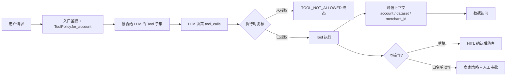

# Agent 权限治理

> 模型决定「想调用什么」，不等于用户「有权调用什么」。Agent 权限治理就是用确定性代码补上这个差额。

状态口径：**已实现** = 代码可核对；**部分实现** = 主链路可用但有缺口；**已设计** = 有方案未上线；**规划中** = 未开始。

## 1. 为什么 Agent 需要独立的权限治理

传统 Web 系统里权限主体是「人」，接口校验角色即可。Agent 系统多了一层执行主体：

```text
用户 → Agent → LLM 决策 → Tool 调用 → 数据 / 外部系统
```

这带来新问题：模型可能请求未授权 Tool（幻觉或被诱导）、可能传入不属于当前租户的参数、一次执行可能跨多个数据域、写操作一旦执行错误会被放大。Qianke 定位是 Decision Support Agent，第一阶段不允许自动执行营销、改订单、删数据，但 Agent 仍会调用 SQL、RAG、画像查询和「受控草稿写入」，这些都必须在确定性边界内。

必须写进文档的原则：

```text
模型决策不是授权凭证。权限检查必须由可信服务端代码完成，
不能只依赖 Prompt 告诉模型“不要越权”。
```

## 2. 基本机制

Qianke 的 Agent 权限约束分四层：

| 层 | 机制 | 回答的问题 |
|---|---|---|
| 入口 | `_require_login` + 账号状态 | 谁在发起这次执行 |
| 工具授权 | `ToolPolicy.for_account` + 执行时复核 | 这个账号能用哪些 Tool |
| 上下文约束 | dataset / `merchant_id` / `action_scope` | 这次执行能碰哪份数据 |
| 动作治理 | 草稿确认 / 动作白名单 / 商家策略 / 人工审批 | 高风险动作能不能落地 |



核心是 **「暴露前过滤 + 执行时复核」**：绑定给 LLM 的只有当前身份允许的 Tool；模型若仍产出未授权调用，chatbot 节点在执行前拒绝并进入终态。

## 3. 总体架构

```text
身份层：账号、角色、企业、商家成员、演示/停用标记
策略层：ToolPolicy（角色 → Tool）、main.py 商家二次收口、C 端模式工具集
上下文层：_tenant_scope（企业数据）、_CURRENT_MERCHANT（商家数据）、action_scope（草稿写入）
执行层：LangGraph ToolNode + 7 个注册 Tool + Super-agent 动作执行器
审计层：event_trace、agent_action、sa_approval、执行记录
```

三类策略不能混成一个集合交集：

| 策略 | 决定什么 | 失败语义 |
|---|---|---|
| Runtime Policy | 任务还能不能继续（步数、超时、预算、取消） | 终态，如 `MAX_STEPS_EXCEEDED` |
| Tool Policy | 某个 Tool 调用是否被授权 | `TOOL_NOT_ALLOWED`，不执行 |
| Data Access Policy | 这个 Tool 能看到哪些数据 | 查询失败 / 空结果 / 结构化错误 |

## 4. 关键设计

### 4.1 角色 → Tool 白名单

```text
admin / ent_admin / exec / analyst / ops → 全部 7 个 Tool
cs → rag_search / calculator / resolve_customer_identity
     / get_chat_user_profile / search_chat_user_profiles
guest / disabled / demo → 无
```

`ToolPolicy.for_account()` 生成白名单，`get_tools(allowed_tools)` 只暴露子集；执行时 chatbot 节点再次比对，未授权即终止。暴露与执行两处都检查，是为了防「模型绕过可见列表硬编一个工具名」。

### 4.2 商家账号二次收口

`api/main.py::agent_run` 在 ToolPolicy 之上再收一层：商家操作者只允许 `get_chat_user_profile` / `search_chat_user_profiles`。原因是商家账号通常没有平台分析数据集，不应在平台数据空间执行 SQL/RAG；它需要的是本商家画像查询。这是「同一角色矩阵不足以推断所有账号工具集」的具体例子。

### 4.3 可信上下文由服务端注入

dataset 从登录账号推导，`merchant_id` 从成员表取，account 在入口解析后写入 contextvar，`request_id` 用于幂等与审计。工具拿不到「用户自由传入的 tenant_id」。`agent/actions.py::action_scope` 把 `account_id + dataset + request_id` 绑定到一次草稿写入，确认接口再校验账号归属，防止 A 账号确认 B 账号的动作。

### 4.4 写操作的最小化设计

Qianke 唯一的 Agent 写能力是「运营跟进任务草稿」：Tool 只能创建 `agent_action.status = DRAFT`，用户通过独立 API 确认后才变 `CONFIRMED`，不直接写订单、库存、用户、活动。

Super-agent 动作执行是另一条受控链路：Agent 只能 `propose_action` 登记建议（8 个动作白名单）→ 人工审批（owner/admin）→ ACTION Job → 执行前再读商家策略（允许动作、补偿/退款上限、是否强制原因）→ 执行。审批参数不能绕过策略：执行期会重新校验 `ACTION_NOT_ALLOWED_BY_POLICY`、`COMPENSATION_EXCEEDS_POLICY`、`REFUND_EXCEEDS_POLICY`。

### 4.5 C 端按模式暴露工具

`c_end/agent.py::_tools` 按会话模式返回工具：companion 无工具；advisor 只有 `recommend_products`；order 只有订单查询；transaction 才有 4 个工具（含只生成草稿的 `prepare_order`）。这不是 UI 隐藏按钮，而是真正不把工具绑定给模型——伙伴模式下模型没有下单能力。

### 4.6 还没有解决的问题

Agent 没有独立主体身份（用的是用户身份 + 环境上下文，不是 `agent_id + scopes`）；没有委托链与能力令牌；没有 per-tool 数据域声明，数据范围靠全局 contextvar；ToolPolicy 拒绝有终态但没有结构化 denied 指标；C/B/A 三端治理入口未统一。

## 5. 工程实现

| 能力 | 代码位置 |
|---|---|
| 角色 → Tool 白名单 | `src/rag_demo/agent/policy.py` |
| Tool 注册与暴露过滤 | `src/rag_demo/agent/registry.py` |
| 执行时复核 | `src/rag_demo/agent/loop.py::make_chatbot_node` |
| 商家二次收口 | `src/rag_demo/api/main.py::agent_run` |
| 可信上下文 | `_tenant_scope`、`auth.set_current_account`、`action_scope` |
| 草稿写与确认 | `src/rag_demo/agent/actions.py`、`tools/action.py` |
| Super-agent 动作白名单与策略 | `src/rag_demo/superagent/actions.py`、`c_merchant_policy` |
| C 端模式工具 | `src/rag_demo/c_end/agent.py::_tools` |

测试现状：`tests/test_agent_execution_safety.py` 覆盖 ToolPolicy（含 demo/guest 为空）；`tests/evals/agent/write_action` 覆盖受控写链路；本文未执行测试，不宣称通过。

## 6. 企业级要求

| 维度 | 要求 | 当前状态 |
|---|---|---|
| 最小权限 | 默认无 Tool，按角色/模式授予 | 已实现 |
| 双重校验 | 暴露前过滤 + 执行前复核 | 已实现 |
| 身份可信 | 租户/商家来自服务端上下文 | 已实现 |
| 写操作分级 | 草稿 / 审批 / 白名单 / 金额上限 | 已实现（两条链路） |
| 可解释 | 能说明某次执行为何被拒绝 | 部分实现（终态 + Trace，无统一拒绝指标） |
| 可审计 | 工具调用、动作、审批可追溯 | 部分实现（event_trace + 审计表，未统一） |
| 主体模型 | Agent 身份、委托、能力令牌 | 已设计 |
| 跨端一致 | B/C/A 同一套治理 | 规划中 |

## 7. 方案对比

| 方案 | 优点 | 缺点 | Qianke |
|---|---|---|---|
| Prompt 约束 | 零成本 | 可被诱导，不是边界 | 仅作辅助 |
| 角色白名单 | 简单、可测试 | 粒度粗，难表达数据域 | 当前主方案 |
| 上下文注入 | 防止参数伪造 | 依赖每层都使用上下文 | 当前主方案 |
| 能力令牌 | 可委托、可撤销、可审计 | 实现与运维成本高 | 已设计 |
| 统一 PDP | 一致、可解释 | 需策略语言与工程投入 | 规划中 |

最危险的不是「没有权限表」，而是「权限表只在接口层生效」。工具若只依赖调用者传参，模型就能通过构造参数绕过；所以工具必须自己从可信上下文取作用域。

## 8. Qianke Engine 实践

| 能力 | 状态 | 证据 |
|---|---|---|
| 角色 → Tool 白名单 | 已实现 | `agent/policy.py` |
| 暴露前过滤 + 执行时复核 | 已实现 | `registry.get_tools`、`make_chatbot_node` |
| demo / disabled / guest 无 Tool | 已实现 | `ToolPolicy.allowed_tools` |
| 商家账号二次收口 | 已实现 | `api/main.py::agent_run` |
| 草稿写 + 账号归属确认 | 已实现 | `agent/actions.py` |
| Super-agent 动作白名单 + 商家策略 | 已实现 | `superagent/actions.py` |
| C 端按模式暴露工具 | 已实现 | `c_end/agent.py::_tools` |
| Agent 主体身份 / 能力令牌 / 委托链 | 已设计 | 无代码 |
| 统一策略决策日志 / 指标 | 部分实现 | 终态与 Trace 有，指标未统一 |
| 跨端统一治理 | 规划中 | 三端各自实现 |

必须准确表述：Qianke 已实现「账号级 Tool 授权 + 上下文数据域 + 写操作审批」的主链路；「Agent 作为独立安全主体」仍是设计目标，不能写成已实现。

## 9. 评估 / 验收

```text
[ ] 未授权 Tool 请求被拒绝，且不产生副作用
[ ] demo / disabled / guest 账号的工具集合为空
[ ] 商家账号无法调用 SQL / RAG 工具
[ ] 工具读取的 merchant_id 不来自请求体或模型参数
[ ] 草稿只能由创建者确认，重复确认被拒绝
[ ] 未审批的动作不会进入执行；超策略上限被拒绝
[ ] C 端 companion 模式没有下单工具
```

指标建议：`unauthorized_tool_attempts`、`tool_policy_denied_total`、`tool_calls_per_task`、`action_blocked_by_policy_total`、`hitl_bypass_attempts`。

## 10. 常见误区

1. **把 Prompt 当权限**：提示词是约束，不是边界；模型被诱导时只能靠代码兜底。
2. **只在暴露层过滤**：模型仍可能硬编工具名，执行时必须有第二次检查。
3. **让工具信任模型传入的租户**：`tenant_id` 必须来自可信上下文。
4. **把 Runtime 限制当权限**：步数/超时是资源控制，不是授权控制。
5. **写操作只做前端确认**：确认必须对应服务端状态机与归属校验。
6. **忽略异步执行**：入口鉴权完成不代表后台 Worker 仍有正确作用域。
7. **一次给全量 Tool**：工具越多，路由与越权面越大。

## 11. 总结

```text
Agent 权限治理 = 身份可信 + 工具最小化 + 双重校验 + 数据域固定 + 写操作分级。
Qianke 已把防线落在 ToolPolicy、上下文注入、草稿确认与动作审批上。
Agent 目前不是独立安全主体，而是“用户身份 + 环境上下文”的执行器；能力令牌与委托链仍是设计目标。
```

## 12. 延伸阅读

- 内部：[Tool Gateway 安全设计](05-tool-gateway-security.md)、[Human-in-the-loop 人工审批](06-human-in-the-loop.md)、[RBAC 与 ABAC 权限模型](02-rbac-abac.md)
- 代码：`src/rag_demo/agent/policy.py`、`src/rag_demo/agent/loop.py`、`src/rag_demo/agent/actions.py`
- 证据：`docs/agent-write-action.md`、`docs/e2e/superagent-policy.md`、`docs/e2e/superagent-roles.md`
- OWASP LLM Top 10（LLM06 Excessive Agency）：<https://genai.owasp.org/llm-top-10/>
