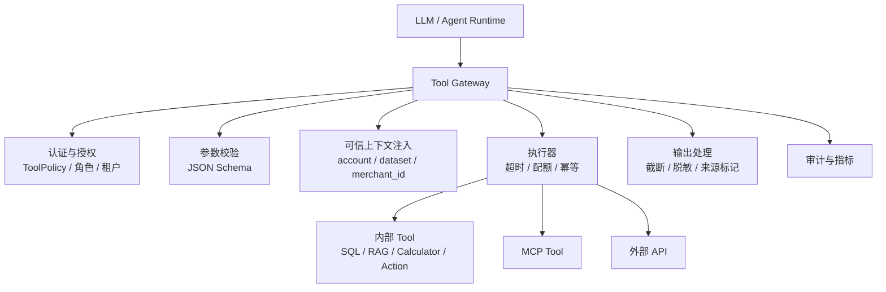

# Tool Gateway 安全设计

> Tool 是 Agent 唯一能改变外部世界的手。Tool Gateway 的职责，是让这只手只能伸进被允许的范围。

状态口径：**已实现** = 代码可核对；**部分实现** = 主链路可用但有缺口；**已设计** = 有方案未上线；**规划中** = 未开始。

## 1. 为什么需要 Tool Gateway

Agent 的安全边界最终落在 Tool 上。没有统一网关时，每个 Tool 各自实现校验，问题会以三种形式出现：

```text
不一致：SQL Tool 有白名单，画像 Tool 没有；A 工具校验租户，B 工具忘了
不可观测：不知道谁在什么上下文调用了什么工具、被拒绝了几次
不可治理：限流、超时、幂等、输出脱敏没有统一入口
```

具体到 Qianke，Tool 调用链路上已经出现过这些风险点：

| 风险 | 说明 |
|---|---|
| 未授权调用 | 模型请求当前角色没有的 Tool |
| 参数越界 | 模型生成 `merchant_id` / `tenant_id` 等本不该由它决定的参数 |
| SQL 越权 | 写操作、非白名单表、无 LIMIT、超大结果集 |
| 工具输出不可信 | 检索片段、外部接口返回可能包含指令或敏感数据 |
| 副作用不可控 | 写工具重复执行、审批后参数被替换 |
| 外部工具扩张 | 接 MCP / 第三方 API 后，攻击面从内部函数变成网络边界 |

**结论：Tool Gateway 不是多一层 REST 包装，而是把「谁能用、能传什么、能碰哪些数据、结果怎么处理、是否可重试」收口到一个确定性入口。**

## 2. 基本机制

一个完整的 Tool Gateway 通常承担九件事：发现与注册（Tool 清单、版本、Schema）、身份认证、授权决策、参数校验、上下文注入、执行隔离（超时/并发/沙箱）、输出处理（截断/脱敏/标记来源）、幂等与重试、审计与指标。

一次调用的目标流程（伪代码，非现有实现）：先解析 tool_call 并认证主体，`policy.require` 拒绝未授权，Schema 校验并拒绝额外字段，服务端注入可信上下文，执行时施加超时/配额/幂等，输出经截断与脱敏后返回，最后记录审计。

Qianke 当前没有这个统一入口，但各项能力已经散落存在。本篇文章的价值是把「已有」与「还缺」分开说清。

## 3. 总体架构

目标架构（已设计，非当前实现）：



当前实际链路是：LLM → LangGraph ToolNode → Tool 函数。暴露前由 ToolPolicy 过滤，执行前由 chatbot 节点二次校验（`TOOL_NOT_ALLOWED`），Tool 内部各自校验（SQL 白名单/只读/LIMIT、草稿写 scope），最后返回 `ToolResult`/`ToolError` 并写 `event_trace`。

因此准确定位是：**Qianke 有「Tool Contract + Registry + Policy + 工具内安全门禁」，没有独立 Tool Gateway。**

## 4. 关键设计

### 4.1 契约先行

Qianke 用 `ToolResult`（`ok/data/error`）与 `ToolError`（`code/message`）统一返回。成功与失败都必须可被调用方确定性处理：依赖 `error.code`，不依赖 message 文本。`get_tool_contracts()` 同时输出 JSON Schema，可被 MCP 或前端复用。

### 4.2 暴露过滤与执行复核

ToolPolicy 决定暴露集合，`make_chatbot_node` 在执行前比对 `allowed`，发现未授权即进入 `TOOL_NOT_ALLOWED` 终态。**不能假设「模型只会在可见列表里选」**——模型可能生成任意工具名。

### 4.3 参数校验

所有 Tool 使用 Pydantic `args_schema`；当前 SQL / RAG / Calculator 三个工具设置 `extra="forbid"`，多余字段直接拒绝；action / chat_profile 仍默认忽略额外字段。统一到 Gateway 时应收口为全部 Tool 拒绝额外字段。

### 4.4 可信上下文注入

租户、数据集、账号不能由模型或调用方决定。SQL Tool 不接受模型传入的 `merchant_id`；数据范围由服务端 dataset contextvar 与只读账号决定。草稿写用 `action_scope` 绑定账号、数据集、request_id。**Gateway 的核心价值之一，就是把「上下文注入」从每个 Tool 的自律变成统一机制。**

### 4.5 输出的「数据而非指令」

检索片段、SQL 行、外部接口返回都应被视为不可信数据：

```text
结构化返回（columns / rows / sources），不把原始文本拼成新指令
限制单次返回大小（SQL fetch 上限、截断超大字段）
敏感字段在输出前裁剪或脱敏（见《数据隐私与脱敏》）
工具输出不能被解释为系统提示，不能被当作新的授权依据
```

### 4.6 副作用与幂等

Qianke 当前写路径包括：B 端草稿写（DRAFT）、Super-agent 白名单动作（审批后执行）、C 端 `prepare_order` 草稿（用户逐单确认）；三者都不是直接业务写。动作执行有 Job 队列与状态机，但**通用 Tool 层没有统一幂等键**：读工具不需要，写工具依赖各自业务幂等（例如重复售后被 `AFTER_SALE_EXISTS` 拒绝）。真正的 Gateway 需要把「是否可重试、幂等键是什么」写进 Tool 元数据。

### 4.7 超时与资源限制

```text
SQL：statement timeout 10s；SELECT 结果按 SQL_FETCH_MAX 截断
RAG：top_k 与检索范围受接口约束
Agent：wall timeout 70s、max_steps / max_tool_calls / token budget
```

这些限制目前分散在 Tool 与 Runtime，目标态应由 Gateway 统一执行「工具级配额」。

### 4.8 外部与 MCP 工具

`registry.get_tool_contracts()` 的注释写明「与框架无关的 Tool Contract（JSON Schema + invoke），MCP 可直接复用」。但当前没有 MCP 代理、没有外部工具的出口控制（egress）、没有第三方凭据隔离——这些是 Gateway 化的核心待办。

## 5. 工程实现

| 能力 | 代码位置 | 现状 |
|---|---|---|
| Tool Contract | `src/rag_demo/agent/tool.py` | 已实现 |
| 注册 / Schema 输出 | `src/rag_demo/agent/registry.py` | 已实现 |
| 角色授权 + 执行复核 | `agent/policy.py`、`agent/loop.py` | 已实现 |
| SQL 安全门禁 | `tools/sql_tool.py`、`agent/tools/sql.py` | 已实现 |
| 草稿写作用域 | `agent/actions.py`、`agent/tools/action.py` | 已实现 |
| 结构化错误 | `ToolResult.failure` | 已实现 |
| 调用 Trace | `loop.py::TraceCallbackHandler` | 已实现 |
| 统一 Gateway | 无 | 未实现 |
| 工具级配额 / 出口控制 | 无 | 规划中 |

## 6. 企业级要求

| 维度 | 要求 | 当前状态 |
|---|---|---|
| 认证授权 | 每次调用可判定身份与权限 | 部分实现（Policy 有，无统一入口） |
| 参数安全 | 拒绝额外字段、限制取值范围 | 部分实现（SQL 严格，其余不一） |
| 数据边界 | 租户/数据集不可被参数覆盖 | 已实现（上下文注入） |
| 输出安全 | 截断、脱敏、来源标记 | 部分实现（各 Tool 分散） |
| 幂等 | 写工具可安全重试 | 部分实现（业务层幂等，非工具元数据） |
| 可观测 | 调用量、拒绝量、耗时、错误码 | 部分实现（Trace 有，指标未统一） |
| 可扩展 | 新 Tool 接入不改主链路 | 部分实现（注册表可扩展，治理要逐个补） |
| 外部工具 | MCP/第三方工具的统一代理与出口控制 | 规划中 |

## 7. 方案对比

| 方案 | 描述 | 优点 | 缺点 | Qianke |
|---|---|---|---|---|
| 函数内校验 | 每个 Tool 自己校验 | 简单直接 | 不一致、易漏 | 当前现状 |
| 进程内 Gateway | 统一装饰器/中间件收口 | 改造成本低、复用上下文 | 与运行时同生命周期 | 设计方向 |
| Sidecar Gateway | 独立服务代理工具调用 | 隔离强、可独立限流 | 部署复杂、延迟增加 | 规划中 |
| MCP 网关 | 统一代理外部 MCP Server | 生态兼容、出口可控 | 需要协议与凭据治理 | 规划中 |

选择建议：工具数量少、同进程部署时，进程内 Gateway 足够；出现外部工具、多语言工具或强隔离要求时，再引入 sidecar / MCP 网关。Qianke 当前 7 个内部 Tool，优先做「统一装饰器 + 元数据」比拆服务更划算。

## 8. Qianke Engine 实践

| 能力 | 状态 | 证据 |
|---|---|---|
| Tool Contract / 结构化错误 | 已实现 | `agent/tool.py` |
| 注册表与 JSON Schema | 已实现 | `agent/registry.py` |
| 角色白名单 + 执行复核 | 已实现 | `agent/policy.py`、`loop.py` |
| SQL 只读 / 白名单 / LIMIT | 已实现 | `tools/sql_tool.py` |
| 只读数据库账号 | 已实现 | `db/connection.get_readonly_conn` |
| 草稿写作用域 | 已实现 | `agent/actions.py` |
| 调用 Trace | 已实现 | `event_trace` |
| 统一 Tool Gateway | 已设计 | 本文目标架构，无代码 |
| 工具级配额 / 限流 / 幂等元数据 | 规划中 | 无实现 |
| MCP / 外部工具代理 | 规划中 | 无实现 |

必须准确表述：Qianke **没有独立 Tool Gateway 组件**；现有能力是「分散在 Runtime、Policy、Registry 与各 Tool 内的准网关」。把它写成「已实现 Tool Gateway」是不准确的。

## 9. 评估 / 验收

```text
[ ] 模型请求未注册 Tool 时返回结构化错误，不抛异常
[ ] 未授权 Tool 不执行，且不产生副作用
[ ] 额外参数被拒绝；SQL 写操作 / 非白名单表 / 无 LIMIT 被拒绝
[ ] SQL 结果超过上限被截断，不拖垮进程
[ ] 工具输出不会作为系统指令进入下一轮 Prompt
[ ] 写工具重复调用有明确幂等语义，每次调用都有 trace
```

指标建议：`tool_call_total`、`tool_denied_total`、`tool_error_rate`、`tool_p95_latency`、`tool_output_truncated_total`、`external_tool_calls_total`。

## 10. 常见误区

1. **把 Tool 当普通函数**：没有授权、没有 Schema、没有错误码，模型一调就炸。
2. **只在 Prompt 里限制**：提示词不是执行边界。
3. **只做暴露过滤**：还要在执行前复核，模型可能硬编工具名。
4. **让模型决定租户**：上下文必须由服务端注入。
5. **工具输出直接拼进 Prompt**：外部内容可能携带指令，需按不可信数据处理。
6. **先接外部工具再补网关**：出口控制、凭据隔离、限流会被动补，成本更高。
7. **忽略幂等**：读工具无所谓，写工具重试一次可能就是一次事故。

## 11. 总结

```text
Tool Gateway 收口的是“谁能用、传什么、碰哪些数据、结果怎么处理、能否重试”。
Qianke 已有契约、注册、策略、SQL 门禁与 Trace，但没有统一 Gateway；这是“部分实现 + 已设计”。
在工具数量扩大或接入 MCP/外部 API 之前，值得先把 Gateway 的元数据与统一入口补上。
```

## 12. 延伸阅读

- 内部：[Agent 权限治理](04-agent-permission-governance.md)、[Prompt Injection 防护](07-prompt-injection-defense.md)、[操作审计与追踪](09-operation-audit-tracing.md)
- 代码：`src/rag_demo/agent/tool.py`、`registry.py`、`policy.py`、`tools/sql_tool.py`
- 证据：`docs/handbook/01-agent-architecture/09-agent-tool-calling.md`、`docs/e2e/security-hardening.md`
- OWASP LLM Top 10（LLM06 Excessive Agency）：<https://genai.owasp.org/llm-top-10/>
- Model Context Protocol：<https://modelcontextprotocol.io/>
- JSON Schema：<https://json-schema.org/>
